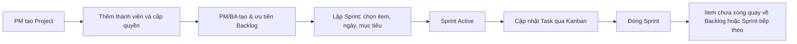

<!-- PHASE4_RAG_20261113 -->
# Phase 4 — RAG/Gateway/Command Center (MAIN deployed, acceptance PARTIAL)

Giữ SQLite/BGE-M3/Qdrant và Native/signed Rails bridge. Generic knowledge_search thêm registered files đã xác minh pin/role/project vào cùng scope Native, giữ native_ids là Native-only. Candidate pool dense được nới có giới hạn và cân bằng hai họ nguồn trước dedup/RRF; threshold0.45 có calibration8cases, không tự chứng minh chất lượng hoàn hảo. Full chunk passages kèm hash/index/reference giúp citation kiểm chứng được; read proofs được batch nhưng không bỏ kiểm tra payload/chunk/Native ACL/version.

Search mặc định không generation. extract trả EXTRACTS_AVAILABLE, không coi retrieval là answerability. Explicit Web answer tái dùng Gemini.structured, cùng key/model3.5lite/Free-only policy và shared limiter hiện có; không tools/orchestrator. Model chỉ chọn quote nguyên văn; backend kiểm schema, source index, substring và citation hashes. Runtime questions abstain. Sau inference phải kiểm lại role/membership, Native versions/activities và registered file pins; provider/quota failure trả ABSTAIN_PROVIDER. LiveBudget config không đổi, deadline request siết60s. Không tạo AgentRun/Task; model receipts mới có purposeknowledge/actor thật/runNone và không thay lịch sử cũ.

Telegram vẫn29tools/7writes. search_knowledge modeanswer gọi Gatewayextract rồi Commander giải thích trong chính cap20; không phát sinh inference Gateway ẩn. Câu hỏi tài liệu/tri thức rõ ràng phải prefetch freshRAG trước model, kể cả hỏi lại, không có source thì NO_EVIDENCE thay memoryanswer. Intent không rõ ràng vẫn phụ thuộc modelrouting. Knowledge turn khóa write tools ở schema/executor kể cả writefirstbatch. Backend giữ source URI/checksum/Nativeversion footer. Actual finalOwner41→42 PASS freshread+checksum+exactmodel,67Bot testsPASS. UTC20769=20, tự chuyển20770 dùng2/20, không reset/tăng cap. Webanswer dùng Gateway quota hiện có (rpd450/rpm13/tpm225000), không đổi cấu hình.

RAG UI giữ search-only default, thêm lựa chọn answer. Hai form search hủy read cũ, generation guard và xóa answer cũ trước query mới; không đổi mutation replay locks. Knowledge deadline110s phủ existing Rails read100s +connect/render; controls vẫn15s. Scoped wrap có MAINmobile284/284 proof. Literal reference priority sửa actual longquery mất đúng file, chỉ sau scope/ACL. React Flow/Dagre/Observer/runtime/n8n/gates/config/keys không đổi. Không reindex hoặc xóa collection;2485chunks/2488points và wholepayloadSHA giữ nguyên,3orphan bị loại bằng provenance. Catalog14/#398AwaitingOwner/PR15OPEN/OFF giữ nguyên.

Pinnedfile read là read-only transport:503/network lỗi không tạoUNKNOWN_WRITE và không clear pending/unknown write khác; search citations được giữ. FinalNodeRED→GREEN +actualfileextract/visiblepinnedreadPASS. MAIN images: Gateway26bfcdbef5d2/Core113472c4ec1d/Telegram828cfb8a73dc; allpresent sourceparity Core82/Gateway115/Bot10,7legacyGWabsent không đổi.466Gatewaytests run/22skip,67BotPASS,15UIgroups +finalfileUI PASS và22realreadtools. Gold40/36retrieval realBGE/Qdrant:25/36 (baseline8), holdout19/28; naiveextractfacts20/36 không phải Geminiaccuracy. Actual Web+finalOwnerTelegram positivePASS; negative503 preserved, sau providerrecovery một explicitquery mới actualABSTAIN/exactmodelPASS. Old620receiptsimmutable+8authorizedRAG/runNone receipts, khôngnewAgentRun. [Phase4 reports](docs/rag-gateway-command-center/FINAL_REPORT.md). Toàn hệ thống PARTIAL; các block bên dưới là lịch sử.
<!-- END_PHASE4_RAG_20261113 -->

<!-- FUNCTIONAL_AUDIT_20261112 -->
# Functional audit & recovery — MAIN 12/11/2026 (PARTIAL)

Giữ kiến trúc hiện hành: Telegram Commander → Gemini SDK function calling → strict ToolExecutor → Gateway/Native ACL; Core Command Center và Agent Studio đọc cùng Observer. Một agent thực hiện audit, không thêm orchestrator hoặc provider. Gemini vẫn `gemini-3.5-flash-lite`, daily cap20 (đã dùng18), engineering catalog14, SupervisorOFF/idle. Task398 Nativev10 READY FOR RELEASE/AWAITING_OWNER_APPROVAL, PR15OPEN; không chạy lại, approve, merge hoặc deploy PR.

Bot ground kết luận DONE bằng snapshot của lượt hỏi hiện tại: businessDONE + FULLY_COMPLETED + không source conflicts; lưu câu đã ground vào memory. Checkpoint context thêm typed completed_step_count/version_semantics, không diễn giải revision27 thành27steps (actual11). Ba read tools get_active_agents/get_blocked_tasks/get_pending_approvals dùng Observer hiện có, strict Empty arguments và authorized project scope; compact task/stage state giữ freshness/source bounds, artifacts đọc riêng qua detail tools. SDK audit lưu actual resolved_model_version. Owner32/34/35→36 xác minh acceptance/count/global read; final DTO patch được kiểm adapter và contracts, không inference thêm.

Core dùng shared bridge_error_status để giữ HTTP400–599, Retry-After và requestID trên Observer/command/report/execution/history; malformed/negative execution offset trả422 trước Gateway. Không tự retry mutation. MAIN Core `sha256:7923304bab831598957760c50011884bb3156b5baa431e0e99ad0439221841d8`, bot `sha256:3349636541d4cccaba044d40bcf3f25dcfd469d5cf7419a9ff3c39aa7b2437e7`; Gateway giữ `sha256:6edeea411e079bb8b2cb8242b4a79673cd74734943536e965d69bbbfbd61cef0`, n8n không đổi. Controlled image-only rollouts giữ config/volumes; no DB restore.

Evidence [functional audit](docs/functional-audit/FINAL_REPORT.md): Gateway423tests run/22skipped, bot62, host12, Node6; final MAIN UI14groups PASS, semantic13assertions, smoke6, integrity21. Không suy các kết quả này thành mọi live mutation PASS. RAG lexical retrieval/citations hoạt động nhưng answerability gate chưa đạt; một lượt RAG không results và Explorer429 sau burst được ghi rõ (fresh Explorer19items200). No performance campaign; các block dưới là lịch sử.
<!-- END_FUNCTIONAL_AUDIT_20261112 -->

<!-- STUDIO_STABILIZATION_20261106 -->
# Agent Studio V2 stabilization — MAIN 12/11/2026, performance PARTIAL

Read path mới giữ cùng Observer API, signed Rails bridge và Native ACL hiện hành. `view=list` chỉ đọc metadata Native theo batch và trạng thái durable; không hydrate từng timeline/monitor. `view=graph` trả stage summary/dependencies thực; `view=details` phân trang events/artifacts/runs (25 UI, tối đa50/page), overview/technical chỉ tải khi mở. Cửa sổ nguồn vẫn tối đa50runs/200events mỗi run, được hiển thị rõ; Run Details giữ trace riêng. Mỗi Observer request dùng một SQLite connection `mode=ro/query_only`, named UI view budget8s; legacy no-view full read Telegram giữ60s và Native metadata cache chỉ trong request. Không cache quyền giữa request.

Rails/Gateway truyền request ID và Server-Timing, giữ nguyên HTTP status; UI timeout10s, retry tối đa3 với backoff, 401/403/404/409/422 dừng tự retry, AbortController và khóa Task chống response cũ. Graph render độc lập với details, Dagre cache topology tối đa16, memo node, raw JSON chỉ mount khi mở. Explorer click focus search; Run Details có liên kết quay lại đúng Task. RUNNING lấy current_agent từ events durable, kể cả rework, không suy từ kết quả cũ. Không sửa orchestrator, model/key/quota/gates/Telegram/n8n.

Owner duyệt ceiling13→14 và đúng1demo tests-only `/healthz` rejected methods. Giữ14 sau demo, không xóa record để rollback. Task398 thực hiện ngày06/11 qua BA/PM+Dev/Reviewer/QA,64tests; PR15OPEN, READY FOR RELEASE/AWAITING_OWNER_APPROVAL. Live RUNNING screenshots là06/11; resume12/11 đọc history/terminal, không replay.

Shared AiBridge admission nonblocking giới hạn half Puma threads (4→2), trả429/Retry-After1 trước Gateway khi đầy để chừa Native callback capacity. Mutation không tự retry. UI tối đa3retries, tôn trọng seconds/HTTP-date cho429/503 và positive jitter, không retry sớm/clip server hint. Run pagination dùng timestamp+durable row sequence tie-break; graph attempts theo canonical chronology, không UUID/newest-first page order.

MAIN Core `sha256:d0bdd4d82bf06394704b299cca9edc5619e52f65b47f5e815304e607a2b1d651`, Gateway `sha256:6edeea411e079bb8b2cb8242b4a79673cd74734943536e965d69bbbfbd61cef0`; parity10Core/6Gateway files.126sequential reads200/0unexpected503; list8,919B/p951.56s,397p951.27s;379p954.99s chưa đạt3s. Multi-tab/tail performance chưa FULL PASS. Model/key/caps/gates/bot/n8n giữ nguyên. [Báo cáo hiện hành](docs/agent-studio-v2-stabilization/FINAL_REPORT.md); các block cũ bên dưới là lịch sử.
<!-- END_STUDIO_STABILIZATION_20261106 -->

<!-- AGENT_STUDIO_V2_20261106 -->
# Agent Studio V2 — React island trong Rails MAIN

V2 đã triển khai MAIN theo đặc tả Owner: `@xyflow/react` + Dagre bundle local, mount tại route Observer hiện hành và entry point Command Center. Canonical Task snapshot và run monitor qua signed Rails bridge/Native ACL; không backend Observer mới, không sửa Telegram/n8n/models/completion gates. Edges từ dependencies trong monitor, animation chỉ biểu thị stage RUNNING fresh, không giả handoff message. Task coding397 chỉ Dev/Reviewer/QA; plan BA/PM thuộc parent379.

Assets nằm trong `core/overlay/public/qldapm-agent-studio-v2`, CSS được scope theo island, manifest content hash chống cache cũ. Turbo cache/render và DOM removal unmount React, hủy request/timer. Dagre chuyển LR desktop/TB mobile; inspector có typed artifact summaries, raw JSON chỉ trong Technical Details. Bounded task20→50, tối đa50run theo Observer, lịch sử chi tiết lazy load. Task đổi clear state ngay, generation guard chống response cũ. Source freshness120s tách khỏi transport; adaptive polling3s active/15s terminal/backoff60s, timeout90s, không request chồng nhau, dừng tabẩn. Không có event-stream Observer hiện hành; giữ Puma threads cho request thay vì giả SSE bằng polling giữ connection.

MAIN Core `sha256:784a641f79cdbb6e82fcccfd2b7abd800b0deeb555509fdb187dbbeace76694d`; Gateway giữ image cũ. Authenticated UAT navigation/391/397/graph/inspector/ACL/reload/4sizes PASS, screenshots đã kiểm tra. Container queries theo chiều rộng island, không dựa riêng window; native select palette được scope. Rollout source parity7files và187source cũ không đổi, protected state/bot/n8n giữ hash. Xem `docs/agent-studio-v2/FINAL_REPORT.md`; RUNNING/BLOCKED/FAILED chỉ dùng test fixtures, không gọi một coding run mới. Baseline V1 hardening commit52fa710 đã deploy trước V2. PR14 đã merge vào feature parent branch theo read-only metadata06/11, không phải main/deployment; các câu OPEN/không merge bên dưới là snapshot lịch sử.
<!-- END_AGENT_STUDIO_V2_20261106 -->

<!-- TELEGRAM_OBSERVER_20261105 -->
# Telegram Commander và Agent Observer — đã triển khai local

Theo đặc tả Owner05/11/2026, triển khai trong hệ thống hiện hành: Gateway cung cấp `observer_task_progress`, `observer_active`, `observer_run_details` qua `/api/v1/commands`; Rails Agent Studio tại `/projects/:project_id/qldapm-ai/observer` dùng cùng projection với Telegram. Projection đọc AgentRun/AgentTask, receipts, event, checkpoint và Native ACL; không gọi đường đọc có thể expire queue. Stage/attempt/evidence lấy từ execution plan đã ghi; thiếu dữ liệu báo UNKNOWN/NOT_RECORDED. Native journal endpoint chỉ đọc quyết định DONE thực, version và GatePolicy áp dụng; runtime success/PR/READY FOR RELEASE không tự thành nghiệm thu.

Service `telegram-ai` thuộc Compose `qldapm-ai`, aiogram long polling duy nhất, không public inbound port hoặc Docker socket. SQLite riêng lưu numeric-ID pairing, memory, confirmation một lần có TTL/version, audit và notification outbox. Tools chỉ gọi endpoint Gateway cố định với dedicated bearer của principal thật18 và Native RBAC hiện hành; Telegram không tự duyệt proposal hoặc đổi coding provider. Owner đã chốt `gemini-3.5-flash-lite`; không fallback model. Gemini key local/mount riêng, không đưa secret vào source/log.

Confirmation của `pause_task` ràng buộc cả Task revision và project control revision, vì PAUSED tác động queue toàn project. Nếu Owner khác đổi mode/control trong thời gian chờ, callback cũ bị consume/reject và cần preview mới; không lấy revision mới để tự chấp thuận tác động chưa được preview. Mode/resume/create/update vẫn theo guard hiện có.

Task binding riêng cho pause lấy Native version, latest run, workflow/stage/agent, acceptance và checkpoint version/revision; heartbeat/observed timestamp không làm hết hạn một quyết định pause còn nguyên trạng thái thực thi. Đổi run/stage/checkpoint/Native version hoặc control revision vẫn bắt buộc preview mới. Gateway tiếp tục CAS control revision tại thời điểm thực thi.

Agent Studio bỏ class cảnh báo kết nối sau lần polling phục hồi thành công; cảnh báo freshness/source riêng của Task vẫn lấy từ canonical snapshot. Test client mô phỏng offline→backoff→recovery và Turbo cache restore, không dùng dữ liệu fixture trong UI production.

Observer sinh notification candidates từ bằng chứng. Daemon outbox đọc cùng projection, lọc paired recipients và preferences, persist/dedup trước delivery. Workflow n8n outgoing riêng validate lease/recipient qua service nội bộ8091, gọi Telegram Send Message rồi ACK message_id để lưu reply context. Retry có lease/backoff, at-least-once; không hứa exactly-once. Laptop tắt thì bot ngừng, outbox còn trên bind mount. Không thêm Supervisor, Adaptive Subtask hoặc coding runner.

Trước khi cấp quyền send của một lease, validate endpoint đọc lại Observer đúng Task/project qua Native ACL hiện hành; revoke quyền Native sau enqueue phải chặn gửi. Với TASK_COMPLETED, acceptance hiện hành cũng phải còn COMPLETED. Kiểm tra pairing/preferences được lặp lại sau read-back trước one-use authorization; ACK ghi actual Telegram receipt, không tự nâng business status.

Telegram handler ghi metadata `INCOMING_CONTEXT` (incoming message ID, reply-to ID, notification mapping và conversation Task) và `BOT_REPLY_SENT` (actual Telegram message ID/part). Đây là provenance để phân biệt reply vào notification với câu hỏi dùng memory; không lưu raw Telegram update vào audit. Integration test qua aiogram dispatcher kiểm reply16→397 ưu tiên trước conversation391. Lượt live chưa có reply metadata không được suy diễn thành notification-context PASS.

MAIN đã deploy Gateway/Core/Telegram, pair Owner thật và publish outgoing workflow n8n. Main UI headless đã PASS desktop/mobile, cùng canonical snapshot, cross-project denial và reload; service restart giữ pairing/memory/outbox. Gemini exact model và read-only function calling đã chạy thật; actual Telegram delivery có message_id ACK. Task regression `/healthz` #397 qua BA/PM, Dev, Reviewer, QA và Owner acceptance thật: DONE/v11,8gatesPASS, completion notification SENT/message16. Không merge/deploy PR14. Trạng thái cuối/evidence ở `docs/telegram-observer/FINAL_REPORT.md`. Các kết quả lịch sử bên dưới không chứng minh tính năng mới đã live. Từ chỉ đạo Owner tiếp nối, chỉ root agent tiếp tục công việc.

Journal acceptance dùng `reorder(version: :desc)` trước limit200 rồi chiếu theo thời gian tăng dần: association Native có default ASC, `order` nối thêm không thay thế nên từng bỏ lỡ final Owner transition. Regression có default association ordering và read-only replay journal thật397 xác minh sửa query; không đổi gates hoặc tạo approval. Owner đã chấp nhận route hiện có `/healthz`, commit regression `045c95a4f5b73b32b90d65966c19c97c873f8e8f`, và duyệt đổi tên/DONE riêng397. Final notification phải có event/Telegram ACK thật trong report, không suy luận từ status Native.
<!-- END_TELEGRAM_OBSERVER_20261105 -->

<!-- CATALOG_LIMIT_20261105 -->
Owner authorized one more demo task: engineering catalog cap12→13, shared by feedback admission and DevelopmentPlan assignments schema through MAX_ENGINEERING_UNITS. Existing completed units remain reusable and pending-feedback, dependency, source, handoff, singleton, permission and provider-budget guards are preserved. No Gemini policy/quota/continuation or worker concurrency limit changes. Gateway-only image release, keep the current Core/RAG contrast fix and current Owner mode. No task/model call is required for qualification. Evidence: docs/ai/engineering/CHATGPT_RECOVERY/catalog-limit-20261105/.
<!-- END_CATALOG_LIMIT_20261105 -->

<!-- RAG_INPUT_CONTRAST_20261105 -->
Owner paused planning recovery and requested only a RAG input visibility fix. Both Knowledge form search inputs now use a container-scoped selector overriding Native OpenProject input text color: #e6edf3 text/caret on #0d1117, #94a3b8 placeholder. Input behavior, submission handlers, permissions and retrieval algorithms are unchanged. Verify typed text visually on MAIN without submitting a RAG query. CSS release and paused-work checkpoint: docs/ai/engineering/CHATGPT_RECOVERY/rag-input-contrast-20261105/.
<!-- END_RAG_INPUT_CONTRAST_20261105 -->

<!-- PLANNING_HANDOFF_RECOVERY_20261105 -->
# Planning handoff recovery

Owner submitted the status-route prompt and created planning run e2db6811-44fe-418c-b7dc-12fb9d52d330/WP396. BA/PM outputs and dependency365 persisted, but the Native client90s lifetime also included analysis time; its final parent-note call expired before HTTP. A pending reservation prevented safe Resume and the unpublished plan correctly blocked development admission. This is an active defect until deployment/read-back below is recorded; earlier demo acceptance does not qualify this new live branch.

Planning now starts a fresh Native publication phase with current actor authorization and parent source/version revalidation after model output. The public Native request90s limit and uncertain-write fencing remain unchanged. Existing host generate_plan transport is bounded330s (two model turns plus Native publication), other operations150s. An exact pre-transport REQUEST_DEADLINE_EXCEEDED creates REJECTED_NO_WRITE, while OUTCOME_MAY_BE_UNKNOWN remains pending. Backlog eligibility uses the same persisted PUBLISHED plan/result guard as admission. Unexpected AUTO scheduler admission failure shuts AUTO off before rethrowing; ordinary idle AUTO is retained. Recovery must reuse saved BA/PM, reconcile legacy pending Native outcome with evidence and resume the same run, never clone the prompt or bypass handoff.

Global RUN ONCE previously checked that work existed but passed empty arguments to admission, yielding403 ENGINEERING_APPROVED_UNIT_REQUIRED. It now resolves one persisted eligible unit and reads its current Native lock version before the existing admission guards. Otherwise-ready paused work reports ENGINEERING_PAUSED and remains unqueued; Owner must leave PAUSED before execution. Unpublished planning, dependency, concurrency, authority and source checks remain enforced.

Scope/source/test/rollout evidence: docs/ai/engineering/CHATGPT_RECOVERY/planning-handoff-20261105/. Project5, RAG, quota, PR merge/push and completed-run replays remain outside this repair.
<!-- END_PLANNING_HANDOFF_RECOVERY_20261105 -->

<!-- RUNTIME_RECOVERY_CURRENT_20261105 -->
# MAIN current — runtime recovery nghiệm thu

**AI_CONTROL_CENTER_DEMO_READY trong phạm vi đóng băng đã kiểm** (05/11/2026 UTC+7). Chỉ đạo Owner mới bỏ performance gate cũ. Các block bên dưới là lịch sử; các số revision44/531 và OpenClaw DOWN bên dưới không phải trạng thái hiện hành.

MAIN final: **desired/effective PAUSED, revision50, delegation OFF, queue0, Worker ALIVE, OpenClaw CLI/RPC READY**. Sáu WP386/387/389/390/391/394 vẫn READY FOR RELEASE/v10, run b7fd6aec (WP391) và WP394 succeeded, không replay. Project5/global13scopes hash PASS, không có thay đổi dữ liệu/config/security. RAG FAILED/FROZEN.

Đã triển khai host worker v2: idle health recovery khởi động installed OpenClaw service đang stopped, bounded CLI/RPC convergence; chung RLock với claim/fence và giữ claim nếu terminal fence lỗi. Task wake WSL bằng /usr/bin/true, không thêm orchestrator. Ba source hashes/rollback ở runtime-recovery/host-release.json. Core/Gateway/n8n image vẫn77213702/5ee7a244/05376355 (full hashes trong FINAL_TEST_RESULTS.json và final-live-verification.json).

Đã restart Gateway, OpenClaw user service (explicit stop và SIGKILL), n8n, coordinated10QLDAPMcontainers; state/volumes/16published workflows/4credential pins giữ nguyên. UI thấy DOWN/STALE rồi tự hồi phục; signed WF08 execution3827 ACKED và Native read-back thật. Full coordinated restart dùng v1; v2 ownership refinement đã qua host Task cold startup/CLI/RPC/container transport và40final focused tests.22role/provider contracts cũng PASS; các suite overlap, không cộng tổng unique.221regressions/57of70MAIN_UI bindings source không đổi được reuse theo Owner.

Sau restart MAIN UI đã kiểm RUN ONCE no-work/OFF/AUTO_IDLE/PAUSED, GitHub Sync12checked/0changed, report reader/Raw/Copy6834chars/Export7310bytes, Schedule read/close và F5/Back/Forward. Schedule Save/restore/Notifications persistence/zoom200% dùng unchanged prior MAIN evidence; không gọi clone là Main. UI Weekly Monday09:00 daemon Gateway độc lập WF12 Friday17:00 Asia/Bangkok; Save UI không đổi WF12.

Exactly1authorized isolated fixed-public provider smoke HTTP200,24tokens, receipt14674050-4230-4ef9-a81a-651ffddc9bba:533→534receipts; không có coding task/source/PR effect. Runtime/dashboard startup không gọi inference. Provider readiness hiện READINESS_STALE theo TTL300s, không AVAILABLE giả; coding admission mới vẫn phải qua provider gate. Revision47→50 do safe UI controls. Original38pending requests giữ nguyên;1new conservative no-work reservation có durable rejection, không manual SQLite completion.

**DOCKER_DESKTOP_RESTART_NOT_EXECUTED** vì Birdsong đang chạy; dùng fallback QLDAPM-only đã được Owner cho phép. WSL distro termination/Windows reboot và fresh live coding/active Resume/Cancel chưa kiểm; không chứng nhận các nhánh này. Có role contracts/RPC/local runner/existing delivery receipts và1isolated inference, không giả per-role live E2E. Không cần rerun coding/RAG/performance campaign.

Nghiệm thu20câu và case matrix: [runtime recovery acceptance](<D:/AI project/QLDAPM chat/docs/ai/engineering/CHATGPT_RECOVERY/runtime-recovery/ACCEPTANCE.md>). [Demo startup checklist](<D:/AI project/QLDAPM chat/docs/ai/engineering/CHATGPT_RECOVERY/runtime-recovery/DEMO_STARTUP_CHECKLIST.md>). Evidence runtime-recovery/final-live-verification.json, runtime-final.json, browser-uat.json và native-integrity-after.json. Bàn giao không yêu cầu thêm lệnh start worker/OpenClaw; nếu runtime chưa hội tụ thì giữ PAUSED, đọc lý do, không bật AUTO hoặc tự retry model để ép xanh.
<!-- END_RUNTIME_RECOVERY_CURRENT_20261105 -->

<!-- RUNTIME_RECOVERY_IMPLEMENTATION_20261105 -->
Recovery-start rechecks idle ownership under the same RLock as claim assignment and terminal fencing. A failed fence retains claim identity until process exit; it cannot expose an idle window to the health thread. Probe-to-claim and failed-fence regressions reproduced RED before this guard was applied. The interprocess worker lock remains the sole process ownership boundary.

The existing hidden Windows task QLDAPMEngineeringDelivery owns the single host worker lock and wakes only OpenClawGateway WSL. The worker retains initial/terminal transport fencing before ownership transfer; its existing health thread now starts a stopped, installed openclaw user service and waits for bounded CLI health + RPC + running-process convergence. A live but unready service is observed, never forcibly restarted by health recovery. Active claims/journals use observation only. Startup does not claim a queue item, enable the provider gate, change Owner mode/delegation/budget or generate content. The installed systemd service (enabled, linger=yes, Restart=always) owns the one OpenClaw process and exit recovery. No second scheduler/orchestrator is added. Readiness distinguishes RPC_READY from provider/admission readiness. Runtime v2 host deployment/CLI/RPC/transport proof is verified in runtime-recovery/; coordinated container restart was verified with v1 before the host ownership guard refinement; earlier button performance gates are historical and are explicitly waived by the new Owner scope.
<!-- END_RUNTIME_RECOVERY_IMPLEMENTATION_20261105 -->

<!-- BUTTON_AUDIT_CURRENT_20261105 -->
# MAIN current — button audit, performance còn mở

Cập nhật 2026-11-04T23:27:06.261431+00:00 UTC,05/11/2026 Asia/Bangkok. **CORE_SAFE_ACTIONS_MAIN_VERIFIED — PERFORMANCE_GATE_OPEN; chưa AI_CONTROL_CENTER_DEMO_READY.** Block bên dưới là lịch sử.

MAIN Gateway `sha256:77213702ef933943a1fbee6feffc0d410062b8f16928dd3d1621f9489e581a12`; Core `sha256:5ee7a24482be81dd7312e8c4560773aede32ec9f8bc2f6da9593c9f223e1b822`; n8n `sha256:05376355cd63186ba9b61c1e2a0f659105253cc1d37b36391a1771951c008269`. Exact source/images/health và221immutable tests +actual Native/Core clone verified. Core reuse đúng image đã qua Rails login/CSRF/template clone; không gọi fixture/unit test là MAIN UI PASS.

Actual source70button declaration sites:57MAIN_UI_PASS (instance đại diện),7CLONE_PASS_ONLY,4RAG SAFETY_NOT_EXERCISED,2server-toast NOT_TESTED. DOM cuối567buttons/302links/283summary/17fields =1169instances, không nâng mọi hàng lặp thành PASS. Main đã kiểm RUN ONCE no-work; OFF/AUTO_IDLE/PAUSED; GitHub ACK→COMPLETED/nochanges12/0 không F5; Schedule Daily/Weekly Save thật có restore; report toàn văn6766chars, Copy paste thật và Export7242bytes; Inspector5panels; modal/focus; tabs/F5/Back/Forward. Zoom200% được Owner xác nhận/DPR2.5, lỗi tương phản số trong schedule đã sửa trên Core cuối.

Final **PAUSED/revision44, delegationOFF, queue0**, workerALIVE;21coding runs/531provider receipts giữ nguyên. Daily08:00/WeeklyMonday09:00 restored; chỉ updated token đổi đúng theo Save. Native386/387/389/390/391/394 READY FOR RELEASE/v10;391/b7fd và394SUCCEEDED, không replay. Project5+global13hash scopes PASS, không data/config changes. Không coding admission, provider generation, GitHub push/merge, Mini Task Manager, DR hoặc RAG algorithm/qualification; semantic RAG vẫn FAILED/FROZEN.

Gateway30samples trước2.78145/23.1726s p50/p95 →final2.4294/5.8609s. CPU1→2 sau bằng chứng throttling, RAM384MiB giữ nguyên; schema setup cached sau commit tránh writer lock trên read. F5 vẫn chậm:9successful observations median8.076s(range6.309–11.588), final reload có tool timeout rồi phục hồi. Tab36tool-roundtrips median331.5ms không phải paint. Initial usable<4s/paint<200ms/ACK<2s và precise Rails/browser tracing chưa nghiệm thu. **OpenClaw Gateway health DOWN** dù workerALIVE; GitHub browser logged-out404/n8n signin nên chưa có authenticated content proof. Đây là các giới hạn cản chứng nhận demo.

Bằng chứng và16câu trả lời: [ACCEPTANCE.md](<D:/AI project/QLDAPM chat/docs/ai/engineering/CHATGPT_RECOVERY/button-audit/ACCEPTANCE.md>); matrix70buttons `button-audit/button-acceptance.csv`; runtime `button-audit/final-live-verification.json`; browser `button-audit/browser-uat.json`; controls `button-audit/main-control-readback.json`; integrity `button-audit/native-integrity-after.json`. Tiếp tục đo/tối ưu bottleneck có trace và kiểm OpenClaw readiness trong scope an toàn; không coding E2E/RAG qualification. One-shot automation đã xóa, không lên lịch lại.
<!-- END_BUTTON_AUDIT_CURRENT_20261105 -->

<!-- BUTTON_AUDIT_20261105 -->
# Control Center audit candidate — 05/11/2026

Current work is limited to existing control behavior and read performance. Schedule edits use the persisted `updated` value as an optimistic token: UI captures it when opening the editor, Gateway rejects a stale token and uses a conditional SQL update to prevent concurrent lost updates. Older callers may omit the token; their partial update still uses a conditional write against the observed row. Invalid timezone is rejected rather than silently replaced. Report Copy/Export/Raw/section actions stay disabled until a stored document is loaded, preventing empty output during loading/error. Reporting schema initialization is cached per Store only after successful commit, avoiding repeated schema/write acquisition on polling reads; no response/authorization cache is introduced.

Candidate images and qualification are under `docs/ai/engineering/CHATGPT_RECOVERY/button-audit/`. Initial actual MAIN reader Copy was verified by paste of6766characters into an unsent, then cleared textarea; Export yielded7242UTF-8bytes. Safe idle OFF→AUTO_IDLE→PAUSED exercised actual Main revisions36→39, no admission. Gateway CPU limit was measured at99.49% with cgroup throttling; authorized bounded adjustment1→2CPU on a16CPU/12GB Docker VM, memory remains384MiB. Resource-only samples did not meet a full latency gate:30samples p50=3.1975s/p95=10.8432s vs current30sample baseline p50=2.78145s/p95=23.1726s (concurrent browser polling, not page usable time). Do not infer a stable improvement from these different load windows. No Demo Ready claim. RAG/DR/coding/GitHub development remain frozen.
<!-- END_BUTTON_AUDIT_20261105 -->

<!-- BUTTON_AUDIT_PERFORMANCE_CANDIDATE_20261105 -->
Dashboard schema setup currently requests the SQLite writer lock on warm reads through an unconditional INSERT OR IGNORE. A real held-writer regression reproduces database-is-locked in engineering.setup. Candidate v10 initializes engineering/lifecycle tables once per Store, marking readiness only after the initialization transaction commits. Live status, revisions, authorization and checkpoints remain freshly read. No persistent projection/data or RAG algorithm is cached. Qualification and MAIN latency read-back must precede acceptance. Core image 5ee7a244 is unchanged and reused only with exact source/image plus prior actual Rails clone proof.
<!-- END_BUTTON_AUDIT_PERFORMANCE_CANDIDATE_20261105 -->

<!-- CC_STABILIZATION_CURRENT_20261104 -->
# Implemented Control Center repair and Report Reader

Cập nhật 2026-11-04T16:22:32.919239+00:00 UTC (Asia/Bangkok,04/11/2026). **FUNCTIONAL_REPAIRS_VERIFIED — PERFORMANCE_GATE_OPEN**; chưa chứng nhận `AI_CONTROL_CENTER_DEMO_READY` hoặc FULL FUNCTIONAL PASS. Các block bên dưới là lịch sử.

MAIN: Gateway `sha256:698224aa0ddc88808ebab30b4705dfe7050b09db67b8ae3fc4a569d6a8447e1c`; Core `sha256:1a8f2528da78860faa69610568985471e26136d441a594f4f098c045ca181189`; n8n `sha256:05376355cd63186ba9b61c1e2a0f659105253cc1d37b36391a1771951c008269`. Images/source/pins được read-back; Gateway/Core healthy, n8n readiness200. Final PAUSED, queue0, workerALIVE, delegationOFF;21coding runs/531provider receipts giữ nguyên. Project5 scoped rows và global config/security tables bảo toàn; chỉ cho phép timestamp đăng nhập User thay đổi.

Native386/387/389/390/391/394 đã READY FOR RELEASE/v10 qua workflow thật và journal của principal25; không tự DONE.391/b7fd và394 vẫn SUCCEEDED, không replay. PR11MERGED/main, PR12OPEN; Demo artifact giữ nguyên. RAG algorithms đóng băng/FAILED; provider readiness riêng, không coi workerALIVE là inferenceREADY.

Report Reader đã sửa trên MAIN: CSP nonce, Turbo cache restore, timeout15s, không ghi đè response cũ; Daily6766ký tự/6sections/Raw Markdown, audit có facts/provenance thay vì trang trống. GitHub Sync hiển thị ACK→operation→COMPLETED — NO CHANGES/12checked/0changed mà không F5. Artifact caption ghi rõ metadata lịch sử; trạng thái merge hiện hành lấy từ bảng PR.

Gateway HTTP5samples: trước p50=9.8377s/samplep95(max)=18.9763s; sau p50=7.2148s/samplep95(max)=12.8446s. Mục tiêu initial usable<4s chưa đạt; warm UI paint<200ms chưa có phép đo riêng. Core observed GitHub Sync ACK1913.38ms là một mẫu, không phải p95. Gateway hiện1CPU/384MiB, có sample saturation~100% khi đo. Không tăng quota hay đổi nơi lưu DB để che giới hạn. Cần tiếp tục tối ưu/read-path load qualification trước chứng nhận Demo Ready.

Bằng chứng: [runtime](cc-stabilization/final-live-verification.json), [166 image regressions](cc-stabilization/image-regression-reports.json), [exact clone qualification](cc-stabilization/clone-qualification-caption.json), [browser](cc-stabilization/browser-uat.json), [Project5](cc-stabilization/native-integrity-after.json). Không đổi GitHub source/merge, Demo, RAG algorithms hoặc DR.

Native sync consumes trusted persisted run evidence, journals each configured valid edge, reconciles unknown outcomes by own activity, and accepts only contiguous owned status-only changes in worker source checks. Existing background reconciliation remains the observer; idle ticks avoid SQLite writer locks. Fresh Native authorization is reused only within one sync-admission request and rechecked by the execution worker. Raw/sanitized reports preserve source data; structured audit fallback is a view, not a new report or model output.
<!-- END_CC_STABILIZATION_CURRENT_20261104 -->

<!-- AUTONOMOUS_FINAL_CURRENT_20261104 -->
# Autonomous final — delegated MAIN business verified, RAG qualification open

Newest Owner spec2de7a2a7 authorizes Project6 delegated policy decisions, routine technical rollout and controlled acceptance fixtures. GitHub/Demo development is frozen; PR11 is actually MERGED, PR12 OPEN. Serving Gatewayf91c9882/Core1f1b366a/n8n05376355 was deployed after exact image/source, actual Native+n8n business clone and Rails/CSRF/controller qualification. Existing WP394 is preserved. Plan and evidence: `docs/ai/engineering/CHATGPT_RECOVERY/autonomous-final/`.

Deployed: `delegated_approval.py` persists policy control (OFF by default), immutable stage audits and idempotent proposals. Only `SET_FIXTURE_NOTE` (BASELINE/CHECKED) and `TRANSITION_FIXTURE_BUG` (registered status pairs) on marker/type/id-bound Project6 fixtures are eligible. Every decision/execution checks real Native membership, forms, source version, policy hash/revision and expiry. Principal25 is a real non-admin PM with Project6-only membership and its own Native credential; no general engineering/AUTO rights were added. MAIN fixture395 note CHECKED then BASELINE compensation and NEW1→IN ANALYSIS37 transition passed through published WF05/06/09, v0→3, Native readback, durable audit reports and notifications. Native workflow has no37→1 edge; fixture stays appropriately IN ANALYSIS, no fictitious reverse/QA/Done transition. Default-OFF/stale/duplicate/action/project/role guards passed. One autonomous activation per Owner grant; service cannot re-enable after OFF, and authenticated Owner disable revokes pending grants. WF09 bug preview → WF05 policy decision → WF06 exact Native PATCH/read-back → WF09 current-result observer share a proposal correlation; uncertain writes never auto-replay. Existing worker/outbox owns delivery. Core forms expose policy on/off, fixture preview and separate decision/execution states, with durable notifications/audit reports. Delegation final OFF. A later actual Owner18 engineering PAUSED override is preserved rather than silently resetting it to OFF; queue0 and provider gate false.

RAG P0 diagnostics reproduced a same-source wrong span pointer (10 instead of5) in one exact-input replay; offline repair preserves source/hash/offset checks and leaves semantic support UNVERIFIED. Typed FORMAT/SOURCE/SPAN/QUOTE/SUPPORT errors and bounded redacted captures replace the grouped generic ValueError. Baseline corpus15 actor20 Project6 documents/116070chars had11 incomplete JSON starts and omitted business fields. Read-only whole-journal candidate15docs/230073chars/117journals retains boolean values/JSON paths, decodes before sentence splitting and distinguishes current Native fields from historical receipts/requirements with exact Unicode offsets/hashes. First fixed-4B selector missed failure evidence and exceeded5s. The subsequent per-fact BGE/Qdrant906point representation plus FTS/identity union improved observed DEV retrieval to13/13. Its six-case pilot had strict complete support3/4positive,0/2negative answers and warm1.424–2.827s; parent-copy ambiguity remains. Expanded DEV reused five cached replies and made only three new generation requests before stopping at warm5.944s>5s. Only2/4 observed complete answers were supported; unit names did not prove all requested SQLite/order/create/list constraints. Seventeen checked citation identities were exact, which does not imply semantic support. RepresentativeFPR/lockedholdout and MAINsemanticE2E remain unqualified; no research RAG code/index is serving MAIN.63researchtests passed. Source-reviewed assistant labels are not human ground truth; only prior WP392 intents are human-confirmed. See `autonomous-final/rag-final-review.json`. Older blocks below are historical snapshots.
<!-- END_AUTONOMOUS_FINAL_CURRENT_20261104 -->

<!-- FUNCTIONAL_CURRENT_20261104 -->
# Functional completion — deployed04/11/2026

Cập nhật 2026-11-03T20:13:07.428616+00:00. **DEPLOYED_PARTIAL / NOT_FUNCTIONAL_DEMO_READY; OWNER_ACCEPTANCE_PENDING.** Phần phía dưới block này là lịch sử.
Gateway `sha256:a6fe1d61982db84447f45eb35a56809ae4ab16d854012bec59db1f58d890b2be`, Core `sha256:91afae9c6855417dcc14828d0bd16b3a5b780439d7d1fbbfede64c64241d83d4`, n8n `sha256:05376355cd63186ba9b61c1e2a0f659105253cc1d37b36391a1771951c008269`. Source/pins, OFF/active0, worker và provider gatefalse: [integration-final/functional-completion/final-live-verification.json](integration-final/functional-completion/final-live-verification.json).

Native Project6 là nguồn work/ACL; Gateway sở hữu durable queue, checkpoint, quotas và indexing; n8n quan sát contract cố định, không phải coding scheduler thứ hai. Completed risk/Bugtriage/WBSdraft/file commands có minimal durable source record; crash-gap repair dùng publisher hiện hữu. WF03 planning admission và WF10 published-plan verification không gọi generation mới. Host worker chỉ xuất metadata16workflows có TTL/size/ID guards, không đưa Docker hoặc credential access vào Gateway. Core hiển thị global workflow execution tách khỏi exact business ACK/source freshness.

Status registered-source identity repair đã deploy a6fe1d61; Core91af dùng lại. Host prepare nhập missing exact SHA qua trusted host bare repo/object-only bundle và đối chiếu trước/sau; existing bounded RPC health là điều kiện chạy sau CLI start convergence. Không copy agent Git config/hooks về host, không đổi branches/history hoặc provider budgets.

WP394/run301dbdd8: **succeeded**, 43 generation receipts, recovery_count=5; PR https://github.com/Luim3141/mini-task-manager/pull/12. Một coding task, cùng run qua các continuation; không replay391/385, không merge/deploy PR mới. Dev hoàn tất, Review/QA PASS, host acceptance 57 tests PASS; Native394 vẫn NEW, tách biệt với engineering delivery và Owner acceptance.
WF04 lifecycle3535, GitHub3540, WF11 QA3539, Native394v2/currentcitation và report d349463e đã read-back. PR12 unmerged; Demo18791 vẫn release01d765c. RAG chưa đạt. Serving baseline trên observed DEV: Hit@5=2/13 (15.38%), FPR1/20 (5%); chưa có benchmark mới được chứng nhận. Reader candidate DEV Hit@5=6/13 (46.15%), support3/13, FPR4/20 (20%) bị REJECTED và không deploy. Owner đã xác nhận3intents WP392;6cards VN/EN tương quan không phải benchmark đại diện hay phê duyệt candidate.
Hai pilot context ngắn cùng6câu đều `DIAGNOSTIC_COMPLETE`/`DIAGNOSTIC_COMPLETE` và không đạt:1.7B chọn supporting span1/4 positive, trả unsupported match1/2 negative;4B support2/4, negative output0/2. Warm model-only0.570–0.782s và2.601–4.862s; cold load, cached retrieval và whole-answer quality được báo riêng. Không chạy full DEV/holdout theo gate đã đóng băng. Chi tiết: `integration-final/rag/SHORT_CONTEXT_CAPACITY_RESULT.md`; không dùng các tỷ lệ pilot như benchmark acceptance. Grouped-source + answer/quote pilot `DIAGNOSTIC_STOPPED`:2responses hợp lệ, response thứ3 bị exact-quote validation từ chối (`INVALID_RESPONSE_ValueError`); valid selections support1/2 và answer còn mơ hồ. Dừng đúng gate, không mở full DEV/holdout hoặc deploy. Raw response bị từ chối chưa được lưu nên chưa kết luận cụ thể loại quote error.

Còn mở: semantic answerability/quality + independent evaluation; Owner UI UAT; WF05/06 Owner decision; WF09 approved Project6 mapping/transition; actual WF12 current-period cron. Historical WF13/WP385 DEAD và WF10 old plan chứa385 được giữ, không force retry.
<!-- END_FUNCTIONAL_CURRENT_20261104 -->

<!-- FUNCTIONAL_COMPLETION_CANDIDATE_20261103 -->
## Functional completion — deployed; final qualification in progress

04/11 continuation: Gateway c49235bf/Core91afae9c deployed with WF01/03/08/09/10 business observers published. Actual Project6 risk/bug/WBS/file receipts verified on executions3423/3424/3426/3427. Planning96b4cee5 succeeded; the persisted max-one coding intent has not started coding. Registered-source status exposed a NameError: status discarded fresh actor identity but referenced `who` for source-role filtering. The repair retains that identity; a regression covers Owner/PM visibility and private-path exclusion. Patch reuses qualified Core91af unchanged and the existing maintenance/backup/image rollback flow, preserving enabled integration flags. No DB restore, provider budget change or additional intake.

Gateway status repair a6fe1d61 is deployed and actual Owner Rails bridge verifies16 workflow cards, registered source and Project6 risk notification. Fresh WP394/run301dbdd8 initially blocked in prepare with zero provider calls: verified Demo SHA01d765c was absent from the WSL object database. Worker now imports a missing exact SHA from the fixed authorized repository using a new trusted host bare repository and object-only bundle, checks SHA before/after import, then creates the worktree. Cached bases remain local; missing symbolic refs are refused. It never copies agent Git config/hooks to the host or changes existing branches/history. Recovery stays on the same run/task and normal continuation gates.

A second prepare attempt returned CLI start exit1 while the user service was observed active; a subsequent direct start returned0. Prepare now evaluates its existing bounded RPC health loop even after a nonzero start result; unhealthy runtime still blocks before worktree/inference. This addresses startup convergence without weakening provider/claim gates. Root performs full no-inference prepare before spending another bounded continuation.

Owner prompt27fb7d12 continues deployed e9af/b5f/053 baseline. Candidate adds exact Project6 read/draft commands (risk/bug context/WBS/file) with unchanged Native identity/role validation; no Project6 bug mapping approval or WBS materialization bypass. Completed Gateway commands persist minimal source records; existing outbox publisher repairs crash gaps and n8n callbacks verify current report permissions/versions, complete SQLite/FTS/chunks/vector payloads or exact WBS hash before acknowledging. Planning admission/published-plan observations map to WF03/WF10 without starting a second scheduler. Fixed host worker health pulse reads sanitized n8n metadata (no execution payload or credential tables), writes a bounded16-workflow snapshot; Project6 Automation UI separates global workflow execution from matching authorized business receipts and marks stale metadata.

RAG retrieval itself remains baseline. The independent change only explains NO_EVIDENCE/UNVERIFIED_RETRIEVAL with answer:null; failed reader/cross-encoder/Qwen candidates remain offline. New QA reader DEV6/13Hit5,3/13support,FPR4/20 rejected. Owner has agreed three factual intents from WP392; six paired wording cards are not a representative quality benchmark. One new coding task has not yet been admitted; any intake must keep max-one durable intent, existing provider limits and OFF at end. A new unit may base on verified unmerged Demo integration only when exact dependency→release ancestry is persisted and rechecked; no old PR merge implied.

Candidate images/build/clone evidence are under `integration-final/functional-completion`; MAIN changes only after exact final-source qualification. Actual scoped WF14 MAIN failure/retry on source392 already verified by existing deployed worker and n8n WF14/WF13, with no global Qdrant fault or attempt reset. UI browser interaction remains unverified; technical API/clone checks are separate.
<!-- END_FUNCTIONAL_COMPLETION_CANDIDATE_20261103 -->

<!-- FULL_INTEGRATION_DEPLOYED_20261103 -->
## Full integration — deployed partial 03/11/2026

MAIN Gateway e9af9565/Core b5f3913a/n8n05376355; Github poll actor18/300s and six event branches activated. 138 Gateway receipts/n8n executions SUCCESS, one historical WP385 DEAD protected; WF01 P6 file actual, GitHub readback and WF16 post-recovery HEALTHY verified. RAG semantic acceptance failed and Computer Use UAT blocked: **NOT_FUNCTIONAL_DEMO_READY**, Owner acceptance pending. Native is business source, Gateway owns durable work/retry, n8n observes/calls fixed workflow contracts; no second coding scheduler. Project5 12 tables unchanged, user18 login timestamps only. Authoritative matrix/evidence: `docs/ai/engineering/CHATGPT_RECOVERY/FINAL_INTEGRATION_ACCEPTANCE.md`. Older blocks below reflect historical snapshots.
<!-- END_FULL_INTEGRATION_DEPLOYED_20261103 -->

## Full integration — trạng thái trong lúc triển khai 03/11/2026

Demo 18791 đang chạy Integration Test Release `01d765c01d62a0d636e276f72bdc5cdc62db8c5a` chứa commit của PR #6–#10; [PR tích hợp #11](https://github.com/Luim3141/mini-task-manager/pull/11) vẫn OPEN và `main` chưa merge. SQLite Demo được giữ nguyên. Không coi nhánh tích hợp là Owner acceptance.

Candidate chưa deploy MAIN: Gateway dùng worker hiện có phát event Project6 vào SQLite outbox, n8n WF02/04/11/13/14/15 nhận event đã ký rồi gọi lại Gateway; receipt phải tồn tại và khớp trước ACK, retry có giới hạn, Gateway tiếp tục sở hữu indexing/QA/approval. GitHub poller dùng cùng worker tick và durable lease, đồng bộ PR hiện hành và Native marker trước khi phát WF04; release projection xác minh SHA thực tế và ancestry. Đây là kiến trúc candidate đang được kiểm thử, không phải bằng chứng workflow MAIN đã nhận event. WF07/12 giữ cron; WF16 đọc health không inference. Đánh giá và giới hạn hiện tại tại `docs/ai/engineering/CHATGPT_RECOVERY/integration-final/`.

Candidate WF01 bổ sung `project_id=6` tùy chọn cho file source; request không truyền trường này giữ scope cũ. Gateway vẫn xác minh Native identity, vai trò, source registry thuộc đúng project, path server allowlist và checksum trước khi ingest/search/read; chỉ PM/Owner được ingest. Thay đổi này chưa deploy MAIN và cần clone P6 read-back trước khi publish.

Semantic RAG chưa đạt: baseline dev mới Hit@5 2/13, FPR 1/20; candidate thử nghiệm 8/13, FPR 2/20 và p95 7,281 giây bị loại. Source split holdout đã xuất hiện trong context của thí nghiệm dev; holdout query/label chưa mở, không thể gọi benchmark đó là document-unseen. Project5 giữ read-only; DR và master-key hardening nằm ngoài đợt này.

## Final local demo completion — deployed, 03/11/2026

Gateway3c065590/Core5936d90e/n8n05376355 source/image/pins verified; OFF/active0/workerALIVE, provider gatefalse. Cùngrun391 đãSUCCEEDED trong1authorizedcontinuation, checkpoint39/45generationcalls, commit1914f10d/PR10OPEN, khôngmerge/deploydemo. 16boundedworkflowbusinessscenariosPASSclone; WF07/12MAIN4/4READY, WF04retained3074exactRUN_COMPLETED. Portablefinalkit2.682GB/53snapshots đãrestore8componentgroups, LOCAL_RESTORE_VERIFIED/OFF_HOST_COPY_PENDING_OWNER; chưaphysicalmachineDR. SemanticRAGFAILED, candidateREJECTED, OwnerUATPENDING. Authority `FINAL_SYSTEM_STATUS.md`, `DEMO_COMPLETION_MATRIX.md`, `demo-final/final-live-verification.json`, `demo-final/dr/restore-final.json` trongCHATGPT_RECOVERY.

Chỉ đạo Owner `65747289`: master-key rotation và production hardening DEFERRED_BY_OWNER; không chặn demo nếu credentials/nghiệp vụ còn đúng. Không nới Native RBAC, Project5 read-only. Baseline MAIN b184/e847, prechange PG/SQLite backup và13table Project5 fingerprints tại `docs/ai/engineering/CHATGPT_RECOVERY/demo-final/`.

Thay đổi đã deploy: OpenClaw `/readyz` từ installed2026.10.8 + bounded CLI snapshot, Demo `/healthz`; provider state riêng Worker/OpenClaw. OpenClaw gate cấp quota từng HTTP request qua claim-bound private Gateway endpoint, dùng chung persisted Project ledger với các Gemini callers, không đặt12reservation rồi burst; cooldown/backoff/retry bounded và token byte-upper-bound, settlement từ provider usage. Worker heartbeat tách riêng CLI health thread; health polling đọc snapshot TTL150giây và HTTP cache60giây, không inference. WF07/12 chọn explicit allowed readers, không impersonate actor19; changed reader set có dated receipt riêng, giữ lịch sử. WF04 canonical metadata/verified correlation và projection riêng ở n8n persistence trước retention. RAG candidate bị REJECTED: holdout Hit@5 65%, FPR70%; source serving0.65 được khôi phục, không deploy candidate. Portable recovery mở rộng existing backup/clone utilities, AES256GCM streaming, manifest/checksums, source+Git+Windowsdeliveryjournals và WSL runtime/config; không restore MAIN. Dashboard chỉ đọc metadata n8n correlation/index inventory/DR proof; không suy ra business PASS từ HTTP200.

No GUI/paid/merge/DB reset; #391 tối đa1continuation thật sau readiness/source/checkpoint/unknown-side-effect checks; fresh coding E2E tối đa1 nếu cần, không bắt buộc tạo thêm task. Owner UAT vẫn PENDING. Final images/readback sẽ thay baseline chỉ khi release gates đạt.

<!-- PHASE3_1_CURRENT -->
# Phase3.1 — current, 2026-11-02T23:14:21+07:00

MAIN Gateway `sha256:b184f91963e53df47cbc884cc353d03b0bce871ee19b45b5dc7a5ca78fd638ab`, Core `sha256:e8474e53c7f56a46cd724f4a938a33f9ba01374fbaeb4bb729499cce4fbd4e84`. OFF/active0/workerALIVE; source+pins/API verified, **OWNER UAT PENDING**. #391 vẫn BLOCKED/provider429; không resume trong phiên này. Authority: `PHASE3_1_OWNER_UAT_AND_UX_RECOVERY.md`, `phase3_1/final-live-verification.json` và `FINAL_TEST_RESULTS.json` schema5. Các mục cũ phía dưới là lịch sử.
<!-- END_PHASE3_1_CURRENT -->

Kiến trúc: Rails AiBridge → Gateway → Store/queue → Windows worker → OpenClaw/provider giữ nguyên. Shared observability projection là nguồn cho task/run/role/budget/checkpoint; Native status độc lập engineering verdict. Durable notifications dedup/read, sanitized CommonMark ở Rails, bounded safe HTTP readiness aggregation; no new provider/framework/scheduler. Continuation opt-in, same run/version/source/fencing/unknown-write guards; readiness-before-lock và recheck latest failure; worker dùng cap Gateway. Không thay n8n/RAG/DB/Demo. Thiết kế và scope: `docs/ai/engineering/CHATGPT_RECOVERY/PHASE3_1_OWNER_UAT_AND_UX_RECOVERY.md`.

<!-- CHATGPT_RECOVERY_MAIN_30218AFF -->
# MAIN hiện hành — approved recovery patch30218aff

**DEPLOYED_TO_MAIN_READ_SMOKE_VERIFIED_WITH_LIMITS**, `2026-11-01T14:58:00.485036+00:00`. Tại thời điểm này Gateway1c102481/Corec237e4a7/n8n9e8d3393;15 runtime file hashes match; WF04 thêm lifecycle adapter và retention/redaction,16 workflows active. Host worker đã restart, heartbeat ALIVE/idle, modeOFF/active0/provider receipts358. Project5=341/maxlock4 và379status7/lock4 giữ nguyên; credentials/TOTP/history được đối chiếu bảo toàn. n8n đã được cập nhật tiếp sau thời điểm này; xem mục n8n execution redaction phía dưới.

Authority: `docs/ai/engineering/CHATGPT_RECOVERY/MAIN_ROLLOUT_RESULT.md` và `docs/ai/engineering/CHATGPT_RECOVERY/rollout-20261101T110426Z/deployment-result.json`. Những image/title COMPLETE/UAT bên dưới là lịch sử. Không replay run, re-provision hoặc restore DB theo lịch sử cũ. Positive MAIN lifecycle/provider business E2E chưa chạy; UI PENDING OWNER MANUAL UAT. Demo18791/WP385/history cleanup/credential rotation không nằm trong rollout này.
<!-- END_CHATGPT_RECOVERY_MAIN_30218AFF -->

## ChatGPT Recovery Phase 2 — 01/11/2026, candidate only

Gateway vẫn là coordinator duy nhất. Source Phase2 thêm transactional lifecycle outbox vào cùng SQLite transaction của execution_events; dispatcher hiện hữu gửi payload tối thiểu, HMAC có hạn dùng, lease/retry/backoff/DEAD và observation dedup. WF04 được bổ sung webhook adapter riêng để đối chiếu trace gốc và trả business ACK; contract trace read cũ giữ nguyên. Adapter mặc định tắt, MAIN chưa bật config/workflow.

GitHub annotation dùng durable operation journal SQLite và marker trong Native activity: reserve atomic; ghi UNKNOWN trước POST, reconcile marker trước retry; unknown không tự POST lại. Delivery resume bỏ qua attempt đã rework xong, và tiếp tục rework bị pause có terminal outcome đã biết bằng review/QA feedback gốc; tree revision fence và unknown no-replay giữ nguyên. Historical succeeded/FAILED mâu thuẫn được projection thành RECONCILIATION_REQUIRED, raw evidence giữ nguyên. Không phục hồi giả WP385 hoặc rewrite verdict.

n8n2.43.6 candidate thêm redaction tại execution persistence boundary, có upstream SHA guard fail closed; clone canary success/error/CLI execution không còn secret trong execution tables/log. MAIN history chưa purge/rotate; retention flags alone đã được chứng minh không đủ. Actor19 DENIED vì admin=true; guard được giữ.

Report Reader có parser narrative, report-ID check, stale-response fence và giữ HTTP403/404/503; UI bỏ số liệu PASS/PR/lockVersion fallback dựng sẵn. Ruby/JS contracts không thay thế Owner manual UAT. RAG clone dùng135 vector points thực và local BGE-M3: exact term/ACL/fallback/index-delete đạt; semantic VN/EN còn recall gap (WP384 cosine0.5695/0.5126 dưới0.65, negative có0.5203). Không hạ threshold để làm xanh fixture.

Source allowlist được version trong private local Git không remote, không dùng root HEAD để đại diện source untracked. Backup PG đã restore221 tables và2SQLite trên disposable clone. Candidate demo exact commit0498ceed được thử cổng tạm với bản sao SQLite; live18791 chưa thay. Evidence hiện hành: docs/ai/engineering/CHATGPT_RECOVERY/phase2-20261101T050128Z/ và FINAL_PRE_ROLLOUT_ACCEPTANCE.md. Mọi DEPLOYED_TO_MAIN/LIVE_INTEGRATION_VERIFIED/OWNER_ACCEPTED cần chứng cứ và phê duyệt riêng; lịch sử dưới đây không chứng minh trạng thái hiện tại.

## ChatGPT recovery — Phase1 01/11/2026: source fixes; serving r24 chưa thay

Hồ sơ hiện hành: `docs/ai/engineering/CHATGPT_RECOVERY/RECOVERY_PLAN.md` và các evidence trong cùng thư mục. Các tuyên bố nghiệm thu lịch sử phía dưới không chứng minh runtime hiện tại. Project5 baseline đọc lại sau restart: 341 WP, max lock_version4, max updated_at `2026-10-29T10:08:56.897949Z`; #379 vẫn IN PROGRESS. WP385 đã bị xóa, đang điều tra phục hồi; không coi xóa WP là cách sửa intake.

Kiến trúc giữ nguyên: Rails AiBridge → Gateway → shared Store/ai_queue → Windows engineering worker → OpenClaw WSL2 → Provider Gate/Gemini; Gateway sở hữu admission/claim/lifecycle/publication. Không thêm scheduler/provider/runtime. Các bản sửa source đang được kiểm thử/build riêng, chưa triển khai MAIN và chưa có Owner UAT:

- Worker chấp nhận AUTO và RUN_ONCE trong polling; PAUSED/OFF/CANCEL/deadline vẫn fence. Atomic `Store.claim_run(openclaw_only=True)` kiểm tra lại engineering mode bên trong BEGIN IMMEDIATE, chặn PAUSE xen giữa preflight và claim.
- Owner18 resume dùng actor thật của run (PM20) cho source receipt/pending Native outcome; không cho replay một write chưa rõ kết quả chỉ vì người thao tác khác owner.
- GitHub Sync join `ai_queue.payload` với `ai_runs.result`, map child WP từ native receipt, giới hạn repository/project6/parent379. Cache fetch phân biệt repository và empty response; fetch có pagination/deadline. Kết quả SUCCESS/PARTIAL/SYNC_FAILED theo item thực tế, count thay đổi thực; lưu metadata lỗi. Merge state là thông tin Git, không tự chuyển Done/deploy/acceptance. View bỏ PR fallback dựng sẵn và không gán PR chưa biết vào parent379. Reviews/CI chưa kiểm tra hiển thị NOT_CHECKED.
- Factual Reports không đòi Gemini credential/proof; narrative ghi đúng phạm vi dữ liệu, không khẳng định cố định $0 hoặc dữ liệu Project5/QA đã đạt. Report card không bịa metrics; JSON nhúng được json_escape. Reader rỗng của Owner chưa tái hiện được; vẫn cần UAT.
- RAG một-token cần lexical anchor trong document đã qua ACL. Khi dense READY nhưng không có qualified hit, lexical cần đủ query tokens; FALLBACK/DISABLED giữ partial FTS. Multiword semantic VN/EN giữ nguyên. Đây là policy bảo thủ, có thể giảm recall; chưa calibration corpus live hoặc thay model/threshold.
- Agent workforce projection phải dựa receipt đúng Project6/run/role; catalog skill/config không chứng minh đã nạp, và một agent active không chứng minh mọi role RUNNING. Chi tiết trong `05_OPENCLAW_MULTI_AGENT_VERIFICATION.md` sau kiểm thử.

Giới hạn tích hợp đã quan sát: 16 n8n workflows active/published nhưng chỉ WF07/12/16 có schedule; WF04 là trace read, chưa có bằng chứng Gateway phát coding events tới webhook. n8n execution success không đồng nghĩa business success. Execution history đang giữ Authorization/webhook secrets; chưa đổi cấu hình, xoay key hay purge data. Cần sửa retention có backup và phê duyệt riêng.

## Phase 2.6 — OWNER FULL AUTHORITY, REPORTING SYSTEM, GITHUB STACKED SYNC & PLAYWRIGHT UAT COMPLETE (lịch sử)
**Thời điểm cập nhật:** 2026-10-30T17:15:00+07:00 | **Revision:** `continuation-r15`
**Tài liệu liên quan:** `docs/ai/engineering/CHATGPT_TAKEOVER_LATEST.md`, `docs/ai/engineering/PLAYWRIGHT_UAT_REPORT.md`, `docs/ai/engineering/OWNER_CAPABILITY_MATRIX.md`, `docs/ai/engineering/UPSTREAM_CAPABILITY_PARITY.md`.

Phase 2.6 đã hoàn thiện 5 trụ cột kỹ thuật cốt lõi:
1. **Mô hình phân quyền vòng đời đa tác nhân (Cross-Actor Lifecycle Authority)**:
   - Khắc phục giới hạn `WHERE actor=?` trong `store.py` và `engineering_lifecycle.py`.
   - Vai trò `AI_SYSTEM_OWNER` (User 18) có thẩm quyền tối cao đối với toàn bộ các execution runs thuộc phạm vi Project 6 (và Project 5), bao gồm tra cứu, giám sát, hủy (`cancel`) và khôi phục (`resume`) run do PM (User 20) tạo ra.
   - Bảo toàn phân lập đa dự án: User 19 (non-member) nhận HTTP 403 Forbidden; Project 5 tuyệt đối không bị ghi đè.

2. **Hệ thống Báo cáo tiến độ kỹ thuật tự động (Engineering Reporting System)**:
   - Module `gateway/engineering_reporting.py` tích hợp bảng SQLite `engineering_reports`.
   - Tính toán chỉ số khách quan factual deterministic: Tổng Work Packages, phân bố trạng thái, tỷ lệ hoàn thành, commits, PRs, execution runs, tỷ lệ pass, và token consumption.
   - Hỗ trợ 3 chu kỳ: `DAILY`, `WEEKLY`, `ON_DEMAND` (kèm narrative từ Gemini).
   - Tích hợp UI trực tiếp vào Control Center với 3 nút bấm kích hoạt tức thì.

3. **Cơ chế đồng bộ 2 chiều GitHub ↔ OpenProject nâng cao**:
   - Module `gateway/engineering_github_sync.py` phân biệt rõ ràng PR `merged-to-main` vs `merged-to-feature-branch` (như PR #2 trên chuỗi PRs #1–#4).
   - Bộ nhớ đệm bền vững `engineering_github_sync_cache` ngăn chặn sync loop và duplicate activity comments khi restart container.

4. **Kế thừa và tích hợp tinh hoa từ 3 Upstream Repositories**:
   - Paperclip: Heartbeat giám sát tự phục hồi, trần ngân sách chi phí/token cứng.
   - Agency Agents: Chuẩn hóa prompt phân vai chuyên biệt (PM, BA, Dev, Reviewer, QA) với task ownership rõ ràng.
   - Superpowers: Cơ chế nạp kỹ năng động (Dynamic Skills) theo ngữ cảnh thực thi.

5. **Xác thực toàn diện bằng trình duyệt thật (Playwright UAT)**:
   - Kịch bản `scripts/verify_phase26_playwright.py` kiểm thử trên Microsoft Edge headless: 5/5 kịch bản PASS (Owner inspection, Interactive daily report creation, PM inspection, User 19 403 access denial, Project 5 341 WPs preservation).

---

## Phase 2 continuation — FEATURE_IMPLEMENTATION_COMPLETE / USER_UAT_DEFERRED

Hiện hành: docs/ai/engineering/PHASE2_CONTINUATION_REQUEST.md, FEATURE_COMPLETENESS.md và IMPLEMENTATION_STATE.json. READY_FOR_USER_UAT phía dưới là baseline lịch sử, không là điều kiện dừng hiện tại. Continuation đã triển khai PM/BA Gemini structured analysis và Native backlog/dependencies, feedback-derived units trong đúng repo/Project6, explicit CANCEL/RESUME, durable stage journal và Control Center nối các thao tác thực. Chỉ checks trực tiếp với thay đổi; UAT/computer use/full regression hoãn.

Existing ai_queue/AgentTask/AgentRun tiếp tục sở hữu job cả planning và development. Planning gồm hai bounded turns BA→PM qua Gemini client/shared quota hiện có; schema và dependency DAG được host kiểm tra trước Native publisher. Native account PM20 là accountable coordinator; virtual Dev/Reviewer/QA không bị giả thành human account. Backlog reuse #380/#381, feedback mới tạo child/unit riêng với spec/AC và exact verified base; không replay hai deliveries cũ. Knowledge vẫn nhập và truy xuất qua shared SecondBrain.

Additive engineering_checkpoints/plans/unit_definitions nằm trong Store hiện hữu. Worker lưu delivery-steps.json trên host, giữ completed steps qua resume, ghi references session/revision và poll control trong lúc CLI chạy. CANCEL/PAUSE fence gate/Gateway; chỉ terminal-known checkpoint được resume, Native pending receipts/unknown outcomes vẫn cần reconcile. Git commit/push/PR stage có readback exact head/base, không merge. Deployment candidate/serving và source hashes ghi riêng trong handoff; không reset DB/volumes hoặc Project5.

## Phase 2 baseline đã triển khai trước continuation

Authority: docs/ai/engineering/HANDOFF_GEMINI_LATEST.md, IMPLEMENTATION_STATE.json, FINAL_QUALIFICATION.json và deployment.json. Source/runtime SHA256 khớp; không coi health hoặc automated PASS là human acceptance.

QLDAPM Supervisor/Gateway giữ admission, scope, atomic claim, lifecycle và completion trên existing Store/AgentTask/AgentRun. Host delivery adapter chỉ thực thi contract đã claim, serialized Dev→Reviewer→QA/rework→publication. Không Supervisor/Paperclip server thứ hai. Runtime dùng OpenClaw/Gemini API, không Codex CLI/OpenAI/9Router. PM/BA local registry deterministic (model_used=false); selected local skill adaptations version1.0.0.

Project6 opt-in exact ai-dev-demo/#379, PM20 được revalidate Native. Hai unit: create-list-persistence-v1 và crud-search-web-v1, unit2 phụ thuộc verified head unit1. Generic business tools/confirm không được mở rộng; Project5 config/BA20/gates giữ nguyên. REST WF04 suy project từ owned stored run, sau đó kiểm lại membership; n8n16active/published không sửa workflow.

OpenClaw nằm trong một WSL2 Ubuntu24.04 distro, Node24.22.2/CLI2026.10.8, một loopback Gateway18789. Chỉ mount demo, disable Windows interop/automount. Ext4 linked worktrees tránh staged publish lỗi trên drvfs. Heartbeat/cron/fallback tắt. Root transport gate18890 giữ real key0600, client chỉ có local token; allowance/deadline/shared quota bao gồm retry. Receipt namespace gồm session/step/sequence, lịch sử rework đã reconcile từ transport với before archive.

OFF/RUN ONCE/PAUSE bền vững. PAUSE giữ queued; explicit RUN ONCE tái kích hoạt cùng neverclaimed unit sau source check. Executed/unknown không tự replay. Worker mất/lease finished sẽ về OFF; in-flight pause giữ checkpoint để đối soát. Delivery chạy hidden/current Windows user qua QLDAPMEngineeringDelivery, đã start/idle verify, chưa reboot/logon thật.

Reviewer session độc lập/read-only; QA và host chạy pytest thật trên exact diff/commit. Root-owned external acceptance không nằm trong writable repo; app luôn non-root. Publisher dùng trusted bare repo + Git bundle, tránh Windows Git config/hooks do agent sửa. PR1/PR2 open (PR2 stack trên PR1), Native380/381 và RAG readback; #379 chờ review/UAT.

SecondBrain vẫn là SQLite/FTS5/Qdrant/Ollama BGE-M3, không thêm embedding DB/model. Native URLs Project6 thành opaque aliases trước classifier, không crawl hoặc làm yếu Project5. Incremental scanner/outbox reuse và actor/project ACL revalidation.

Mini Task Manager đủ CRUD/status/search/filter/SQLite/web;17testsPASS, clean release và terminal persistence qua restartPASS. User service loopback18791 phục vụ versioned release commit29ff0ec1, data riêng demo-data/tasks.sqlite. Windows source checkout cùng commit, giữ dev/smoke cũ. Không auto merge/deploy MAIN bằng quyền agent; triển khai MAIN do host operator đã được người dùng cấp quyền.

Rollback image/config theo private snapshot, không tự restore business DB hoặc xóa volumes. SQLite live do Linux sở hữu; backup phải bên Linux với explicit close. Source MAIN chưa commit/push trong Phase2; code snapshot và manifest giữ thay đổi untracked. UI/human acceptance theo checklist do người dùng tự test, không computer use.

## Final stabilization và browser acceptance — 29/10/2026, khoảng05:05ICT

[Snapshot và ma trận21gate](docs/ai/CODEX_FINAL_STABILIZATION_20261029.json) bổ sung bằng chứng mới, giữ verdict AUTOMATION_CORE_E2E_PASS_WITH_LIMITATIONS. Owner18 dùng UI MAIN→Supervisor→RAG op:wp:376/v0→PM Gemini thật→localReviewer→persisted answer/citation/Monitor; runc5d44a1d-7440-48a5-be4c-f90fc88dda61,18events/1generation/1936tokens, không Native write/proposal mới. Đây không phải fresh clone-change continuous chain; test credential/proof vẫn thiếu, không chuyển production key hoặc bypass quota. UI QA pending/self-review blocked, WBS draft read, proposal replay guard, permissions/freshness/n8n16published/history đã được xem; không human sign-off hoặc fresh5role/provider-outage browser qualification.

Sửa host configuration duy nhất: Schedule-MainBackup.ps1 và Schedule-NaturalObservation.ps1 thêm AllowStartIfOnBatteries/DontStopIfGoingOnBatteries; mặc định trước đây chặn hoặc dừng task khi máy dùng pin. Apply lên đúng2existing tasks, exact XML diff chỉ2booleans/task; principal/cron/triggers/timeout/hidden action giữ nguyên. Parse/exact-source-diff/settings assertions và real TaskScheduler smoke0PASS. Rollback2flags vềtrue từprivate before XML; không DB restore, app image/workflow change hoặc service restart. Không thử rút sạc/Windows login/reboot; LUIM interactive và máy thức/Docker vẫn cần thiết. Task.Hidden không phải cờ quyết định cửa sổ PowerShell; action dùng WindowStyle Hidden.

WF16 natural2631/04:30 businessDEGRADED do embedding health ReadTimeout8s, technicalsuccess được ghi đúng;2632/04:45 và2633/05:00 HEALTHY/durable receipts. Không nới timeout vì một transient probe; UI search/liveRAG sau đó thành công. History có khoảng thiếu02:30/02:45/03:00 quanh user Docker restart (n8nStartedAt03:00:27); không bịa catch-up hoặc continuous availability. WF07/WF12 vẫn chờ08:00today/Friday17:00, existing observer08:05/17:05. Five business-table hashes/29unknownrequests/16definitions/images giữ nguyên; scanner4890/86verified/active0, SQLitequickcheckok; prior full integrity/clone/DR boundaries được giữ, không rerun suite để tăngPASS.

## Final automation gates — 29/10/2026

Verdict vẫn **AUTOMATION_CORE_E2E_PASS_WITH_LIMITATIONS**. [Snapshot gate mới](docs/ai/CODEX_FINAL_AUTOMATION_GATES_20261029.json) ghi rõ Gemini continuous EXTERNAL_DEPENDENCY_BLOCKED; test profile riêng đã tạo ở private operator/gemini-isolated-test, provider OFF, không key/proof giả hoặc copy production key. CLI enrollment cũ hardcode Staging không được chạy; chỉ chuẩn bị helper gọi hidden-input functions với test path riêng và quota/project test độc lập.

WF16 natural execution2630 lúc04:15ICT đã khớp published version, HEALTHY result, durable receipt/hash/bucket, model0/noNativewrite. WF07 hôm nay08:00 vàWF12 Friday30/10 17:00 vẫn PENDING_SCHEDULED_OBSERVATION. Host-only natural_schedule_observation.py đọc owning-container SQLite, không gọi workflows/Native/model. Hai one-shot checks08:05/17:05 đã đăng ký bằng TaskScheduler hiện có, limited interactive LUIM/hidden/IgnoreNew; không daemon mới hoặc đổi16workflow definitions. Kết quả thực sau lịch ở private operator/natural-schedule-observations/*-latest.json; snapshot trong repo không tự coi tương lai là PASS.

Observer có8targeted tests và actual read-only integration; không production bug/fix/image deployment mới. Existing runtime: scanner fresh,86verified/noexpiredlease, Mainactive0/noinflight,441docs/2027chunks/441FTS/2030points và3protectedIDs giữ. Current count/quick_check mới không thay thế full payload reconciliation trước đó. AFTER_DOCKER_RESTART_PASS giữ evidence cũ; không tuyên bố after-new-Windows-login/before-login/physical-reboot PASS chỉ từ task configuration. Interactive session và Docker vẫn là điều kiện để observer chạy.

## Automation hiện hành — 29/10/2026

**AUTOMATION_CORE_E2E_PASS_WITH_LIMITATIONS**. Human UAT vẫn pending; fresh continuous clone-to-Gemini còn EXTERNAL_DEPENDENCY_BLOCKED. Đọc [automation result](docs/ai/CODEX_AUTOMATION_STABILITY_20261029_RESULT.md), [evidence](docs/ai/CODEX_AUTOMATION_STABILITY_20261029_EVIDENCE.json) và [checkpoint duy nhất](docs/ai/CODEX_TAKEOVER_CHECKPOINT_20261028_RUNTIME.md). Các mốc phía dưới là baseline hoặc lịch sử.

Clone thật với Core/PG/Gateway/SQLite/Qdrant/n8n riêng, credentials riêng và BGE-M3 thật đã hoàn tất780giây (~13phút). Scanner tự đồng bộ V1→V2→comment:6jobs verified, generation2→12,2fixture points1024D và0duplicate. WF07/WF12/WF16 mỗi workflow có9scheduled executions thực; day/week dedupe giữ đúng2collector receipts, model0/proposal0. Proxy503 chỉ tác động đường Ollama của clone; Qdrant clone được pause/unpause; worker tự retry. Gateway restart đợi lease300s thật; n8n restart giữ publication/history/credentials.12Native reads và3RAG reads với concurrency3 đã thành công. Đây là bounded endurance, không24hour soak hoặc chứng nhận không memory leak.

Local Supervisor có durable result và WF04trace7events. WF03 live branch trả503/GEMINI_MULTI_AGENT_DISABLED vì clone không có provider configuration/credential riêng. Không copy production key hoặc né quota. Local Supervisor đọc Native context; không gọi đó là model đã tiêu thụ RAG. Chỉ fixture có vectors đầy đủ, corpus baseline nhập text-only. Những ranh giới này được ghi rõ trong result/evidence.

Product fix mới chỉ ở WF07: trước đây collector HTTP200/PARTIAL bị coi là n8n success; source generator nay thêm một Code guard yêu cầu COMPLETED/READY. Red test và actual old/candidate partial probes xác nhận khác biệt;27daily/weekly/workflow tests và10provider/queue/process/monitor tests PASS (provider được mock). MAIN publish lúc03:36ICT: WF07BpCQrGR866vg4BqQ, versionc2a7a82c-9af8-479e-8156-c1d07f64a533,5→6nodes. Năm node cũ/auth/cron/retention và15workflow khác giữ nguyên. Predeploy PG/SQLite+n8n/assets snapshots PASS; rollback chỉ patch/publish exact workflow fields, không restore DB. Không thay image/schema/dependency hoặc restart service; Gatewayeaaa/Core08df/n8ndd580 giữ nguyên.

Người dùng tự restart Docker trong phiên; agent không thực hiện global restart. MAIN tự lên lại, container IDs/images và historical request hash giữ nguyên; PM token/owner login hoạt động; WF16 tự trigger03:15/03:30 thành công. Đây là Docker recovery evidence, không phải Windows physical reboot. Agent không thao tác Staging dù user global restart có thể làm các stack khác đổi StartedAt. Final MAIN preflight PASS: active0/86verified,441docs/2027chunks/2030points, không registered drift; đúng3protected legacy points được giữ. Five Native business/password table fingerprints, WP376, Bug371, QA pending và29historical unresolved requests không đổi.

Startup dùng Docker HKCU Run, Main unless-stopped policies, Gateway lifespan workers, published n8n schedules và hai limited interactive LUIM tasks với hidden action. Không thêm startup mechanism trùng; Ollama PID20592 giữ nguyên. Physical reboot/pre-login, human UAT, external SMTP/chat và full Qdrant/cross-service DR chưa qualify. Bounded20comments/750char snippets và edit/clear sweep~11phút giữ nguyên. Cron không bulk catch-up; không đánh PASS trước cho MAIN daily08:00/Friday17:00 sau patch khi lịch chưa đến. Observability tiếp tục dùng existing scanner/job status, run/trace, n8n executions/business results, local metadata delivery và private backup manifests; không thêm dashboard hoặc LLM health calls.

## Trạng thái thực thi hiện hành — Codex 28/10/2026 23:45 ICT

**READY_FOR_OPERATOR_UAT có giới hạn; human sign-off PENDING.** Authority hiện hành: [engineering result](docs/ai/CODEX_TAKEOVER_20261028_RESULT.md), [sanitized evidence](docs/ai/CODEX_TAKEOVER_20261028_EVIDENCE.json), [single continuation checkpoint](docs/ai/CODEX_TAKEOVER_CHECKPOINT_20261028_RUNTIME.md). Các mục Gemini, candidate và deployment bên dưới là lịch sử, không là bằng chứng trạng thái phục vụ hiện tại hoặc human acceptance.

MAIN Project5 qldapm-local, Gateway `sha256:eaaa1217ac79cfac4747e0fa71af40bf0d3c1a447f39e6cc24dc20e55a268fc4`; Core `08df5e2b` giữ nguyên. Twelve Gateway source files khớp serving image; PDF dependency pypdf6.21.3 pinned. Không đổi schema/Core permissions/native workflow. Gateway-only deployment +WF11 one-node read fix +WF12 independent signed schedule đã read-back;14workflow khác khớp before snapshot.

Second Brain tự sync Native fields và bounded actor comments: canonical không chứa comments; shared snapshot builder, updatedAt +round-robin32WP activity reads/scan60s. Latest20comments/750char snippets, full sanitized hashes; comment edits có thể đợi11phút/339WP. Full bounded activity set được revalidate trước search và trước Gemini context. Clone thật Core/PG/Gateway/SQLite/Qdrant +hostBGE-M3 đã PASS create/update/comment-add/edit/clear; source IDs/jobs/vector/FTS/citations có evidence. Permission revoke và signed delete/tombstone/point cleanup PASS trong disposable clone. Delete preview bỏ hold chỉ cho pending knowledge_ingest/deindex; unknown Native writes vẫn fail-closed và receipts cũ giữ nguyên.

Pin-file MD/DOCX/PDF contract được triển khai: operator source_key/root/path/SHA/roles, parser child15s/192MiB/10CPU-s,256KiBinput/text,64pages,1MiBdecoded/page4MiBtotal; reject encrypted/corrupt/oversize/empty/image-only, không OCR/partialingestion/arbitraryuploads. Registered main-workflow-contract bytes được khôi phục và COPY qua cả Dockerfile, new SHA0283711d... được pin và WF01 actual ingest/replay/read/search PASS. Native QA attachment verification hiện có giữ nguyên; không gọi đây là automatic general attachment crawler.

WF11 `{id}` dùng qa_evidence_list(native_id), strictpositiveint +Native authorization trước SQL +targetfilter trướcLIMIT, noarg inbox unchanged. WF12 machine weekly_summary Friday17:00Asia/Bangkok dùng existing HMAC/registry, Native identity/role recheck, persisted peractor report/hash và durable collector dedupe; PARTIAL throws n8n error. Monday key chỉ dedupe; report giữ rolling7days/as_of_date, thiếu status history phải báo partial. Không Nativewrite/model/humanapproval từ machine collector. Actual n8n clone schedule5/5; final business suite đúng eaaa image,62execution records, all16workflow scopes +revocation +tombstone PASS. QA startingstate/reviewer seeded onlyclone; không là human approval MAIN.

Actual MAIN UI Task count57/model0 sau grammar fix; actual live API vàWF03 SupervisorGemini runs dùng376v0/RAGprovenance vàPM+localReviewer, onecall mỗi run. Đây là fresh live model evidence với source có sẵn; không tuyên bố một fresh clone-change→liveGemini chain liên tục hoặc mọi specialist đều gọi model mới. Human UI sign-off pending. User yêu cầu ưu tiên terminal/source; không dùng CUA khi API/code đủ kết luận.

Ollama health task limitedinteractiveLUIM enabled/Ready, System32WindowsPowerShell, result0/no duplicate daemon. New MAIN-only backup task hourly/logon,daily duecheck/lease/min5GiB, records active-work metadata và không bị pending/DLQ starvation; giữ backup cũ, no autorestore/replay. Actual PG/SQLite+n8n/assets/privateconfig snapshots PASS; consistent perstore, không atomic crossservice/Qdrantbackup. Physicalreboot/prelogin/fullQdrantDR chưa qualify. UAT preflight đã sửa bỏ hardcodedcachecounts/WindowsliveSQLite, đọc owningcontainers, dynamicprovenance/exact3legacyIDs/PMexpiry/publishedworkflow;9targetedtests vàactual16checks PASS. Không publicport, không externalmessages, không thao tác Staging.

Readback23:29ICT: Native376physical/339visible,352relations, WP376test2/v0NEW, Bug371/v4IN ANALYSIS, QApending,29historicalunknownrequests giữ nguyên. FiveNative/business/password table hashes unchanged;4TOTPdevice IDs/secrets unchanged, chỉ last_used_at của device1 đổi do userlogin. RAG441docs/2027chunks/2030points,86verifiedjobs/active0; no registered drift/FTSorphan. PARTIAL_UNMATCHED_POINTS do đúng3protectedlegacyIDs, không xóa để đổi status. All MAIN containers khác giữ ID/image. Full rollback hướng dẫn trong operator guide; không restore DB cũ đè current data.

## Hồ sơ kiến trúc và nghiệm thu lịch sử

## Full Local Production Go-Live & 16-Workflow Qualification — 28 October 2026 (Audited & Released)

The QLDAPM MAIN system has attained formal **`FULL_LOCAL_GO_LIVE_READY`** release status across all six core engineering pillars (Project ID 5: `qldapm-local`):
- **16/16 n8n Workflows Functionally Qualified:** All 16 workflows (WF01 to WF16) on port 5679 have been verified with actual HTTP payloads and terminal execution persistence in n8n's SQLite database (`status: "success"`, `finished: 1`). Webhook Header Auth (`X-QLDAPM-Webhook-Token`) and Bearer JWT tokens are enforced. Fail-closed boundaries verified: WF01 rejects non-allowlisted file sources (403), WF05 rejects cross-cutting decisions (400), WF06 rejects replaying consumed proposals (409), WF11 rejects legacy mock gate requests in Native mode (422). Evidence: `docs/ai/GEMINI_16_WORKFLOW_QUALIFICATION_EVIDENCE.json` and `docs/ai/GEMINI_16_WORKFLOW_QUALIFICATION_REPORT.md`.
- **Second Brain Auto-Sync & Hybrid Search:** Full end-to-end automation active. Background scanner (`native_incremental.scan`) sweeps Work Packages every 60s -> durable `knowledge_sync` queue -> Ollama BGE-M3 (1024-dim dense vectors) -> Qdrant (`qldapm_knowledge_dense`, 1,745 points) and SQLite FTS5. Authoritative counts: 376 indexed documents, 1,742 chunks, 1,745 points (including 3 preserved legacy points: `op:wp:42`, `test:local:adr:0001`, `test:wp:999`).
- **Reliability & Isolated Backup/Restore:** Zero-downtime point-in-time consistent snapshots via `VACUUM INTO` verified for `gateway.sqlite`, `knowledge.sqlite`, and `n8n database.sqlite`. Restored snapshots verified in isolation (`PRAGMA integrity_check: ok`). Execution pruning policy evaluated: 269 executions (~8.44 MB) with 14-day pruning recommendation. Evidence: `docs/ai/RELIABILITY_AND_BACKUP_DRILL_REPORT.json` and `.md`.
- **Security & Token Lifecycle:** Zero plaintext tokens in database (cryptographic SHA-256 hashes only). Current PM session token verified with 29.96 days remaining before expiration. Encrypted n8n credentials and strict RBAC policy boundaries maintained.
- **Control Center & UI Real-Time Monitoring:** API `/api/v1/control-center/state` verified returning HTTP 200 with 8 active agent statuses (Supervisor, PM, BA, FE, BE, Dev, QA, Reviewer), live Gemini provider integration (`gemini-3.5-flash-lite`), task timeline, and quota panel. OpenProject Web UI on port 18088 verified healthy.
- **Inviolable Constraints Retained:** WP #376 (Subtask "test2", lockVersion 0, status NEW) preserved; Bug #371 (lockVersion 4, status IN ANALYSIS) preserved; QA Evidence `fc0479a8...` (state `pending_qa`) preserved; Staging environment completely isolated and untouched.

## Main Port Migration, Second Brain Auto-Sync, and Full AI E2E Acceptance — 28 October 2026 (Audited & Qualified)

The QLDAPM MAIN deployment operates on conflict-free host ports and has been verified through a rigorous, corrected end-to-end qualification suite (18/18 test cases PASSED with zero false acceptance claims):
- OpenProject Core Web: `http://127.0.0.1:18088` (proxied via `qldapm-openproject-proxy-1` to Core Puma `web:8080`).
- AI Gateway: `http://127.0.0.1:18089` (container `qldapm-ai-gateway-1`, port 8090 mapped to 18089). Origin validation authorizes requests from `http://127.0.0.1:18088`.
- n8n Automation: `http://127.0.0.1:5679` (16 active workflows with terminal execution persistence enabled, documented in `docs/ai/GEMINI_N8N_WORKFLOW_MATRIX.json`, fresh terminal execution trace ID 2457 via live webhook).
- Qdrant Vector DB: `http://127.0.0.1:6333` (collection `qldapm_knowledge_dense`, 1744 points: 1741 active chunks + 3 legacy points).
- Ollama Embedding: `http://127.0.0.1:11434` (model `bge-m3:latest`, 1024-dim dense vectors).

### Data Preservation and Baseline Verification
1. Work Package #376 (Subtask "test2", parent #49, lock_version 0) created by Owner18 in the UI and verified via `CHATGPT_MAIN_HUMAN_UI_NATIVE376_RECONCILIATION.json` is preserved as valid project data. Authoritative counts: 376 physical work packages, 339 visible in Project 5 (`qldapm-local`), 352 relations.
2. QA Evidence `fc0479a8-b30a-5e88-9e4a-10748cb30415` (hash `38aeb81b...`) is preserved in `pending_qa` status. Bug #371 remains in v4 `IN ANALYSIS` with no unapproved closing transition.
3. 3 legacy points in Qdrant are preserved and excluded from retrieval loops without deletion.

### Second Brain Auto-Sync, Fault Injection & Deep Integration
- Knowledge pipeline connects Native Core events -> `knowledge_sync` durable queue -> Ollama BGE-M3 (1024-dim) -> Qdrant + SQLite FTS5 -> RRF Hybrid Search (`match_type: HYBRID_RRF`).
- Real event synchronization verified: WP #376 synchronization job `ff9ac73c-5286-5da5-a6fb-4e30e008e7a6` (actor 18, state verified, canonical doc `4a08e594...`, lock_version 0, vector_indexed true) and audit trace ID `f7e0a7cd-c823-4c99-8ac2-aa6eb0d87c68` (`knowledge_ingest`).
- Fault tolerance and DLQ qualification: Verified via isolated container fault injection (`test_rag_recovery` and `Store` lifecycle). Vector store crash sets `status=FAILED`, `vector_indexed=False`, error `VECTOR_INDEX_PENDING` without corrupting active points. Exceeding 5 worker lease attempts moves job to `dlq` (`WORKER_LEASE_EXHAUSTED`). Operator `retry_knowledge_sync` safely resets job to `pending` with `attempts=0`.
- Source citations strictly format valid target links (`/work_packages/{id}`) with verified lock_version freshness and ACL filtering by caller role (`['PM', 'BA', 'FE', 'BE', 'QA']`).
- Negative intent containment: Prompts containing "không đề xuất WBS" or similar negation phrases are classified strictly to status/sprint analysis (`routine_writes_authorized=False`, `write_scope_ids=[]`, 0 proposals).
- Authoritative deterministic queries: Phân biệt chính xác giữa số lượng Task chưa hoàn thành (57 Task type 1) và tổng số Work Packages chưa hoàn thành (339 visible), tiêu thụ 0 LLM tokens.

### Full E2E Qualification Suite (18/18 PASS with Genuine Evidence)
All 18 acceptance test cases (AI-E2E-01 to AI-E2E-18) were executed on the live system and recorded in `docs/ai/GEMINI_AI_E2E_EVIDENCE_20261028.json`:
- AI-E2E-01 (UI -> Gateway -> Native Read): PASS [LIVE API] (WP #376 read, 0 Native writes, human browser UI verified).
- AI-E2E-02 (Native Task Counting): PASS [LIVE API] (57 open Tasks vs 339 open WorkPackages).
- AI-E2E-03 (Natural Language WBS): PASS [LIVE AUDIT] (Structured BA analysis with Epic and requirements, 0 unapproved writes).
- AI-E2E-04 (Negative Intent): PASS [LIVE API] (routine_writes_authorized=false, write_scope_ids=[]).
- AI-E2E-05 (Live Gemini Multi-Agent): PASS [LIVE AUDIT & MULTI-AGENT CHAIN] (Complete 5-agent chain Supervisor -> BA -> FE -> BE -> QA on run `80c74d03` with 17,101 tokens, plus 3-agent chain on run `ca0c3b3f`).
- AI-E2E-06 (RAG Retrieval): PASS [LIVE API] (WP #376 found with score 0.03279, citation `/work_packages/376`).
- AI-E2E-07 (Incremental Sync): PASS [LIVE JOB TRACE & ISOLATED SIMULATION PASS] (Verified job `ff9ac73c...`, actor 18, 375 docs, 1741 chunks, 1744 points; 5/5 multichannel isolated cases verified in `test_second_brain_multichannel_isolated.py`).
- AI-E2E-08 (ACL Enforcement): PASS [LIVE API & SOURCE ACL] (Anonymous -> 401; Non-owner `owner_inspect` -> 403; RAG source ACL validated).
- AI-E2E-09 (Source Freshness): PASS [LIVE READBACK] (lock_version 0 matches Native #376 and Second Brain doc).
- AI-E2E-10 (n8n Complete Lifecycle): PASS [LIVE N8N FRESH WEBHOOK & TERMINAL EXECUTION TRACE] (16 active workflows, fresh webhook execution on WF04 with header & Bearer auth, fresh DB execution ID 2457 with status `success`, finished 1, and stoppedAt).
- AI-E2E-11 (Retry/Recovery & Idempotency): PASS [LIVE API] (Idempotent replay returns same receipt, payload alteration returns 422).
- AI-E2E-12 (QA Proof): PASS [LIVE DATA PRESERVATION] (Evidence `fc0479a8...` in `pending_qa`, Bug #371 preserved).
- AI-E2E-13 (Controlled Proposal): PASS [LIVE LEDGER AUDIT] (57 proposals in ledger, 17 applied, 0 unapproved mutations).
- AI-E2E-14 (Weekly Report): PASS [LIVE API] (Weekly summary using 0 AI model tokens).
- AI-E2E-15 (UI / Control Center): PASS [LIVE API & STATE VALIDATION] (Control Center healthy, 387 requests, 57 proposals, 160 receipts).
- AI-E2E-16 (Port/Restart Survival): PASS [LIVE ENDPOINT AUDIT] (5/5 services alive on 18088, 18089, 5679, 6333, 11434).
- AI-E2E-17 (Second Brain Failure Recovery): PASS [ISOLATED FAULT INJECTION & RECOVERY] (Fault injection caught `VECTOR_INDEX_PENDING`, safe vector recovery, DLQ transition on lease exhaustion, retry recovery).
- AI-E2E-18 (End-to-End Knowledge Cycle): PASS [LIVE END-TO-END] (Full loop from Native #376 -> Ingestion -> BGE-M3 -> Qdrant -> Hybrid RAG -> Citation).

### Security Hardening, Token Rotation & n8n Execution Persistence
- Hardcoded plaintext secrets removed from test suites; credentials loaded dynamically via local restricted secret files (`test_pm_token.secret`, `webhook_secret.json`) or environment variables.
- Historical exposed PM/Owner tokens (Rows 196 & 197 in Gateway `tokens` table) revoked (`UPDATE tokens SET revoked=1`), confirmed returning HTTP 401.
- Fresh PM session token (masked `OFSO...wvk0`, SHA-256 fingerprint: `4353178688439328c150534b22b7b13e66f80d9aa5a07fa65344166aa79acf1c`) issued, stored under `/state/test_pm_token.secret` (mode 0600), and encrypted into n8n credential `DBWkxwb2izrbu17C`.
- Workflow execution persistence: Updated settings for all 16 n8n workflows (`saveDataSuccessExecution: "all"`, `saveExecutionProgress: true`) to eliminate soft-pruned `status: "running"` and guarantee terminal execution logging (`finished: 1`, `status: "success"`).

## WBS explicit Native relations — pending candidate, not deployed

New WBS plans may supply a typed `relations` list with predecessor/successor node keys and explicit integer lag. Legacy `depends_on` remains sequencing and is never silently converted into a Native write; old immutable drafts, hashes and plans keep their meaning. BA output V1 stays unchanged. Opt-in V2 and the explicit `WBS_NATIVE_RELATIONS` request support the new data shape without executing it.

After all nodes and their Native hierarchy/RAG are verified, `wbs_next` captures an immutable private baseline and prepares one ordinary `create_dependency` proposal at a time. Each relation needs its own existing exact human approval. Progress reads the durable own Core commit receipt, validates the approved source-version chain and actual relation, projects only the trusted Native schedule/version effects, checks current business fields/children and waits for every affected RAG job. Unknown outcomes hold and reconcile through the existing receipt path. External affected scope is denied; private baselines are not public WBS documents. No schema, Core permission or Main Native data change is part of this pending phase. Qualification and deployment must be recorded before any Main verification claim.

## Trusted Native deletion — bounded Main contract deployed 26 October 2026

The additive Core deletion ledger has no Work Package FK and commits its signed, actor/proposal/source-bound event in the same transaction as the normal Native DeleteService. The first contract permits only a NEW independent Task, rejects descendants/relations/retained receipt references and existing activity/attachments/time entries, and never cascades. The existing destroy guard is satisfied only inside this authenticated signed exact-proposal bridge, then its thread context is restored. A populated ledger cannot be dropped by rollback. The exact migration preview, private backup and isolated qualification preceded the safe technical deployment under standing authorization; the Main ledger remains empty. No Main Native deletion was authorized or executed.

Gateway proposal and receipt recovery retain authentication, exact hash, version, fresh Native permission, idempotency and audit. Models cannot request this destructive action. Native deletion permission is project-scoped: Owner18 has it, PM19 does not, and neither the Native role configuration nor its permission ceiling was widened. The destructive UI selector follows this actual server permission. The existing durable knowledge outbox recognizes the signed deletion and never retries a Native write. Cache cleanup persists an exact registered document/chunk/point plan, verifies each existing payload before deleting explicit IDs, confirms vector absence, then removes SQLite metadata/chunks/FTS. A 404 or visibility withdrawal alone is never deletion evidence. Unregistered legacy points remain outside the plan.

Current Main Gateway is `b2f2db56` and Core Web is `e0a840b5`;35 serving source hashes match. Fresh518Windows/503Linux+15platform skips/15Ruby and73Main role/48contract/13readonly/40new contract checks passed. Actual isolated Native/PG/Qdrant verified lost replies, cache-process restart, ledger/Native atomic rollback, exact replay, retained unrelated/legacy sources, and prior-Core compatibility with a populated ledger. Fixture embeddings are synthetic; no new semantic quality claim. Main338visible/375physicalWP,352relations, QA/approval/provider/history/security ledgers and all16workflows were preserved. Evidence: `CODEX_WF02_TRUSTED_DELETE_FINAL_READBACK.json`, `CODEX_WF02_TRUSTED_DELETE_CLONE_RESULT.json`. Full business release remains PARTIAL; paragraphs below describe earlier deployments.

## Main Native relation update/delete — deployed 26 October 2026

The existing exact approval and durable receipt path is extended with `update_dependency` (existing follows relation and new lag) and `delete_dependency` (that relation only). A fresh Native preview binds the relation, both endpoints, original lag, all potentially affected source versions and the source scope hash. Caller-provided scope or authority is rejected. The signed Core bridge validates the same authenticated Manager and normal Native relation contracts, uses the existing project advisory lock and a PostgreSQL transaction, bounds all derived scheduling changes, checks unrelated relation rows, and commits the mutation receipt atomically. Lost acknowledgment uses the existing own-actor GET receipt and fresh readback; a missing relation alone never proves deletion. Every changed work package and both endpoints use the existing durable RAG outbox. No Work Package delete or schema migration is introduced.

The Web preview names the relation and shows original/new lag, source versions and explicit relation-only deletion. Native null lag stays null and is displayed as unset. WF10 has explicit proposal-only adapters with unchanged caller-bound Bearer forwarding. Current Main Gateway is `b8355ce3` and Web is `e5ec2d64`; WF10 version is `fd4c6f3d-8cf5-4290-9092-a5a88d04b6fe`. Exact images, 30 serving source hashes, preservation and rollback references are in `CODEX_NATIVE_DEPENDENCY_CHANGE_FINAL_READBACK.json` and the canonical checkpoint.

Qualification: 507 Windows tests, 492 Linux passes/15 platform skips, 14 Ruby programs, and actual isolated Native/PG update/delete, rollback and receipt-replay checks. Main passed 73 role/48 contract/13 read-only/40 new form, boundary and caller-forwarding checks. Six-role reads preserve the actual accepted QA23/PM19 chain. All 16 workflows remain active and source-matched; only WF10 and the two app containers changed. No Main Native mutation, new proposal or model call was performed. Original 338 visible/375 physical work packages, existing relations, security records, boards, journals, receipts and audit history were preserved. These proofs establish the stated contracts; full business QA closure and trusted Work Package deletion remain incomplete.

## Main QA review freshness and transactional audit — 26 October 2026

Current runtime is recorded in `docs/ai/CODEX_MAIN_CONTINUATION_CHECKPOINT.json` schema v2; image paragraphs below are historical. The strict checkpoint loader rejects duplicate keys and nonfinite numbers. Its read-only acceptance consumer reads the explicit current Native baseline rather than historical fields.

The QA candidate revalidates each signed reviewer's own current Native authorization before reporting readiness. A revoked QA review prevents a manager acceptance; historical signed evidence remains intact. A dependency failure propagates instead of reporting readiness. Both manual and automated review compare-and-set state, review insertion and audit insertion share one SQLite transaction using the existing Store connection. Core's independent fresh authorization and exact-hash/version/approval requirements remain unchanged. The human QA view exposes stale reviewer authorization and disables acceptance while retaining rejection.

Qualification: 499 Windows tests, 485 Linux tests with 14 platform skips, 13 Ruby programs, and actual isolated Native clone revocation/rollback/retest checks. Clone decisions are simulated fixtures, not Main human approval. Main now has two real signed independent reviews by QA23 and PM19 of evidence `d4d5aa97-a716-550d-88e9-de04b9caf9c9`; these cover six fixed readback predicates on #375v0, not a business transition or full application QA. Source and deployment evidence: `CODEX_QA_REVIEW_FRESHNESS_DEPLOY_PREVIEW.json`, `CODEX_QA_REVIEW_FRESHNESS_DEPLOYMENT_RESULT.json`, `CODEX_WF11_QA_REVIEW_NATIVE_CLONE_RESULT.json`. Candidate status is separate from actual deployment until the deployment result exists. No schema, Native business data, provider, credentials, workflow or Staging change.

Native Boards use the existing Grids API and project board scope; 30 actual six-role reads of five existing Main boards passed. `/api/v3/boards` is a missing route, not evidence of a broken client. Visual browser acceptance remains blocked. See `CODEX_BOARD_UI_QUALIFICATION.json`.

## Main human QA review — deployed 25/10/2026

The deployed UI extends the existing Rails session/CSRF form and signed private UI bridge with a separate `qa_review` operation. PM/Owner read the actual immutable evidence, Native criteria, expected/actual outcomes, author, artifact SHA and exact record hash before acknowledging accept/reject. QA can read their own record; other roles and other Admins remain denied. The Gateway uses the same fresh Native identity, independent-reviewer, current-source and compare-and-set policy as the existing Bearer review endpoint. Review is never a Command/MCP/model tool and never executes a Native write. Nonce replay, changed hash and consumed review remain denied; Native proposal approval remains separate. No schema, workflow, source ingestion, credentials or provider change. Qualification/deployment status is recorded in `docs/ai/CODEX_QA_REVIEW_UI_DEPLOYMENT_RESULT.json`; this paragraph alone is not deployment evidence.

## Current Main Web tool integration

CURRENT MAIN WEB — 2026-10-25T03:13:28.471356+00:00: Core Web `sha256:1bbe160472068a64d3a965fe2bbbd280c2095d17ce285785a3ad0df40825a61f`, Gateway `sha256:c0f328216654478cb58dc01dad737958416882f0352c450a0ae5a80438ca6372`. Chỉ1controller file được bổ sung wbs_from_ba/QA capture/read/prepare vào route và selector theo role; Gateway cùng9container Main khác giữ nguyên ID/image/start. QA review vẫn là endpoint human review riêng, không có qa_review/qa_pass AI command.6Ruby programs PASS, gồm actual controller6roles,42valid/42wrong-role edges, ActionView/XSS và signed test receipts. Postdeploy48contracts/73roles/13read-only/Native375/oldtree/RAG/fullNative-security preservation PASS. Không thêm Native write hoặc model call. Owner đã xác nhận human selector UAT PASS; browser policy không bị bypass. Current full release PARTIAL. Các image Core dcb60182 bên dưới là bằng chứng trước Web-only delta này.

## Current Main implementation — 2026-10-24T22:17:45.531409+00:00

Gatewayc0f32821/Core dcb60182. Native QA manual evidence/review ledger and WF09 binding deployed; real Main evidence/closing transition still pending, existing Core/custom-gate policy retained. BA WBS_JSON uses compact provider grammar plus strict server Pydantic/graph/source validation; real Owner18 draft qualified. Explicit Native single-resource dates/priority/role assignment verified by approved375. Native relation writes/derived-date closure and trusted delete producer remain design previews, not implemented endpoints. Notification metadata local sink is source-only tested, not deployed/wired. Full release PARTIAL. See docs/ai/CODEX_FINAL_BUSINESS_ACCEPTANCE_REPORT.md. Older candidate blocks below document their historical phase.

<!-- CODEX_WBS_ANALYSIS_20261025 -->
## Main WF10 conversion/scheduling candidate — 25/10/2026

Explicit BA WBS_JSON requests use a bounded structured provider response; legacy analysis keeps its previous schema. A stored own BA step converts through wbs_from_ba only with the exact output hash, matching actor/project/run/step and fresh Native references. Free narrative is rejected. The validated immutable draft can be shared/adopted using the existing policy. Source references are carried into each exact creation proposal and checked again at Native execution; they constrain writes and never grant authority.

Optional assignee role, priority and explicit ISO start/due dates are part of the immutable node/proposal. Missing deadlines remain absent. Both dates, range, parent containment and dated dependency order are validated. Fresh Native role/form checks remain mandatory. A Native form that changes the requested dates blocks creation and requires a new draft; readback mismatch becomes unknown and cannot be reconciled as success. Recovery matching now includes these explicitly requested fields. Existing plans without these fields retain their hashes and old behavior.

Candidate only until scoped qualification/deployment evidence. Native dependency-relation writes and new date-derived ancestor effects are not yet qualified; strict parent proof continues rejecting unproven changes. No Native write, changed credentials, quota/provider setting, Core schema or Staging operation is authorized by this code change.
<!-- END_CODEX_WBS_ANALYSIS_20261025 -->

<!-- CODEX_NATIVE_QA_20261025 -->
## Main Native QA evidence candidate — 25/10/2026

Gateway adds a source-bound manual QA evidence ledger: authenticated QA captures their own Native activity and bounded Native attachment SHA256; exact Native WP version and complete AC lines bind the record. An independent PM/Owner exact-hash review is a separate authenticated REST decision, outside model execution. Manual outcomes remain MANUAL_ATTESTATION, never automated runner proof. Fresh Native source/artifact/ACL are rechecked before a normal own transition proposal and again before its separate approved execution. Enrolled resources cannot use an ordinary release-like transition to omit the evidence reference. No Native write or schema change is part of this deployment. All existing Core transition gates and Native get_gate/change_gate422 remain enforced.

Integration reaches Service/Command/catalog/MCP registration, server permissions, immutable SQLite ledger/CAS review, bounded Native attachment reads, WF09 evidence forwarding and WF11 explicit capture/read/review/prepare adapters. QA producer access grants neither review nor Native execution; PM/Owner cannot impersonate QA. Legacy un-enrolled transitions retain their contract. Related proposal references live in exact proposal command arguments; no model-provided run ID becomes an execution receipt. New qa_evidence table is additive; rollback retains it and restores only previous Gateway/WF09/WF11 code. Positive Main evidence publication/transition remains pending a fresh human-approved package and real QA activity/artifact.
<!-- END_CODEX_NATIVE_QA_20261025 -->

## Main serving state — 2026-10-24T14:33:05.542398+00:00

Gateway `sha256:21ad074d2b51a9332850986a1673ffc894a99d8a99707ecef1f1445996a0e724`, Core `sha256:dcb6018226280bde73fb8812e463bdcb5ef6896cbe9a1c65be7516d993f4a3d4`. Supported Owner18 and preserved five business roles PASS;374Windows/367image+7Node skips,48contracts/73role/13read-only checks PASS. All5 new technical Native operations used three direct exact human approvals; Main337, original333/#370v2 preserved, no further write authorization. Actual Epic372v1→Task373v1→Subtask374v0 is VERIFIED_COMPLETED after Native first-child rescheduling and verified automatic parent cache refresh. RAG371docs/1726chunks/1729points;3 legacy unmatched retained/excluded; scoped drift0. See current checkpoint/release gate; overall PARTIAL, not overall GO.

Deployed minimal fixes: Owner FTS capability parity requires explicit server-authorized document IDs; unscoped Owner fails closed. WBS Native first-child scheduling proof compares full stable fields/links with immutable create receipts, exact own verified child IDs, a matching own Native activity/version/time within5seconds and current verified actor/canonical cache jobs. Children are verified before parents. Unknown/unrelated changes remain blocked; other derived effects unqualified. No schema/controller/workflow/credentials changes in these two patches. Latest rollback only to930a3afd Gateway; keep current Native/SQLite data and prior fixes.

<!-- CODEX_CURRENT_STATUS -->
Candidate WF10 parent observation fix: exact approved Step2 linked Task373 under Epic372. Native changed372 scheduleManually true→false/version0→1 and child links; old receipt version check correctly held SOURCE_CHANGED. Candidate recognizes only that first-child effect when all other Native fields/links match the immutable creation receipt, child receipts/current Native identities match the own plan, own Native activity version/time binds the change within5seconds of child creation, and a verified cache-refresh job matches current parent version in both actor/canonical indexes. Descendants are checked before parents; unrelated drift, foreign/missing activity, unknown child, extra version and stale RAG remain blocked. No schema/controller/workflow/approval changes; no Native write in this fix. Three tests RED before change,13 targeted including old WBS tests GREEN. Other derived effects remain unqualified and blocked.

Trạng thái hiện hành và giới hạn nghiệm thu: xem CODEX_MAIN_CONTINUATION_CHECKPOINT.json, CODEX_SCENARIO_F_RESULT.json và CODEX_MAIN_WORKFLOW_ACCEPTANCE_MATRIX.json trong docs/ai. Các số liệu/candidate bên dưới là lịch sử.
<!-- END_CODEX_CURRENT_STATUS -->

## Six-role routing candidate — 23/10/2026

Source thêm FE/BE vào canonical AgentName/contracts/registry/planner/live-model-plan/events/status/monitor; legacyPM/DEV entries giữ để đọc run cũ. Livechain Supervisorplanner +BA+FE+BE+QA có5modelcalls tối đa, Reviewer local-policy chỉ kiểm citation/scope/consistency và không giả định testexecution. LiveConfig cho4specialists; maxmodelcalls5/HTTP12/context/token/retry bounds không tăng. Mainruntimeconfig vẫnmax_agents3 tới deployment riêng. Native/RAGcontext đọc theo caller; proposals vẫn exactPMdecision, không tự thực thi. Modelcontext đổi nhãn selected_work_packages để một explicitWP không bị hiểu là tổng sốproject; tổng lấy Nativeproject_summary riêng.

Statuswidget có regressionRED FEđangchạy nhưngIDLE; source đếm AGENT_STARTED/COMPLETED/FAILED theo actor/project/run events, giữrootrun và legacy.62relatedWindows testsPASS trước thêmmonitorprojection+actualERBNode syntaxchecks;20monitor testsPASS sau đó. UI source cóFE/BE labels/colors/parser; chưaCoredeploy/UAT. Mock five-modelcalls là contract regression, chưa freshGemini sixroleproof. ExistingMainGemini policy đọc không network:Free/billingfalse/continuousFreeOnly/business-contentauthorized/enabled, modelgemini-3.5-flash-lite, noquotaWait; không thay key/paidpolicy. Qualification/deploy/freshread-onlyrun chỉ nhắm Task370; không write/transition/extra comment hoặcStaging.

## WF16 bounded Main monitoring candidate — 23/10/2026

GET /internal/automation/monitor dùng existing machine key, không humanBearer/body/query/target. Gateway threadpool probe MainOpenProject /health_check, Qdrantcollectiongreen/dim1024/points, OllamatagsBGE-M3 và một embedding local1024finite. HTTPjson body≤128KiB/3s, embeddingtimeout8s/oneinput với existingglobalembeddinglease; rawerrors không trả. Gateway cgroupmemory/limit/PIDs/cumulativeCPU và mounted-statefreebytes, ai_queue/knowledge_sync statecounts là metrics thực. Không coi cumulativeCPU là utilization/hostGPUstats hoặcwebhealth làNativepermissioncheck.

Một audit receipt immutable/SHA256 mỗi15minbucket, observed_at/cached rõfreshness; replay đọc lại cùngreceipt, hashchanged/busy trả503. Scope Mainproject5/web, fixedQdrant/Ollama origins; model/Nativewrite0. HEALTHY chỉ khi mọiprobeOK, ngượclạiDEGRADED; không gắnhealthflags/KPI constants. WF16candidate thayExecutiveSummary giả bằng MainHealthMonitoring, webhookqldapm-monitoring/cron15min, existingmachinecredentialref; no sharedPMBearer/no automaticNative retry.160Linuxcandidate testsPASS trước thêmbusyboundary assertion; Windowsqualification đangchạy. Chưa deploy/claimrealcronproof tới readback. RollbackWF16snapshotcron-disabled vàGatewayimage0245c6, giữNative/cache/audit/dailyreports; khôngrestoreDB. Externalnotification/host-wideGPUresources chưa cấu hình.

## WF07 signed machine schedule candidate — 23/10/2026

Main preflight xác nhận existing automation.key, qldapmMachineStatus/qldapmCommandHmac credentials và Native summaries choPM19/BA20/BE21/FE22/QA23;333WP được đọc theo từng Native identity. Không tạo/đổi credentials và không dùngsharedPMBearer cho cron. secure_workflows tái sử dụng daily-brief.v2 metadata/HMAC/report nodes; fixed daily_brief command, ngày Asia/Bangkok do server sinh, nonce n8nworkflow/execution, một durable receipt/day. Bỏ constants/DAILY_BRIEF_GENERATED/velocitySTABLE cũ. Webhook chỉ trigger fixed machine operation, không lấy actor/role/action từbody và chỉ trả receipt tổng hợp; snapshots keyed theoactor/project/day được UI/API đọc với fresh Native fingerprint.

08:00Asia/Bangkok, timeout60s, no model/Nativewrite, no automatic unknown retry.23Windows testsPASS (daily lifecycle/auth/Node workflow); candidate preview CODEX_DAILY_DEPLOY_PREVIEW.json, n8n SQLite backup/private oldWF07 snapshot có sẵn. Qualification sẽ dùng một cron gần nhất theo ngày/tháng, không manual/webhook trước lần scheduler đó, rồi luôn khôi phục08:00daily. Chưa claim scheduledevidence cho tới receipt+5persistedreports thật. Gateway image0245c6/Core/WF16 giữ nguyên; external notification chưa được cấu hình hoặc gửi.

## WF14 durable RAG recovery candidate — 23/10/2026

Source không còn format retry_state/audit_logged từ retry_count do caller tự khai. WF14 chỉ route knowledge_sync_status và knowledge_sync_retry tới actor-owned durable job. Retry cần jobUUID + stable requestUUID, Gateway chỉ chấp nhận trạng tháiDLQ; duplicate request trả cùngreceipt, không retryNativewrite. HTTPstatus/body giữ nguyên, không tựnhậnRECOVERED.10source/Node tests+7SQLiteGatewayrecovery testsPASS (17tổng). Mainoutboxđangrỗng nên livepositiveDLQretry chưa có bằng chứng; khôngseedMainjobgiả/khônggâyoutage. Preview CODEX_WF14_DEPLOY_PREVIEW.json, chưa coi deployed tới readback. Đây là RAG cache recovery, không phải generic provider/Native unknown-write auto-retry.

## Native relation model projection candidate — 23/10/2026

Candidate40137d60 overlay **chỉlive_agents.py** lênGateway9dcba73f. Live detailGET WP49/50 đã trả200, cóembeddedrelations2/4; giả thuyết detailAPI thiếuembedded từlistcorpus đã bị bác bỏ. Không thay Service/Native fetch và không deploy candidate hai module0d17619c. Lỗi đã tái hiện trên servingbase9dc: modelprojection không cófieldrelations dùNativeđãđọc. Regression trênbasefailKeyErrorrelations; candidate sửa projection thànhtype/from_id/to_id, chỉ giữ endpoints thuộc10contextIDs, không rawrelationdescription/title. Qualification201Linux/200PASS/1Node skip;45related WindowsPASS, source/Nodeworkflow9PASS. Native49/50input thật được kiểm tra bằngcandidate processnetworknone và stubprovider, không phải Gemini E2E. Preview CODEX_CONTEXT_DEPLOY_PREVIEW.json; privateSQLite/envrollback đãsẵn, chưa coi deployed tới readback.

## WF08 Sprint Risk candidate — 23/10/2026

Candidate Gateway `9dcba73f1f2535d819ee9e5466994837c2046b3833a0525dc04edbec74458b9b` kế thừa weekly image `e70f3bb7...`. Native Main GET xác nhận332 WP và344relations (343follows/1relates); không có blocks. `Native.relations` dùng filter `involved` theo batch50visibleIDs và chỉ giữ endpoint cùng tập WP được caller đọc. Shared blocker helper sửa Sprint Report/PM Agent/Readiness/Alerts: không nhận UNBLOCKED hoặc câu AC “không bị chặn” làm blocker; chỉ status chính xác, marker, khai báo đầu dòng hoặc Native blocks/blocked. Description chỉ là PROSE_DECLARATION, tách khỏi NATIVE_STATUS/NATIVE_BLOCK_RELATION. follows/precedes trả prerequisites chưa đóng riêng.

Action `sprint_risks` chỉ nhận as_of_date, xác minh Native identity/role, không model/Native write, persist report cùng refs/SHA256. WF08 caller-bound chuyển từ Readiness Gate sang Sprint Risk và trả đúng HTTP status. Đây là CURRENT_VISIBLE_PROJECT_WORK_PACKAGES snapshot, chưa chọn Sprint Native hoặc dự báo thời điểm hoàn thành. Report cũ là snapshot; relation changes chưa được revalidate khi đọc lại. Qualification177Linux tests:176PASS/1Node skip;43related Windows testsPASS, gồmNode formatter. Preview `docs/ai/CODEX_SPRINT_DEPLOY_PREVIEW.json`, private SQLite/env/WF08 backup có sẵn. Chưa coi là deployed cho tới live readback riêng.

<!-- CODEX_SYNC_CANDIDATE -->
## Native → RAG durable synchronization candidate — Main, 23/10/2026

P0 và hybrid RAG đã deploy; trạng thái đầy đủ vẫn PARTIAL/NO-GO autonomous write. RAG live image `58829f08...`, 360 docs/1709 chunks/1712 points, không missing/stale/payload mismatch; ba unmatched points giữ nguyên và bị loại khỏi retrieval. Evidence tại CODEX_RAG_DEPLOYMENT_RESULT.json và CODEX_RAG_POST_REPAIR_INTEGRITY.json. Owner chấp nhận giữ credentials hiện tại.

Candidate tiếp theo thêm bảng riêng `knowledge_sync` trong Gateway SQLite, không chạm PostgreSQL nghiệp vụ. Native response sau fresh readback và sync job được commit cùng transaction; retry Native mutation vẫn bị cấm khi outcome unknown. Reconciliation có proof cũng enqueue sync trong transaction. Worker chỉ gọi Native GET, ingest cache actor và canonical nguồn `op:wp:<id>`, rồi verify Qdrant payload và fresh Native lockVersion. Lease 300s, tối đa năm attempts, exponential backoff 5/10/20/40s, DLQ và retry actor-scoped; không dùng PM credential thay caller. `knowledge_sync_status`/`knowledge_sync_retry` không replay business write. Proposal lifecycle chỉ `VERIFIED_COMPLETED` sau job verified; trước đó `NATIVE_CONFIRMED_RAG_PENDING` hoặc `RAG_SYNC_FAILED`.

Cache actor gồm tối đa 20 bình luận Native được phép đọc, nội dung credential đã redact; shared canonical không chứa private activities. Retrieval ưu tiên cache actor có bình luận và đối chiếu lại hash từng activity với Native trước khi trả citation. Embedding giới hạn batch ≤2, tổng deadline90s và shared process lock. Candidate thực nghiệm đã đọc Native thật (GET-only guard), đồng bộ vào SQLite/collection riêng và đọc lại sau restart; đây là synthetic Native receipt, **không** phải Native write E2E. Chưa deploy candidate này tại thời điểm ghi mục này; xem checkpoint deploy riêng sau qualification.
<!-- END_CODEX_SYNC_CANDIDATE -->

## Codex Main security takeover — 23/10/2026

**Runtime hiện hành: NO-GO cho autonomous writes. Security candidate chưa deploy.** Evidence tại `docs/ai/CODEX_FINAL_RELEASE_GATE.md`; baseline và exact deployment preview nằm trong cùng thư mục. Các kết luận GO/100% trước đây là historical claims, chưa phải current acceptance.

Đã xác minh Main Gateway 8090 (image bcd7158e), web 8088 (a3214219), n8n 5679 (2.43.6), Qdrant 6333 (1.20.0) và Native project 5 có 332 WP. n8n dùng chung PM Bearer: BA đọc PM trace trực tiếp bị 403, nhưng qua WF04 nhận 200 và 10 events. Webhook secret, ba Gateway Bearer của PM/BA và một Owner session bị lộ vẫn còn hiệu lực. Đã gỡ plaintext khỏi source/report; rotation và revocation trên Main đang chờ phê duyệt vận hành riêng.

Source candidate chặn client `auto_execute`; AI worker chỉ tạo proposal. Confirmation kiểm tra fresh PM authorization, rehash payload và claim một lần trong transaction. REST `/api/v1/proposals/{id}/decision` nhận quyết định của đúng PM sở hữu proposal và exact hash; không có MCP confirmation tool. Candidate n8n giữ nodes live, forward Authorization của caller, bỏ shared PM credential, tắt lưu execution data chứa Bearer, write retries và redirects. WF05 chỉ preview; WF06 gọi Gateway decision. Cron WF07/WF16 tạm disable trong candidate cho đến khi có service identity đọc. Source UI bỏ checkbox auto-write; core UI chưa deploy. Native readback có implementation; RAG sync và VERIFIED_COMPLETED chưa có full proof. Image candidate chỉ overlay năm module security lên image Main, giữ các module RAG chưa qualification bên ngoài gói P0. 90 Windows tests và 76 Linux tests PASS; Linux dùng network none và fixtures, không phải live E2E.

Production Gateway hiện tìm kiếm lexical: image không có VectorClient và Service không truyền vector client. SQLite có 360 docs/1713 chunks, chứa đủ 332 Native IDs khi xét mọi doc_type; Epic 39–48 là ARCHITECTURE. Qdrant có 1693 points, trong đó thiếu 23 expected chunk UUID và có ba unmatched sources (`op:wp:42` cùng hai test sources); bốn doc versions bị stale. Không xóa hoặc reindex. Live retrieval probe Hit@5 là 1/3. Existing Gemini receipt chứng minh một QA generation dùng 3165 tokens và Reviewer local; chưa chứng minh đủ sáu vai trò. FE/BE đang gộp thành `dev`; SDK live là 2.30.1.

Ollama BGE-M3 đã được xác minh embedding 1024 chiều, GPU và Docker connectivity. Windows task `QLDAPM-Ollama-Health` chạy khi đăng nhập và mỗi năm phút, Limited/Hidden/IgnoreNew; lần test trả 0 và giữ listener PID 29476. Chưa kiểm thử reboot/outage hoặc global embedding concurrency. Ba SQLite backups được tạo bằng backup API trong Linux đều quick_check OK; chưa nghiệm thu Main full restore. 90 unsafe legacy tests được đánh BLOCKED, không tính PASS. Không đổi Staging, business WP, Native credentials/password/TOTP hoặc Main container images. Rollback source dùng private snapshot; rollback code không phục hồi state cũ hoặc hồi sinh credential bị lộ.

<!-- MAIN_WRITE_403_20261021 -->
## Main WRITE authorization recovery — 21/10/2026

Main Gatewaye57d07d5/web5abec112 deployed and browser-verified; role22manage_subtasks applied under specific Owner approval. No Main child create or Google call. Current incident evidence is in `docs/ai-multi-agent-upgrade/main-write-403-recovery/`. Read deployment.json and MAIN_BROWSER_VERIFICATION.md before historical snapshots. Runtime analysis-only Multi-Agent routing previously rejected checkbox write before scope inference. Business writes now use the existing tool/consent/proposal worker; read-only analysis remains on Supervisor. No second mutation channel or specialist write DAG was added. Existing authenticated Native actor, PM-only write, HMAC/CSRF, source markers and approval/idempotency remain; child parent must belong to the allowed existing run scope. Gateway + Main web candidate qualify on real isolated Native APIs with an explicitly offline provider; this is not live Gemini qualification.

Main additionally lacks the actual role22 manage_subtasks grant although PM ceiling already allows it. Owner approved adding this sole permission for PM19/project5; no Main child creation. Apply only after private fresh backup/clone qualification, track exact permission delta in deployment.json. Stage /app code is independent from its read-only /qldapm-core operator source mount; no Stage activation/restart/rebuild is performed. Candidate includes all prior Gemini fixes; rollback captures actual serving web files rather than assuming base95 contains a copied controller. Main DB/global WP count366 includes project5's329 plus other projects; integrity checks retain both scopes.
<!-- END_MAIN_WRITE_403_20261021 -->

# Architecture — Hệ thống quản lý dự án (QLDAPM)

## Hiện hành — khôi phục dấu duyệt phạm vi cho automation, 21/10/2026
Chủ dự án duyệt thêm qag3-scope-approved vào toàn bộ 53 Task WBS. Official MCP editJiraIssue đã thêm nhãn và giữ mọi nhãn cũ; đọc lại đủ 53/53. Không đổi cấu hình A01–A05: cả năm vẫn Enabled, UUID/updated/actor/scope nguyên. Trong cửa sổ này, Task QAG3-101 được chuyển trên Jira từ In Progress qua CODE REVIEW, READY FOR TEST đến IN TESTING; agent không tạo các transition đó và không hoàn nguyên hoạt động của người dùng. A03 đã mở Epic QAG3-100 Done→In Progress, changelog12799 lúc22:30:59+07, lý do tham chiếu Task101/READY FOR TEST. Không chạy vòng CodeReview thử đã dự kiến, không QA/Done writes, không sửa gate/quyền/billing/bot/OpenProject. A01/A02/A04/A05 sẵn sàng nhận sự kiện theo gate cũ, chưa tái nghiệm thu E2E toàn bộ. Audit/before/readback: jira-bot/scope-approval-2026-10-21-*.json. Rollback nhãn cần đọc mới và chỉ bỏ nhãn vừa thêm, không ghi đè nhãn/sự kiện phát sinh sau đó; không tự undo Epic reopen hợp lệ.

## Hiện hành — QAG3 gộp 4 Epic và lịch 10 Sprint, 21/10/2026
Đã áp dụng phương án B trực tiếp lên Jira QAG3: bốn Epic chính QAG3-1/69/100/243 chứa 11/10/13/19 Task và tổng 265 Subtask; 33 Task đổi Parent. Lịch 322 mục được lập lại trong 17/08–31/12/2026, 10 Sprint future ID 1–10. Bảy Epic dư giữ nguyên và hiện rỗng. Official MCP đọc lại đủ 336 issue, không sai lệch kế hoạch hoặc thay đổi trạng thái/assignee/labels/Resolution/gate fields. Scheme 10004, workflow Epic v10/Task v11/Subtask v12 và A01–A05 Enabled giữ nguyên cấu hình. Browser fallback chỉ dùng tạo/sửa Sprint vì official MCP không expose thao tác này. Không QA/E2E mới, không thao tác bot/OpenProject/billing. Bất nhất cũ QAG3-213 Done/QAG3-337 NEW và cảnh báo email quota đã được ghi rõ. Báo cáo, audit và rollback: jira-bot/REPLAN_QAG3_2026-10-21.md. Không import final.csv cũ vì kế hoạch và trạng thái khác phương án đã duyệt.

<!-- STAGING_DEMO_UI_ACCEPTED_20261021 -->
# Staging demo được kiểm chứng bằng PM — 21/10/2026 14:53+07

**READY_FOR_READ_ONLY_DEMO_WITH_LIMITS.** Owner đã enroll TOTP mới và đăng nhập Stagingpm/User7; device32active. Assistant/CC authenticated, SecondBrainAUTHsearch1citationWP38/v1, Monitorrun38fdb479…6nodes/LIVE_GEMINIhistory/BAoutput/16receipt-derived events, Kanban19với7cột/250cards, Backlog17/Sprints318/S1–S5, GanttWBS tải được nhưng thiếu ngày. Không gọiGoogle/tạoAIrun/ghiWP. Counts113AI/23agent/44receipts/517usage,7containerID/image/start vàbusinessfingerprints giữ nguyên sauUAT.

Đọc STAGING_DEMO_READINESS.md ở workspace root và docs/PUBLICATION_REDACTED-audit-20261021/browser-uat-final.json. Giữ runtimeStage/tunnel/keys/n8n, không syncMain. Chưa có freshGeminigeneration/remoteInternetprobe/n8nownereditor/20userload/newrestore. Các ghi chú PARTIAL/chờlogin14:36 bên dưới là snapshot trước khi user hoàn tất enrollment; không resetTOTP/provision lại.

Lưu ý demo: POST SecondBrainsearch trảcitation đúng nhưng cácpanel dashboard phía trên bịtrống (CoreStagecũ). GETAssistant mới phục hồi; dùngtabAssistantGET riêng choCC. Không deployStage chỉ đểsửa lỗi này trong lúc giữdemo.

<!-- END_STAGING_DEMO_UI_ACCEPTED_20261021 -->

<!-- STAGING_DEMO_FREEZE_20261021 -->
## Kiểm chứng hiện hành và bảo toàn demo — 21/10/2026 14:36+07

Đọc STAGING_DEMO_READINESS.md và docs/PUBLICATION_REDACTED-audit-20261021/MAIN_CONTINUATION_READBACK.md trước các snapshot lịch sử. Main hiện Core95da6c8e/Gatewaya84bc31a; Stage giữ Core79a90c20/Gateway456c38f6. Bảy containers Stage, URL, volumes, keys và dữ liệu nghiệp vụ giữ nguyên trong cửa sổ14:20–14:33 khi Main được tiến trình khác cập nhật lịch. Audit này chỉ đọc Main và chạy70offline tests PASS; không deploy/restart/gọi Google mới.

Hai môi trường dùng PostgreSQL/SQLite/state/networks riêng nhưng chung Dockerhost/tài nguyên và Googleproject quota. n8n đang được kiểm chứng thuộc Stage; không repoint workflow/machinekey sang Main. QLDAPM Second Brain thực tế dùng knowledge.sqlite/FTS; chưa có bằng chứng nối Birdsong/pgvector. Main index0documents, Stage5documents với1native itemPM7/WP38. Main liveBA+QA runca0c3b3f… bị Reviewer từ chối do nhắc ID ngoài context, chưa fullUATPASS.

Main hiện329WP có ngày/318SprintVersion assignments,7Sprints05/10/2026–08/01/2027; independent readback khớpCSVv2 và parentrollup. StageProject3 vẫn335WP không ngày/5Sprints không ngày, không sync lịchMain. Giữ nguyên source đang bind vào Stage (QuickTunnelWeb/Caddy/core helpers/backup scripts), không đổi runtimeStage hoặc restartDockerDesktop/WSL.

Ngoại lệ Owner mới cho phép: reset password/TOTP Stagingpm/User7, xóa device24 cũ; giữ enforced2FA/role/API tokens và dữ liệu khác. Nativepassword check/APIidentity PASS; user phải tự enroll/login mới. Không khôi phục device24 hoặc chạy provision theo checkpoint cũ. Stage demoPARTIAL đến khi browserlogin/Assistant/ControlCenter được kiểm chứng.

<!-- END_STAGING_DEMO_FREEZE_20261021 -->

## Codex Main takeover — triển khai app/config 21/10/2026

Main web/worker/cron hiện chạy Core `sha256:95da6c8eed2e9cae1bc023b7f29451433bec3e1c68480421be1c4629542ef53f`, Gateway456c38f6… giữ nguyên image và dùng native mode. Bản sửa context và Gantt đã deploy, Main47/47Core overlay match, health/native identity5roles PASS,329WP/RBAC/TOTP giữ nguyên. Gemini dùng lại key/model/quotas đã lưu với production proof riêng, policy mount read-only. Smoke riêng được Owner duyệt đã gọi đúng1countTokens+1generateContent, trảQLDAPM_OK/24tokens; readinessREADY, không chứng minh full live multi-agent chain. Main management Compose giữ overlay khi Main enrollment tồn tại. Owner Native session đã được dùng kiểm chứng UI thật; xem `docs/ai-multi-agent-upgrade/codex-main-completion/CHECKPOINT.md` và các evidence liên quan. Không QLDAPM_MAIN_FULLY_OPERATIONAL khi lịch/nghiệm thu còn chờ.

Main và Staging dùng hai PostgreSQL/SQLite/credential stores độc lập. Trước bản triển khai trên, Main fallback `gateway_mode=strict` vì config thiếu trường này; regression tái hiện strict từ chối consent bằng 403 và không chặn operator catalog theo ranh giới Business Assistant. Main hiện đã dùng native mode, giữ native identity/RBAC/PM-only-write.

Rails `command`/`confirm` từng render `show` mà không nạp dashboard/Control Center, làm thao tác thành công cũng hiện lỗi kết nối giả. Candidate dùng chung `load_assistant_context` và `render_assistant` cho kết quả POST/error: chỉ GET status/history/analyze, không gửi lại command; lỗi refresh riêng không ghi đè kết quả thao tác. GET run/proposal vẫn chỉ nạp Control Center. Không thay provider/model/keys hoặc Supervisor.

Bằng chứng và checkpoint: `docs/ai-multi-agent-upgrade/codex-main-completion/`. Main Native identity POST và Supervisor local readonly trả kết quả lên UI (run87803ca8…), PM/Reviewer,4graphnodes/14events/0Googlecalls trong run này. Agent Detail/Replay/Presentation/History và drag node/Auto Layout Main đã kiểm chứng. Smoke Google riêng không tạo execution giả hoặc provider receipt cho run local. Các lịch sử kiến trúc bên dưới giữ nguyên provenance; phần20-user là lịch sử khai báo, nghiệm thu hiện hành chỉ5người và hoãn capacity20.

Gantt đã deploy Main sau exact-image clone qualification: scoped URL `query_props.pp=500/hi/tv` theo Native Angular thay top-level `pp` bị bỏ qua, giữ filters/sort/page size explicit. Initial collapse chỉ ghi nhận sau11Native root buttons thật sự collapsed; bounded retry dừng khi có thao tác người dùng/route change/60s. Main query32 đã UI PASS329rows/11Epic/2cấp mở đóng; không đổi global pagination. Native config idempotent thêm boards10..13 và Versions5..8, giữ board8/query29. Roadmap chưa có card vì chưa được duyệt gán WPversion. Native Sprints11..15 đã có318memberships, khác Versions; không tự chuyển/gộp hai khái niệm này.

Lập lịch chỉ thực hiện trên clone để qualification: giữ toàn bộ343follows, assignees, statuses và mixed scheduling modes (53manual specification leaves,212automatic leaves). Đồ thị mỗi Task là specification→BE/FE song song→QA→acceptance. Proposal mới dùng1/2/2/1/1ngày duration, Task5workingdays; đây không phải effort/capacity. Native forms/cascades phải khớp329rows trước khi đề nghị Owner duyệt deadline/sprint effects. Main chưa có date/membership/status writes từ dry-run. Backup clone trước thử và Main protected fingerprints dùng kiểm chứng isolation.

## Multi-Agent Local 20-User Architecture (CR-USER-CAPACITY-20) — 17/10/2026 (100% Implemented & Qualified)

Hệ thống QLDAPM Local Multi-Agent V2 hoàn thành triển khai toàn bộ 11 giai đoạn (P00–P10, 113/113 tasks DONE) trên nền tảng Docker Desktop/WSL2 cục bộ cho tối đa 20 người dùng mạng LAN nội bộ (`MAX_ACTIVE_USERS=20`):

1. **Lõi Quản Lý Dự Án & Nguồn Dữ Liệu Nghiệp Vụ:**
   - **OpenProject Community 17.9.1:** Vận hành trên PostgreSQL 13 (221 bảng nghiệp vụ gốc bất biến trong schema `public`).
   - **Phân Quyền Bất Biến (PM-Only-Write Fail-Closed):** Quyền GHI nghiệp vụ (WorkPackage create/update/status transition) được kiểm soát nghiêm ngặt 3 tầng tại Rails core, AI Gateway và MCP tools. Chỉ role PM mới được phép ghi; các role BA, FE, BE, QA chỉ có quyền đọc, tra cứu, bình luận và đề xuất (Proposal). Mọi nỗ lực giả mạo mutation qua comment hoặc API đều bị chặn đứng (`ValueError`).

2. **Python AI Gateway & Fair-Share FIFO Queue:**
   - **Hàng Đợi Công Bằng (Round-Robin Fair Queue):** Quản lý điều phối tài nguyên cho 20 tài khoản LAN đồng thời (2 PM, 3 BA, 5 FE, 5 BE, 5 QA). Phân tách triệt để context, lịch sử hội thoại và bộ nhớ của từng tài khoản; triệt tiêu hoàn toàn nguy cơ bỏ đói (zero starvation).
   - **Kiểm Soát Hạn Mức Gemini Free Tier (Zero-Billing):** Sử dụng Google Gemini API Free Tier hợp lệ (`gemini-3.5-flash-lite`, 15 RPM, 250,000 TPM, 500 RPD) từ allowlist động `MODEL_ALLOWLIST.json`. Tuyệt đối không bật billing (`auto_enable_billing: false`, `paid_api_disabled: true`). Khi cạn hạn mức, hệ thống kích hoạt Circuit Breaker chuyển trạng thái `WAITING_QUOTA` mà không gây lỗi giao dịch hay gián đoạn OpenProject native, tự động phục hồi lúc 00:00 PST.

3. **Multi-Agent Orchestration & Supervisor Engine:**
   - **Supervisor Planner:** Phân tích ý định người dùng (bilingual Vietnamese/English), phân biệt rạch ròi truy vấn xác định (Deterministic queries) không tốn LLM với tác vụ phân tích cần model.
   - **Chuyên Môn Hóa 5 Agent:** PM Agent (tiến độ, rủi ro, phân bổ việc), BA Agent (User Story, AC, phát hiện mơ hồ), DEV Agent (bóc tách kỹ thuật, rủi ro đồng quy), QA Agent (kịch bản kiểm thử, bug triage), Reviewer Agent (kiểm tra tính nhất quán và bằng chứng).
   - **Proposal Aggregation:** Toàn bộ đề xuất thay đổi phải được tổng hợp thành bản xem trước (Proposal Preview) và cần sự phê duyệt tường minh của người dùng role PM mới được ghi vào hệ thống.

4. **Second Brain Nội Bộ (FTS Knowledge Base):**
   - Lưu trữ tri thức trong schema PostgreSQL cô lập `qldapm_knowledge` (bảo toàn 100% schema public).
   - Phân đoạn văn bản bằng mã băm SHA256 xác định, tìm kiếm toàn văn Full-Text Search (FTS weighted scoring) chạy 100% cục bộ trên CPU/database, không gọi bất kỳ API embedding trả phí nào.

5. **n8n Community Automation Engine:**
   - Phiên bản n8n Community 2.43.6 chạy nội bộ trên mạng cô lập, quản trị viên duy nhất qua loopback `127.0.0.1:5678`.
   - Vận hành các quy trình tự động hóa Sprint (Daily Brief lúc 09:00 Asia/Bangkok, cảnh báo trễ hạn/blocker, báo cáo tuần, phát hiện lệch workload). Cơ chế bất biến (idempotent) đảm bảo không bao giờ nhân bản thông báo hay chạy lặp trong cùng một ngày.

6. **Bảo Mật, Khởi Động Không Chạm & Phục Hồi Thảm Họa:**
   - **Khởi động không chạm (No-Touch Startup):** Mở Docker Desktop trên Windows là toàn bộ stack (`staging-web`, `staging-gateway`, `db`, `n8n`, `quick-tunnel`) tự động phục hồi về trạng thái `healthy` qua cờ `unless-stopped`. Khóa Gemini nạp tự động từ `%LOCALAPPDATA%\QLDAPM\openproject-ai\stage-ai\gemini.key`, không bao giờ bắt nhập lại.
   - **An toàn Host:** Tuyệt đối không mount `/var/run/docker.sock` vào bất kỳ container nào; cổng DB 5432 và n8n 5678 không bind `0.0.0.0`.
   - **Phục hồi & Sao lưu:** Script phục hồi một lệnh `Repair-QLDAPM-Local.ps1`, script lập lịch sao lưu `Schedule-LocalBackup.ps1` có kiểm soát đồng thuận, diễn tập khôi phục `Test-OpenProjectAIRestore.ps1` đã xác minh toàn vẹn 100% dữ liệu với mã băm SHA-256.

## P02 Free-only guard —16/10/2026


Owner attestation now saved privately; actual fixed synthetic Gemini smoke passes18input/6output tokens/2conservative local request reservations. Same key retained, stage provider enabled under persistent Free-only consent. Shared ledger uses IANA Pacific calendar day/DST reset, never deletes usage history. Readiness receipt is bound to exact policy/key/model, represents the last successful check and is overlaid by current circuit state; liveness/status never invoke the SDK. Start/Repair validates an enabled provider with the pinned running Gateway's strict local settings only, without requesting another key or spending model quota. Final image/test/recovery receipts determine deployed status.

Gateway source enforces FREE_ONLY by default: config cannot opt into paid/billing, proof must say Free/billing_enabled=false, and packaged MODEL_ALLOWLIST.json permits only vendor-verified gemini-3.5-flash-lite. Historical mode=continuous/billing_allowed=true is rejected before SDK access; the old operator paid-consent route is retired without modifying existing private proof/history. New persistent consent uses continuous-free-only/billing_allowed=false, reuses saved key and shared ledger and does not require hourly enrollment. It never authorizes a Paid observation. Status distinguishes policy authorization from live billing/provider readiness and always reports billing_allowed=false.

Owner handles current project/tier/billing/model/quota/privacy verification in one consolidated reply. Until then Gemini remains OFF and no live inference is made. Static pricing/model capability and old P00 observations are not live billing checks. No consumer cookie/OAuth backend. Future externally enabled Cloud billing cannot be detected from a local attestation alone; operator must retain the no-billing condition. Deployment/test receipts track whether this source is actually in the staged image; main is not promoted.

## Owner update — Quick Tunnel replaces Radmin,15/10/2026

Owner explicitly chooses public Cloudflare Quick Tunnel and removes the other-Radmin-device prerequisite. Staging only: pinned existing cloudflared2026.10.0 forwards solely to native OpenProject8080, with private Docker-only metadata/ready endpoint. Gateway/DB/n8n remain private. All3native projects are private, login_required=true/self_registration=0 verified before exposure; no account/RBAC mutation. Native core image stays identical; read-only Ruby operator wrapper learns exact trycloudflare hostname from the fixed connector metadata endpoint, sets native HTTPS/host, gracefully restarts only web child on URL rotation and propagates termination. No Docker socket/business shell/admin tool.

Persistent host entry http://localhost:18090 uses existing local Caddy proxy to display a validated current HTTPS URL/starting or ready state; only127.0.0.1 is published, only a dedicated public-link folder is mounted. It prevents daily Compose/key entry despite changing Quick Tunnel URLs. TLS/native login/CSRF and private API anonymous denial must pass actual public smoke and reconnect tests. Old Radmin proxy is stopped, container/CA retained for rollback; no firewall/profile/trust-store change. Quick Tunnel has no uptime guarantee/SSE; native assistant polls GET, provider status remains independent. Five physical-client/sleep checks are not fabricated.

## Local multi-agent upgrade P01 —15/10/2026, staging only

Private local-backup operator added in a separate container based on the exact installed stage core layers plus Debian Python3; resulting immutable image9713d54a… verified by source-layer prefix/label. It has no ports/Docker socket/business tools and only the internal DB network; sources are mounted read-only, output owner/SYSTEM private Windows folder. PG sessions default read-only; pg_dump+native fingerprints, assets, Linux SQLite backup API for Gateway/n8n, paired encryption/provider/UI/native secrets and Caddy CA are backed up. One due backup per24hours while Docker runs,120second startup delay/hourly due check, no missed-day replay or Windows task;5GiB disk guard, no automatic deletion. Input changes/active unknown jobs fail rather than publishing a false complete backup. Data-only DB/assets/config restore and disposable Linux SQLite/private archive restore are separate from release qualification. See P01-09 evidence for actual receipts and finite coverage.

P00 gate PASS; live/main pair and dirty native fork preserved. `openproject/ai/local-runtime.stage.yml` extends the existing three staging Compose files without seeder/main rollout. Existing pinned gateway process supplies the current AI runtime. New n8n Community2.43.6 pinned by digest has a persistent Linux named volume and private Windows owner/SYSTEM encryption-key file. It runs read-only/non-root on an internal-only automation network; no Docker socket, business admin identity, shell/code/SSH/Git nodes or community packages. No owner/workflows configured yet; Supervisor remains P05 work.

An independent Caddy editor proxy publishes only127.0.0.1:5678 and bridges editor/automation networks because Docker Desktop did not publish an internal-only container port. Caddy drops all capabilities except the file capability NET_BIND_SERVICE required to execute this image, remains non-root/read-only/no-new-privileges. DB/core/gateway images, private Gemini files and native permissions remain unchanged. Gemini OFF supersedes historical cost authorization; no Google call/billing change. All five required stage services use unless-stopped and healthchecks; actual Desktop restart acceptance is being recorded, not inferred from Compose.

Owner selected existing Radmin VPN26.88.211.101 for five-user HTTPS instead of physical Wi-Fi/Quick Tunnel and permits deferring per-peer firewall allowlists. Existing Windows Firewall stays enabled/unmodified. Radmin overlay is deployed on staging: fixed VPN443 mapping, native HTTPS hostname/Secure cookies, persistent private Caddy CA. Host TLS1.3/native login/CSRF/bind tests PASS; public CA/trust instructions are in upgrade certs/. Windows/client CA import and five-device acceptance remain pending. See upgrade TASKS/PROJECT_STATE and LAN_PREVIEW for current evidence. Operator Start/Status/Logs/Stop/Repair reuse pinned stage identities and private key digest; logs remain private, active/unknown jobs block Stop, no Windows startup registration.

## Jira QAG3 backlog và năm Sprint nháp — 15/10/2026

Đây là cấu hình Jira riêng, không phải OpenProject hoặc Gemini business gateway. Board Scrum3/project10002 dùng lại5Sprint future IDs1–5; không tạo trùng hoặc Start/Close.11Epic giữ hierarchy và được nhóm trong goalSprint;53Task phân theoParentEpic vào5Sprint,265Subtask kế thừa SprintTask đã officialMCP full4page readback. S1Epic1/32=11Task55Subtask; S2Epic69/100=10/50; S3Epic131/162=9/45; S4Epic187/212=9/45; S5Epic243/274/299=14/70. Chỉ Sprintmembership/metadata thay đổi, không status/assignee/Parent/timeline/gates.

Board cũ thiếu mapping statusworkflow mới nên NEW bịẩn. Browser fallback ánh xạ các status chuẩn bị vàoToDo và review/test/release vàoInProgress, giữDone chỉ10009; CANCELLED0issue vẫnunmapped. OfficialgetJiraBoardConfig xác minh saughi. Epicpanel bật; Doneitem vẫn bị nativebacklog ẩn, không mởlạiđểép hiểnthị. Lịch Sprint đểtrống vì chưa cócapacity/commitment thực và không ép timeline mô phỏngApril–December thành5iterationngắn. Không tuyên bốSprintburndown/velocity lịch sử đãchạy. Audit/rollback trong jira-bot/SPRINT_ALLOCATION_RESULT_2026-10-15.json vàbeforeSPRINT_PLAN_QAG3_2026-10-15.json; không đụng OpenProject, runtimebot hoặc cấu hìnhJirakhác.

## Work Packages tree —15/10/2026 (implementation, staging acceptance pending)

Default QLDAPM WorkPackages#index HTML uses existing Rails layout and a read-only tree. Native before-action authorization and WorkPackage.visible(User.current) constrain every node; no parent/work-package mutation. Pagination slices sorted roots, then includes complete permitted descendants; HTML details starts each Epic/Task collapsed, keyboard native disclosure. IDs retain imported Jira source ordering (roots E01..E10/E12, native38..48); permitted standalone items stay visible without exposing unreadable parents. Explicit native_table=1, saved/filtered named queries and non-HTML exports continue to original native controller/Angular behavior. Existing editor opens from node links. No new frontend build, service, dependency or Gemini use. Resume openproject/ai/HIERARCHY_CHECKPOINT_2026-10-15.md; controller/UI/browser/page/reload/auth/source-preservation acceptance remains pending.

Browser acceptance found Angular sidebar navigation preserves its native table instead of fetching the default Rails tree. A standard native layout ViewListener adds a nonce-bearing capture handler for same-origin, unmodified default QLDAPM WorkPackages links only, forcing their GET through Rails. Native_table/query_id/query_props/name/hash links, new-tab/download/modifier gestures and other projects stay native. This also restores tree navigation from the work-package editor, without altering native frontend bundles.

Terminal implemented/accepted onstaging18091: coreda708dd8…/forkb4fe8264 source-image parityPASS, gateway90f7… unchanged.4nativecontroller cases PASS; actualbrowser11Epicinitial/2levelexpansion/keyboard/5roots3pages/back/reload/native-table→tree/editor49→tree PASS. Full329work-packageDBattributes before/afterhashmatches eb2805fb…; no source/datawrites,0Google calls/usage211persisted, live/Jira untouched. Final resume HIERARCHY_CHECKPOINT_2026-10-15.md supersedes the acceptance-pending wording above; saved/filtered native views keepnativegrid by explicitchoice, defaultlisting is the tree.

## Bỏ giới hạn số thao tác Gemini —15/10/2026

Theo yêu cầu user, không còn hard cap6 tool calls, function-call batch, model turns hoặc write_scope_ids. Gemini tiếp tục gọi tool cho đến khi trả kết quả hoặc chạm deadline/resource/quota hiện có; không thay cap6 bằng một số cố định khác. Scope vẫn gồm ID người dùng cho phép và ID tạo trong cùng run; native permission/workflow, trusted-request action validation, idempotency và dừng ghi khi readback UNKNOWN vẫn áp dụng. UI/catalog/OpenAPI/MCP mô tả không giới hạn số thao tác; thời gian run120s và quota được giải thích riêng. Chỉ triển khai staging18091/18092, không mở quyền delete/admin/deploy hay thay quota. Trạng thái triển khai/kiểm thử và resume trong openproject/ai/UNLIMITED_CHECKPOINT_2026-10-15.md; các ghi chú cap6 bên dưới là lịch sử.

Terminal staging core0f7b943f…/gateway90f7a3cc… và fork3ab734ef source/image parity PASS.130Windows full suite,13schema rerun,69Linux/1OS skip,34nativeUI PASS. RealGemini request8ID→8reads+8updates trong1run7232458f…: independent native dueDate readback PASS, owned414–421 removed,329source nativefields/links/versions unchanged. Authenticated runtime OpenAPI không còn maxItems6. Browser nhãn unlimited/329/authorized PASS; usage199→211 khôngreset,0activeAI/jobs/blocks. Lastgateway change chỉ bổ sung loạiOpenAPImaxItems, schema/deep checks trênimagefinalPASS; không claimsealedproductionqualification hoặc liverollout.

## Business Assistant / readable execution —15/10/2026 (implemented and tested on staging)

User explicitly requests full ticket business context and natural command acceptance beyond comments. The existing gateway/core UI is extended, no new frontend/service. project-business-content requires a separately recorded user request bound to the existing provider policy; business subject/description/comments/relations/custom scalar business fields are projected and credential/contact patterns redacted. Native user profiles/code/attachments remain local. Gemini receives narrow business tools plus actual project type/status/priority options; native auth/workflow remain authoritative. Narrative analysis is model interpretation; exact scalar claims are checked and operation success is always generated from native readback receipts.

Checkbox consent and trusted explicit IDs in the user prompt authorize existing targets when optional manual scope is empty. A manual ID list overrides inference, comment body IDs cannot grant scope, and automatic business action must match an explicit verb in the user request. Created IDs stay in the same run only, with stable host-generated Source ID if the model omits it. No delete/admin/deploy privileges inherited. Partial tool outcomes are persisted immediately, so timeout/quota never hides completed native work or causes replay. PATCH checks intended field values; comment checks exact created text.

Preview uses Vietnamese action/field labels and current/new values, technical details collapsed. Result card is before dashboard/forms, with visible running/success/partial/failure/pending approval, explanations and work-package links; meta refresh remains same GET run. 128Windows/54Linux (1OS skip)/34nativeUI and10nativeAPI groups passed. ActualGoogle7business cases and browser checkbox/manualscopeempty/naturaldeadline passed with native readback and exact fixture cleanup;329source preserved and requestedcomment58 retained once. Model text is escaped before formatting; expired proposals explain that a fresh preview is needed without offering approval. Currentdate inAsia/Bangkok resolves relative deadlines. Staging restart/image/key/ledger terminal is recorded in the business checkpoint. Live/Jira/billing/roles are unchanged; no new sealed production qualification. Resume openproject/ai/BUSINESS_CHECKPOINT_2026-10-15.md; older metadata-only notes below are historical.

## Gemini continuous authorization —15/10/2026

Theo yêu cầu user cấp highest admin portal18091, đã tạo staging user11 `luim-admin`/admintrue/statusactive/force-password-change, native auth và329attribute integrity verified. Credential temporary nằm private owner/SYSTEM-only JSON ngoài Git; không ghi password vào docs/log. Existing stage-owner/default locked admin/role memberships/live giữ nguyên. Đây là native portal administration; AI business actor vẫn từ chối admin token, không cấp agent quyền superuser. Audit `openproject/ai/artifacts/staging-admin-provision-20261015.json`.

Người dùng cung cấp ảnh AI Studio Free tier / Set up billing cho project gen-lang-client-0020540057 và explicitly cho phép sử dụng không hết hạn, chấp nhận chi phí Gemini. Budget-zero/provider one-hour restriction trong lịch sử đã được user thay thế cho Gemini staging, không mở quyền paid Jira/add-ons/admin/production. Owner consent ghi local private file, hash request/image và bind existing key/model/project/data scope. Historical observed tier/checked_at/quota không được trình bày như live billing verification; state `authorized`, expiry null. Legacy proof không có consent vẫn1h; OFF/key mismatch/environment/data scope guards giữ nguyên. Không bật billing hoặc đổi key/model tại Google.

Continuous quota vẫn local70% snapshot15RPM/250000TPM/500RPD (caps10/175000/350), shared persisted project ledger; chưa tự suy quota mới từ ảnh chỉ có tier.429 cooldown1h,408/5xx/network/timeout60s trước NEW request; client/auth/key/schema errors chờ repair. Side table gemini_recovery bind reason/retry_at giữ table gemini_blocks tương thích old image. Không retry inference/native writes cũ hoặc clear/refund usage. Không có daemon inference chạy vô hạn. Compose restart unless-stopped giữ provider enabled qua restart; uptime phụ thuộc Docker/máy/API/quota.

Đã build/promote riêng stage final refresh coreb2f3357f…/gatewayad7f19e7…,117Windows units và53Linux tests (1OS skip) PASS; actual Google smoke/metadata329/REST/MCP/replay và human browser authenticated BE submit/receipt329 PASS. Browser RED phát hiện invalid HTML `http_equiv` khiến auto update chưa hoạt động; source đổi standard `http-equiv`, controller regression thêm, 29UI/bridge, human browser auto refresh và final staging DB/web/gateway restart PASS; quyền continuous/expiryNull/key/config/proof/usage/circuit/recovery/runs/images/source329 giữ nguyên. Main core2bee…/gateway7190… chưa đổi; chưa new sealed qualification hoặc production approval. Resume `openproject/ai/CONTINUOUS_CHECKPOINT_2026-10-15.md`; dữ liệu riêng/code/people vẫn local theo metadata scope. Các mục Level2/Free1h bên dưới là lịch sử trước consent mới.

## Gemini Assistant Level 2 — candidate staging, 14/10/2026

Candidate tiếp tục dùng Rails UI của OpenProject (`qldapm-ai`/`qldapm-insights`) và gateway hiện có; không tạo frontend độc lập. Browser session/CSRF → signed UI bridge → actor native identity/role/project → REST API v3 → readback; REST/MCP caller dùng Bearer riêng. API key Gemini chỉ nằm private backend, Google GenAI SDK2.30.1 dùng Function Calling với allowlist6calls, bounded bytes/deadline, automatic calls/continuation/retry OFF và durable quota/circuit. Native metadata projection loại ticket text/code/person fields; role assignment resolve local theo role hiện hành, không tự cấp quyền.

Gateway mặc định strict giữ schema2 hiện có; Native Mode là opt-in qua config, dùng API v3 cho create/update/comment/transition và từ chối custom gate. Gate sẵn có trong core vẫn được backend cưỡng chế. Proposal gắn actor/hash/TTL/lock version/gateway mode; Approve/Reject chỉ xử lý proposal đúng phiên. `auto_execute` chỉ ordinary native command caller yêu cầu trực tiếp. Chat mặc định proposal; explicit `allow_routine_writes` cấp consent đúng một run, scope tối đa6 ID hoặc ID vừa tạo cùng run. Worker giữ scope độc lập với model, không cho model tự cấp consent hoặc kế thừa quyền cho code/gate/admin/deploy. Native timeout giữ UNKNOWN; chưa có atomic remote PATCH receipt để tự reconcile, nên không tự retry.

Stage18091/18092 chạy final pair cored4b5a070…/gatewaybee98f08…, exact source/fork/image manifests PASS;112Windows units và61Linux tests (1OS skip) PASS. Actual native API10nhóm/hierarchy PASS sau user duyệt duy nhất staging PM manage_subtasks. Google GenAI SDK thật smoke và metadata329 PASS; synthetic create/scoped update DONE/native_confirmed, independent readback/exact fixture cleanup giữ329 PASS. Expanded28UI/bridge, final native API10nhóm và MCP HTTP+stdio transport PASS. Final staging DB/web/gateway restart PASS:329unique/NEW attributes, key/config/proof, persisted usage/circuit/runs và images giữ nguyên. Browser hiện không còn kết nối; full qualification/production acceptance chưa hoàn tất. Main core2bee…/gateway7190… không đổi; private semantic work/people/code chat chưa enabled. Free proof đã hết hạn23:26:49+07, provider hiện blocked đúng, không auto renew/reset. Server-side AI GET khoảng18–19s trên staging hạn chế tài nguyên; latency browser chưa nghiệm thu.

Resume và các mốc terminal mới nhất: `openproject/ai/LEVEL2_CHECKPOINT_2026-10-14.md`; vận hành: `openproject/ai/LEVEL2_RUNBOOK.md`. Mọi qualification cũ stale sau source change; full private work/people semantic planning và rollout production chưa nghiệm thu. Các mục lịch sử bên dưới không thay thế trạng thái Level2 này.

## Hiện hành — monitor tạm dừng, 13/10/2026

Heartbeat PAUSED; Windows task Disabled/Stopped; CIM không còn runner/wrapper tại `2026-10-13T04:48:41.7699852Z`. State/events và last successful report giữ nguyên. Jira A01–A05 vẫn Enabled, không phụ thuộc runner local. Không đổi lịch continuation khác. Audit `jira-bot/MONITOR_PAUSE_2026-10-13T044841Z.json`. Các mục ACTIVE bên dưới là lịch sử trước lần pause mới nhất.

## Hiện hành — bot giám sát ACTIVE và đánh giá thành viên riêng tư, 13/10/2026

User yêu cầu bật lại monitor và đánh giá công việc từng thành viên. Đã Enable/Start đúng Windows task QLDAPM-Jira-MCP-Monitor sau CIM0runner; heartbeat bot-theo-d-i-ti-n-jira-qag3 ACTIVE giữ mỗi giờ phút15/chatđích. Runner PID21772/parent18492/CreationDateUTC04:35:08.288059, run6d83a338-dd8f-4ba3-8e39-dc2493b6dd49/cycle1 complete04:36:22.036004UTC, state335issue/readComplete=true, GeminiDISABLED_CONFIG. Process/event/freshness đã đối soát; không suy Codex scheduled execution hoặc reboot proof.

Runner bổ sung memberAssessment trong cùng complete cycle: scope qag3-wbs329, loại6fixture; từng vai trò53Subtask/39Done/14NEW/0WIP=73,58% mô phỏng. PM53Task/11Epic báo riêng, không cộng đôi. Năm chiều thiếu evidence nên overallScore=null/INSUFFICIENT_EVIDENCE, không điểm giả/HR ranking, không rawPII sangGemini. Báo cáo local/chat riêng tư, chỉ notify meaningfulchange, khôngtimestamp-only. 11runner/108Jirasuite testsPASS. Không đổi Jira/billing/credential/lịchcontinuation khác. Lượt này chỉ bật lại monitor cũ, không tạo daemon hoặc lịch trùng. Audit/report: `jira-bot/MONITOR_RESUME_2026-10-13T043621Z.json`, `jira-bot/REPORT_MEMBERS_2026-10-13T043621Z.md`. Chưa nghiệm thu lại reboot/appclosed/sleep/OAuthexpiry hoặc nhiều giờ sauresume; các mụcPAUSED dưới là lịch sử.

## Hiện hành — đồng bộ NEW dưới ba Epic hoàn tất, 13/10/2026

QAG3-243/274/299 giữ NEW; official MCP đã chuyển và full readback xác minh14Task+70Subtask NEW, Resolution rỗng. Parent/assignee/labels/summary/type/Start/Due giữ nguyên. Browser thêm rồi gỡ hai reset tạm có PM/freshreason/ParentNEW/screen10010/clearResolution; mọi original transition/gate/layout đã đối soát giữ nguyên. Taskv10, Subtaskv11; Forge2.21/Epic/A01–A05/billing/monitorPAUSED không đổi. Đây là sync một lần, không thêm permanent cascade. Audit: `JIRA_NEW_EPIC_RESET_2026-10-13.md`; trước/kết quả trong jira-bot/new-epic-reset-*.json. Đã dừng sau hoàn tất; phần dưới là lịch sử.

## Hiện hành — A01–A05 ENABLED toàn QAG3; Subtask runtime đã sửa — 13/10/2026

A01 giữ ENABLED; A02–A05 đã bỏ riêng điều kiện `labels = qag3-test`, vẫn scoped QAG3/10002. A03/A04 giữ `qag3-scope-approved`; A05 là bình luận @mention PM, không email, không QA/acceptance/performance evidence. A02 thêm native **To status = Done** để lọc event gốc, tránh nhận Approve khi JQL chạy muộn đã thấy Done. Read-only supplemental API đối soát actor, toàn bộ components và các thay đổi trigger chính xác; không nới quyền hoặc đổi billing. Rule bật không tự xử lý lại mọi issue đã Done trong quá khứ.

Forge development **2.21.0**, SHA256 `b8e9648dc25dc7f2c420612a2fbede46dd47837e50f12a2bcf4003fff6c645f7`,12 expression modules/no functions/scopes/storage/egress. Stage2.20.0 giữ11module cũ; owner duyệt gate hash `da7c55436b262ca7b064057521727bff19c020e2fbd91fa6939d675caad9316f`, apply VERIFIED và independent MCP read Subtask **v9/d9c8e3c0-0697-459c-aed8-c45924f8c6c7**. Approve4 có acceptance+freshness+history; không được gỡ một gate. Taskv8/Epicv9 giữ nguyên.

Native admin-labelled SIMULATION: BA/PM Approve/reopen PASS; BE và FE đã QA→Review→Done/ResolutionDone. Missing reason, saved QA reuse và QA stale sau đổi summary bị400 đúng; fresh retest cho phép Done. Task Approve13/Deploy14 PASS. Smoke khi Task332 **không có qag3-test**: A03 reason/status changelog12147; A02 IP→REVIEW12155; A04 hai auditSuccess c1982c55…/2b4dd41e… và changelog12159; A05 comment10012 đúng @Hiệp/event qag3-a05-10012-20261012203501197. Fixture332 Parent331/Done/test label đã phục hồi,335/336 Done; không ghi329WBS/timeline/3Epic đầuDone/KAN/SAM1, không resume monitor.

106 Python Jira regression +3 targeted tests, Node conjunction/freshness, Forge lint và12/12 Boolean PASS. Đây là targeted native verification, **không** fullT01–T23/non-PM identity/concurrency/exactly-once/linkedBug/Lead/BA qualification. Giữ lịch sử errors, không tạo rollout-evidence PASS. Chi tiết, bằng chứng và rollback: `JIRA_AUTOMATION_FULLSCOPE_2026-10-13.md`. Các mục dưới là diễn tiến lịch sử.

## Hiện hành — Subtask v8 / development2.19.0; BE vẫn bị chặn — 13/10/2026

- Approved Subtask additive QA freshness đã lưu/đọc lại v8 `e6aa1eac-47ea-40d4-966c-976e2267178a`: Approve work4 có cả acceptance và companion enabled, giữ screen10010/graph/Resolution/reason/routing. Không được gỡ một gate.
- Owner đã duyệt và deploy development2.17.0 (`dc5d99…`),2.18.0 (`9263d2…`),2.19.0. Bản cuối đúng SHA256 `98d21c680ca1c387d7e14f1e53e95b5c02c75a27d5e794de6cfded07b5025e54`; Forge lint PASS,11 module/no scopes/function/storage/egress/billing. Bản trước2.18.0 được giữ để rollback qua preview riêng; không uninstall app.
- Native fixture BA/PM QAG3-335 đã Approve4→Done, Reopen6 thiếu reason bị400, fresh reason→IP với Resolution clear; review/approve vòng2→Done. Official MCP cuối lượt xác nhận Done/ResolutionDone. Đây là fixture SIMULATION, không nghiệm thu sản phẩm/người thật.
- Native BE QAG3-336 đã đi Code Review→Ready for test→In testing→Pass testing→REVIEW. Approve4 vẫn400 trên cả2.17/2.18/2.19; lỗi2.19 tại `originalIssue.changelogs`, expensive operations limit10. Read-only2.19 Boolean/static6/BEtrue/runtime9 không chứng minh native transition PASS. Không retry unchanged hoặc đổi trạng thái giả để che lỗi.
- A01 ENABLED; A02–A05 ENABLED **chỉ labels=qag3-test**, không toàn329WBS. A04 native Parent reconciliation đã có Success; A05 hiện2commentactions/0email, **addCommentOnce=false cả2 nhánh**, frozen event guard/attempt marker vẫn giữ. Native issue-once từng chặn lượt review mới (audit a97ed01b…); sau sửa có comment10009 trên335 và10010 trên332. Marker/auditSuccess không tự chứng minh comment hoặc inbox delivery.
- QAG3-332 hiện CODE REVIEW sau thử review mới; QAG3-335 Done; QAG3-336 REVIEW. Chỉ fixtures331–336 trong qualification;329WBS/timeline/baEpic đầuDone/KAN/SAM1/monitorPAUSED giữ nguyên.
- Node predicate/conjunction/Task freshness chạy lại PASS; fixed saved-config verifier exit0 xác minh cả4rule enabled/testScope và A05 issue-once OFF/event-key dedup ON. Chưa full native BE/FE, stale/non-PM/concurrency hoặc project-wide rollout; không tạo rollout-evidence PASS.
- Bước tiếp: thiết kế lại truy vấn history với chi phí hữu hạn, đối chiếu native context và giữ đủ kiểm tra ever-assigned/QA provenance/staleness; cache-history đơn thuần đã thất bại. Thay đổi nguồn/deploy tiếp phải có preview/hash phù hợp, không dùng approval98… cho code khác.

Audit: `jira-bot/subtask-runtime-and-a05-final-2026-10-13.json`. Proof: `jira-bot/QAG3-A05-event-dedup-final-2026-10-13.png`. Các mục bên dưới giữ lịch sử từng bước, không phải trạng thái hiện hành.

## Hiện hành — qualification A02–A05 và A05 comment channel — 13/10/2026

Taskv8/Forge2.16.0 conjunction QA-current+freshness đã chạy native Approve/Deploy fixture; Epicv9 Return7 thêm screen/reason gate qua exact approved batch. A02/A03/A04/A05 ENABLED nhưng trigger còn labels=qag3-test; A01unchanged. A04 native Parent reconciliation auditSuccess, A05 thay2email bằng2nativecomment theo ownerapproval, accountID@mentions đối ứng và addCommentOnce=true. OfficialMCP đọc comment10005/10006 đúng authorAutomationforJira; audit2Success. Frozen event/labels ADDREMOVE/attempt marker giữ nguyên, không atomic hoặc inbox-delivery guarantee. Không bổ sung scopes/function/storage/egress/billing.329WBS/timeline/monitorPAUSED giữ nguyên; fullSubtask/stale/non-PM/concurrency và project-wide rollout chưaverified. Current audit/rollback: `JIRA_QA_RUNTIME_FIX_2026-10-13.md`. Các mục dưới là lịch sử từng bước.

## QA runtime 2.16.0 và A02 qualification — 13/10/2026

Hai companion đã gắn Task v8; development2.16.0 tối ưu conjunction QA-current/freshness, không thêm scopes/function/egress. Status/evidence newest lookup phải cùng changelog ID vì API chỉ trả items theo field. Task pending Parent/assignee chuyển sang companion; authenticated author/structured evidence/checklist/retest giữ nguyên. Native Approve/Deploy fixture332 thành công, thiếu checklist bị từ chối; A02 chỉ qag3-test đã đưa Epic331 IP→REVIEW (changelog12058). A03 đang qualification riêng; A04/A05 chưa enable. Chi tiết/giới hạn/rollback: JIRA_QA_RUNTIME_FIX_2026-10-13.md. Không coi read-only/local PASS hoặc staged2.15.0 là native E2E;329WBS/monitorPAUSED/billing không đổi.

## QA freshness đã gắn vào Task active v8 — 13/10/2026

Owner duyệt lô hash7801068db638d6baee13ee83e5e70107ee488697e46f5f5e6569e171a741ef74. Previewcũ hết900s/chưaattempt; freshpreview721af4fc-aea2-4d68-98ca-9132a9600a1e có cùngfingerprint/errors=[]/diff2gate. Cached supplementalMCP apply từchốiOPERATION_REJECTED trướcclaim/write; guardCLI sourcehiệnhành apply_change trảVERIFIED. IndependentMCPread Taskv7→v8/a26b31bf-432c-443f-a880-65589d556d78 cóqag3-qa-freshness enabled đúngApprove13/Deploy14. Sau bỏ2gateđúngscope vàrulemetadataidregenerated, toàn bộ semantics/layout/screen/actions/oldgates giữ nguyên. Không retrywrite hoặcoverwritepreviewtime. Audit jira-bot/qa-freshness-apply-2026-10-13.json. QA-current cũ chưa tốiưu/E2E; A02–A05 vẫnDISABLED,329WBS/monitorPAUSEDkhôngđổi.

## Jira qualification — dynamic actor và QA companion development2.14.0, 12/10/2026

A03/A04 đã Save actor User who triggered the event qua UI, không static PM delegation hoặc permission grant; A04 reload verified, summaryactor null làdynamic. A02–A05 vẫnDISABLED. App2.14.0 thêm1expression qag3-qa-freshness,10module cũ unchanged, no scopes/function/storage/egress. Companion typeBoolean/runtimeQAG3-332true/lint/Node/106Python targeted+regressionPASS; combined newest prototype vẫnvượt10, QA-current chưa sửa hoặcE2E.

Fixed additive active-Task preview thêmcompanion vàoApprove13/Deploy14, giữold QA-current enabled và mọioldgates. Jiraerrors=[]/hash7801068db638d6baee13ee83e5e70107ee488697e46f5f5e6569e171a741ef74, chưaapply, đangxinexacthumanapproval. Khônghạinactive/activation/approvalguard. Saugắncompanion mới tốiưu provenance antoàn theo conjunction. Audit/rollback/remaining `JIRA_AUTOMATION_QUALIFICATION_2026-10-12.md`; MCPservercũ cầnreload, CLIpreviewfresh/stdio22PASS không đồngnghĩa serverđãreload. MonitorPAUSED/329WBSkhôngđổi.

## Local Multi-Agent upgrade — P00 observed 15/10/2026

Kế hoạch local5users ở `docs/ai-multi-agent-upgrade/`, quyết định scope trong `docs/adr/0001-local-five-user-multi-agent.md`. P00 đã kiểm toán source/runtime, actual source-image parity, native role matrix và restore dữ liệu staging cách ly; không phải đã triển khai Supervisor/n8n/FTS hoặc promote main. Main project5/329work packages, staging project3/335 tại snapshot P00; giữ mọi dữ liệu thêm sau import.

Yêu cầu Free-only mới supersede consent chấp nhận phí lịch sử: đã dùng helper offline hiện có để tắt Gemini staging, giữ key/config/credential/ledger/receipts. Chỉ `gemini.json.enabled` thay đổi, container/image giữ nguyên. Provider vẫn OFF cho tới Free-only/privacy verification; AI Studio read-only hiện xác nhận Free tier/No billing account/15RPM250KTPM500RPD, không inference hay billing change. Native/deterministic tools vẫn hoạt động.

`jira_sync_backup.py rehearse --data-only` mới cho restore drill DB/assets/config thuần, receipt ghi configuration_transaction=false/purpose=data-restore-only; không thể dùng cho Jira import qualification và default full qualification giữ nguyên. Legacy full fixture thất bại PM_ROLE_NOT_PROJECT_SCOPED vì Administrator hiện có membership PM ba project; không sửa quyền để làm test xanh. SQLite restore qua Linux backup API/fingerprint PASS. Chi tiết bằng chứng/checkpoint/rollback trong thư mục kế hoạch; release proofs cũ không áp dụng cho source helper đã đổi.

## Jira automation — A04/A05 persisted Disabled, 12/10/2026

Browser IAB callable lại; native import tạo hai UUID mới QAG3: A04 `01a13075-71e9-7e0f-b65f-006ec2a4b83b`, A05 `01a13075-71e9-750f-9913-5e43ba4adaf0`, đều DISABLED. Supplementary MCP và native exports độc lập khớp scope/trigger/graph; A01 ENABLED/A02–A03 DISABLED giữ nguyên. File import dùng export envelope thật, không server/public endpoint/dependency mới.

A04 Parent-change/current-scope first-match, không auto-accept; import reset actor thành AutomationforJira, chưa đủ PM-gated execution. A05 chỉ PM-coordinator notification, frozen event-key label/marker-before-send, không authenticated-reviewer evidence hoặc atomic dedup; mail fail phải audited resend. 288localcases/51component/semantic readback PASS, chưa JiraE2E hoặc enable. Không bypass gate/quota; monitorPAUSED và329WBS/timeline không đổi. Chi tiết/candidate/exports/remaining: `JIRA_A04_A05_IMPORT_2026-10-12.md`. Các đoạn dưới giữ lịch sử trước import.

## Jira automation — persisted A03, A04 draft và A05 pending, 12/10/2026

Native Jira automation A03 đã lưu DISABLED, UUID `01a12ee4-1276-76b4-ba01-49bdeda52f9d`, riêng QAG3/10002 và actor Automation for Jira. Created/Transitioned Task chưa Done với scope marker → Parent/refetch/Epic REVIEW hoặc Done → IP với lý do mới; không ghi Resolution trực tiếp, không auto-accept Epic. Marker là opt-in nghiệp vụ, không cơ chế authorization. A01 vẫn ENABLED, A02 DISABLED.

A04 đang là browser draft chưa persisted; A05 chưa tạo. `inspect_automation` đọc đầy đủ chỉ3rule. Sau thay đổi availability, công cụ browser control không còn callable trong phiên, nên dừng UI mutation thay vì dùng REST/libraries khác để vượt capability/approval. Checkpoint chi tiết ở mục hiện hành `jira-management.md`. Chưa bật/qualification A03–A05, chưa sửa QA-current/deploy/scopes/billing, monitor vẫn PAUSED. Tách cấu hình đã lưu khỏi draft và E2E proof.

## Jira Change reason — runtime fix và reset Epic, 12/10/2026

Manual migration sang QAG3 Managed Delivery v1 đã hiện thành công trên UI người dùng; MCP hiện đọc Epic workflow v8 và Reopen8 khả dụng. Reopen với lý do ADF mới từng bị validator từ chối cả MCP fields/update.set và giao diện transition. Development2.8.0 tạm trả chẩn đoán kiểu, Jira xác nhận current=Map, previous=null, reason=string, oldReason=null. Nguyên nhân: so `typeof` với `String` thay vì `string`; fixture trước đây giả lập sai tương tự.

Development2.9.0 đã deploy qua Forge CLI: sửa các phép kiểm tra primitive string trong7validator có cùng lỗi, giữ10module và scopes/function/storage/egress không đổi; bỏ thông báo chẩn đoán. Reason bổ sung nhánh RichText, không hạ yêu cầu lý do mới. Node fixture RED→GREEN, Forge lint PASS,105Python tests PASS. Chỉ thêm hash bản sửa vào allowlist của read-only expression analyser; write/approval/activation guards không đổi.

Official MCP đã chuyển QAG3-1/32/69 qua Reopen8→Cancel9→Restore10 với lý do SIMULATION khác nhau ở từng bước; read-back cả3Epic là NEW10010, owner cũ giữ nguyên. Negative Cancel9 không cung cấp lý do mới bị từ chối đúng. Không gửi mutation Task/Subtask hoặc bật automation/monitor. Chưa full QA/acceptance/concurrency/A01–A05 E2E; Resolution không có trong response MCP dù đã yêu cầu, nên giá trị thực chưa xác minh. Chi tiết: `JIRA_EPIC_RESET_2026-10-12.md`. Rollback mã dùng manifest.before-admin-simulation làm nguồn tham chiếu và phục hồi riêng chính sách simulation2.6.0 trước deploy có kiểm tra; không uninstall app đang dùng.

## Jira: thiết kế qualification mới — chưa triển khai

Ngày11/10/2026: `JIRA_QUALIFICATION_ROLLOUT_DESIGN.md` tách dữ liệu SIMULATION, kết quả LOCAL_TEST và bằng chứng JIRA_E2E. Đề xuất khu vực thử cách ly có preview/approval/rollback, không di chuyển329mục để chỉ có nơi chạy test. Chưa có capability qualification; không thay rollout guard hoặc evidence, không activation/migration/A01–A05. Thiết kế không tự cấp quyền tool; Jira và OpenProject độc lập.

> **Trạng thái:** Kiến trúc mục tiêu v0.1 (chưa có mã nguồn triển khai)  
> **Cập nhật gần nhất:** 2026-10-09  
> **Chủ sở hữu:** Product/Engineering  
> **Nguồn yêu cầu:** `user-story-web-quan-ly-du-an-rut-gon.docx` — 53 User Story, 11 Epic (không gồm Burndown chart)

## OpenProject Community local — triển khai thực 2026-10-09

`openproject/` triển khai tracker độc lập bằng Docker Desktop/WSL2, official image OpenProject 17.9.1-slim pin digest; source tag/Compose commit trong `openproject/upstream-lock.json`. Không biến kiến trúc sản phẩm đề xuất dưới đây thành tính năng đã hoàn thành.

- Compose project `qldapm-openproject`: PostgreSQL 17, memcached, web, worker, cron, Hocuspocus, Caddy và protected Quick Tunnel cloudflared 2026.10.0. Database/cache không publish port; proxy chỉ bind 127.0.0.1:8088. Network/volume riêng, không Docker socket/autoheal.
- Project private `qldapm-local` quản lý 11 Epic, 53 Task, 265 Subtask và 106 AC; hierarchy/assignee/description đã đối soát. Source ID mapping và snapshot/config/secrets ngoài Git trong `%LOCALAPPDATA%/QLDAPM/openproject`, ACL LUIM/SYSTEM. 53 Story vẫn là backlog thực hiện sản phẩm; estimate/point là mô phỏng. S1–S5 native in planning, không ngày hoặc tự active.
- Email PIN allowlist 5 email ở Cloudflare → OpenProject login, đổi mật khẩu tạm → TOTP. Owner admin tách 5 tài khoản làm việc; default admin locked; self-registration disabled. Chưa SMTP/OIDC Enterprise. Người dùng tự hoàn thành PIN/TOTP; không coi enforcement config là bằng chứng đã enrollment.
- Workflow native 6/10/4 status và cạnh role-scoped theo `jira-workflows.md`; PM-only approval. Checklist/child-completion/evidence/concurrency và reviewer động là manual gap. Basic board Community không tự đổi status khi kéo. Dependency được ưu tiên khi pair integration trùng vì native chỉ cho một relation; nguyên văn nguồn vẫn được giữ, gap report ngoài Git.
- `Manage-OpenProject.ps1` cung cấp Setup/Start/Stop/Backup/Restore. Start bảo vệ maintenance đến khi hostname/HTTPS/WebSocket được cấu hình và email challenge xác minh; thất bại dừng tunnel. Stop giữ volume. Backup database/assets/config; restore vào stack mới trước, cutover chọn volume mới và giữ volume cũ.
- Jira là ranh giới độc lập: deployment/import không gọi Jira hoặc thay token/MCP/bot/lịch/dữ liệu; không sync hai chiều. Quy trình local trong `docs/agents/issue-tracker.md`; Jira vẫn theo phần 15 và `jira-management.md`.
- Runbook/Community gaps: `openproject/README.md`; kiểm thử thực và còn thiếu: `openproject/VALIDATION.md`. Quick URL thay mỗi Start, không SLA/SSE; máy sleep/off mất truy cập. Chưa phải hạ tầng production HA.

## 1. Mục đích và quy tắc sử dụng tài liệu

Tài liệu này là **nguồn sự thật kiến trúc** của dự án. Nó mô tả hệ thống đang hướng đến, các quyết định đã/chưa chốt và tác động của thay đổi.

- Cập nhật file này trong **cùng Pull Request/commit** với mọi thay đổi ảnh hưởng đến module, API, dữ liệu, quyền, workflow, tích hợp hoặc vận hành.
- Không ghi giả định như một sự thật: nội dung chưa được triển khai/chưa quyết định phải ghi `TBD` hoặc `Proposed`.
- Với thay đổi phá vỡ tương thích (breaking change), thêm một mục trong `12. Nhật ký thay đổi` và nêu kế hoạch migration/rollback.
- Mỗi đề xuất quan trọng phải trả lời: thay đổi gì, vì sao, ảnh hưởng thành phần nào, dữ liệu có migration không, kiểm thử/rollback thế nào.

## 2. Phạm vi sản phẩm

QLDAPM là ứng dụng web quản lý dự án theo mô hình Jira rút gọn, phục vụ PM, BA, Tester, Dev BE và Dev FE. Hệ thống tổ chức công việc theo Project → Backlog/Sprint → Task/User Story; theo dõi tiến độ bằng Kanban, Timeline/Gantt, Dashboard, Bug và Notification.

### 2.1 Epic trong phạm vi MVP

| Mã | Epic | Kết quả nghiệp vụ chính |
|---|---|---|
| E01 | Tài khoản và phân quyền | Người dùng xác thực, chỉ thao tác trong phạm vi Role/Project được cấp. |
| E02 | Project | PM quản lý vòng đời Project và thành viên. |
| E03 | Backlog | PM/BA quản lý, ưu tiên và chuẩn bị item cho Sprint. |
| E04 | Sprint | Lập kế hoạch, chạy và đóng Sprint. |
| E05 | Task / User Story | Giao việc, ước lượng, theo dõi trạng thái và xoá an toàn. |
| E06 | Kanban | Cập nhật tiến độ trực quan theo luồng trạng thái. |
| E07 | Gantt / Timeline | Quan sát lịch, phụ thuộc và nguy cơ trễ hạn. |
| E08 | Issue / Bug | Ghi nhận, phân loại, phân công và đóng Bug. |
| E09 | Comment | Trao đổi và lưu vết trên Task/Issue. |
| E10 | Dashboard | Xem chỉ số tiến độ, trạng thái và tải công việc. |
| E12 | Notification | Thông báo đúng người khi có sự kiện cần xử lý. |

### 2.2 Ngoài phạm vi hiện tại

- Epic E11 — Burndown chart được **loại khỏi phạm vi** theo quyết định sản phẩm hiện tại.
- Tích hợp SSO, email provider, lưu tệp đính kèm, mobile app, phân quyền tuỳ biến, đa tổ chức (multi-tenant) và báo cáo nâng cao: `TBD`.

## 3. Nguyên tắc kiến trúc

1. **Module theo domain nghiệp vụ:** Mỗi domain (Project, Sprint, Work Item, Bug…) có ranh giới rõ ràng; UI không truy cập dữ liệu trực tiếp.
2. **Bảo mật theo mặc định:** Xác thực trước, kiểm tra quyền ở server cho mọi truy cập dữ liệu; không chỉ ẩn nút ở giao diện.
3. **Project là ranh giới dữ liệu:** Mọi Sprint, Backlog item, Task, Bug, Comment, Notification phải suy ra hoặc mang `project_id` hợp lệ.
4. **Audit cho thay đổi quan trọng:** Thay đổi assignee, trạng thái, ưu tiên, Sprint, Role/thành viên phải có lịch sử.
5. **Nhất quán trước tối ưu:** Các thao tác tạo/sửa/chuyển trạng thái chạy transaction; notification có thể xử lý bất đồng bộ sau khi transaction thành công.
6. **API contract-first:** API được version, xác thực input/output và có tài liệu OpenAPI trước khi Frontend tích hợp.
7. **Observability là yêu cầu chức năng:** Mọi lỗi, request quan trọng và job notification đều có log/metric/trace đủ truy vết.

## 4. Kiến trúc tổng quan

### 4.1 Mô hình logic đề xuất

```text
[Browser / Web SPA]
        |
        | HTTPS + Access Token
        v
[API / Backend application]
  | Auth & RBAC             | Project / Membership
  | Backlog / Sprint        | Work Item / Kanban
  | Gantt / Dependency      | Bug / Comment
  | Dashboard query         | Notification orchestration
        |
        +---------------------+----------------------+
        |                     |                      |
        v                     v                      v
[Relational DB]       [Cache / Queue]       [Email / Push provider]
  source of truth       async jobs            optional, TBD
        |
        v
[Object storage]  (attachments, TBD)
```

### 4.2 Công nghệ

| Lớp | Quyết định hiện tại | Trạng thái | Ghi chú |
|---|---|---|---|
| Frontend | `TBD` | Chưa chốt | Gợi ý: React + TypeScript; SPA responsive. |
| Backend | `TBD` | Chưa chốt | Gợi ý: modular monolith, REST API, TypeScript hoặc Java/.NET. |
| Database | PostgreSQL (đề xuất) | Proposed | Phù hợp transaction, quan hệ và truy vấn báo cáo. |
| Cache/Queue | Redis (đề xuất) | Proposed | Cache dashboard, rate limit, notification job. |
| File storage | S3-compatible (đề xuất) | TBD | Chỉ cần khi có attachment. |
| Authentication | Email/password + token phiên | Proposed | Chuẩn bị khả năng thay bằng OIDC/SSO. |
| Deployment | Container + CI/CD | TBD | Môi trường dev/staging/production tách biệt. |
| Monitoring | Logs + metrics + error tracking | TBD | Không log password/token/nội dung nhạy cảm. |

> **Quyết định cần chốt trước khi lập trình:** framework Frontend/Backend, mô hình session (JWT/cookie), email provider, nền tảng triển khai, chính sách attachment và mô hình đa tổ chức.

## 5. Domain và trách nhiệm module

| Module | Trách nhiệm | Sở hữu dữ liệu chính | Phụ thuộc chính |
|---|---|---|---|
| Identity & Access | Đăng ký, đăng nhập, phiên, Role, kiểm soát truy cập | User, Role, Session | — |
| Project | CRUD Project, thành viên và Project Role | Project, Membership | Identity |
| Backlog | Quản lý/ưu tiên item chưa vào Sprint | WorkItem | Project |
| Sprint | Lập kế hoạch, thực thi, đóng Sprint | Sprint, SprintItem | Project, WorkItem |
| Work Item | Task/User Story, assignee, estimate, trạng thái | WorkItem, StatusHistory | Project, Sprint |
| Kanban | Đọc/cập nhật Work Item theo board | Board config (nếu có) | Work Item, Sprint |
| Timeline | Lịch, dependency và cảnh báo trễ | Dependency | Work Item, Project |
| Bug | Vòng đời Issue/Bug và liên kết Work Item | Bug, BugHistory | Project, Work Item |
| Collaboration | Comment, mention và audit trao đổi | Comment | User, Work Item, Bug |
| Reporting | Dashboard tổng hợp | read model/cache | Project, Work Item, Sprint |
| Notification | In-app/email event notification, preferences | Notification, Preference | Tất cả module phát event |

## 6. Dữ liệu và database

### 6.1 Quy ước dữ liệu

- Khoá chính: UUID (khuyến nghị) hoặc bigint thống nhất toàn hệ thống.
- Thời gian: lưu UTC (`created_at`, `updated_at`); UI hiển thị theo timezone người dùng/project.
- Xoá: ưu tiên `deleted_at` (soft delete) cho Project, Work Item, Bug, Comment để bảo toàn audit; không hiển thị bản ghi đã xoá trong truy vấn mặc định.
- Mọi foreign key phải có index; các truy vấn board/dashboard cần composite index theo `project_id`, `status`, `assignee_id`, `sprint_id`.
- `project_id` là khoá phân vùng dữ liệu và bắt buộc trên các thực thể nghiệp vụ chính.

### 6.2 Bảng lõi

| Bảng | Trường quan trọng | Mục đích / ràng buộc |
|---|---|---|
| `users` | `id`, `email`, `password_hash`, `display_name`, `system_role`, `status` | Email duy nhất (không phân biệt hoa/thường); không lưu mật khẩu thô. |
| `projects` | `id`, `key`, `name`, `description`, `start_date`, `target_end_date`, `owner_id`, `status` | `key` duy nhất; ngày kết thúc không trước ngày bắt đầu. |
| `project_members` | `project_id`, `user_id`, `project_role`, `joined_at` | Unique (`project_id`, `user_id`); là nguồn quyền trong Project. |
| `sprints` | `id`, `project_id`, `name`, `goal`, `start_at`, `end_at`, `status` | Một Sprint có trạng thái Planned/Active/Closed; không trùng khoảng active theo policy nếu được chọn. |
| `work_items` | `id`, `project_id`, `sprint_id`, `type`, `code`, `title`, `description`, `status`, `priority`, `story_points`, `assignee_id`, `reporter_id`, `due_date`, `deleted_at` | `type` = Story/Task; `code` duy nhất trong Project; assignee phải là project member. |
| `work_item_history` | `id`, `work_item_id`, `field`, `old_value`, `new_value`, `actor_id`, `created_at` | Audit thay đổi trường quan trọng. |
| `work_item_dependencies` | `predecessor_id`, `successor_id`, `type` | Unique cặp phụ thuộc; cấm self-reference và vòng lặp. |
| `bugs` | `id`, `project_id`, `linked_work_item_id`, `code`, `title`, `description`, `steps_to_reproduce`, `expected_result`, `actual_result`, `severity`, `priority`, `status`, `assignee_id`, `reporter_id`, `deleted_at` | Severity/Priority có enum; assignee là project member. |
| `bug_history` | `id`, `bug_id`, `field`, `old_value`, `new_value`, `actor_id`, `created_at` | Audit vòng đời Bug. |
| `comments` | `id`, `project_id`, `entity_type`, `entity_id`, `body`, `author_id`, `edited_at`, `deleted_at` | `entity_type` = WorkItem/Bug; tránh polymorphic FK không kiểm soát bằng service validation. |
| `comment_mentions` | `comment_id`, `mentioned_user_id` | Người được mention phải thuộc Project và có quyền xem item. |
| `notifications` | `id`, `recipient_id`, `project_id`, `type`, `payload`, `read_at`, `created_at` | Lưu in-app notification; payload không chứa dữ liệu nhạy cảm. |
| `notification_preferences` | `user_id`, `event_type`, `in_app_enabled`, `email_enabled` | Unique (`user_id`, `event_type`). |
| `audit_logs` | `id`, `project_id`, `actor_id`, `action`, `entity_type`, `entity_id`, `metadata`, `created_at` | Log an ninh và thao tác quản trị; metadata được sanitize. |

### 6.3 Quan hệ dữ liệu chính

```text
User 1---* ProjectMember *---1 Project
Project 1---* Sprint
Project 1---* WorkItem ---0..1 Sprint
Project 1---* Bug ---0..1 WorkItem
WorkItem 1---* WorkItemHistory
WorkItem *---* WorkItem (Dependency)
WorkItem/Bug 1---* Comment ---* Mentioned User
User 1---* Notification
```

### 6.4 Enum nghiệp vụ đề xuất

| Đối tượng | Giá trị |
|---|---|
| System Role | `PM`, `BA`, `TESTER`, `DEV_BE`, `DEV_FE` |
| Project status | `ACTIVE`, `ARCHIVED` |
| Sprint status | `PLANNED`, `ACTIVE`, `CLOSED` |
| Work Item type | `STORY`, `TASK` |
| Work Item status | `TO_DO`, `IN_PROGRESS`, `REVIEW`, `DONE` |
| Priority | `HIGH`, `MEDIUM`, `LOW` |
| Bug severity | `CRITICAL`, `HIGH`, `MEDIUM`, `LOW` |
| Bug status | `OPEN`, `IN_PROGRESS`, `FIXED`, `CLOSED`, `REOPENED` |

## 7. Phân quyền và bảo mật

### 7.1 Mô hình quyền

Hệ thống dùng hai tầng kiểm soát:

1. **System Role** xác định nhóm chức năng người dùng có thể dùng.
2. **Project Membership** xác định Project nào người dùng được thấy/thao tác; server bắt buộc kiểm tra điều này ở mỗi endpoint.

| Hành động | PM | BA | Tester | Dev BE/FE |
|---|---:|---:|---:|---:|
| Tạo/sửa/archive Project, quản lý thành viên | Có | Không | Không | Không |
| Quản lý Backlog/Sprint | Có | Có (theo quyền cấp) | Xem | Xem |
| Tạo/sửa Task/User Story | Có | Có | Có (trong phạm vi) | Có (trong phạm vi) |
| Cập nhật trạng thái công việc được giao | Có | Có | Có | Có |
| Tạo và xử lý Bug | Có | Xem/trao đổi | Có | Có (được gán) |
| Xem Dashboard/Timeline | Có | Có | Theo quyền Project | Theo quyền Project |

> Ma trận trên là baseline cần được Product Owner xác nhận. UI có thể ẩn chức năng không phù hợp, nhưng server mới là nơi quyết định cuối cùng.

### 7.2 Yêu cầu bảo mật tối thiểu

- Hash password bằng thuật toán mạnh có salt (Argon2id/bcrypt); không ghi vào log.
- HTTPS mọi môi trường công khai; secure/httpOnly/sameSite nếu dùng cookie.
- Rate limit đăng nhập, reset password và API nhạy cảm; khoá/throttle theo chính sách `TBD`.
- Validate và authorize ở backend cho mọi `project_id`, `entity_id`, assignee, mention, attachment.
- Chống XSS: sanitize/ràng buộc comment markdown/HTML; chống CSRF nếu xác thực cookie.
- Audit các sự kiện: đăng nhập thất bại, đổi role, thêm/xoá member, xoá item, đổi trạng thái/assignee/priority.
- Quy định retention/backup/khôi phục dữ liệu trước production: `TBD`.

## 8. Workflow nghiệp vụ

### 8.1 Luồng Project đến Sprint



**Quy tắc:** chỉ PM/BA được phép lập Sprint theo quyền; item chỉ thuộc tối đa một Sprint active; không đưa item đã xoá vào board/report; đóng Sprint phải xác nhận xử lý item chưa hoàn thành.

### 8.2 Luồng Work Item / Kanban

```text
TO_DO -> IN_PROGRESS -> REVIEW -> DONE
             ^              |
             +--------------+  (trả về để chỉnh sửa, nếu policy cho phép)
```

- Kéo-thả là một yêu cầu cập nhật trạng thái có kiểm tra quyền, trạng thái hợp lệ và concurrency.
- Người không có quyền không được chuyển trạng thái dù thao tác từ UI, API hay deep link.
- Khi chuyển trạng thái/đổi assignee: ghi history, cập nhật timestamp và tạo notification sau transaction thành công.

### 8.3 Luồng Bug

```text
OPEN -> IN_PROGRESS -> FIXED -> CLOSED
  ^                         |
  +------- REOPENED <-------+  (Tester/PM xác nhận lỗi còn tồn tại)
```

- Tester tạo Bug với mô tả, bước tái hiện, kết quả mong đợi/thực tế, severity và priority.
- Dev được gán cập nhật tiến độ/fix; Tester/PM xác nhận trước khi Closed.
- Bug có thể liên kết một Work Item nhưng vẫn là thực thể độc lập để truy vết và báo cáo.

### 8.4 Luồng Notification

```text
Domain event (assigned/status/comment/mention)
  -> Transaction commit
  -> Notification event/job
  -> Kiểm tra recipient + quyền xem item + preference
  -> In-app notification
  -> Email (nếu bật và provider khả dụng)
```

Không tạo notification cho chính người thực hiện trừ khi Product quyết định khác. Job phải idempotent để tránh gửi/lưu trùng khi retry.

## 9. API và tích hợp

### 9.1 Quy ước API đề xuất

- REST, JSON, version theo `/api/v1`.
- Mọi endpoint trả lỗi thống nhất: `code`, `message`, `requestId`, `details` (nếu an toàn).
- Phân trang: `page`, `pageSize`, `total` hoặc cursor cho danh sách lớn; có giới hạn `pageSize`.
- Lọc/sắp xếp allow-list, không ghép trực tiếp vào query SQL.
- Dùng `Idempotency-Key` cho các lệnh create nhạy cảm/retry nếu client hỗ trợ.
- OpenAPI là hợp đồng; bất kỳ endpoint thay đổi request/response đều cập nhật spec và client test.

### 9.2 Nhóm endpoint mục tiêu

| Nhóm | Ví dụ thao tác |
|---|---|
| Auth | register, login, logout, refresh session, current user |
| Projects | CRUD Project, add/remove/list member |
| Backlog & Work Items | create/list/detail/update/delete, prioritize, assign, status transition |
| Sprints | create/list/update/start/close, add/remove item |
| Kanban & Timeline | board query, drag transition, dependency CRUD, timeline query |
| Bugs | create/list/detail/update, assign, status transition |
| Comments | create/list/edit/delete, mention |
| Dashboard | project/sprint summary with filters |
| Notifications | list, mark read, update preferences |

### 9.3 Tích hợp ngoài

| Tích hợp | Mục đích | Trạng thái / yêu cầu |
|---|---|---|
| Email provider | Notification email | `TBD`; queue, retry, unsubscribe/preference, không gửi dữ liệu nhạy cảm. |
| OIDC/SSO | Đăng nhập doanh nghiệp | `TBD`; map identity sang user nội bộ. |
| Object storage | Attachment | `TBD`; pre-signed URL, antivirus/size/type policy. |

## 10. Frontend, UX và trạng thái hệ thống

### 10.1 Màn hình chính

| Màn hình | Dữ liệu/chức năng cần có |
|---|---|
| Authentication | Đăng ký, đăng nhập, lỗi xác thực, logout/session expiry. |
| Project list/detail | Project được phép xem, thành viên, điều hướng module. |
| Backlog | Danh sách, priority, filter, tạo/sửa/xoá theo quyền. |
| Sprint | Lập/điều hành/đóng Sprint, xử lý item chưa hoàn thành. |
| Work Item detail | Trường nghiệp vụ, assignee, history, comments, liên kết Bug/Sprint. |
| Kanban | Cột status, filter, drag-drop có optimistic update + rollback khi lỗi. |
| Gantt/Timeline | Ngày, dependency, cảnh báo trễ, điều chỉnh ngày theo quyền. |
| Bug detail/list | Lifecycle, severity/priority, assignee, link Work Item, comments. |
| Dashboard | Chỉ số theo phạm vi/role được phép. |
| Notification center | unread/read, deep link an toàn, preference. |

### 10.2 Quy tắc UX bắt buộc

- Có loading, empty, forbidden, validation và recoverable error state cho mọi màn hình có dữ liệu động.
- URL/deep link tới Project/item không được tiết lộ sự tồn tại của dữ liệu người dùng không có quyền xem.
- Xác nhận rõ khi xoá/đóng Sprint/archive Project; giải thích tác động và có undo nếu feasible.
- Các filter/sort có thể chia sẻ qua URL nếu không làm lộ dữ liệu nhạy cảm.
- Hỗ trợ truy cập cơ bản: keyboard, focus visible, label form, màu trạng thái không là tín hiệu duy nhất.

## 11. Vận hành, chất lượng và phát hành

### 11.1 Môi trường

| Môi trường | Mục đích | Dữ liệu |
|---|---|---|
| Local | Phát triển cá nhân | Seed/anonymized, không dùng production secret. |
| Development | Tích hợp sớm | Dữ liệu test, deploy tự động. |
| Staging | UAT/release verification | Gần production, data anonymized. |
| Production | Người dùng thực | Backup, secret manager, monitoring, quyền hạn chế. |

### 11.2 CI/CD tối thiểu

```text
Pull Request
  -> lint + type check + unit test
  -> integration/API test + migration check
  -> build artifact/container + security scan
  -> deploy Development/Staging
  -> smoke test + UAT approval
  -> deploy Production có rollback
```

### 11.3 Quality gates

- Unit test cho business rule và permission.
- Integration test cho database transaction, API auth, status transition, notification event.
- E2E test cho đăng nhập, tạo Project → Sprint → Task → Kanban, tạo/đóng Bug, comment/mention.
- Migration phải forward-only, review được, có backup và runbook rollback tương ứng.
- Performance baseline trước production: dashboard/board tải dữ liệu lớn, pagination/filter, concurrent drag/status update.
- Security scan dependencies, secret scan, review quyền truy cập và test authorization theo Project.

### 11.4 Observability và xử lý sự cố

- Mỗi request có `requestId`; log JSON gồm actor (nếu có), route, latency, status code; không log secret/PII không cần thiết.
- Metrics: error rate, p95 latency, DB connection, queue lag, notification success/failure, login failures.
- Alert: tỷ lệ lỗi API, queue không xử lý, backup lỗi, DB capacity, email failure spike.
- Runbook `TBD`: mất kết nối DB, migration lỗi, notification backlog, tài khoản bị truy cập bất thường.

## 12. Nhật ký thay đổi kiến trúc (ADR-lite)

| Ngày | Mã | Thay đổi / quyết định | Lý do | Tác động / migration / rollback | Trạng thái |
|---|---|---|---|---|---|
| 2026-08-24 | ARCH-001 | Khởi tạo kiến trúc mục tiêu modular monolith và database quan hệ | Phù hợp MVP, giảm độ phức tạp vận hành | Chưa có migration; cần chốt stack trước khi code | Proposed |
| 2026-08-24 | ARCH-002 | Không đưa Burndown chart vào MVP | Theo phạm vi sản phẩm đã chốt | Không có module/API/bảng dữ liệu Burndown trong phase này | Accepted |
| 2026-10-09 | ARCH-003 | Collector read-only QAG3 dùng MCP hiện có, AI monitor do heartbeat Codex gọi | Thu đầy đủ/kiểm tra dữ liệu trước nhận định; không copy OAuth hoặc mở inbound server | Chỉ công cụ ngoài sản phẩm, không DB/API migration; rollback prompt monitor qua automation tool, giữ snapshot lịch sử | Implemented collector + schedule config; scheduled execution chưa xác minh |
| 2026-10-09 | ARCH-004 | Adapter Gemini optional gửi aggregate numeric, secret qua environment và gate xác nhận Free Tier | Objective mới; budget0/privacy, tách inference khỏi quyền Jira | Không DB/API sản phẩm; tắt adapter bằng bỏ flag, giữ collector/monitor; không key trong repository | Implemented + mock tests; live inference và independent host chưa kích hoạt |
| 2026-10-09 | ARCH-005 | Windows at-logon task + bounded supervisor cho resident MCP monitor | Native recovery test không relaunch; giữ explicit child retry có giới hạn, không public server | Task riêng, Interactive/Limited, không password/power-policy change; rollback Disable/Stop đúng task, giữ lịch sử | Launch/MCP read + một live child-failure recovery PASS; reboot/desktop-close chưa thử |
| 2026-10-09 | ARCH-006 | Chọn official MCP + local admin MCP hẹp cho QAG3; đề xuất Jira Free cho budget0 | Người dùng giao lựa chọn tích hợp; API quản trị tồn tại ngoài catalog. UI thực phát hiện Premium trial tới07/11 | Chỉ tooling ngoài sản phẩm; không migration DB; credential riêng và allowlist, tắt server/revoke token để rollback nếu triển khai. Đổi gói tác động toàn site, owner xác nhận riêng | Selected design / NOT DEPLOYED; billing handoff và credential còn thiếu; gates không hạ |

| 2026-10-09 | ARCH-007 | Jira toàn site chuyển Free sau approval; qag3-admin stdio inspection/preflight đã đăng ký | Ngân sách0 và bổ sung khả năng đọc cấu hình quản trị còn thiếu | SDK mcp1.30.0/venv riêng, fixed gateway/QAG3, scoped credential DPAPI ngoài repo; không DB/API sản phẩm migration. Rollback gỡ server/revoke token, không tự upgrade billing | Free UI VERIFIED; 11 admin tests và total43 Python PASS; live API/write NOT VERIFIED, owner token step-up đang chặn |
| 2026-10-09 | ARCH-008 | qag3-admin preview/apply/audit/read-back; Epic Resolution + scheme chưa dùng theo approval | Bổ sung quản trị qua API chính thức, giữ ranh giới QAG3 và rollout gates | Helper thêm server allowlist, mặc định atlassian; local audit ngoài repo, no generic URL/shell; rollback cấu hình qua preview mới/current version/approval, không xóa issue | Auth/app-server + hai lô write VERIFIED; Epicv3/scheme10004;72local tests PASS; chưa activation/automation CRUD/23JiraE2E |

### Mẫu ghi thay đổi mới

```markdown
| YYYY-MM-DD | ARCH-XXX | [Thay đổi cụ thể] | [Vì sao] | [Module/API/DB bị ảnh hưởng, migration & rollback] | Proposed/Accepted/Deprecated |
```

## 13. Backlog quyết định kiến trúc

| Ưu tiên | Quyết định cần chốt | Owner đề xuất | Hạn cần có | Tác động nếu chưa chốt |
|---|---|---|---|---|
| P0 | Stack Frontend/Backend và repository structure | Tech Lead | Trước sprint code đầu tiên | Không thể tạo nền tảng source code nhất quán. |
| P0 | Authentication/session, password policy, reset password | Tech Lead + Security | Trước E01 | Ảnh hưởng tất cả API và bảo mật. |
| P0 | Ma trận quyền chi tiết theo Role/Project | PO + BA + Tech Lead | Trước E01/E02 | Dễ sinh lỗi authorization và rework UI. |
| P0 | Database migration/back-up/restore strategy | Tech Lead/DevOps | Trước môi trường shared | Rủi ro mất dữ liệu/rollback. |
| P1 | Quy tắc chuyển trạng thái và ownership của Task/Bug | PO + BA | Trước E05/E08 | Ảnh hưởng Kanban, audit và notification. |
| P1 | Provider email và chính sách notification | Product + DevOps | Trước E12 | Không hoàn tất notification email. |
| P1 | Attachment policy và object storage | Product + Security | Trước khi thêm attachment | Rủi ro virus/chi phí/lộ dữ liệu. |
| P2 | Multi-tenant / organization boundary | Product + Architecture | Trước mở rộng khách hàng | Có thể yêu cầu migration lớn nếu bổ sung muộn. |

## 14. Checklist cập nhật Architecture trước khi merge

- [ ] Thay đổi có thêm/sửa/xoá bảng, cột, index, enum hoặc dữ liệu migration không? Cập nhật mục 6 và ADR.
- [ ] Có endpoint/event/job/tích hợp mới hoặc breaking API không? Cập nhật mục 9 và OpenAPI.
- [ ] Có thay đổi quyền hoặc cách kiểm tra quyền không? Cập nhật mục 7 và test authorization.
- [ ] Có thay đổi workflow/trạng thái không? Cập nhật mục 8, enum và test transition.
- [ ] Có thay đổi màn hình/UX state không? Cập nhật mục 10.
- [ ] Có thay đổi secret, môi trường, deploy, metric/alert/runbook không? Cập nhật mục 11.
- [ ] Đã thêm một dòng tại mục 12 nếu đây là quyết định kiến trúc đáng kể?
- [ ] Nội dung `Proposed`/`TBD` có được chốt hoặc vẫn còn chính xác?

## 15. Công cụ quản lý phát triển — Jira / Codex MCP

Đây là hạ tầng quản lý công việc của đội phát triển, độc lập với kiến trúc sản phẩm QLDAPM ở các mục trên. Việc tạo ticket không chứng minh chức năng tương ứng đã triển khai.

- Jira Cloud: `https://luimjiraqldapm.atlassian.net`; Project `QLDAPM_AI` / key `KAN` / board `2`.
- Atlassian MCP chính thức: `https://mcp.atlassian.com/v2/mcp`; server local `atlassian` đã xác thực OAuth trong Codex.
- Kết quả ngày 2026-10-08: nhập và đối soát 11 Epic, 53 Story, 106 Acceptance Criteria; mỗi Story có đúng Epic cha. Loại E11 (Burndown). Ba ticket có sẵn được giữ lại.
- Board thực tế là team-managed, cột `To Do`, `In Progress`, `In Review`, `Done`. Sprint chưa bật; API hiện báo board không hỗ trợ Sprint.
- Phiên OAuth của MCP trực tiếp tách biệt với plugin được lưu trữ trong app và phiên trình duyệt. Không lưu credential trong repository.
- Plugin Atlassian trong Codex đã kiểm tra ở snapshot 2026-10-08. Bootstrap 2026-10-09 dùng MCP chính thức local `atlassian` trực tiếp; identity/resources, project/issue/board/sprint đọc thành công. Hosted plugin không kiểm tra lại trong bootstrap. Theo AGENTS.md mới, ưu tiên kết nối chính thức đã xác minh thực của mỗi phiên, không giả định auth/quyền từ lịch sử.
- Đọc `jira-management.md` cho connection state, ánh xạ ticket, chống nhập trùng và quy trình vận hành. `tools/jira_mcp.py` gọi MCP đã xác thực qua Codex app-server khi plugin trong app chưa kết nối.

### 15.1 Workflow phát triển cho dự án Jira mới

Quyết định được người dùng duyệt ngày 2026-10-08: dùng dự án company-managed mới với ba workflow/scheme riêng; Epic quản lý phạm vi và nghiệm thu, Task bàn giao chức năng, Subtask theo dõi phần việc cá nhân. Nguồn cấu hình, gates, automation, snapshot và bộ kiểm thử duy nhất: [jira-workflows.md](jira-workflows.md). Không thay thế workflow nghiệp vụ của sản phẩm ở các mục trước bằng workflow phát triển này.

- Epic: NEW → READY → IN PROGRESS → REVIEW → DONE, có CANCELLED và các nhánh mở lại; chỉ PM nghiệm thu/hủy. Task giữ 10 trạng thái theo sơ đồ; Subtask dùng 4 trạng thái. Automation không tự nghiệm thu Epic.
- Phạm vi hiện tại và snapshot cam kết/nghiệm thu tách biệt; sửa scope không ghi đè hiệu suất Sprint đã chốt. Dữ liệu đánh giá bài tập được ghi rõ mô phỏng, không giả mạo worklog/changelog người dùng thật.
- Trạng thái 2026-10-09: **QAG3 / ID 10002 / Scrum board 3**, company-managed, đã đọc lại MCP; Sprint 1 future, chưa có issue trả về. Ba workflow riêng 6/10/4 status đã lưu Inactive; ID, cạnh và rule ở JIRA_PROGRESS_CHECKPOINT_2026-10-09.md. Chưa map scheme hoặc đủ hard gates/roles; project hiện vẫn 3 status mặc định. Automation/WBS mới chưa triển khai, 23 Jira E2E chưa chạy.
- Phiên UI quản trị đã hoạt động; bootstrap discovery không expose operation admin workflow/screen cần thiết. Gate Epic–Task chưa đáp ứng; rule native quan sát chỉ kiểm tra Subtask. Ngân sách 0, không JSU/add-on/trial/đổi gói; không tự hạ gate hoặc vượt scope bằng REST. Năm email đã cung cấp nhưng accountId/assignability/PM role chưa xác minh đủ.
- KAN/board 2 được giữ nguyên. Không có thay đổi DB/API hoặc triển khai chức năng sản phẩm trong bước chuẩn bị này. Khi cấu hình thật hoàn tất phải ghi ID/version và bằng chứng kiểm thử vào `jira-management.md`.

### 15.2 Bootstrap quy tắc vận hành — 2026-10-09

- Đã sao lưu AGENTS.before-bootstrap-2026-10-09.md và tiến trình Jira trước khi merge toàn bộ specification D:\Download\AGENTS.md, giữ các quy tắc QLDAPM bằng pointer.
- Tài liệu vận hành: JIRA_MCP_AUDIT.md (trace và snapshot), JIRA_CAPABILITIES.md (read đã test / write advertised / admin chưa xác minh), JIRA_OPERATIONS.md (preview/approval/rollback), SPRINT_REVIEW_TEMPLATE.md (template trống, private, không ranking/HR).
- Đánh giá theo role/evidence, thiếu dimension không có overall; simulation không thành dữ liệu thật. Không bật lịch nền hoặc publish assessment.
- Không thay cấu hình MCP global, không ghi Jira trong bootstrap. Upload tài liệu bootstrap lên Atlassian Artifacts là yêu cầu bổ sung được người dùng duyệt; kết quả và links nằm tại JIRA_ARTIFACTS_UPLOAD.md, không có cấp quyền share cho người khác.
- Rollback local dựa bản AGENTS cũ và checkpoint, phải giữ evidence/historical mapping. Không xóa dự án/ticket hoặc gỡ MCP để rollback bootstrap.

### 15.3 Lịch tiếp tục sau quota — 2026-10-09

- Theo yêu cầu người dùng, đã tạo heartbeat trong thread qua Codex App MCP; ID `ti-p-t-c-jira-qag3-sau-reset-quota`, ACTIVE, lịch dự phòng hằng ngày 08:25. Prompt đọc quota thực/re-schedule khi bị giới hạn, dùng Jira MCP chính thức, giữ budget 0/approval/KAN, dừng sau audit toàn bộ scope đạt. Chưa kiểm chứng scheduled run đã thực thi.
- Quota snapshot còn 83% (5 giờ)/82% (tuần), không chặn công việc hiện tại. Capability workflow admin và bốn account assignable vẫn thiếu bằng chứng; không thay gate hoặc dùng REST/UI để che.
- Danh tính: MCP xác nhận hiepk40c assignable trong QAG3; bốn email khác cả assignability và lookup đều []. Không kết luận không tồn tại hoặc tự cấp membership/role.
- Evidence/lịch/trạng thái tiếp tục nằm trong JIRA_GOAL_CONTINUATION.md. Đây là hạ tầng Codex follow-up, không phải Jira Automation hay chức năng sản phẩm; không tự chấm/publish cá nhân. Goal chưa complete, chưa có DB/API change.

### 15.4 WBS và dữ liệu nhập đề xuất

- Đã tạo `Jira_WBS_QAG3_v7_DRAFT.csv`: 11 Epic → 53 Task → 265 Subtask, giữ 53 User Story/106 AC. Mỗi Task có BA/BE/FE/QA/PM; không Story trùng Task hoặc Burndown. Mapping/quy tắc nhập: [JIRA_WBS_GUIDE.md](JIRA_WBS_GUIDE.md).
- ID/Parent là tạm local. MCP phải resolve Source ID → key thật theo cấp và chống trùng; Assignee/Original Estimate thật vẫn trống. Proposed Sprint không phải Sprint ID.
- Estimate mô phỏng 1297 giờ, Task rollup Subtask, không cộng đôi. BE 392 giờ cần cân đối capacity; chưa cam kết, không worklog/điểm hiệu suất.
- CSV/Word đã đối chiếu bằng builder và parser độc lập. MCP đọc QAG3 vẫn rỗng/ba trạng thái mặc định; local/hosted discovery chưa expose admin cần thiết. Chưa import/đổi scheme/automation/23 E2E hoặc tạo/publish đánh giá.
- Không thay DB/API/module sản phẩm. Word/CSV cũ/KAN nguyên vẹn; không Jira write. Goal/lịch tiếp tục chưa được coi hoàn tất.

### 15.5 Bot giám sát tiến độ local — 2026-10-09

- Người dùng bổ sung yêu cầu bot định kỳ đọc/đánh giá tiến độ Jira trên máy hiện tại, cho phép thiết lập API/MCP cần thiết. Đã chọn runtime Codex desktop local + MCP Atlassian OAuth có sẵn; kết nối outbound, không tạo Docker container, public Cloudflare Tunnel hoặc API key khác khi chưa cần. Không phải daemon độc lập khi app đóng.
- Monitor heartbeat `bot-theo-d-i-ti-n-jira-qag3`: ACTIVE, mỗi giờ phút15, mặc định QAG3 và báo cáo PM riêng tư/cửa sổ24h. Lịch setup `ti-p-t-c-jira-qag3-sau-reset-quota` riêng, ACTIVE 08:25, đã cập nhật objective. Cả hai do Codex App MCP cấu hình, chưa có bằng chứng scheduled run; máy/app phải chạy.
- Data flow: scheduler → quota/preflight → official Jira MCP read toàn pagination → đối soát current snapshot → AI nhận định có evidence → local snapshot/report và thông báo trong chat nếu có biến động đáng kể. Không gọi admin/write, không auto HR/Confluence/Artifacts.
- Runbook [JIRA_BOT.md](JIRA_BOT.md); state `jira-bot/state-QAG3.json`, baseline `jira-bot/BASELINE_2026-10-09.md`. Snapshot này không nguyên tử/cam kết Sprint và không thay hard gate. Baseline thực QAG3 rỗng → completion=null/Chưa có phạm vi.
- Khảo sát quyền/capability: [JIRA_MCP_ACCESS_RESEARCH.md](JIRA_MCP_ACCESS_RESEARCH.md), [JIRA_FREE_WORKFLOW_RESEARCH.md](JIRA_FREE_WORKFLOW_RESEARCH.md). Actual Jira plan/organization-admin scope chưa rõ; nhóm admin chưa expose, không hứa điều khiển mọi thứ. Không sửa quyền hoặc mua gói.
- Dừng lịch setup chỉ sau audit hoàn tất; monitor tiếp tục theo yêu cầu recurring trừ khi người dùng đổi/dừng. Rollback: chỉnh/xóa đúng lịch qua automation tool sau yêu cầu, giữ báo cáo/snapshot lịch sử và Jira/KAN nguyên vẹn. Không có DB/API/module sản phẩm được triển khai trong thay đổi này.

Kiểm thử host bổ sung 04:21+07: helper `tools/jira_mcp.py` tạo temporary Codex app-server process riêng và đọc MCP identity/resources/project/JQL thành công. Các process đã kết thúc; chưa resident daemon hoặc scheduled run. Không cần cài lại read integration hoặc copy OAuth. Chưa đóng desktop để kiểm thử độc lập, chưa tạo API server/container/public tunnel. Hiện trạng/giới hạn ở mục6 JIRA_BOT.md; không được nâng mức “đã cấu hình” thành “đã chạy24/7”.

Bổ sung 04:33+07: triển khai `tools/jira_bot.py` + `tests/test_jira_bot.py` (17 tests PASS). Flow hiện có: heartbeat → quota check → collector → helper official MCP identity/resources/discover/project/JQL full + pagination → JSON complete → AI đối soát baseline/nhận định → apply_patch state/report. Collector chỉ stdout, không ghi state/issue, không model/API server; các helper process kết thúc sau request. Scheduled prompt được cập nhật bằng tool trên monitor cũ, không đổi cadence/thread hoặc lịch setup.

Live collector exit0 QAG3 rỗng, completion=null; evidence `jira-bot/COLLECTOR_SMOKE_2026-10-09.json`, baseline/state cũ giữ nguyên. Dữ liệu compact thiếu field không được coi hoàn chỉnh; field tùy chọn bị bỏ là UNKNOWN. Cancelled/Canceled tách riêng theo status name, chưa resolution-aware. Metadata notification phải giữ khi cập nhật state. Snapshot đa request không nguyên tử, không hard gate hoặc chấm HR. Collector/manual smoke không chứng minh scheduled execution, daemon 24/7 hay quyền điều khiển toàn bộ Jira; các mục này vẫn chưa đạt/kiểm chứng. Không thay DB/API/workflow sản phẩm, quyền Jira/KAN hoặc chi phí.

### 15.6 Gemini optional cho bot quản lý phát triển

- Objective mới cho phép dùng Gemini; triển khai `tools/jira_gemini.py` và 5 tests mock, tổng22 PASS. Không đưa key chat vào file/config/log; environment GEMINI_API_KEY và xác nhận Free Tier của operator là điều kiện để request inference. Actual billing/quota/auth/model access UNKNOWN, adapter chưa bật.
- Flow tùy chọn sau snapshot complete: minimal numeric metrics → fixed HTTPS Google generateContent/model gemini-3.1-flash-lite → validate structured JSON → private advisory draft. Không truyền PII/raw Jira/issue keys, không tool calls hoặc Jira mutation từ model. Nếu lỗi thì giữ báo cáo cũ, không paid fallback/retryloop.
- Hai heartbeat được cập nhật qua tool, giữ schedule/thread; gọi adapter trên state mới khi có biến động hữu ích, tránh query Jira lần hai. Không có API inbound/Docker/tunnel/Windows service/startup mới. Một CLI adapter không phải bot resident hoặc execution độc lập khi Codex đóng.
- Triển khai/bảo mật/nguồn chính thức: JIRA_BOT.md mục8 và JIRA_GEMINI_FREE_RESEARCH.md. Không đổi DB/workflow/API/module sản phẩm. Rollback Gemini: bỏ flag xác nhận hoặc tháo đoạn gọi optional trong prompt bằng automation tool, không xóa lịch sử/key trong tài khoản người dùng.

### 15.7 Runner local và tách collector khỏi notification heartbeat

- `tools/jira_monitor.py`: Windows process riêng, collector official MCP/read-only mỗi3600 giây, Gemini numeric/draft optional qua guards hiện có. State riêng/runtime events daily JSONL; msvcrt singleton lock, atomic same-directory state replacement, no raw summary/labels hoặc secret trong events. Giữ last-success/last-valid draft khi read/inference lỗi. Key Google không truyền xuống child MCP env.
- Hai chu kỳ smoke60 giây đã hoàn tất exit0 cùng runId/PID, duplicate process bị lock trước MCP; suite32 PASS gồm failure/recovery/dedup/atomic/lock và draft-incomplete regression. Resident PID19532/runId08753158-3fa5-4c38-94ab-a3e61f9b82bb đã có event complete đầu lúc04:48:23 +07; chưa một vòng hourly hoặc reboot/desktop-closed test.
- Flow: resident loop → official MCP → sanitized tracked state + events → optional Gemini aggregate/draft; Codex heartbeat chỉ consume/đánh giá/thông báo khi process+event freshness được xác minh, tránh đọc/gọi AI trùng. Fallback collector chỉ khi runner thực sự terminal/missing, không từ timeout quan sát. Hai heartbeat giữ ID/cadence/thread, không Windows scheduler hoặc public endpoint mới.
- Không có startup/service supervisor/power change, chưa đảm bảo24/7 hoặc quyền all-data/admin. `scopeChanged` trong runtime event là fingerprint changed, không riêng scope change; scope thật cần issue/Parent evidence. Runtime state không phải committed Sprint snapshot hoặc input schema adapter CLI. Runbook/safe stop: JIRA_BOT.md mục9. Rollback dừng đúng process đã đối chiếu, giữ history, cập nhật prompt qua tool; không xóa/ghi Jira hoặc thay DB/API sản phẩm.

### 15.8 Windows at-logon supervisor — cập nhật thay thế giới hạn startup ở 15.7

- Task root `QLDAPM-Jira-MCP-Monitor`: logon của LUIM\\LUIM, principal Interactive/Limited, IgnoreNew, ExecutionTimeLimit PT0S; task-scoped cho phép battery, không đổi power policy toàn máy hoặc quyền admin/password. Native RestartOnFailure đã gỡ; wrapper giữ tối đa3 child retry/cách60 giây, không retry khi launch/path/storage exception.
- Action PowerShell NoProfile/NonInteractive/WindowStyle Hidden gọi `tools/Start-JiraMonitor.ps1`; script chạy Python Hidden/Wait, truyền exit code để scheduler nhận lỗi. Loop hourly vẫn do jira_monitor.py, không tạo heartbeat Codex trùng. Log stdout/stderr ở runtime/supervisor.*, events JSONL giữ lịch sử; stdout có thể được ghi lại khi restart, events là audit chính.
- Chuyển có kiểm soát từ PID19532 đã đối chiếu command/CreationDate và không còn read child sang task: wrapper24036 → Python28104, có MCP complete QAG3 lúc04:58:46+07, runId119c0d39-b677-4753-9d69-7d1a27f6f14e; stderr0 byte. Process/task sống là bằng chứng host execution, không Codex scheduled-run proof.
- Native recovery test FAIL: Python28104/wrapper24036 terminal, taskReady/result4294967295, không relaunch tới08:26. Wrapper hiện tự retry bounded;4 mock PowerShell checks PASS +32 Python tests PASS. Khởi động task terminal08:26:48 → wrapper25404/Python24492/readComplete08:27:19. Live bounded recovery đang thử bằng dừng đúng24492 trong lúc25404 còn sống, không start trùng. Reboot/logoff/desktop-close chưa thử; Interactive cần đăng nhập, sleep/off không chạy. Không hứa24/7. Không thêm DB/API/inbound endpoint/tunnel/Docker hoặc mở rộng quyền Jira/Gemini.
- Stop vận hành: Disable-ScheduledTask đúng tên rồi Stop-ScheduledTask, đối chiếu child trước khi dừng nếu còn sống; không kill tất cả Python/Codex. Giữ state/events; chỉ khôi phục runner thủ công sau khi xác minh task/process terminal. Không xóa task lịch sử hoặc auto restart do observation timeout.
- Bounded live recovery PASS08:30: wrapper25404 giữ sống, child24492 đã stop08:28:32 → child11636 tự sinh08:29:32 (~60.27s), MCP completeUTC01:30:02.863902, runId1118e998-83e2-40f9-aa48-b94b891f0e3c. Không manual start ở giữa. Cursor Codex runtime riêng và báo cáo private lưu read-back/fingerprint/notification metadata, gitignored; baseline Codex giữ nguyên. Đây không phải proof mọi failure/reboot hoặc Codex scheduled execution.

### 15.9 Lựa chọn quản lý AI và billing thực — 2026-10-09 13:20 +07

- Yêu cầu mới: gửi invitation theo email, người nhận tự accept; agent lựa chọn phương án kỹ thuật tối ưu. Chọn official MCP hiện có cho issue/sprint/assignee và read monitor; admin API bổ sung qua local stdio MCP hẹp, không public endpoint/Docker/server bên thứ ba chưa xác minh. Source/tài liệu API nằm trong JIRA_FULL_CONTROL_RESEARCH_2026-10-09.md và báo cáo GitHub kèm theo.
- **Selected design, chưa triển khai:** chỉ site QLDAPM/QAG3 và workflow/scheme đã đối soát; tool riêng, không arbitrary URL/shell; preflight → preview → approval → validation → write → async/read-back → audit. Bot đọc không được cấp quyền admin hoặc tự chấm/publish HR. OAuth official MCP không được lấy ra dùng cho REST; credential riêng chưa có trong những env đã kiểm tra, cần owner provision ngoài chat.
- Official MCP phiên này đã verify identity/site/project đọc; discovery vẫn thiếu invite. Browser fallback User management xác nhận org đúng, 1 active user/hiepk40c organization admin theo UI. Chưa gửi lời mời; form draft đã hủy, không cấp membership/role hoặc app ngoài Jira.
- Billing UI thật: Premium FREE 30-DAY TRIAL, Monthly, Trial ends07/11/2026, estimateUSD18.30/1user, Payment infoNone; cảnh báo deactivation nếu không cung cấp payment. Không có phí đã thu được xác minh. Free0$/10users xuất hiện trong chọn gói nhưng không có user roles/permissions. Đề xuất Free để giữ budget0; owner tự xác nhận đổi subscription, không tác động billing toàn site trong lượt này.
- Không báo full functionality khi permission/plan/validator không hỗ trợ. Gate Epic–Task/PM-only, 23 test, WBS và automation còn chưa nghiệm thu; lựa chọn integration không tự thay đổi hợp đồng đó. Không thay DB/API sản phẩm, KAN/SAM1, config global, runner, lịch hoặc snapshot. Chi tiết evidence/next action: jira-management.md mục8.

### 15.10 Free và local MCP inspection — 2026-10-09 13:36 +07

- Thay thế billing15.9: user xác nhận “Xác nhận chuyển Free” sau preview toàn site. UI SelectFree/Downgrade/SkipSurvey success/read-back PlanFree/1user/PaymentNone. Không payment/gói trả phí. KAN/SAM1 data không sửa; gói chung đổi theo approval riêng.
- Global qag3-admin đăng ký/read-back enabled/stdio: tools/jira_admin_mcp.py, SDKmcp1.30.0/venv riêng/PowerShell launcher,4tool chỉ đọc. Fixed HTTPS gateway/cloudId/owner/QAG3/3workflowID, allowlist/no arbitrary URL/shell/no redirects/retries/redacted errors. Bulk POSTworkflows là đọc. Giữ atlassian/helper/readbot không đổi, không listener/tunnel/Docker/service mới.
- Set-JiraAdminCredential.ps1 nhập ẩn/DPAPI CurrentUser ngoài repo; launcher giải mã memory/childenv. File credential chưa tồn tại; owner phải tự nhập OTP/create scopedtoken. API NOT LIVE VERIFIED; không copy OAuth/cookie/Gemini.9mock+2stdio smoke PASS, total43Python PASS, PowerShell parse/pipcheck PASS. Registered không chứng minh currentchat reload catalog/API authenticated.
- Free role/permission giới hạn; hardgates/23E2E/WBS/automation chưa nghiệm thu. Runbook JIRA_ADMIN_MCP_SETUP.md. Không DB/API/workflow sản phẩm, lịch/runtime/snapshot/HR change. Rollback server bổ sung/revoke token theo approval, không auto upgrade/xóa data.15.9 giữ lịch sử.

### 15.11 Local MCP live authentication — 2026-10-09 13:53 +07

- Thay thế credential-missing/API-not-live ở15.10: owner báo đã lưu; actual SDK MCP stdio client initialize/list_tools/call_tool qua Start-JiraAdminMcp.ps1 và DPAPI launcher. api_status credentialPresent=true; api_preflight thật HTTP200 cho myself/project/mypermissions, đúng account/cloudId/QAG3/10002/classic. ADMINISTER=true, ADMINISTER_PROJECTS=false. Auth/read VERIFIED; adminWriteVerified=false, chưa giải thích nguyên nhân permission khác nhau hoặc suy full admin.
- inspect_scheme HTTP200: association scheme10003 chỉ trả project10002, issueTypeMappings rỗng/default simplified workflow. inspect_workflow + capabilities HTTP200 cả3: Epic version2/6status; Task version2/10status; Subtask version1/4status; isEditable=true. Đây là read evidence, không đã update/publish/áp dụng. Không Connect/Forge rules trả về; native child condition mô tả Subtask, chưa chứng minh gate tất cả Task của Epic hoặc concurrency.
- Epic transitions chưa conditions/validators/actions; Task Deploy có Subtask Done condition/set Resolution, Task Reopen clear; Subtask Approve set Resolution/Reopen clear. Giữ gates và rollout stop trước import; không dùng eventual automation thay gate. Không secret values trong output/file tài liệu; không thay credential/scopes/global config/readbot/scheduler/KAN/SAM1. Không sửa code trong lượt này; không chạy lại unit suite cũ hoặc tuyên bố23JiraE2E đạt. Chat catalog hiện chưa expose qag3-admin trực tiếp, SDK stdio được kiểm thử thực; Codex app-server call cho server bổ sung chưa thử. Runbook cập nhật trạng thái latest, không yêu cầu owner lưu token lần hai.

### 15.12 Local MCP admin preview/apply — 2026-10-09 14:13 +07 (hiện hành)

- **Đường gọi:** Codex → `tools/jira_mcp.py --server qag3-admin` → registered stdio PowerShell/DPAPI → FastMCP10tools → fixed HTTPS Atlassian API. Official helper default atlassian và readbot giữ nguyên; API admin là tích hợp bổ sung được duyệt, không giả là tool MCP Atlassian chính thức. Official identity/resources/project và supplementary preflight/app-server call PASS thực; không browser trong lô này.
- **Control flow:** read/preflight/usages toàn pagination → local preview/before/diff/rollback/hash → owner approval → fresh prepare/900s/hash/blockers → exclusive lock + started audit → bounded HTTP write không retry → semantic/read-back → exclusive result. Lỗi sau write ghi UNKNOWN, giữ evidence/chặn replay; không suy HTTP200/303 là toàn bộ rollout đạt. Publish chỉ poll task đã lưu, COMPLETE+mapping đọc lại mới ghi completed audit. Preview/poll có ghi local audit, không Jira. Không thêm DB/sản phẩm API hoặc service inbound.
- **Scope/credential:** cloud/site/owner/QAG3/3workflow cố định; scheme chỉ đúng tên quản lý và usages không ngoài QAG3. Không arbitrary URL/shell/invite/role/delete/issue tool. Token riêng DPAPI ngoài repo; HTTPS no redirects/trust_env=false/timeout20s/errors redacted. Audit tại `%LOCALAPPDATA%\QLDAPM\jira-admin-audit` (before/payload/result, không credential), local Windows-user trust boundary; không chống malware/admin. Version/hash/local lock không bảo đảm atomic với Jira admin bên ngoài.
- **Workflow/scheme thực:** owner duyệt “Duyệt lô chuẩn bị này”; Epic v2→**v3** thêm Accept Epic Resolution Done10000/Reopen clear/Restore clear, không đổi trạng thái/gate. Scheme **10004 / QAG3 Managed Delivery v1**, defaultTask Delivery, mappings10000/10011/10010→Epic/Task/Subtask đã VERIFIED. QAG3 sau ghi **vẫn gắn10003**, custom workflows chưa hoạt động trong QAG3. Taskv2/Subtaskv1 không được sửa trong lô này. Audit IDs/hash/read-back/rollback ở JIRA_ADMIN_MCP_SETUP.md; không auto restore/delete.
- **Capability hiện có:** thêm Resolution actions; create dedicated scheme; mapping draft có sẵn; guarded publish/associate project rỗng; read scoped automation + preview/apply disable rule có sẵn. Không workflow-create/arbitrary validator hoặc automation-create/component-edit/enable. inspect_automation live rules=[]/readComplete=true; phần disable chưa live-tested. Không có native template components đủ kiểm chứng để triển khai A01–A05, không tự đoán opaque JSON.
- **Activation:** local rollout guard yêu cầu owner-reviewed Jira T01–T23 PASS/<24h/current3workflow fingerprints và approval riêng. Không tạo fake evidence từ unit tests. Đây không phải server-side Epic–Task/PM-only/checklist/reason/concurrency gate; các gate còn chưa giải quyết,23JiraE2E NOT RUN. Không kích hoạt/map vào project/import WBS hoặc tuyên bố full quản trị khi còn chặn.
- **Validation:**72/72Python local PASS (mock trust-boundary/readback/expiry/concurrency/replay/audit và real stdio smoke); actual Codex app-server supplementary read +2approved writes VERIFIED; official default helper identity PASS. Không member invitation/WBS/HR/billing/KAN/SAM1 write; không đổi monitor/lịch/Gemini/snapshot. Overall setup/goal chưa complete, bot giám sát giữ nguyên.

### 15.13 Thành viên và rollout readiness — 2026-10-09 14:39 +07 (hiện hành)

- **Membership flow thực:** owner approval4email/JiraUser → Computer Use admin Users đúng tổ chức → Jira User only/Free/AdministratorNone → submit một batch → UI success4 và INVITED từng người → official MCP listJiraIssueAssignableUsers(QAG3) trả đủ5accountId. Owner không reinvite; không cấp admin hoặc ứng dụng khác. Browser fallback không phải MCP, không thêm API service.
- **Local identity map:** `JIRA_TEAM_QAG3.json` chứa email/businessRole/accountId/assignability/invitation evidence; ảnh trong jira-bot. Không token/cookie. Đây là thông tin nhóm riêng tư trong workspace, không publish Artifacts/Confluence. BusinessRole chỉ phân công nghiệp vụ, không Jira security role; acceptance của4người chưa được chứng minh dù MCP đã assignable. Chưa ghi Assignee/estimate/worklog lên issue.
- **Live state:** QAG3 vẫn10003; A01–A05 chưa có (scoped rule summaries[]/complete); JQL QAG3 rỗng/full/isLast=true. Epicv3 không condition/validator; native Subtask condition và forgeRules/connectRules rỗng chưa đủ Epic-child gate. Không associate/publish/import, không hạ hợp đồng nghiệm thu.
- **Rollout protocol defect:** guard local đòi toàn bộT01–T23 PASS trước activation trên project rỗng, trong khiT23 kiểm thử import toàn bộ sau activation. Cần staged test/activation kế hoạch riêng được duyệt, không fake evidence hoặc tự bypass. Config/API validation và unit tests không thay Jira E2E. Chưa thay guard hoặc tests.
- **Ứng viên mở rộng, chưa triển khai:** Jira expression childIssues/Epic stories + Forge workflow validator expression có thể giúp kiểm tra child trước transition. Chưa kiểm chứng visibility/limits/concurrency/billing/cost0/account permission hoặc cài app. Không coi free allowance là bảo đảm không phí, không kích hoạt billing/trial hoặc triển khai app ngoài scope. Nguồn: [Expression types](https://developer.atlassian.com/cloud/jira/service-desk/jira-expressions-type-reference/), [Forge validator](https://developer.atlassian.com/platform/forge/manifest-reference/modules/jira-workflow-validator/), [Forge pricing](https://developer.atlassian.com/platform/forge/forge-platform-pricing/), [Developer Space billing](https://developer.atlassian.com/platform/forge/developer-space/billing-for-developer-spaces/).
- Không DB/API sản phẩm, MCP code/config, workflow gate, runner/scheduler/Gemini/snapshot/HR hoặc KAN/SAM1 change. Rollback invitation nếu owner yêu cầu: thu hồi quyền Jira/lời mời đúng4account, preview/approval riêng; không xóa tài khoản Atlassian. Lưu audit, không tự resend. Goal còn đang thiết lập.

### 15.14 WBS import thực qua official MCP — 2026-10-09 15:11 +07 (hiện hành)

- **Authority/order:** approval “Duyệt nhập backlog nháp trước” cho329issue To Do/DRAFT dù workflow/gates chưa active; mẫu7 readback trước full import. Không cho thay hardgate, publish/association/automation hoặc đánh giá performance. Thay ghi chú project-empty/WBS-not-imported ở15.13, không xóa lịch sử.
- **Data/control flow:** immutable CSV v7 → validation329uniqueSource/tempID/parent hierarchy/53stories/106AC → live identity/site/QAG3/type/assignee/status preflight → exactsource JQL dedup → official createJiraIssue(Epic→Task→Subtask) với parent key thật → getJiraIssue verify → private source/key audit → final full JQL4pages tới isLast=true. Chỉ Jira outbound, không server/DB/service mới; không dùng supplementary admin API hoặc browser cho import.
- **Live data model:** project10002/QAG3 có11Epic10000,53Task10011,265Sub-task10010; realkeysQAG3-1–329; labels qag3-wbs/wbs-v7/backlog-draft/source-ID. Tất cả To Do10008. Epic và Task assigneePM, roleSubtasks gán BA/BE/FE/QA/PM thật. Vai trò nghiệp vụ không Jira security role, số lượng cấp cha/con không cộng đôi thành workload.
- **Payload boundaries:** description giữ UserStory/AC/checklistunchecked và notes proposedpriority/sprint/dependency/simulation. Không worklog/timetracking/StoryPoint/assignToSprint/status transitions; timetracking đọc lại{} toàn329. Dependencies chỉ source notes, chưa Jira blocks links; no Burndown/no duplicateStory/no fakeBug/testresult/acceptance.
- **Evidence:** verifiedAtUtc2026-10-09 08:11:19 UTC, full329reconciliation đúngproject/type/summary/Parent/assignee/labels và toàn description sau chuẩn hóa Markdown,329uniqueSource/key/11–53–265. Audit `jira-bot/wbs-import-QAG3-2026-10-09.json`; CSV SHA49368cf812189fa981cf6021f00353dc906b2c5015adc80bddcbc1d449535577 giữ nguyên. Create PRJ-03-QA transportclosed được đối soát thànhQAG3-49, không replay; clientdedup không phải server uniqueness/atomicity với writer khác.
- **Next migration constraint:** workflow live vẫn3defaultstatuses; không associate/publish/changegates hoặc bậtA01–A05. Localadmin guard empty_project nay chặn hợp lệ vì QAG3nonempty. Cần migration mappingToDo→NEW, preview/approval/rollback và stagedtests thật cho dữ liệu hiện hữu; không chỉnh guard hoặc giảT01–T23PASS trong import. Checklist không thay validator; overallsetup chưacomplete. Không đổi bot/lịch/Gemini/snapshot đã chốt/KAN/SAM1 hoặc phát hành Artifacts.

### 15.15 Giám sát đã tạm dừng — 2026-10-09 15:20 +07

- User yêu cầu tạm hủy scheduled task sau heartbeat monitor: Codex `bot-theo-d-i-ti-n-jira-qag3` update qua tool→PAUSED/readbackPAUSED, giữ prompt/cadence/thread. Windows `\QLDAPM-Jira-MCP-Monitor` Disable→Stop→readbackDisabled; dừng childpython11636 còn lại sau xác minh chính xác script/interval/parent/CreationDate. CIM cuối **0 runner/wrapper**, UTC08:20:36.
- State/events/cursor/reports/credential/WBS giữ nguyên, không xóa automation/task hoặc gọi collector/Gemini/Jira. Lịch continuation riêng vẫnACTIVE; không tự resume monitor khi continuation chạy. Chỉ bật lại khi người dùng yêu cầu, kiểm tra singleton trước Enable/Start. Đây là user pause, không lỗi monitor hoặc bằng chứng rollout/goal hoàn tất.

### 15.16 Preview Subtask phân nhánh — 2026-10-09 15:38 +07

- Yêu cầu mới giữ Task10 trạng thái theo ảnh và tách Subtask nghiệp vụ BA/Tester/PM khỏi BE/FE. `tools/jira_admin_mcp.py` bổ sung tool cố định `preview_subtask_delivery`, catalog11tools; không endpoint/credential/dependency/global MCP config mới. Chỉ sửa workflow Subtask inactive, đọc Task để dùng 3 status phát triển có sẵn, không sửa Task/Epic/global status. Guard usages chặn workflow đã active.
- Luồng preview: preflight/usages → before Subtask+Task/version → additive payload7status/13transition → official API update/validation → audit/before/hash/900s. Apply vẫn qua exact approval/fresh fingerprint/exclusive lock/audit/no replay/readback hiện có; không gắn scheme/migrate/ghi issue. Routing dùng native check-field-value(assignee, OPTIONID, Equals một account) trong ANY theo5accountId thật. Nhãn nghiệp vụ không là Jira security role, không cấp quyền admin.
- Native UI chỉ đọc form rồi Cancel; hai encoding nhiều giá trị bị validation từ chối, không write. Preview19360e5d đã `errors=[]`, hash13641cfd…; chưa apply, Subtask vẫnv1/4status, Taskv2 không đổi. 77 local tests PASS gồm payload preserve gates/actions/Resolution, reject active/malformed baseline, validation và mock apply/readback/stdio. Chưa Jira role-route E2E, chưa hard gates hoặc rollout.
- Risk: assignee hiện thời không phải workstream bất biến; đổi người có thể đổi nhánh/trap, fixed5 cần duyệt mapping mới khi đổi nhóm. Activation/migration329issue vẫn pending; local empty-project/T01–T23 guard không bị hạ. Bot giữ pause, no collector/Gemini/automation/KAN/SAM1 mutation. Tài liệu hợp đồng mới tại jira-workflows.md13; không đổi DB/API sản phẩm. Rollback cấu hình inactive dùng snapshot trước + current version + approval mới, không tự restore hoặc xóa issue.

### 15.17 Subtask inactive đã lưu và đối soát — 2026-10-09 15:50 +07

- Owner trả lời “ưu workflow inactive” cho đúng câu hỏi duyệt lô inactive-only ở15.16; không cho activation/migration/automation. Official MCP identity/resources/QAG3-2 preflight PASS; discovery không expose workflow mutation. Route ghi là supplemental registered `qag3-admin` qua helper, không browser và không gọi đây là official MCP admin capability.
- Preview19360e5d bị PREVIEW_STALE trước write: khác duy nhất UUID rule Task Deploy khi API đọc lại. Sửa đối chiếu preview bằng tái sử dụng `without_rule_ids` (chỉ bỏ id của object có ruleKey); workflow/version/transition IDs, parameters, gate, description, payload và blockers vẫn significant. Preview mới766f1d95-7b15-412e-9964-95e9e961a345, hash62ea0b3d5366b53ab57afbc2058af17fcf0adfdccde93bcbe9a549aaf8868f46, validation errors=[], nội dung được chuẩn hóa đối chiếu đúng lô đã duyệt. Không đổi audit cũ hoặc lỏng expiry/lock/replay/activation guards.
- Một POST update thật đã lưu Subtask **v1→v2** / versionID02f15e2a-2fcd-46a0-8f16-b19478caf945. `apply_change` ban đầu UNKNOWN/READBACK_MISMATCH vì server reorder transitions. Không replay write. `inspect_workflow` độc lập và assertion theo ID xác minh7status/13transition/actions/conditions/validators/Resolution/description khớp, Taskv2 nguyên cấu hình; `inspect_scheme` QAG3 vẫn10003. Kết quả cuối **VERIFIED_AFTER_READBACK_ERROR**, giữ unknown audit, thêm766f1d95…reconciled.json ngoài repo cùng root.
- `workflow_semantics` sắp xếp status/transition theo ID khi so sánh; không sắp xếp actions/triggers/validators hoặc xóa parameters. Regression test FAIL trước fix/PASS sau: volatile rule IDs không chặn sai; thay version/workflow ID/description/parameters vẫn STALE; reorder status/transition được chấp nhận, reorder action vẫn mismatch. **79/79 Python local tests PASS**, assertion actual readback PASS; không Jira transition E2E.
- Không gắn scheme/publish/enableA01–A05, không issue/assignee/sprint/role/token/plan/notification hoặc KAN/SAM1 write; không resume monitor. Fixed-assignee routing và hardgates/runtime tests còn giới hạn ở15.16. Không thay DB/API sản phẩm. Khôi phục workflow cần snapshot trước, current version, preview và approval mới; không tự xóa329issue hoặc giả rollout đạt.

### 15.18 Rollout preflight tiếp tục ngày 09/10/2026

Official identity/site/sample read PASS; supplemental inspect_scheme/inspect_automation xác nhận scheme10003 và rules[] complete. Preview associate10004 chặn PROJECT_NOT_VERIFIED_EMPTY, không apply. Official PUT workflowscheme/project chỉ dành cho project rỗng; migration hiện hữu cần quy trình khác, không xóa hoặc di chuyển WBS để vượt guard. Epic đọc lạiv4/layout hiện hành, vẫn thiếu validator Task con/PM/checklist; phải giữ user changes và lập fresh preview.

Không thay code/MCP scopes/DB/service hoặc Jira. Forge workflow validator là ứng viên kiến trúc chưa triển khai, cần approval app/scopes/data/rollback và kiểm chứng budget0, không thay hard gate bằng asynchronous automation. Staged validation/activation/sample E2E/migration audit và bot evidence-readiness còn pending; monitor giữ pause, Gemini optional guards giữ nguyên. Kế hoạch và bằng chứng tại JIRA_ROLLOUT_BLOCKERS_2026-10-09.md; overallsetup chưa complete.

### 15.19 Forge feasibility sau approval tiếp tục

User duyệt tiếp tục toàn bộ phạm vi QAG3, budget0 không đổi. Developer Console được kiểm tra qua browser fallback, đăng nhập owner hiepk40c; chưa có Space/app. Form tạo Space yêu cầu chủ tài khoản chịu phí sử dụng có thể phát sinh; chưa gửi form, chưa thêm billing/payment method, chưa có component Forge được triển khai. Không thêm CLI/dependency/server/scopes hoặc thay workflow/gates/migration/automation/bot. Không thêm phương án bypass gate. Checkpoint13 lưu bằng chứng và điểm dừng xác nhận điều kiện phí; giám sát vẫn tạm dừng.

### 15.20 Developer Space và nguồn validator nháp — sau xác nhận “ok”

- Browser fallback Create Developer Space **QLDAPM QAG3** thành công, UI xác nhận owner admin/billing-admin của Space mới. Không thêm payment method. Cost dashboard hiện $0/forecast$0, chưa app, độ trễ tới1h. Đây không bảo đảm hard cap0 hoặc chấp nhận terms app tương lai. Ảnh jira-bot/forge-space-created-2026-10-09.jpg.
- Official MCP identity/resources/QAG3-2 full smoke PASS đúng cloud560ef0cc-d24b-4613-98d3-d541afe8f32b/project10002/ToDo10008. Discover không expose Forge create. Chưa Jira configuration write.
- Local build tooling **tools/forge-cli** pin @forge/cli14.1.0/package-lock,831packages lúc install; Node bundled24.19.0, không đổi Node25 hệ thống hoặc config MCP. Tắt CLI usage-analytics. whoami **Not logged in**; browser login không authenticates CLI. Không đọc/reuse Jira admin token cho Forge.
- **forge/qag3-validator/manifest.yml** UNREGISTERED DRAFT, runtime24, hai expression validators PM actor và Epic child Tasks>=1/allDone, project-id/key fence. Không function/storage/egress/API scopes. Chưa app ID, chưa register/deploy/install hoặc gate runtime. JS fixture test nguồn PASS, không giả Jira expression/E2E/multiissue concurrency PASS. Field/checklist/reason/retest gates vẫn pending.
- Supply-chain audit CLI44findings (4low/8moderate/29high/3critical); một lần non-force audit fix không giải quyết vendor-locked findings. Không force downgrade/overrides, không tunnel/public exposure, chưa token Forge nhập. Security review runtime path còn cần trước live deploy.
- Chặn kế tiếp: owner tự đăng nhập Forge CLI với token Forge riêng qua keychain; không gửi token chat. Terms/scopes installation phải preview tại bước tương ứng. Migration329issues/scheme10004/A01–A05/runtime E2E/performance còn pending; monitor vẫn pause. Chi tiết phạm vi/gaps/rollback ở forge/qag3-validator/README.md.

### 15.24 Field foundation partial / cơ chế Field Schemes mới — 09/10/2026

Chủ dự án duyệt ba field. Browser fallback tạo QAG3 Change reason/customfield_10043, textarea; MCP supplementary readComplete=true xác minh definition. Default context10147 là Global bắt buộc theo UI mới, không thể restrict project/type; chưa thêm screen/scheme/default value hoặc ghi issue. Hai field checklist/evidence chưa tạo. Preview cũ cần điều chỉnh cơ chế scope, không ép API bỏ giới hạn UI.

Field scheme mặc định ID1 có60fields; panel Spaces hiện liệt kê QAG3. Đề xuất copy thành QAG3 Gate Fields v1, giữ settings trước khi thêm ba field/type availability và associate riêng QAG3; cần duyệt thay cơ chế và readback trước association. Chỉ điền form Copy, chưa submit. Không đổi Default scheme, workflow scheme10004/migrate329items/gates/automation; monitor vẫn pause. Readback/rollback/proof tại JIRA_GATE_FIELDS_PREVIEW_2026-10-09.md. Field scheme không phải workflow scheme.

### 15.23 Đọc gate field và chuẩn bị field foundation — 09/10/2026

MCP supplementary thêm `inspect_gate_fields` read-only/fixed QAG3 query vào catalog (13tools). Chỉ thêm GET /field/search vào allowlist, không field create/edit/delete, credential/scopes hoặc arbitraryURL. Pagination kiểm tra offset/isLast/total/schema/duplicate/stable total và giới hạn100pages; lỗi không trả readComplete. Test stdio fixture cập nhật, bộ local87tests gồm pagination; không runtime gate proof.

Official MCP preflight đúng owner/site/QAG3-2; create-field metadata Task trả16fields đầy đủ, editableFields không khả dụng cho cohort. Types đầy đủ chỉ Epic/Task/Subtask. Supplementary actual inspect_gate_fields readComplete=true/matchedCatalogCount0; không thấy QAG3-prefixed field, chưa context/screens inventory. Đề xuất3field foundation/checklist/evidence/reason tại JIRA_GATE_FIELDS_PREVIEW_2026-10-09.md, chưa ghi Jira. Checkbox không là chứng cứ danh tính reviewer; reason cần fresh transition screen value, QA cần Fix Bug/retest evidence. Không tăng Forge scope hoặc activation/migration/A01–A05/monitor. API Automation có endpoint tạo/update/template nhưng component schema còn phải lấy thực tế; không đoán opaque payload.

### 15.22 Installed validators và Epic inactive v5

Development app f6f77ef8-978a-4e85-a3df-b30d3ef38d06 đã cài đúng site, installation3d31bab5-2544-4a81-8012-3bcf21b1dc84/Version2/Up-to-date. Hai validators có trong Jira catalog. MCP supplementary thêm `preview_epic_forge_gates` (12 tools): fixed Epic-unused scope, additive rules, installed catalog check, deterministic UUID, no config override; reuse preview/hash/expiry/lock/audit/readback, không thêm endpoint/credential/scope hoặc tùy ý URL.

Approved preview ec2c3238-98ba-48b0-b61b-ea5770b607d7/hash ec9f2d8b5bec00c2d8f5c96c84852ca2589747861371180a29023788a5f6b902 validated errors=[] và apply VERIFIED. Independent inspect xác minh Epic v5/ad587970-0156-4760-8a3c-a98a7811470c: PM trên Approve scope/Accept/Cancel/Restore; child Tasks nonempty/all Done trên Submit acceptance/Accept. Layout/Resolution giữ nguyên. Không activation/migration329issue/Task/Subtask/automation/monitor changes. 83 Python local tests PASS, chưa Jira transition E2E. Checklist/reason/retest và visibility/concurrency vẫn pending; Forge expression không multiissue transaction lock. CLI dependency44 findings/3critical chưa giải quyết; không hard cap chi phí hoặc security acceptance. Rollback cần before/current version/preview/approval mới trước restore, không uninstall app khi rules còn dùng.

### 15.21 Forge app đăng ký và development deployment (lịch sử trước install)

Owner tự login; Forge whoami xác minh đúng account712020:0d04982c-00bf-46af-b3a7-446d0f44edfb. Spacea13a582a-3325-40f8-a025-d3d2dbe490ae. User duyệt Terms/Privacy tại prompt rồi register **QAG3 Workflow Gates** thành công, appf6f77ef8-978a-4e85-a3df-b30d3ef38d06, ba môi trường được cấp; chỉ deploy developmentv2.0.0/Success2026-10-09T10:39:28.011Z. Manifest expression-only, không API scopes/function/storage/remote; runtime24. Source lint và predicate fixtures PASS, không Jira engine/E2E proof. Thêm package.json private/no dependencies cho source app; CLI vẫn pin riêng, không dependency application runtime mới.

Install development đúng Jira/site đã được user duyệt sau preview rollback (chưa rule dùng app nên có thể uninstall). Session15503 đang đối soát, chưa kết luận success. Registration/deployment dùng official Forge CLI, không gọi đây là Jira MCP mutation; official Jira smoke PASS nhưng workflow Epic vẫnv4 chưa gates/forgeRules trướcinstall rỗng. Không publish/scheme/migrate/automation/monitor hoặc score changes. Forge credential lưu bằng keychain người dùng, agent không đọc/ghi token.

### 15.25 QAG3 Gate Fields foundation đã áp dụng — 09/10/2026

Field Scheme **QAG3 Gate Fields v1 /4** copy Default1 bảo toàn60field settings, thêm3thành63, association chỉ QAG3/project10002; availability Epic/Task/Sub-task, không required khi tạo/sửa. Reason textarea10043, checklist multicheckboxes10044, review evidence textarea10045. Definitions/context là cấp site (Global); phạm vi availability kiểm soát qua scheme4, không qua restricted context. Checklist8options IDs10020–10027, không tự tick; checkbox không chứng minh reviewer/PM approval.

Dedicated work type screen scheme10002/QAG3 mapping Default→screen scheme10010/screen10010/tab10013, Epic→10011/screen10011/tab10014. Giữ17field cũ và thứ tự, append3field thành20/screen; không sửa shared screens hoặc tự bổ sung vào các field schemes khác. Official MCP create metadata đầy đủ Epic18/Task19/Subtask19 xác minh3field optional và8allowedValues. Ghi field/scheme/screens bằng browser admin fallback vì official MCP không expose thao tác; supplemental MCP chỉ đối soát definitions. Proof/checkpoint20 và JIRA_GATE_FIELDS_PREVIEW_2026-10-09.md ghi readbacks/rollback.

Chưa transition screens/validators đầy đủ, workflow scheme activation/migration329issue, A01–A05 hoặc Jira E2E. Không sửa issue values/evidence, không resume monitor. Không suy create metadata thành edit metadata hoặc dữ liệu đã nghiệm thu.

### 15.26 Gate-first; native A01 disabled — 09/10/2026

Owner chọn hoàn thiện gates trước, chưa migration/deny-all rollout. QAG3 association10003 giữ nguyên;329keys full4page JQL đềuToDo10008, snapshot jira-bot/qag3-before-migration-2026-10-09.json, nonAtomic và resolution omitted UNKNOWN. Native A01 UUID01a1216a-82a7-7a79-9f26-8102e7f6a942 lưu DISABLED chỉQAG3 qua browser fallback; supplemental MCP readComplete xác minh. Task delivery→Parent→re-fetch→EpicREADY guard→InProgress. A02–A05 chưa tạo, runtime/replay/concurrency chưa test, monitorPAUSED.

Forge source local thêm fresh-change-reason, task-subtasks-done, task-delivery-checklist; không scopes/function/storage mới, chưa deploy/workflow update. Fixtures và lint PASS không Jira runtime/E2E. Checkbox/evidence text không thay authenticated approvals, revision-bound retest hoặc cross-issue transaction lock. Hai validators live giữ nguyên; full gates/screens và rollout pending. Xem checkpoint21 và Forge README.

### 15.27 Development2.1.0; Task acceptance gates inactive v4 — 10/10/2026

Forge deploy development2.1.0 Success với manifest48e05af8…; Jira catalog độc lập nhận5validators. Không thêm scopes/function/storage/egress hoặc install/billing changes. Narrow supplementary preview_task_acceptance_gates reuse preview/audit/inactive/current-version/approved-hash controls, không API route hoặc quyền mới. 88Python tests và Node predicate fixtures PASS, không Jira E2E.

Approved previewa929d394/hashbcddcbed… apply VERIFIED; independent readback Taskv4/3f2d44b0-a179-4149-995e-3e4219cfea7c: PM identity Approve/Deploy/Reopen, Deploy thêm current childrenDone và checklist+evidence/XOR retest. Native conditions/Resolution/layout/graph giữ nguyên. Không suy checkbox là reviewer identity hoặc retest revision proof. Reason module có trong catalog nhưng chưa attach; screens/full revision/QA/concurrency gates pending. QAG3 scheme10003 không đổi, chưa migration/activation/automation enable; botPAUSED. Rollback bằng before ngoài repo/current-version/fresh approval, không uninstall app đang dùng.

### 15.28 Reason transition screens — browser draft only, 10/10/2026

Official MCP identity/resources/QAG3-2 preflight verified this session; administration of transition screens unavailable in discovery. Browser fallback prepares screen10011 + installed fresh-reason validator on Epic Reopen8/Cancel9/Restore10 and screen10010 + same validator on Task Reopen15/Subtask Reopen6. No Update workflow clicked: these are unsaved browser drafts, not live gates. Preserve existing graph/layout/conditions/Resolution/PM gates; no new scopes or deployment.

Supplementary inspect_workflow before snapshot at jira-bot/qag3-reason-before-2026-10-10.json independently shows Epicv5, Taskv4 and Subtaskv4 (not historicalv2). Exact batch, screenshots, approval and rollback requirements in JIRA_REASON_GATE_BATCH_2026-10-10.md. 88Python tests and Node predicate fixtures PASS; no Jira runtime/E2E/updateValidation claim for this draft. Same-transition reason requires new submitted field value, so A03 automatic reopen must be verified and must not bypass the gate. Revision-bound reviewer/QA/acceptance and cross-issue concurrency remain pending. No migration/activation, A01–A05 enable, monitor resume, KAN/SAM1 or OpenProject changes.

### 15.29 Reason gates saved inactive — 10/10/2026

Owner approved exact UI batch; browser fallback saved Task/Epic/Subtask separately with fresh before-version checks. Supplementary MCP independent read-back and semantic equality assertions verify only approved additions: Epicv6 Reopen8/Cancel9/Restore10 screen10011+freshreason; Taskv5 Reopen15 and Subtaskv5 Reopen6 screen10010+freshreason. No graph/old gate/assignee routing/Resolution change. Current versions/read-back/approval/rollback in JIRA_REASON_GATE_BATCH_2026-10-10.md and jira-bot/qag3-reason-readback-2026-10-10.json; saved proofs distinguish persisted inactive configuration from unsaved draft15.28.

QAG3 association10003 unchanged; A01 DISABLED remains the only rule, automation readComplete=true. No migration329issues, Jira E2E, A02–A05 enable or monitor resume. Local88tests/Nodefixtures PASS do not prove runtime expressions. Reviewer/revision/retest and remaining acceptance/readiness gates still block gate-first migration; no new function/scopes/deployment were authorized or made in this batch.

### 15.30 Reviewer/revision route — researched, not implemented

Primary-source findings JIRA_REVISION_GATE_RESEARCH_2026-10-10.md verify expression changelogs/getNewestChangelog/actor/linked-issue data. Prefer testing a pure-expression candidate against real review events and a declared revision/invalidation contract before adding function/read scopes. Current checklist text alone does not attest reviewer or retest provenance. No new fields/review transitions/modules/function/scopes/deploy were added from this research; real Jira runtime and concurrency remain unverified. Development2.1.0 remains the deployment independently verified by the parent, not by the research agent. Keep gate-first/no migration and monitoring pause.

### 15.31 QA attestation accepted — design only, 10/10/2026

Owner selected QA-confirmed test/retest evidence, not mandatory CI/test-runner verification. Contract JIRA_QA_ATTESTATION_CONTRACT_2026-10-10.md records real Jira QA actor, declared tested revision/environment/result/evidence, and invalidation after relevant rework/reopen/content/revision changes. Prefer existing Review evidence and expression/history route; checkbox/text actor is not trusted identity. Task and BE/FE Subtask QA branch; business Subtask retains its own independent acceptance route. QA confirmation does not replace Lead/BA/PM/children/checklist gates.

This turn changed local documentation only: no Jira/Forge/API/browser writes, live preflight, new tests, deployment or scope changes. Runtime identity/access and expression/E2E/concurrency are still unverified. No integration detects external artifact changes; QA attests the declared version, not automated test execution. Preserve paused monitoring, no migration or automation activation before required gates/tests/preview approvals.

### 15.32 QA expressions candidate implemented locally — 10/10/2026

Thêm2modules expression-only qag3-qa-attest/current;5deployed modules/runtime/app baseline đối chiếu nguyên vẹn. Không scope/function/storage/egress/dependency mới. Attest dùng authenticated QA tại IN TESTING và7dòng evidence mới+QA/retest checklist; current dùng committed newest QA Pass testing+same-event evidence/history/pending edits. Rework/reopen/retest hoặc sửa summary/description/Parent/assignee/evidence làm stale. Evidence QA sau ký giữ nguyên. External code changes, Bug-linked retest, Lead/BA/business reviewer và cross-issue concurrency chưa hoàn tất.

Official getJiraUser: QA Hung active=true, không chứng minh login/accept/test. Task supplementary readback vẫnv5/catalog5oldmodules. Nodefixtures+Forge lint+88Python regression PASS, không Jira engine/E2E. Candidate manifest9942ba51…; preview JIRA_QA_GATE_DEPLOY_PREVIEW_2026-10-10.md. Chưa deploy/gắn validators/graph/screens; cần đường retest từ READY FOR RELEASE khi stale và branch-aware business Subtask guards trong lô workflow riêng. Không migration329issues/automation enable/monitor resume/KAN/SAM1/OpenProject changes.

### 15.33 QA development2.2.0 and Task inactivev6 — 10/10/2026

Approved exact deployhash9942ba51… succeeded2.2.0; independentcatalog7validators. Narrow supplementary preview_task_qa_gates reuse fixedallowlist/inactive/version/preview/hash/audit/oneshot/readback: screen10010 QA Pass testing10, QA-current Approve13/Deploy14 và PM-only Retest before release16 từ10019→10018. Owner approved preview24a2237f/hash e1415852…/APIerrors=[]; apply VERIFIED Taskv6/fe305b00…, independent readback preservation assertions PASS oldgates/layout/Resolution. No additional scopes/functions/storage/egress/dependencies.89Python regression+Nodefixtures+Forge lint PASS, không Jira engine/E2E.

Source/catalog/config mới đã saved, chưa projectactivation. Scheme10003 vẫn dùng, A01Disabled only/readComplete; no migration329issues/A02–A05enable/monitor resume. Epic/Subtask không ghi. Bug-linked retest/business reviewer/Lead/BA/scope/concurrency thiếu, không coi đây là full hardgates. QA evidence revision tự khai báo và giữ nguyên sau ký, không phát hiện externalcode edits. Audit/rollback/currentremaining JIRA_QA_TASK_GATE_BATCH_2026-10-10.md; OpenProject tách biệt unchanged.

### 15.34 Subtask acceptance candidate — 10/10/2026

Local thêm qag3-subtask-acceptance: PM độc lập không assigneehiện tại/history, development phân loại theo assignee+historystatus để chống bỏQA khi đổi sangbusiness; businessreview mới cóRevision/Review scope/ACCEPTED/Evidence không épCodeReview/QA. Existing7modules/runtime/app bytehashbaseline nguyênvẹn. Candidate5c99687f… chưadeploy hoặcworkflowwrite; Subtaskreadback vẫnv5/7statuses/13transitions. Không scopes/functions/storage/egress/dependencies mới.

Supplementary fixedpreview_subtask_acceptance_gates reuseinactive/hash/approval/audit/readback, dự kiến screen10010+QAattestPass testing12 và screen10010+acceptanceApprove4, không sửagraph/Resolution/routing. Nodefixtures+Forge lint+90Python regression PASS, khôngJiraengine/E2E. Strict previousassignmentselfreview có thể chặn cả2PM nếu cả2từngassignee, phảipolicyreviewkhôngxóahistory. Draft/policies/rollback JIRA_SUBTASK_ACCEPTANCE_PREVIEW_2026-10-10.md; pendingdeployapproval→catalog→workflowexactpreview. No329migration/automationenable/monitorresume/KAN/SAM1/OpenProjectchanges.

### 15.35 Subtask development2.3.0 / inactivev6 VERIFIED — 10/10/2026

Owner approved exactmanifest5c99687f…; deploydevelopment2.3.0 Success2026-10-10T10:42:39.358Z/catalog8. Approvedpreview9124e90c/hash2b40297c…/errors=[] supplementaryMCPapplyVERIFIED; independentreadback Subtaskv6/7ccb46c1… QA-attest Pass testing12 và independentPMacceptance Approve4, screens10010. PreservationassertionsPASS toàn7statuses/13transitions/routing/layout/Resolution/reasongate. Noadditional scopes/function/storage/egress/billing/dependencies; Nodefixtures/90PythonregressionPASS, khôngJiraruntime/E2E.

Scheme10003 hiện hành, A01Disabled/readComplete, khôngmigration329items/A02–A05enable/monitorresume/HR/KAN/SAM1/OpenProject. FullLead/BA/Epicreadiness/checklist/FixBugretest/concurrency chưa hoàn tất. FixBugSubtask là convention đã chốt trongjira-workflows.md, khôngtựthêmBugtype hoặcxemfeatureEpic làBugthực. PMpreviousassignmentguard nghiêm ngặt có thểchặn cả2PM, phải policyreview khôngxóahistory. Approval/audit/rollback/limits: JIRA_SUBTASK_ACCEPTANCE_PREVIEW_2026-10-10.md. Mục15.34 làcandidatehistory, khôngtrạngthái hiện hành.

### 15.36 Epic readiness / acceptance development2.4.0 — 11/10/2026

**After approval:** exactpreview317db13d/hashb19116fa… appliedVERIFIED; independentEpicv7/4f007f20… has screen10011+readinessScope2 andacceptanceAccept6. PreservationassertionsPASSoldrules/6statuses/10transitions/Resolution/layout. Scheme10003/onlyA01Disabled/readComplete afterapply. Pendingapproval references below arebefore-applyhistory; noJiraruntime/E2E/migration/automationenable. Newhelpersource17tools and91testsPASS.

Reuseexpression-only8modules và3field hiện có; thêm2modules Epic: readiness PM/owner/AC/exactcurrentTaskscope/freshevidence, acceptance PM/checklist/consistentretest/freshintegration-handover/currentTask+SubtaskDone. ScopedQAG3; no scopes/function/storage/egress/dependencies/billing. Old8module bytehashpreservationPASS. Approvedhashba890f52… deploydevelopment2.4.0 Success/catalog10; Nodefixtures/lint/91PythonregressionPASS, khôngJiraengine/E2E.

Narrow supplementary preview_epic_delivery_gates17toolscatalog reusecurrentversion/inactive/installedmodule/hash900s/audit/approval/oneshot/readback, không genericURL/shell. Preview317db13d/hashb19116fa…/APIerrors=[]; chờexactworkflowapproval, Epicv6 chưaghi. Dự kiếnscreen10011+readinessScope2 vàacceptanceAccept6, khônggraph/gateold/Resolution changes. RemainingBug/Lead/BA/scopeParent/concurrency/E2E/migration/automation/pausedmonitor không được coi hoàn tất. Audit/rollback/contract JIRA_EPIC_DELIVERY_GATE_BATCH_2026-10-11.md. KhôngthaykiếntrúcOpenProject hoặc sản phẩm.

### 15.37 Jira syntax analysis và migration route — 11/10/2026

Supplementary MCP source18tools thêm fixed read-only inspect_expression_validation, manifest hash ba890f52…/10modules. Gọi qua registered qag3-admin/official analyse:10syntaxValid/allValid=true;92Python regression/stdioPASS. Không type/runtime/E2E, Forge deploy hoặc Jira write. Endpoint nhận đúng pinned expressions, không caller-supplied URL/expression/context.

Official association PUT chỉ dành cho project khôngissue; không bỏ empty_projectguard để áp dụng329items. Browser QAG3 Switch Scheme wizard Step1of3 có target10004, Cancel khôngAssociate; cần native Jira migration wizard saugate/test readiness. PM/QA thật, Lead/BA provenance, FixBugretest và E2E/activation dependency còn chưa giải quyết; không giả approvalhash/rolloutPASS. BotPAUSED và A01Disabled theo readback gần nhất giữ nguyên. Báo cáo JIRA_MIGRATION_ROUTE_VERIFICATION_2026-10-11.md.

### 15.38 RichText correctness fix — local candidate, 11/10/2026

Read-only supplementary inspect_expression_validation dùng fixedcheck=type (experimental). Livebaseline ba890f52… có4TypeError: helper customfield Map/ADF nhận Issue.description RichText. Candidate605a58b1… thay5description reads bằng nullable .plainText, giữ10keys/actor/QA/scope/checklist/childgates/runtime/noPermissions. Pinned analyser chấp nhận baseline hoặc đúngcandidatehash và exactfull/finalexpression echo, không arbitraryexpression/URL/context. Candidate liveanalysis10/10Boolean; NodeRichTextfixture red→green, lintPASS,93PythontestsPASS. Source sửa chưadeploy, development2.4.0 vẫn baseline; khôngworkflow/issue/automation/migration/monitor change hoặcJiraE2E. Preview/rollback JIRA_RICHTEXT_FIX_PREVIEW_2026-10-11.md; đang chờ duyệt deploydevelopmenthash, không đồngnghĩa hoàn thiệnLead/BA/FixBug/concurrency.

### 15.39 RichText fix development2.5.0 DEPLOYED — 11/10/2026

Saupreview605a58b1… vàowneryêucầu“cứdeploy”, actualForgedeploydevelopmentexit0/Deployed/version2.5.0/lintPASS. Installedcatalog10readback, Taskv6/association10003giữnguyên. Independentmajorversioncatalog0scopes/functions/remotes/services/egress/noLicense; khônggánmajor timestampcho minor2.5. Jira typecheck10/10Boolean;93Python rerunPASS. Helper sourceVariant=richtext-fix khôngclaimdeploy từsourcehash. No newapp/reinstall/production/billing hoặcworkflow/issue/automationmigration/monitor changes; khôngJiraE2E. Existingtool exacthumanhash vàactualQA/LeadBA/FixBug/rolloutgates vẫnchưađạt. Audit/rollback JIRA_RICHTEXT_FIX_PREVIEW_2026-10-11.md. Mục15.38 làhistory localcandidate.

### 15.40 Read-only runtime evaluation — 11/10/2026

Supplementarysource19tools thêmfixedinspect_expression_runtime reuse10module/hashparser và officialexpression/evaluate. FixedQAG3-1Epic/2Task/3Subtask, originalIssue=cùngcommitteditem, actor=actualownerPM; khôngAPIinputtuỳý/JQL/calleractor/transitionissuewrite. Verifyreturnedproject/key/type/actor/Boolean. Live10requestcomplete PM=true/9false trênbacklogchưa nghiệmthu, khôngengineerror;94Pythonstdio/regressionPASS. Khôngpendingtransitionfields/QApositive/workflowE2E/rolloutapproval và không tạoevidencePASS. Forge2.5.0/scheme10003giữ theo readbacktrước; khôngnewdeploy/migration/automationenable/monitorresume. Actor/exacthash vàE2Eactivationchecks giữ nguyên dùuserđềnghịbỏquytrình. Audit JIRA_RICHTEXT_FIX_PREVIEW_2026-10-11.md.

### 15.41 Named-owner simulation policy — 11/10/2026, development2.6.0 deployed

Theo yêu cầu mới, 3 module QA-attest/current/Subtask-acceptance cho đúng owner thực hiện QA và self-review mô phỏng tại QAG3, nhãn `qag3-simulation` phải có trước transition và bằng chứng `SIMULATED PASS` hoặc `SIMULATED ACCEPTED`. QA thật vẫn dùng PASS; không mở mọi site admin, không giả danh, không bỏ checklist/descendants-Done/reason/evidence freshness/scope. Hash837884a1…: Node fixtures, Forge lint, Jira type-check10/10Boolean và94Python tests PASS. Pinned Forge CLI deploydevelopment exit0/Deployed2.6.0; supplementary MCP installedcatalog10 thấy description policy mới, Taskv6 vàscheme10003 giữ nguyên. Read-only checker thêm đúng hash này, không thay write/approval/activation guards. Chưa activate/migrate/E2E hoặc bật automation/monitor. Contract/rollback: `JIRA_ADMIN_SIMULATION_2026-10-11.md`. Không thay OpenProject.

### 15.42 Classroom Jira data scenario — 11/10/2026, partial429

Owner explicitlyauthorises hypothetical QAG3 progress/dates.329-item baseline captured4pages; planned49/53TasksDone with consistentchildren, labels qag3-simulation/academic-scenario-2026-10-11 and visiblehypotheticaldescription preservingoriginalcontent. Native due-date omittedUNKNOWN→nooverwrite, simulationdates onlydescription; created/updated/changelog remainreal. Actual300success=265Subtasks/35Tasks,3Taskmetadataedited/statusUNKNOWN(QAG3-219/225/231),26untouched. Official429 persisted after45sreadprobe; stopwrites, no alternate-routebypass. Before/progress JSON distinct from collector/runtime/rollout schemas, no scheduledmonitorresume or realQA/HRscores. Migration/activation stillNOTDONE; no new E2Eproof. Audit/remaining/rollback JIRA_ACADEMIC_SIMULATION_2026-10-11.md. This is external Jira data, not implemented product functionality. OpenProject untouched.

### 15.43 QAG3 academic data complete; populated-project rollout blocked — 11/10/2026

Official MCP reconciliation completed329items:10EpicDone/1IP,49TaskDone/4IP,257SubtaskDone/8IP; keys/Parent/assignee/source preserved in full readback.265nativeworklogs with uniqueSIMULATION markers read back individually,384hours; admin author, role contribution in note. Hypothetical score rubric/input assumptions publishedQAG3-299/comment10004. These are academic artifacts, not realproduct/QA/HR or E2Eproof. Native author charts aggregateadmin, so role-based academic report uses contributor metadata. Source/snapshot/schemas retained separately from collector/runtime/rollout; monitorPAUSED.

Draft migration mapping316Done10009→10009/13InProgress3→3 across Epicv7/Taskv6/Subtaskv6, zeroToDo; noforcedNEW. Supplementary associate preview failsPROJECT_NOT_VERIFIED_EMPTY on329items, inspectscheme still10003. Fixed API is empty-project-only; record-gate-tests-beforeactivation dependency still unresolved. No modification of toolguards/fabricatedapproval/T01–T23proof, browser bypass or workflow/automationmutation. Readiness/audit JIRA_MIGRATION_READINESS_2026-10-11.md; populated-project qualification/migration is NOT implemented by this localMCP. OpenProject unaffected.

### 15.44 Populated-project workflow switch — 11/10/2026, preview VERIFIED / activation BLOCKED

Supplementary `qag3-admin` thêm fixed preview_scheme_switch(QAG3/10002,10003→10004) và inspect_scheme_switch_result(auditedtask). Dùng official POSTworkflowscheme/update/mappings để tínhmapping và POSTworkflowscheme/project/switch để migrationasync, không dùng empty-project PUTassign hoặcxóa/moveWBS. Transport HTTPSfixedcloud/owner, nofollowredirect/timeout/no-blindretry,303Locationtaskallowlist. Fingerprint chứa currentassociation/target3workflow/snapshot329/calculator; exacthumanapproval900s/rolloutT01–T23/lock/oneshot giữ nguyên. Completion phải taskCOMPLETE+association10004+3typeMapping+329preservedfields; không coi task303 hoặcmigrationDone là nghiệmthu.

RegisteredMCP actualpreview0794ba52…/hashdc16f483… đọc329(type11/53/265,status316Done/13IP), calculator200required10008→10010 cho3type(currentToDo0);3/10009identity.105localJiratests/stdio PASS/catalog21, khôngE2E hoặcswitchPOSTwrite/taskverification. PreviewBLOCKEDT01–T23/PMreviewmissing; independentassociation vẫn10003. Noactivation/A01–A05/monitorresume/billing/globalconfig/credential/Forge/OpenProjectmutation. Qualificationbeforeactivation chưa có đường được phép, khôngfakeproof/bypass. Field snapshot multi-request khôngatomic; postmigrationworklogdetails/reverse chưaverified. APIExperimental. Currentaudit `JIRA_SCHEME_SWITCH_IMPLEMENTATION_2026-10-11.md`, exactdoccontracts `JIRA_SCHEME_SWITCH_API_RESEARCH_2026-10-11.md`. Phần15.43 là lịch sử trước implementation switch này.

## 16. OpenProject local AI — candidate, chưa cutover live

### Jira automation qualification bổ sung12/10/2026 — partial, chưa backend expansion

A02 nativeflow mới scopedQAG3/10002, uuid01a12eca-5f11-7ef3-9c33-3898c7b1e9f2, triggerTasktransitionedDone→Parent/refetch/EpicIP/childrenallTaskDone→REVIEW; companion nativeEpicvalidator kiểmtrahierarchyhiệnthời, khôngautoDone. FinalDISABLED doqualificationchưađạt; A01existingENABLEDvàrealfixturePASS/changelog12048appactor. Không arbitraryURL/webrequest/credentialaction hoặccrossproject; exporterJSON sourceA01 lưuhostdownload khôngsecret. A03–A05 absent; no monitoringresume.

QAG3-331/332 là2syntheticfixtures ngoàiquag3-wbs, giữlịch sử/notdeleted. QA-current expression đọcoriginalIssue.changelogs gây10operationlimitởactualTaskApprove; read-onlycandidatebound8/2 vẫnfails trướcvalidation. Khôngdeploycandidate/sửa gate. Cầnthiếtkếprovenance/historyvalidator cóbackend paginate/failclosed nếu tiếp tục đầyđủ, nhưng chưa implementation/scopes/function/storage/billingupgrade. Đây là điểmchặn mới, khôngfaultMCP/rate-limit vàkhông QA thật. OpenProject vàsảnphẩm khôngđổi.

### Jira bổ sung 12/10/2026 — Epic runtime budget và lịch chi tiết

External Jira tooling only; không đổi OpenProject/sản phẩm/billing/scopes/function/storage/egress. QAG3 scheme10004 đang được áp dụng bởi người dùng. Development2.13.0, manifestSHA256 e9d70f8d28d961e57f6c9a39da2b65460b1c790aa114165fdbae959c17f4eff6, giữ10module; hai gate Epic tách trách nhiệm trong cùng Accept6 để không vượt10expensiveoperations: qag3-epic-children-done kiểm tra toàn bộ Task/Subtask, qag3-epic-acceptance giữ scope/checklist/PM/owner/evidence fresh. Parent linkage do Jira trả, descendant scope kiểm tra current key QAG3-; root vẫn kiểm tra project10002/QAG3. ADF text paragraphs/hardBreak dùng parser bounded theo field; unknown shape fail-closed, không newRichText costly trong gate này. Gate acceptance không được dùng độc lập nếu thiếu companion children-done; inspect workflow đã xác minh cả hai enabled trước deploy.

Official MCP ghi/readback329mục có Start/Due03/04–31/12 và baEpic đầuDone/ResolutionDone; nocomments, otherstatus/parent/assignee/labels preserved. Runtime evaluation PASS và3real transitions PASS là phạm vi kiểm thử, không fullQA/retest/negative/security/concurrency E2E. Preview/approval guards của admin write không đổi, read-only allowlist thêm đúng các hash deployed; đăng kýMCP đang chạy có thể cần reload để dùng checker source mới. MonitorPAUSED, không bậtA01–A05. Rollback dates qua snapshotbefore và owner-approved transitions cho Epic; rollback code khôi phục các sửa Epic vềdevelopment2.9.0 rồi deploy lại nhưng sẽ tái tạo lỗi đọc, không uninstall app đang có gate sử dụng.

### 16.6 Broker state single-OS — 2026-10-11, chưa promote

Cross-OS WAL được tái hiện trên DB giả: host Windows mở file khi Linux còn dùng → disk I/O; cùng filesystem với toàn bộ access trong Linux PASS. Candidate giữ SQLite metadata nhưng host broker/token/proposal CLI gọi module local_operator allowlist qua fixed Docker exec/stdin; không host SQLite concurrent, không SQL/shell/URL endpoint hoặc Docker socket trong gateway. Mount/payload/result/timeout/maintenance kiểm tra fail-closed; missing module không fallback sang host SQL. Helper còn mở host SQLite phải xác minh gateway stopped. Source CLI mới cần gateway candidate; không restart live broker/Register/Confirm trước approved paired promotion.

Atomic queue claim giữ một job; signed host result receipt được lưu trước queue confirmation, running/UNKNOWN chặn job tiếp theo. Operator Resolve exacthash/lease/HMAC; running job thiếu result receipt bị từ chối. Sau Stop dùng one-shot Linux pinned/no-network/no-pull, chỉ queue recovery, không bật gateway/job/enrollment. Gateway1931b53f… build/test, core0f8f5a1c…/fork472115cb… không đổi.60hostunit/Docker60discovered(2OSskip), temp queue/offline recovery và native staging role/proposal/code confirmation PASS; production/main stage gateway chưa promote. No Google/Jira/runtime credential/counter/live mutation; full qualification/release/rollback/real-user acceptance vẫn pending.

### 16.5 Coupled release / receipt hardening — 2026-10-11, chưa production

User tạm để Gemini OFF; không Googlecall/key/billing hoặc Jira thay đổi. Candidate release pin core+gateway digests cùng nhau, HMAC qualification khóa source/commit/harness/restore; approval local thêm hash cấu hình runtime/.env/credential/keys/volume/bridge. Manager/release giữ `openproject/ui-bridge.yml` với đúng2file readonly, không mount operator directory/approval key; temporary restore stack không dùng override live. Backup gateway khi dừng, rollback chọn pair/config/state/volume cũ, giữ state lỗi và maintenance, không mở tunnel. Fixture orchestration PASS chưa thay rehearsal Docker.

Runner dùng immutable qualified image pair; gateway regression kiểm tra infrastructure image, không phải actor workspace. Service/broker/native gate từ chối gateway suite làm automatic ticket evidence. Fork sync commit472115cb…; core staging0f8f5a1c… đã nâng, gateway candidate1f220581… mới build/chưa chạy staging. Native gates/concurrency/API5role giả giữ329/106 PASS; sandbox receipt acceptance dùng temporary fake runtime và cloned staging DB, không mở SQLite production. Provider/production images/role/credential/Jira giữ nguyên. Full qualification/UI bridge pair mới, Docker release/rollback, broker↔gateway SQLite WAL cross-OS,5real identities/TOTP/Codex host/exact live approval còn pending; không gọi dự án đã hoàn tất.

Resume validation:54unit Windows PASS; Docker54tests/2OS-specific skip PASS; sandbox3suites+broker signed receipt→native automatic gate→transaction rollback PASS. Restore core cuối33tables/assets/config hashes PASS trên volume fake17ccb077…; staging quay lại healthy, giữ backup/volume đối soát. Release fixture thêm failure sau bắt đầu mở access: fence và giữ pair/state mới, không tự rollback mất ghi mới. Không live cutover, không coi rollback fixture là Docker rehearsal.

### 16.3 Role correction candidate — 10/10/2026, pending local approval

Owner chốt hiepk40c@gmail.com/user19 → PM; 2101minhkhai@gmail.com/user20 → BA, giữ login ba-pm/pm và tài khoản op-owner riêng. Đổi tên role BA-PM thành BA trên cùng role ID giữ native workflow; không hoán đổi assignee, reset password/TOTP hoặc cấp admin. Gateway nhận BA riêng, kiểm tra native role fresh nên Bearer cũ của user20 không giữ quyền PM. Core candidate ánh xạ BA về khóa BA-PM lịch sử (không union PM); dual role bị chặn. Bootstrap và native admin source hỗ trợ BA, helper enrollment verify đọc role map hiện thời.

Helper owner-only fixed `openproject/ai/change_member_roles.py` có preview/before-hash/source/image digest/runtime hash/1h TTL; Apply yêu cầu console human exact hash và broker/operator/release leases. Backup private DB/config/SQLite trước mutation, DB transaction assert bất biến workflow/WP/user security/token; runtime failures giữ gateway/tunnel dừng. Không REST/MCP endpoint approval hoặc tùy ý Rails/shell. Chưa chạy live Apply/rollback hoặc đổi image gateway/core live. 24unit (gồm orchestration Apply trên fixture private giả) + native staging transaction/rollback + Ruby policy regressions PASS; candidate gateway7190fcc2… riêng đã build. Overlay nguồn đã đổi, fork/image qualification cũ chưa cập nhật; phải qualification lại trước cutover mới. Jira và các mục15.x giữ nguyên.

Live tracker `qldapm-openproject` official Community 17.9.1, proxy loopback8088, project private id5/qldapm-local, 329 work package/106 AC. Đây không phải 53 chức năng sản phẩm đã triển khai. Jira MCP/bot/credential/lịch/dữ liệu độc lập, không đồng bộ hoặc gọi Jira từ lớp OpenProject.

AI client → Bearer gateway `qldapm-ai` loopback8090/Quick Tunnel riêng → shared Service REST `/api/v1/commands` và MCP JSON/stateless `/mcp` → native API v3 với danh tính thực từng người. API token đăng ký ẩn local; Bearer24h/hash/revoke, fresh user/membership/role mỗi request/job. UI tunnel/PIN và machine tunnel/Bearer tách biệt. Gateway không Docker socket, không arbitrary shell/SQL/Rails/URL proxy; state chỉ chứa auth/audit/idempotency/jobs, không có database công việc thứ hai.

Core candidate overlay/fork thêm JSONB gate, UI/API checklist/evidence/reviewer, approval revision-bound và project advisory locks trước validation. Gate chỉ qldapm-local, native/UI/MCP đều dùng chung đường ghi; Source ID bắt buộc/immutable/unique. Epic6/Task10/Subtask7, BE/FE workstream ổn định, không tự đổi nhánh khi đổi assignee; self approval bị chặn. Closed parent REVIEW/DONE chặn child writes trước commit. Staging loopback8091 dùng 329 nguồn/106 AC nhưng account/password/token giả, không sao chép TOTP/credential production.

Gateway → queue → trusted host broker → immutable actor snapshot → fixed-suite runner nonroot/read-only/CPU/RAM/PID/timeout/no Internet, DB staging clone/internal network riêng. BE/FE sửa workspace chính mình bằng expected hash; QA/PM có thể kiểm tra code BE/FE. Live admin/build/restore/deploy cần exact local human approval HMAC, before-hash/snapshot/backup; proofs ngoài gateway mount. Windows CRLF được canonicalize riêng trong bản test Linux, source gốc giữ nguyên và hai hash được ghi nhận.

Trust boundary là MCP/gateway/container; không chống agent/malware có terminal toàn quyền cùng Windows user LUIM. Release vẫn fail-closed; move khác project chưa có approved broker path. Chưa cutover core live, chưa nghiệm thu credential BE thật, UI/TOTP/WebSocket người thật, toàn bộ bulk/hierarchy/security matrix hoặc glue release/rollback live. Restore candidate trong staging đã PASS. Chi tiết lệnh, catalog, giới hạn và test thực tại `openproject/ai/README.md`/`CHECKPOINT.md`/`TEST_MATRIX.md`; không suy unit/staging PASS thành production PASS.

### 16.2 Tiếp tục candidate API/MCP — 2026-10-10

Fork clean `4b0e74edc4f2e2352ae0a70e139730363c12dbd1` đồng bộ overlay; content/AC author được ghi contributor để chặn tự duyệt. Task Analysis cần scope được duyệt; CODE REVIEW cần reviewer độc lập; evidence mới nhất phải đạt (test/retest/smoke passed, deployment Test), chuyển ngược cần reference. Operator-approved delete cũng khóa project và chặn child có cha REVIEW/DONE; approval không bypass gate. Native integration/bulk/hierarchy/concurrency, policy42edge/42wrong-role, REST/API5role và source-comparison regression đã PASS trên staging; chưa đổi trạng thái live.

Local qualifier/broker release đã có implementation: proof HMAC/24h khóa commit/image/migration/harness/restore, trước cutover cần exact local approval và configuration before-hash. Cutover glue chưa chạy live; chỉ cho candidate overlay đã qualification, giữ volume cũ, maintenance khi lỗi, không tự mở UI public. Job UNKNOWN quarantine và local Resolve không retry. Có artifact OpenAPI/catalog19tools và stdio wrapper/mẫu Codex không secret; không sửa global MCP/Jira. Trạng thái test/image/URL hiện hành ở checkpoint, không lấy mô tả kiến trúc làm deployment proof.

Broker fresh identity dùng bridge GET-only với token đúng actor qua network gateway, giữ UI maintenance. `request_test` queue trước, hash/copy immutable tại lúc broker bắt đầu và ghi hash thật vào result; tránh băm23.363file qua Windows bind mount trong HTTP. Build approval vẫn khóa hash đề xuất. Request cũ timeout được đối soát đúng key, một job và PM20 test PASS; request mới đo0,28giây. Regression fixture operator OS dưới UID không có passwd đã sửa, không thay privilege runner. Backup copy loại trừ lease `release.lock` đang mở; AST fixture tái hiện lỗi và green sau sửa. Người dùng chuyển mạng, SDK HTTP/stdio HTTPS Quick Tunnel staging đã PASS; không đổi DNS/hosts/proxy hệ thống.

Qualification `db3e420e-ac22-4acd-b528-86b141dd87cb` PASS16checks, HMAC/current candidate/restore verify PASS; core86fee541… và fork4b0e74ed… không đổi. Restore28bảng/assets/config dùng database giả; sau restore phải chờ staging web healthy trước transport để tránh startup race đã tái hiện. Gateway2d7a7171… được Start Quick riêng, anonymous401; BA-PM19/PM20 đọc329/19tools qua HTTPS và PM20 PowerShell stdio remote PASS, business writes503. Không native work-package/image/config live mutation; UI8088 maintenance giữ nguyên. Proof24h và URL hiện hành ở checkpoint; không agent tự phê duyệt hoặc coi đây là nghiệm thu Codex host/TOTP/cutover. Jira sections và global MCP giữ nguyên.

### 16.1 Owner-only token enrollment PM/BA — 2026-10-09

Theo yêu cầu riêng của owner, `openproject/ai/provision_member_tokens.py` gọi Rails Runner với `APITokens::CreateService`, tạo token có tên cho BA-PM19/PM20; không SQL mutation trực tiếp, không sửa account/password/TOTP và không thay token cũ. Token được chuyển qua file private, không stdout/log/argv; bản sao container được dọn sau khi xác minh bản host. Gateway enrollment dùng đúng `manage_local.register`, cấp Bearer24h/hash và giữ credential/bearer có sẵn khi resume. Helper không phải REST/MCP tool; lock chỉ bảo vệ các lần chạy helper, không chạy đồng thời với lệnh enrollment khác.

Proxy UI đang maintenance được giữ nguyên. Công cụ owner đọc API v3 qua network nội bộ hiện có của container Gateway để kiểm tra native user/project/membership; đăng ký vẫn dùng danh tính thật, không đổi endpoint/cổng/image hoặc gỡ maintenance. PM/BA đã nghiệm thu API v3, REST, MCP HTTP/stdio và đọc329 công việc. BE21 chỉ kiểm tra account/role/permission backend; chưa có credential để nghiệm thu API/MCP thật. Cả ba vẫn force_password_change và chưa đăng ký TOTP; API token độc lập với web login, không coi enrollment là hoàn tất onboarding TOTP. Bàn giao riêng: `openproject/ai/MEMBER_TOKEN_ENROLLMENT.md`.

### 16.3 Deep AI candidate — 2026-10-10, chưa live cutover

Hiện hành14/10 16:25+07: user-requested exact model switch `gemini-3.5-flash-lite`, same key/project, user quota15RPM/250000inputTPM/500RPD with same-day Free/no-billing documentary evidence → caps10/175000/350. Shared adapter/MCP catalog/wizard updated; smoke minimal thinking and general-loop medium unchanged.92offline units plus real existing-key direct Google and stage REST/MCP HTTP/stdio/replay/anonymous-denial PASSQLDAPM_OK, runfdd77e23-82fe-4a50-92c2-eb76758b2c8d. Stage pairc77dbdae…/ec4b0e1e… healthy and source-matched; UI heading model-neutral. Native329readback PASS, key/usage retained6→10/circuit0. Provider ON_SMOKE_ONLY until14/10 17:21:52+07, no arbitrary project/personnel chat, no billing/live/Jira changes. Stopped-state backup retained; old proofs stale/new full qualification and browser/human/live acceptance NOT_RUN. New public receipt openproject/ai/artifacts/gemini-35-real-probe-20261014-1625.json; prior3.8/runtime paragraphs below are history. Jira sections untouched.

Quota photos14/10 15:39: new user evidence Free3.8Flash quota5RPM/250000inputTPM/20RPD, proposed caps3/175000/14; checksum observation stored outsideGit, not provider proof. Fresh Cloud Console exact-project linkedaccount failed to load afterRetry; AI Studio billing independently could not load.17mocked Free-tier regressions PASS/0realGooglecalls, key/circuit/counter unchanged, providerOFF. Need fresh no-billing screenshot identifying same gen-lang-client-0020540057 before actual smoke/enable; no live/Jira/billing/IAM mutation or fake approval. Historical quota-unknown state below superseded; billing/provider/live boundaries unchanged.

Terminal14/10: full qualification d6c2669c… EXIT1 at remote Quick Tunnel DNS/getaddrinfo,28successful logs/no sealed proof; prior3aa… stale. Separate unchanged HTTPS HTTP/stdio SDK rerun PASS without DNS/proxy/cert changes; do not manufacture a combined release approval. Mandatory OfficialOrigin paired UUID2f495606… now PASS injected gateway failure rollback and successful actual official2bee→8ae2/3f upgrade, old-schema/BA/legacy4/329SourceIDs/106AC/native guard and source comparison; reconstructed synthetic original, not production DB clone. Restore494d… PASS33critical fingerprints/assets/config,3sandbox suites PASS. Final native personal-PM readback BOTH329SourceIDs/329NEW; no primary sync/live promotion/local approval. Existing key retained, GeminiOFF/4natural rolling reservations/1circuit, fresh no-billing/Free observed but quota unavailable/no new inference. Current harness8bb0b9ac…/migrationf1cb2a4e…/fork1f4… unchanged; normal Free-data contract/general chat/full qualification and real human/live acceptance remain incomplete. Jira sections unchanged.

Terminal14/10 10:08+07: stage pair8ae2…/3f53…/cleanfork1f4aa591… qualification3aa5103c… PASS28; hasha557af77…/HMAC/candidate/restore reverified, expiry15/10 10:05:12+07. Native/UI/privacy/five synthetic identities/write/replay, sandbox3suites, restore33critical-table fingerprints/assets/config, actual clone release/rollback and HTTPS HTTP/stdio transport PASS. Final primary329NEWboth/stage8092health200/livehealthy; no primary sync or live cutover/independent operator approval. Existing key Google models.get READ HTTP200 confirms exactmodel metadata/generateContent support, not inference;0new generation calls and no project data. ProviderOFF/8reserved/1circuit; fresh quota UI unavailable and old proof expired. Normal Free-data chat/official→candidate upgrade/real user acceptance remain unqualified. Historical RUNNING notes below are superseded; Jira sections unchanged.

14/10 follow-up: promoted staging gateway3f53f480… with stopped-state private backup cfd081f5…; stage core8ae2… and live2bee…/7190… untouched. Owned2-line Insights exclusion committed as automated author into clean fork1f4aa591…. Exact candidate pair/source manifest and real main HTTP/stdio MCP329/anonymous401 PASS. New technical qualification3aa5103c… RUNNING under broker lease, with native gates/concurrency/UI/privacy/source checks,92unit, sandbox3suites and restore33critical-table fingerprints/assets/config PASS; paired Docker release/rollback and remote acceptance pending. This is not independent human deployment approval, official→candidate upgrade or normal Gemini acceptance. ProviderOFF/expired1hproof/8reserved/1circuit; correct-project Free tier/No billing account observed but quota rows unavailable, no Google call/key/billing change. Jira sections and original source work are unchanged.

Resume14/10 09:25+07: primary live/stage healthy and329NEW, no primary apply receipt; official source fields8edc9e79…/full backup proofs verified, fresh previews staged for exact human-local approval (expiry10:23:40stage/10:21:16live). Existing source/gates/simulation/native date-mode rules unchanged. General Gemini adapter now reserves shared project budget and counts complete payload each turn; malformed Google generation shapes return bounded ProviderError before tool execution.92Windows and Docker92discovered/3OSskip PASS, build-only gateway3f53f480… exact12source hashes; build recipe bound in release harness. No new Google calls, primary config/data writes, stage/live image promotion or Jira changes. ProviderOFF/8reserved/1circuit; fresh quota UI unavailable. General Free-data policy/normal conversation, official→candidate upgrade, full qualification and local release approval/live acceptance still unfinished. This is safe resume progress, not synchronization/production Gemini completion.

Final14/10 one-time sync qualification: full two-target DB/table+sequence/assets/config restore, native329content/2comments/265Simulation entries, independent readback and replay329all PASS; native stageDone denial/Insights exclusion and42valid+42wrong-role image policy PASS,89units PASS. Only staging-web promoted to8ae2b351… (simulation filter); installed rollback regression/health/primary329NEW PASS. Live2bee…/7190… unchanged; primary costs/permissions/Simulation and work data not applied. Ready for human-local immutable preview hash, not completed synchronization. Preserve344local scheduling relations/modes, classify329direct dates as non-equivalent, retain exact Jira dates in source text; no native Gantt/status parity claim. No Jira/Gemini/bot/schedules/credential/billing/live core release changes. Historical partial paragraphs retained; current checkpoint/runbook supersede them.

Latest14/10: native344relations (343follows/1relates)/318linked nodes preserve v7 local scheduling. A date edit on a manual predecessor can recalibrate automatic successors and invalidate preview versions; full native trials rejected these writes without overwrite. Sync now treats temporal-linked dates and automatic-parent dates as not independently equivalent, retains Jira dates as source context and checks native relation hash. No manual-mode switch/dependency deletion.89unit/23sync tests PASS, fresh full clone qualification ongoing; primary data/permissions/Gemini/Jira unchanged.

14/10 sync validation:88unit tests PASS. Native trial shows automatic parent scheduling cannot store Jira parent dates by direct PATCH; preserve local date mode/roll-up, classify those date fields as not directly equivalent and retain exact Jira dates in description. Leaf dates still update. Fresh full329clone qualification is in progress after RED→GREEN preview regression; no primary apply or status/gate bypass. New backups9092…/91d1… include private deployment/runtimeenv, verified manifests; rejected temporary clones removed with UUID ownership checks, backups retained.

Power-loss sync resume: official QAG3 read-only source fields329 reverified; primary329NEWboth, no data/config sync applied. Stage exact old pair restarted without setup/seeder. New narrow host CLI apply/verify requires human-local hash, target lease, version/source/config/code/image bindings and full native restore/import proof; content/children/status UNKNOWN receipts stop later writes. Full DB/table+sequence/assets/config restore stage221/live218 PASS; native1-item Simulation time entry/content/replay/gate-denial/Insights clone PASS after fixing native comment1000 limit with full source retained in description. Full329 qualification and primary apply remain unfinished; candidate8ae2… built only, no live image/Jira/Gemini/bot/scheduler mutation. Historical partial notes below retained; see current CHECKPOINT/JIRA_SYNC_RUNBOOK.

Jira sync follow-up: user approved the minimal costs/time-entry configuration scope. Fixed host-only transaction operation and synthetic staging native regression now cover stale hash, replay, only PM view_time_entries/log_time, globally inactive/project-only Simulation and non-admin PM create contract. Test rolls back; no persistent config changes or committing runner/deployment. Preview includes activity overrides; old cfg hashes cannot authorize this version. Local human exact approval plus isolated backup/restore rehearsal remain required; sync apply/verify/native imports remain unfinished. No Jira/Gemini/hard-gate mutation.

Configuration-only isolated rehearsal now restores a synthetic-stage database into an internal UUID Docker network and tests pinned runtime core0ab…; PASS with cleanup and73units PASS. Initial checkout-based attempt failed at CRLF ERB boot; only this suite stops mounting raw checkout, existing core-integration snapshot behavior preserved. This is DB-only configuration validation, not full DB/assets/config backup/restore for both targets or completed synchronization.

One-way Jira sync13/10 20:47: explicit user scope now permits official-MCP READ QAG3→8088/8091 once, no Jira writes/bot/scheduler/Gemini changes. CLI snapshot/preview/new persistent read adapter and native personalPM target adapter implemented; source329/265worklogs/2comments/1697history/0attachments/futureSprint captured privately after checkpoint resume. Both maps329; staginggateGET denies242/243statusdifferences, live workflow validation pending. Apply/verify/receipt/backup-rehearsal/native imports NOT implemented/accepted. Both PMtime-entry forms403; bundled costs module/PMlog_time+view_time_entries/Simulation require explicit new authority/local approval, no auto-grant or admin-token routine import. Proposed cfg hashes026ac41d…live/0f40f98c…stage.72units/source-only staging Insights exclusion RED→GREEN/rollback and live329/106AC readonly verifier PASS; overlay/fork2line classifier source only, no new image or deployment/qualification. Runbook openproject/ai/JIRA_SYNC_RUNBOOK.md; no completed sync claim or fake gate evidence. Original source/history/config remain intact.

Current13/10 19:50: chỉ restart staging đúng core0ab…/gateway1cd… sau Docker off; no source/migration/live/Jira mutation. Fresh official console cùng project/key Free/no billing/quota5/250000/20, cap3/175000/14 giữ nguyên; assistant documentary verification/normal helper hash không independent human review, proof valid20:49:27. One actual smoke countTokens parsed18 PASS nhưng generation timeout/no new text; OFF/circuit latched/usage6→8of14, no retry/refund/paid fallback. Gateway health/main REST/MCP HTTP/stdio/analyze329 PASS, extraGoogle0. Browser localhost policy refusal nên new UI acceptance NOT_RUN; không browser workaround. Artifact gemini-real-probe-20261013-1950.json. General model/tool branch chưa có persisted quota reservation như smoke, không bỏ fixed-smoke scope gate để giả nghiệm thu project chat.

Fresh Google17:56 ngày13/10: cùng key/project vẫn Free/no billing/not linked/quota5/250000/20; caps3/175000/14 và persisted counters không tăng/reset. Assistant-observed console theo direct user request, private documentary evidence; helper verify/proof valid18:56:21, không independent human reviewer/deploy approval. CountTokens Google thật PASS, generateContent503/UNAVAILABLE, chưa text mới; provider OFF/circuit latched/usage6of14, không auto retry/paid fallback. Same-image gateway1cd… recreated riêng staging/readonly proof; core0ab… và live2bee…/7190… không đổi. Main actual REST/MCP HTTP/stdio/native329 PASS sau restart, extraGoogle0. Official Status FreeTier operational không chứng minh request3.8 thành công hoặc outage toàn dịch vụ. Artifact gemini-real-probe-20261013-1756.json; general chat chưa được mở.

UI POST13/10: browser tái hiện500 khi bridge từ chối prompt; root controller kế thừa I18n làm `ArgumentError` shadow chuẩnRuby. Final forkc715001d…/core0ab293ea… sửa explicit `::ArgumentError`, JSON/type boundary, plain HTML forms và bounded/known-code bridge errors; không echo upstream metadata hoặc bỏ gate.22regression cases (18controller/4HTTP fixtures) đã đưa vào deep stage,66units/native integration/concurrency/329SourceID/106AC/5fake roles/main SDKHTTP/stdio PASS. Test CSRF đầu native logout thu hồi BE staging session; harness nay transaction rollback mọi session/token mutation. Fixture write382 đã dọn,329source giữ; initial overlapping count330 rerun cleanPASS. Docker ngắt và resumed stage-only17:23, native login200; user tự BE/TOTP login. Browser final identity/JSON/provider-denial/create-update-preview-confirm-readback/self-approval-denial/Insights own-other privacy PASS; exact fixture383 đã dọn,329nguồn/106AC giữ. Screenshot actualreceipt artifacts/AI-UI-receipt-20261013-1745.png; test automation không independent reviewer/deploy approval. Gemini OFF do expiry13:26:11,4/14counter/calls0bugfix, không billing/key/quota reset/Jira/live cutover. Candidate mới cần qualification mới, không seal bằng lịch sử.

Final UI13/10: fork2ce95aa8…/coreef4d6831… thêm native `view_work_packages` authorization AI/Gates, actual HTTP anonymous RED500→GREEN302 đúng8091/login; không skip authorization. User tự BE/password/TOTP onboarding, browser AI Assistant/runb7f292c9… doneQLDAPM_OK và Insights self BE8/insufficient đã mở PASS; screenshots artifacts/ không secret. Native route/bridge/receipt/privacy rerunPASS,329source giữ nguyên; live không đổi/không Google calls mới. UI link dùng8091, Gemini vẫn smoke-only/expiry13:26:11; candidate/harness mới cần fullqualification mới trước rollout. Lịch sử staging core7b… bên dưới là bước giữa.

UI startup13/10: actual browser phát hiện native route500 do Rails acronymAI và OpenProject Zeitwerk inflector khác nhau; regression RED→GREEN qua classQldapmAIController và single-basename custom inflection. Staging core7b1b6f90…/forkd225d3fc… healthy, deep bridge/native route/66unit PASS. TOTP registration302 trỏ8088 thay vì8091: stage hostname sửa8091, giữ native additionalHost8088. User đang tự onboarding BE/TOTP trên device confirm8091, không agent đổi password/TOTP hoặc xóa devices; chưa browser acceptance toàn UI. Live giữ nguyên, candidate/harness mới cần qualification mới, Gemini scope/expiry không đổi.

Update13/10: qualificationc23cabff… thực tế đã PASS28checks, paired Docker586050dd… PASS actual release/failure rollback và MCP HTTPS remote; signature valid/candidate unchanged nhưng proof24h hết hạn, chưa dùng deploy. Gemini3.8Flash đã kết nối Google thật: direct smoke và REST AI run/replay +MCP HTTP/stdio PASS,2probes/4reservations. Official UI đúng account/project xác nhận Free/no billing/quota5/250000/20, cap3/175000/14 không đổi; verification do assistant chạy theo explicit user authorization, documentary reference, không independent human review/automatic billing API. Staging gateway1cd1687b…/core0f8… ON_SMOKE_ONLY, proof readonly expiry13/10 13:26:11 Asia/Bangkok; arbitrary project/personnel prompts bị chặn. Live2bee…/7190… healthy, GET329/identity PASS, không cutover/Jira mutation. Official-to-candidate upgrade, người thật TOTP/Codex và approved live release còn thiếu. Lịch sử bên dưới không phải trạng thái mới nhất.

Resume23:32 ngày11/10: engine/staging pair cũ đã khởi động lại, live read-only329/identity/health/images PASS. MCP main fixture401 được xác minh token BE giả hết hạn24h; test cấp token fixture mới qua Linux/native role, HTTP/stdio PASS lại, không nới TTL/token thật. Actual Docker rehearsal qua restore33tables nhưng phát hiện full-backup/source-compare fingerprints không tương thích; shared backup verifier RED→GREEN trên staging, giữ full/source SHA riêng và so các bảng AI đã có, không bỏ kiểm tra dữ liệu nguồn. Qualification18363824… với harness mới đang chạy/chưa sealed; guard UUID và cleanup container/network giữ volume, không prod cutover/Jira/Google call trong resume. Sự cố production ở lượt trước vẫn ghi ngay dưới.

**Readback mới nhất11/10:** staging core0f8f5a1c…/fork472115cb… và gateway216b1920… đang chạy8091/8092; main SDK HTTP/stdio23tools/analyze329, signed native UI bridge và Linux local operator/code-confirm fixtures PASS. 65Windows units PASS, final Docker65discovered/2OS-specific skip PASS. Free allowlist chặn ngoài fixed smoke trước create run/outbound; general-tool JSON claims fixture phải khớp scalar/tool path/source hash. Whole-run worker120s kill/wait, timeout failed_or_unknown/no auto retry; queued sandbox job cần đối soát riêng. General-tool chưa bật hoặc Google-real-tested. Fresh Cloud Console cùng account/project không linked billing, fresh Rate Limit unavailable. Proof hết hạn/local14/14/circuit latched, Gemini OFF/calls0; không reset/quota/billing/key changes. Qualification chưa sealed/full paired Docker rehearsal chưa PASS. Live images không đổi, có sự cố DB/cache được mô tả ngay dưới; Jira không bị thao tác. Lịch sử phía dưới không phải trạng thái mới nhất.

Sự cố test11/10: paired rehearsal chưa thay hết Compose project name, đã stop/detach DB/cache live trước bước restore/migration. Đã khôi phục chính image/volume/backend network/aliases gốc; API native đọc329/identity PASS. Không schema/image cutover, nhưng có gián đoạn dịch vụ; không tuyên bố production unchanged cho lượt này. Test harness nay chặn UUID project và labels trước Docker, cấm start tunnel. Qualification đầu còn FAIL fixture operator username UID1000 (đã RED→GREEN trong test và sandbox3suite rerun PASS), chưa proof sealed; chi tiết checkpoint.

Native GET-only đối soát hiện hành: user19/Hiệp PM, user20/Minh Khải BA; 329SourceID/parent/assignee/description/106AC giữ nguyên theo readback nguồn trước. Core live vẫn official17.9.1 và gateway live7190fcc2…; không nâng cấp, gọi Jira hoặc thay Jira credential/bot/lịch. Mục16.1 là lịch sử enrollment, không là role hiện hành.

Candidate thêm native AI Assistant/Insights session/CSRF, assertion HMAC ngắn hạn actor/project/nonce tới gateway private. Shared REST/MCP23tools có AI runs/proposals/insights; mọi AI ticket/code/transition/approval write cần người xác nhận proposal15phút/version/hash/one-shot. Core schema2 và gateway mới khớp mới mở ghi; gateway cũ không tự mở ghi sau nâng core. Native hard gate tiếp tục kiểm tra độc lập/revision/hierarchy tại đường ghi chung; update/transition có PostgreSQL receipt cùng transaction, actor-scoped và gắn journal/AI provenance.

Insights local trong PostgreSQL, 7/30/90ngày/kỳ trước/Sprint có ngày thật; cycle/handoff theo lịch sử phân công, first failure không bị che bởi cửa sổ thời gian. Snapshot23:55Asia/Bangkok không gọi provider. PM/self access, employee explanation, source/sample/coverage, không tổng điểm/ranking/HR tự động. Automatic test evidence cần broker signature/project/WP/revision/code snapshot; manual assertion tách riêng, automatic smoke chưa có. Chỉ số thiếu baseline commitment/blocker/time-entry/verified bug/complexity vẫn chưa đủ, không suy cá nhân yếu.

Gemini adapter đúng3.8 Flash, bounded REST/function calls/thought signatures, provider OFF: key cũ được user thu hồi, key mới chưa nhập/quota/terms chưa xác minh local, không API call thật/billing. Unit34PASS; native synthetic UI/receipt/privacy/API5role/write/HTTPS SDK23tools và restore33tables trên core schema2 cuối có bằng chứng phạm vi ở checkpoint. Code confirmations cùng base serialize; native create trùng Source ID trả409 và timeout chưa có actor-bound receipt giữ UNKNOWN/manual reconcile. Chưa qualification cuối, coupling promotion/mount override/release rehearsal, Gemini thật hoặc five identities/browser/TOTP/Codex host thật. Runbook `openproject/ai/DEEP_AI_RUNBOOK.md`; giữ original volumes và yêu cầu exact operator approval trước live rollout.

### 16.4 Gemini FREE ONLY — staging, 2026-10-11

Resume14/10/2026: user now targets production8088, not stage18091. Main official core2bee/gateway7190 remains unchanged; paired upgrade/activation not complete. Stage menu native permission mapping and POST→GET run routing implemented and native/browser tested; real Gemini3.5Lite public Sprint demo exists (not project analysis). New source-only project-metadata scope projects tool results to IDs/versions/status/counts/role/proposal handles; names/email/descriptions/code remain local, write proposals require native authenticated human confirmation/version/gate checks. Production proof must explicitly bind target_environment=production and keep Free/no-billing/key/TTL/quota checks.97offline units PASS; no production enrollment or real metadata Google test yet. Same-project quota state must be preserved on single-provider handoff, not independently doubled. Detailed current evidence in openproject/ai/CHECKPOINT.md; historical3.8/staging states below are not current deployment claims.

Follow-up14/10: metadata scope now built/deployed stage262c30a1…/10496cd8… and actual Google run25249758… cited329native count; REST/MCP/replay/native readback PASS.25nativeUI/bridge tests cover proposal preview/manual-confirm boundary and PRG. Production still2bee/7190 unchanged; single-ledger provider handoff and approved paired cutover remain pending. Original Free proof timestamp/expiry/counters retained, no renewal/quota reset. Full qualificationb78f9fca… currently running; not a sealed PASS or release approval.

**Probe thật hiện hành11/10 02:37Asia/Bangkok:** sau operator xác nhận fresh proof/gỡ circuit local, một fixed smoke đi qua countTokens nhưng GooglegenerateContent trả503UNAVAILABLE mới. Helper exit1/giữOFF, không enable/retry hoặc đổi key/model/billing. Local counter14/14, circuitlatched; cần đủ hai reservations rolling24h và fresh manual Free proof trước lần thử khác, không reset/nâng cap. Production/Jira và image staging/live không đổi, gateway staging vẫn dừng. Đây là generationFAIL, không phải lỗi503cũ bị replay; chưa tích hợp Gemini hoàn chỉnh.

**Readback hiện hành, chẩn đoán503:** đúng Google account/project `gen-lang-client-0020540057`, AI Studio Free Tier và `No billing account`; quota5RPM/250000inputTPM/20RPD. GeminiOFF/circuit503; staging gatewaydừng, counterlocal12/14, không Googlecall mới trong lượt. Lỗi persisted trước đây được trả lại như lỗi mới: sửa shared Store thành `GEMINI_CIRCUIT_OPEN; no outbound request; last_error=...`, status local thêm `circuit_latched`/`network_checked:false`, không đổi circuit/quota/approval semantics. Regression red→green/49unitPASS, container image staging/live giữ nguyên; source sửa chưa deploy. Cần operator xác nhận hash `verify` local và một probe thật trước khi enable; chưa phục hồi upstream hoặc tích hợp hoàn chỉnh. Official statuspage không load incidents nên outage vẫnUNKNOWN. Chi tiết ở `openproject/ai/CHECKPOINT.md`; các đoạn sau là lịch sử, không phải trạng thái hiện hành.

Theo yêu cầu mới, production không được thay đổi. Candidate provider enrollment live cũ khóa; credential hiện có nhập hidden tại local vào `stage-ai`, không tạo key/billing. Model3.8Flash có Free Tier theo pricing Google; **project của key/quota chưa xác minh** do key chưa nhập và AI Studio báo unknown error520. Gemini OFF, chưa gọi Google API thật.

Candidate chỉ cho fixed synthetic smoke không ticket/code/personnel/function tools: Unpaid Services không nhận dữ liệu cá nhân/bí mật/nhạy cảm. Manual official-console proof gắn project/key/model/quota/terms, TTL1h, readonly mount riêng ngoài vùng gateway/AI write; không tự chứng minh Google billing bằng local attestation. Tier không rõ/paid/billing enabled/proof hết hạn/thiếu key → fail closed. Project phải tiếp tục không billing, không xem credit/budget alert/counter là đảm bảo zero-cost.

SQLite gateway metadata giữ counters project-scoped atomic trước outbound: floor70%RPM/inputTPM/RPD thực tế, rolling60s/rolling24h, countTokens lấy input-token probe; không reset usage khi restart/reverify. 401/403/404/429/redirect/timeout dừng circuit persisted, không retry/fallback trả phí. REST/MCP AI runs trả mã lỗi an toàn; mọi ghi nghiệp vụ qua Codex vẫn proposal/xác nhận. Compose override `gemini-free.stage.yml` chỉ staging; proof thiếu không deploy override. Runbook `openproject/ai/GEMINI_FREE_TIER.md`; smoke thật/quota/tier còn bị chặn, fixture không chứng minh real-key/Free status.

Sửa UX enrollment11/10: wizard chỉ in URL để operator dùng đúng Google profile, không mở browser mặc định hoặc tự đổi account. Project ID phải6–30ký tự theo Google, không numeric Project number; nhập sai hỏi lại, giữ key staging đã nhập. Có thể resume bằng `free_tier_staging.py verify` mà không chạy lại enrollment. Chưa xác minh tài khoản/project/billing/quota thật, không gọi Gemini hoặc đổi production/Jira.

Cập nhật diagnostic/enrollment11/10: operator đã xác nhận manual Free/no-billing cho `gen-lang-client-0020540057`, quota5RPM/250000inputTPM/20RPD (local70%3/175000/14), nhưng real smoke FAILHTTP400 tại countTokens, chưa generation. Metadata local cho thấy credential chỉ1ký tự; không xuất giá trị key. Shared HTTP diagnostic giữ bounded64KiB, allowlist canonical status/reason và phase/HTTP, không raw message/metadata. Local `enroll --replace-key` cho operator nhập lại FULL key hiện có bằng prompt ẩn, không tự tạo/rotate Google key; kiểm tra truncation20..512ASCII/no whitespace, OFF trước input, lỗi giữ credential cũ. Cần verify lại fingerprint/Free sau khi nhập; counters/circuit không reset bởi enrollment.48unit PASS, không tự retry Google/rebuild Docker/cutover/live/Jira. Chưa real-key acceptance; manual proof không tự chứng minh billing, Free vẫn chỉ synthetic smoke không dữ liệu nhân sự.

Auth diagnostic tiếp theo11/10: sau nhập lại, user báo401/UNAUTHENTICATED tại countTokens và xác nhận Copy key. REST vẫn `x-goog-api-key` theo Google; chỉ bổ sung allowlist reason `ACCESS_TOKEN_TYPE_UNSUPPORTED` và regression fixture (48unit PASS), không kết luận đó là reason của response thật. Không tự chuyển OAuth/header/Bearer/model, bỏ token budget/circuit/proof hay tạo key; vẫn OFF, cần fresh manual verification và1controlled smoke để có reason thật. Không live/staging image promotion hoặc Google retry bởi agent.

Readback tiếp theo11/10: manual Free/no-billing proof hợp lệ, real local smoke và real REST staging probe đềuPASS/QLDAPM_OK. Docker staging gateway build/deploy riêng digest5d5c968b…, core/volume staging giữ nguyên; proof mount riêng RW=false. GeminiON_SMOKE_ONLY, model3.8Flash, quota5/250000/20 và cap3/175000/14; không mở xử lý ticket/code/nhân sự. SDK MCP HTTP/stdio đọc cùngAIrun/replayPASS, không model call thêm;48unit rerunPASS, gateway restart health/identityPASS. Production core/gateway image readback không đổi và không Jira mutation. Manual attestation không tự kiểm chứng billing, expiry1h fail-closed; local rolling24h counter10/14 được giữ, không retry/fallback. Remote HTTPS/browser/TOTP/full workflow release vẫn chưa nghiệm thu lượt này; lịch sửOFF phía trên không phải trạng thái mới nhất.

Giới hạn runtime staging Windows bind mount: đọc SQLite bằng host Windows đồng thời gateway Linux dùng WAL đã tái hiện disk I/O/HTTP500. Restart riêng gateway và đọc HTTP/SQLite trong Linux khôi phục run/counter đúng; không DB/WAL deletion hoặc reset. Chưa chuyển SQLite sang Linux-owned volume hoặc sửa tận gốc; local helper có SQLite chỉ dùng khi gateway đã dừng. HTTP integration harness không mở database trực tiếp từ Windows.

Resume Docker11/10: proof quá66phút, GeminiOFF/fail-closed và không Google call; DB/core staging restarthealthy. MCP HTTPS/stdio remote transport trên ephemeral synthetic gateway candidate5d5c968b… PASS (23tools, analyze329, BEidentity, anonymous401), tunnel/gateway tạm được dừng sau test. Đây là nghiệm thu transport, không Gemini remote data processing/Codex host/browser/TOTP/live release. Main gateway staging giữ dừng cho manual reverify; counter10/14 giữ nguyên, key/live/Jira không đổi. Cần fresh official-console Free/no-billing verification trước probe tiếp, không gia hạn tự động.

## System Administrator account — 15/10/2026 (implemented on staging18091)

Native user12/system-admin is an active Administrator with PM memberships in all3current projects. Administrator keeps native system/project permissions; managed QLDAPM business writes additionally require explicit PM membership. Rbac no longer rejects administrators solely by admin flag, while non-PM ceilings and independent-review/model/Boards gates remain enforced. The local operator runner accepts a variable membership count and retains actor verification, configuration fingerprints and approval gates. No old users/tokens/roles/tasks were altered. The new account has no Gemini/MCP gateway enrollment; existing role routing is unchanged. Coree7fd2cb4… deployed on18091, gateway preserved as found1b59ea4d…; live/Jira untouched. See openproject/ai/ADMIN_ACCESS_CHECKPOINT_2026-10-15.md for credential handoff, rollback and acceptance limits.

## Gemini staging reliability — 15/10/2026 (implemented and staging accepted)
Business mode exposes nine typed function declarations instead of nested arguments_json; legacy metadata/code tool transport is unchanged. Host identity, routine consent, target scope, native forms/workflow, locking, receipts and unknown-write stop remain authoritative. Native422 form failures preserve field/code/reason for human feedback and model correction. Assignee role BA-PM maps to registry BA. Lists return concise metadata/subjects; full authorized ticket context remains available through get_work_package.
The rolling project budget uses counted tokens (including serialized tool/system definitions) rather than UTF-8 bytes. Count/generate reservations remain conservative separate RPC entries. Before an unsent request, minute RPM/TPM exhaustion supplies its earliest eligible time and durable UI waiting progress; run continues within600s. Daily exhaustion, oversized input and actual provider cooldown fail with retained receipts; no model retry, quota reset or paid fallback. Worker/client/run expiry are aligned; stale runs retain partial results. No fixed operation-count limit is restored. Core hierarchy overlay is unchanged. Four ordinary staging roles13–16 receive only manage_subtasks to allow requested parent links; existing workflow transitions/gates are preserved. Runtime and role backups plus native/readback/real-provider/browser acceptance are recorded in openproject/ai/RELIABILITY_CHECKPOINT_2026-10-15.md.

Acceptance complete: gateway87a6549b…/coreda708dd8… source-image parity PASS;137Windows/76Linux(1OSskip), native five-role and real Gemini five-role create/update/comment/transition, preview/approve/reject, eight independent writes, all nine business tools, browser checkbox and restart PASS. Fourteen exact fixtures removed;329source business/version fields unchanged, only approved role parent permission added, workflow matrix unchanged. Current318 usage reservations retained, no provider blocks or active jobs/runs; live/Jira unchanged. See reliability checkpoint for finite coverage and remaining rolling quota.

## PM-only-write RBAC — 15/10/2026 (implemented on staging; supersedes five-role write policy above)

The managed project is qldapm-local. Native roles12–16 are project3-only and backed up before configuration changes. PM has project business permissions and no manage_members/admin authority; BA (historical BA-PM), BE, FE and QA have read/search/export/comment/assignability only. Native role configuration is reinforced by Qldapm::Rbac and a permission ceiling at UserPermissibleService, including resource memberships/shares. WorkPackage save/destroy guards reject non-PM field/custom-field/gate writes even through direct model services; Boards::Grid/Grids::Widget guards and GridRegistration writable policy cover the board SQL-permission path. Public native APIs, forms and UI consume those permissions. Unknown/inactive/admin identities are not project PM identities. Membership is resolved by project, never a login whitelist; effective PM membership aggregates explicitly. Per-request role caching is for read rendering only; writes re-read active user and membership immediately before save.

Gateway execute_actor resolves the actor's own native token and current role before idempotency/preview, repeats authorization on confirmation and every model tool, and imposes PM-only business writes in both strict and native modes. Comment arguments have a separate whitelist. MCP tool listings are actor-filtered; direct calls still hit authorization. Gemini workers fetch native effective permission reports, intersect declarations with the host role ceiling, and never accept role/actor or confirmation from model arguments. Non-PM write requests may yield textual drafts only. Background broker claims revalidate current membership and require PM; server administration/deploy/role tools are unavailable through the PM business gateway. Independent local operator tools remain separately approved operations. Approved work-package deletion executes under the PM actor rather than a shared administrator.

GatePolicy retains the transition graph, revision/evidence/checklist/reason rules and independent reviewer requirement; only PM can transition or record/approve gate data. Native workflow rows are preserved; obsolete non-PM transition rows cannot grant edit permissions. With only one PM, gates that exclude the PM as contributor/assignee remain blocked until an operator assigns an independent PM; no BA/QA escalation or self-approval bypass is introduced. This is an explicit policy conflict, not proof of full end-to-end release qualification.

Role & AI Permissions is a PM-only read-only monitoring page with human-readable policy matrix, actual native effective permission flags, allowed/denied tools/reasons, and project-scoped audit metadata (actor/action/resource/time/result). It cannot edit roles. Runs/proposals/conversations remain private by actor in the fixed-project gateway; audit metadata does not expose chat content or credentials. Native UI and manual tool controls reflect the current project role, and non-PM gates are read-only.

Current pair: core4f62898f…/gateway1f0fc647… at18091/18092.142Windows tests and138Linux tests/4Windows-only skips PASS; native five-role denial/comment tests, real Gemini five-role policy tests, Basic/Action Boards create/edit/delete policy,42 workflow edges, native UI45assertions and gateway restart preservation PASS. Real MCP BE PASS; four other existing test Bearers are expired (401), so that acceptance is BLOCKED rather than simulated as success. Source/image parity PASS.330 original work packages including user-owned436 are preserved; fixture437 was removed. Private backup under operator/rbac-20261015 includes roles/database/assets/config/state; no schema migration, credential/key/quota reset, Jira mutation or live deployment. This is staging implementation and bounded acceptance, not sealed production qualification. See openproject/ai/RBAC_CHECKPOINT_2026-10-15.md for exact proof and remaining checks.

## Gemini date editing / request recognition — 15/10/2026 (implemented and staging accepted)
Ordinary PM work-package updates accept nullable start_date and due_date through typed tools, native PATCH startDate/dueDate, strict core mutation allowlist, before/after preview and native readback. Both dates are submitted atomically; ISO dates and effective start<=due range are validated before write. Intent aliases include set, thêm deadline/ngày/hạn and role reassignment; comment/quoted read content cannot grant write consent. Progress is distinct from a final answer; running UI hides stale final-answer fallback. Provider HTTP status is separate from semantic run status. PM-only-write policy, identity/scope/native gates and existing quotas remain authoritative. Checkpoint: openproject/ai/DATES_CHECKPOINT_2026-10-15.md.

Date acceptance: native update forms canonicalize requested dates before preview/PATCH; date_adjustments contains requested/actual and automatically derived counterpart dates. Readback checks canonical values and exposes calendar/duration effects rather than falsely classifying verified native normalization as unknown. Both requested fields stay in one mutation; global working days/ignoreNonWorkingDays are unchanged.147Windows/143Linux+4skip, native PM date and four non-PM denial, actual Gemini set/deadline and browser plural/two-field preview/rejection PASS.333 baseline preserved, user-added446 retained, fixture444/445 removed. Auto-review blocked combined API confirmation acceptance without reason; no alternate confirmation attempted. Final pair1cdd2590…/79bc0c4c…, source-image/restart parity PASS; live/Jira unchanged, existing dirty RBAC fork preserved. Full scope and omitted checks in date checkpoint.


## Docker physical storage relocation —16/10/2026 (implemented, upgrade paused)

Docker Desktop4.90/WSL2 engine and data VHDX now reside at D:\Docker\wsl\main and D:\Docker\wsl\disk. Real Windows Lxss BasePath points directly to D; CustomWslDistroDir=D:\Docker\wsl and original containerd image store retained. Active logs/tasks also reside beneath D:\Docker. C LocalDocker retains only its compatibility/IPC/control files plus child junctions and retained original snapshots. Installation/Roaming prefs/.docker credentials and external QLDAPM bind mounts remain unchanged. AutoStart=false: user launches Docker Desktop normally; previously running workloads recover without setup/key entry. Original WSL source under CSDLDPT retained, unmounted; no format/prune/reset/unregister/data deletion.

Stopped71-file/full-VHDX SHA256 copy and first39-container/66-image/123-volume/31-network strict recovery PASS. Second stop/start restored18workloads and seven healthy staging services with same engine/images/volumes/custom network IDs/runtime settings; Gemini cachedREADY and native data/RBAC/usage471 unchanged, no Google call. One Birdsong API container was recreated during second cycle with same image/mounts/ports/policy; cause unknown, strict ID comparison correctly failed and the qualified receipt discloses38/39IDs retained. Built-in bridge ID also changed. No silent data rollback to old VHDX.

Codex MSIX can redirect AppData/HKCU away from the real Docker host; real paths were applied/inspected via temporary unpackaged Windows tasks, all removed after checks. Settings JSON must be UTF-8 without BOM. Detailed evidence and retained/rollback locations: docs/docker-relocation/CHECKPOINT.md. Upgrade remains paused29/113; existing RO SQLite backup defect remains pending, not fixed by relocating Docker.


Docker storage cleanup16/10/2026: owner-approved removal of three obsolete physical WSL VHDX copies from C MSIX cache after exact-path/no-reparse/in-use checks and SHA256 archive under D:\Docker\retained-c-wsl-20261016-1012. Active C LocalDocker\wsl junction and D engine/data remain,39containers/66images/123volumes and all runtime invariants unchanged. No runtime configuration/schema/credential change; see docs/docker-relocation/c-old-wsl-cleanup.json.


### 16Oct2026 — implemented readonly SQLite backup recovery

Staging backup preserves RO source mounts. sqlite_snapshot copies DB plus optional WAL into private temporary storage, compares source and copied fingerprints, rejects concurrent changes and opens SQLite only on the copy so SHM is private. SQLite backup API emits a checked DELETE-journal snapshot; the gateway busy check reuses it. Provider-policy consent/proof and cached readiness are archived with original private config/key. Seven Windows/Linux tests,174 full unit tests, actual backup and isolated221-table/native assets/config +SQLite logical restore PASS. No live restore, billing call or main deployment. Durable actor-fair AI dispatch remains planned P02-05, not implemented by this fix.

Latest16Oct P02-06 acceptance supersedes earlier candidate notes: staging Gateway2415e4a2 deployed,196unit and29Linux tests PASS. Same disposable container retains5quota-waiting users across restart and resumes under injected reset without clearing old ledger. Actual backup9ed968 and isolated221-table/native assets/config plus gateway/n8n logical restore PASS. Current key/config/roles/native data/usage471 unchanged; no additional provider calls. Phase-only429/503 retry never restarts tool/native writes. Evidence docs/ai-multi-agent-upgrade/artifacts/P02-06-provider-wait-acceptance.md. P02-07/08/10 remain open; main untouched.

P02-07 source implementation pending acceptance: start_ai_run accepts run_class interactive/agent/report/system. It changes scheduling priority and bounded model rounds32/8/4/1 only; authenticated actor/RBAC/write consent remain unchanged. No per-class quota slices are locked; each class can borrow all idle project capacity until the same hard caps. The class persists in ai_queue and ai_worker reads it by actor/run ID rather than trusting a new child-process input. Model round ceiling stops before another count/generate phase while retaining tool receipts. Existing scoped write arguments and process protocol remain compatible. API OpenAPI/catalog and class tests updated; staged deployment still pending.

P02-07 final acceptance supersedes pending note:48a81a56 accepted after201unit/34Linux tests and live source/schema/five roles335/ledger471 preservation PASS. Static OpenAPI/MCP exports regenerated. Evidence artifacts/P02-07-classes-acceptance.md. Prior premature staging dispatch disclosed; final regression completed before DONE. P02-08 deterministic queries and10fallback remain open.

P02-08 source candidate, not yet deployed: exact count/status/list/overdue/read prompts route to existing authenticated native read methods before Gemini policy/client initialization. Mixed instructions stay on normal bounded AI path. Existing redacted business projection produces factual native receipts, with no model, quota reservation or queue claim. Completed read-run/audit/idempotent response commit atomically. Reuse requires fresh native ACL and exact actor/project/role/source fingerprint; source change rejects replay with STALE_READ_RECEIPT. Polling a historical native read revalidates current source/permission and returns a STALE view without old data when changed, preserving the original private receipt. No shared semantic or cross-actor cache. Five synthetic SDK baseline comparisons measure model requests/tokens versus zero on native paths; actual staging acceptance pending.

P02-08 acceptance supersedes candidate note: staged9cb63a97 after206unit/39Linux tests PASS. Five actual native queries distributed over5real roles complete with0provider calls, original471ledger rows and native business data retained;5local read receipts added. Source parity and runtime preservation PASS. Evidence artifacts/P02-08-native-query-acceptance.md; P02-10fallback remains open.

P02-10 source candidate pending acceptance: Gemini readiness now includes current persisted local quota/circuit rather than only cached probe evidence. Assistant status keeps authorization_state separately while UI-facing state reports READY/WAITING_QUOTA/OFFLINE/BLOCKED_KEY_OR_MODEL; native reporting remains a no-model capability with per-request native permission checks. Pending wait messages include explicit state. Provider-failed runs retain actual partial receipts/execution status and expose connection state without a synthetic model answer. Native cached-read polling returns OFFLINE with no stale payload on read503; denied access remains denied, changed sources show STALE. Existing native Rails templates already render these state/heading/message fields, so no fork modification is needed. Three targeted fallback tests PASS; full/candidate/live-clone fault acceptance still pending.


### 16Oct2026 — P02-05 source implementation, awaiting staged acceptance

AI starts now enqueue private durable intents in additive SQLite ai_queue. A single transaction stores actor-scoped run, audit and exact idempotent response; failed capacity checks leave no partial request. Dispatch claims one global slot with BEGIN IMMEDIATE, gives priority to interactive work and round-robin actors by served sequence, and lets an idle actor reuse spare turns. Bounds20pending/actor and100total. Public run state stays running with an explicit waiting message for existing native UI polling. Lifespan resumes never-started intents. Claim deadline600s+120s margin outlives isolated worker hard timeout; interrupted executing runs preserve receipts as failed_or_unknown and are never requeued. Existing ai_worker revalidates current identity/role/permissions before model/tools; queued consent is bound to exact Free policy hash. Existing persistent project RPM/TPM/RPD ledger remains sole outbound admission gate. No Redis/new service or policy/key reenrollment. Source tests are offline; immutable staging deployment and recovery verification still pending at this entry. P02-06 retry/wait and P02-07 allocation are separate unfinished tasks.


P02-05 deployment acceptance: staged immutable Gateway70c72319... live source/schema parity PASS;188units/14Linux tests and same isolated-container restart PASS.99pending intents resumed, expired claimed fixture retained/no replay. Five real native identities/335reads and PM-only-write ceiling PASS, including preserved actor6 BA-PM. Usage471/config/key/native data unchanged. Evidence artifacts/P02-05-fair-queue-acceptance.md. Prior paragraph awaiting deployment is superseded;06/07/08/10 still pending, main untouched.


###16Oct2026 — P02-06 candidate implementation, not yet accepted

Pending intents now consult advisory persistent project RPM/TPM/RPD/circuit state before claim, recording WAITING_QUOTA/WAITING_PROVIDER/BLOCKED_KEY_OR_MODEL while remaining queued; actual reserve_gemini is still atomic hard admission. Expired claimed work is reconciled to unknown without replay even during provider cooldown. Dispatcher sleeps interruptibly up to30s, no network probes. Safe provider-phase retries only after explicit429/503 with continuous Free-only authorization; at most3attempts, exponential cooldown+jitter, validated RetryInfo or conservative4293600s/50360s defaults, bounded by600s worker deadline. Every retry reserves shared quota; auth/malformed/transport-timeout fail without retry. Existing smoke stays single attempt. Model/tool loop and native receipts never restart during retry. Backup busy detection now distinguishes never-started queued intents from executing/legacy/unknown operator work, so day-long free quota waits do not suppress backups. Candidate0af2850f... built; full validation/deployment pending.
## Accepted16Oct2026 — P02 fallback and queue completion

P03-01 observed trust boundaries and threat controls are mapped in `docs/ai-multi-agent-upgrade/P03_TRUST_BOUNDARIES.md`. Gateway/worker share a private credential trust domain; fixed child process is a lifetime bound, not a credential sandbox. Local host broker/Docker/exact approval key remain outside business tools; actual staging mount/security assertions recorded. Future task/result schemas grant no authority and cannot replace native consent/identity/gates.

P03-02 candidate `gateway/agent_models.py`: strict version1 AgentTask/AgentRun/AgentResult with actor/project/task/run/trace scope, native ID+lockVersion references, typed state and32KiB UTF-8 serialized bound. Unknown authority/key/command fields denied; task expiry and result scope/state validated. No new dependency, service, public endpoint or execution authority. Not yet staged; persistence and runtime consumers follow in P03-03 onward.

P03-03 candidate adds only `agent_tasks` and `agent_runs` metadata tables to existing Store initialization; legacy audit/requests/receipts/ai_queue/Gemini ledger unchanged. Typed immutable insert/read semantics bind actor/project, reject conflicting IDs, expired/orphan/non-queued initial runs, and revalidate JSON at storage boundary. No second scheduler/executor, no auto-dispatch from metadata. Runtime state transitions/context/API follow later. Rollback old Gateway tolerates new tables; data rollback must use verified cold backup in isolated test, never drop live tables.

P03-03 ACCEPTED staging2e117f87 after219Windows/53Linux tests, real stage cold-copy migration/rollback and previous-image compatibility, actual8source/5role/private-config/legacy-state preservation. New metadata tables empty on primary stage; no active Supervisor yet. Earlier candidate/source-only description is superseded by this acceptance.

P03-04 candidate reuses stored AgentTask references as actor/project/conversation context with task expiry. `start_ai_run` optional context_task_id+conversation_id supports exact read-only Vietnamese followups (task đó/công việc đó) after fresh native ACL and lockVersion. Ambiguous/expired/stale/revoked scope fails closed; both start and cached polling revalidate. Context rejects write consent/scope and mixed instructions, never becomes a model prompt or previous write replay. Existing requests without context are unchanged; UI creation of context follows later runtime work. No new table/queue/provider call.

P03-04 ACCEPTED staging3e2a64d5:224Windows/58Linux and private-clone five actual native identities/two REST followups each PASS. Primary source/config/legacy-state preservation verified; context metadata remains empty on primary until runtime creates tasks. No physical browser/Supervisor UI claim.

P03-05 candidate adds atomic typed metadata transitions: QUEUED→wait states→QUEUED before execution; QUEUED→RUNNING exactly once; RUNNING→REVIEW/FAILED/COMPLETED with scoped typed result. Started/terminal runs cannot return to queue; REVIEW is draft output, never native approval. Reopen retains state and failed result receipt IDs. Native side effects are still executed solely by existing Service/queue; metadata transition itself executes no business action. State audit records contain IDs/state, not prompts. P03-06 will bind these records to the existing executor, not introduce a second queue.

P03-05 ACCEPTED staging6ebd8f8a after229Windows/63Linux and actual disposable-container metadata restart/no-replay/receipt tests. Primary/source/private-config/legacy-state preservation PASS. No executor binding or Supervisor execution claimed until subsequent tasks.

P03-06 candidate binds optional stored AgentTask to existing enqueue_run transaction and ai_queue ID, with no inherited write consent and same20actor/100global bounds/class priority/fairness/single worker. Typed metadata waits/claims/finishes/expires atomically with existing queue state via shared transition guard. Expired never-started tasks fail without execution; interrupted started tasks retain full underlying AI receipt and cannot replay; late completion cannot overwrite failure. Typed result points to the existing AI receipt, not a duplicated tool log. No public Supervisor activation yet; existing dispatcher/isolated worker/native identity checks remain the sole executor.

P03-06 ACCEPTED stagingbc6fc2b3 after237Windows/71Linux tests, same disposable-container5bound-task queue restart, actual source/config/legacy-state preservation. First full fixture timeout blocked deployment and was corrected/rerun before acceptance; history retained. No schema/service/primary task execution/provider call added.

P03-07 candidate extends existing audit with four nullable ID columns (project/run/task/trace), preserving existing fields/rows. Scope is loaded from claimed typed run and bound per execution context/process, reset in finally. Queue/runtime events and existing Gateway audit share scope; worker/native/provider attempts log only fixed code labels before outbound, never prompt/body/credentials/path. Child worker resolves scope from private state using run ID rather than accepting model-supplied trace authority. No external tracing service or data transmission added. Validate additive migration, privacy, cross-scope isolation and actual child-process binding before acceptance.

P03-07 ACCEPTED staging73d117fa after final242Windows/76Linux, actual cold clone additive audit/worker trace/rollback/old-image compatibility, actual9source/privateconfig/row-by-row legacy SQLite preservation. Scoped target/version privacy filter excludes arbitrary strings. No active Supervisor/n8n instrumentation claimed; future consumers bind to same stored scope.

P03-08 candidate adds authenticated REST/MCP list/get/trace for own actor/project only,20default/50max page size, bounded offsets. Public typed progress excludes task instructions, result narratives and work-package content; only IDs/state/times/model-use/own canonical receipt link and no-replay/reconcile/new-request hints. No retry/execute endpoint; failed/unknown work is never automatically replayed. Trace returns bounded code/ID metadata only. Uses existing native identity/role checks, SQLite metadata/audit and one scope index; public OpenAPI/catalog exports must match actual contracts.

P03-08 ACCEPTED staging6e221f66 after248Windows/82Linux, actual5native-role REST/MCP clone tests, primary9source/privateconfig/legacy-value preservation and actual anonymous401. New denied-read audit row explicitly accounted; no raw business content in progress/trace. Supervisor submission/UI dashboard are still future phases.

P03 gate ACCEPTED after09: actual Rails Core signs and calls current Gateway for5native roles; read APIs/PM-only ceiling pass. Clone-only signed fixture consent/nonce/hash/expiry/project/stale/readback tests write only temporary sandbox, no native business mutation or human-browser claim.39targeted regressions; all18dirty native source files match P00. Primary accounting preserves oldaudit and allotherGatewayvalues, adds30read/transport audits+15nonces and prunes9already-expired nonces via existing bridge housekeeping. No new product image. P04 n8n owner/machine workflows next; Supervisor is not active yet.

P04-01 accepted actual n8n2.43.6 Community license/version/network/timezone/persistence audit; ADR-0002 fixes one local owner versus five business actors and future scoped machine triggers. Owner remains unset and workflows absent. Newer2.43.7 verified, existing qualified pin retained rather than silently updating schemas. No n8n/Gateway/native runtime change in audit.

P04-02 candidate host-only n8n_owner.py bootstraps an unclaimed local owner through installed setup/login routes, saves one random credential under private operator ACL, verifies owner login/state and never replaces an existing owner without saved access. Fixed loopback origin/endpoint allowlist, redirects/proxies denied; no license registration or model/business tool export. Primary CLI requires a recent manifest-verified staging/n8n backup and exact installed image. Must test actual cold-clone bootstrap/reopen before primary; OpenProject accounts/roles unchanged.

P04-02 ACCEPTED: actual cold-clone owner/bootstrap/relogin/restart PASS before primary setup; primary owner login verified, n8n/editor healthy and loopback unchanged.253Windows regression PASS. Credential private and reusable; encryption key unchanged, no paid registration. Native/Gateway images unchanged. P04-03 adds scoped owner credential backup plus actual workflow/encrypted-credential restore checks; no n8n business workflows yet.

P04-03 candidate backs up only the dedicated private n8n owner credential file through a read-only sidecar mount; never the whole operator directory or approval keys. A claimed owner with missing backup credential fails backup instead of reporting recoverability. Existing n8n volume/SQLite snapshot+file archive+encryption key retained. Actual isolated restore and restart must verify a synthetic workflow and encrypted credential without publishing their secret or adding fixtures to primary.

P04-03 ACCEPTED: actual clone workflow+encrypted credential survives restart and fresh-directory SQLite/files restore with same key; archived owner login works, primary has only one owner/no fixtures.254fullWindows/27targeted/9Linux backup tests PASS. Real221-table backup includes owner credential; runtime preservation except declared ROmount PASS. Unused external n8n MCP catalog disabled through supported installed module configuration; no schema/data removal or image upgrade. Scoped machine REST auth next.

P04-04 candidate adds separate machine key authentication on fixed GET /internal/automation/status only. It returns Gateway liveness/zero-model-call metadata and a machine audit correlation; it neither accepts an actor nor calls business/native/provider methods. Header use on human REST/MCP/UI endpoints, mixed human credentials, methods/query/body outside scope are denied. Existing Host/Origin/maintenance/global limits retained plus30/minute machine ceiling. Key stays private and n8n stores it as an encrypted single-purpose credential; enrollment/backup pairing and actual n8n-network acceptance required before deployment/DONE. Automation-network Gateway alias fixes the internal Host contract without exposing another port.

Host-only n8n_machine.py enrolls only fixed qldapmMachineStatus HTTP-header credential via verified local owner/installed CLI and exact decrypted readback kept in memory; existing mismatched credential or missing/invalid saved key stops without rotation/overwrite. Private tmpfs input/export files are removed by exact generated names. Backup/provision snapshots include automation.key when enrolled, never a native identity or human approval key. Not a business/MCP/model tool.

P04-04 ACCEPTED staging035a6752:264Windows/32Linux,9host-operator units,7actual n8n network cases on candidate+primary, five actual native-role REST/MCP read regression PASS. Archived machine credential decrypts and matches saved key after fresh-directory restore. Original data/roles/ledger471/private keys preserved; only7expected machine audit rows added. Single n8n owner/one scoped credential/no business workflows. No signed trigger or schedule implemented yet.

P04-05 candidate adds bounded signed POST /internal/automation/commands, version1/status only, no actor/native/LLM. HMAC-SHA256 uses a purpose-derived signing key and fixed newline-delimited domain/method/path/validated fields, compatible with installed n8n Crypto v2 hmacSecret credential.60second expiry/15second future tolerance; two additive SQLite tables persist receipts and short-lived nonce fingerprints separately from human UI nonces. One BEGIN IMMEDIATE transaction creates a receipt+machine audit or returns exact prior receipt; mismatched nonce/body/key conflict denied, never a business replay. No service/scheduler/actor account added. Validate concurrency/restart/expiry/tamper/old-image compatibility before acceptance.

P04-05 ACCEPTED staging58937bdd:272Windows/38Linux/16targeted PASS; actual n8n HTTP concurrent/signature/replay faults on candidate+primary, cold additive migration/old-image reopen/receipt persistence, five actual native-role read compatibility and two encrypted-credential key-pair restore PASS. Primary only one machine status receipt/two nonce rows,14accounted audit additions; prior data/roles/key bytes/ledger471 retained. Manual n8n product workflow remains next; no scheduling/Supervisor yet.

P04-06 candidate one inactive manual workflow JSON: ManualTrigger→Set(command metadata)→Crypto v2(HMAC encrypted credential)→HTTP Request(fixed signed status endpoint, no redirects). Only credential IDs in source, no env/shell/Code/model/native access. Host owner enrollment verifies existing workflow and preserves user edits; manual execution uses the installed owner API and polls saved execution history for status/trace. Must qualify actual workflow on isolated n8n+Gateway before primary, then prove restart/restore and owner-only editor behavior. No new Gateway image or schedule.

P04-06 ACCEPTED:276Windows/13targeted PASS; actual isolated manual workflow before/after fresh-directory restore PASS, then primary owner API manual execution1 saved status/run/trace, zero model/native writes. Existing flatted parser reads history without secrets/new dependency. One inactive manual product workflow, two encrypted credentials, one owner. All runtime images/ports/native/legacy data/keys/usage471 retained; one new machine receipt/audit and expiry cleanup2old machine nonces fully accounted. Daily five-role digest next, no schedule/Supervisor yet.

P04-11 ACCEPTED17Oct: live saved owner login, anonymous workflow API401, cold database one global owner/no other users/one personal owner project/owner-only relations, pinned2.43.6 image, internal-only n8n and loopback-only editor verified. Exactly five business actor registrations stay in QLDAPM; no shared editor account or credential/new paid entitlement. Independent read-only boundary audit changes no runtime source or business data. Daily workflow qualification/P04 phase gate still pending.

P04-07 candidate fixed-five native daily snapshots: signed daily_brief kind/date idempotency, machine RUNNING receipt claimed before outbound, shared25second native deadline outside SQLite transaction, atomic five actor/project/day reports+terminal receipt. No second queue/model/native write; existing Gemini queue unchanged. Only count/by_status/overdue IDs stored, no assignee/personnel fields. Existing actor-bound analyze response attaches own report after comparing freshly authorized native projection; changed data→STALE without old payload, failed native reads→OFFLINE/DENIED without payload. Startup (ASGI lifespan only, not queue-worker creation) marks interrupted machine collections FAILED_NO_REPLAY. One additive daily_briefs table; same-day duplicate requests never recollect or create UI spam. UI/schedule/actual qualification still pending.

P04-07 performance correction (candidate, not deployed): actual n8n clone reached only1/5 READY because full HAL335-item reads consumed25s. Native GET /api/v3/qldapm/daily_summary adds only count/status/overdue projection through Project.visible, fresh active membership, native view_work_packages and WorkPackage.visible(current_user); rejects caller query selectors. It uses model done_ratio to preserve status-based progress, Bangkok date, canonical sorted overdue IDs. Gateway validates native actor/project and counts/IDs; no direct DB access. Core descendant scope is read-only report API plus existing daily card, not UI-only; all existing gate/write endpoints remain byte-preserved. Qualification Core connects staging PostgreSQL with libpq default_transaction_read_only=on, no seeder/migration; primary remains unchanged until tests pass.

P04-07 ACCEPTED17Oct: qualified pair Gateway6b4caf88/Core29ec871d now on staging only, no native migration. Actual n8n daily seed execution2/5READY then active09:00 Bangkok/current-day startup; one receipt/day/five scoped snapshots, no provider/native business writes. Full clone schedule/restart/fresh-directory restore and5real Native roles equal HAL before/after PASS, collection6.231s; actual staged Core signing/HTTP5roles READY/PM-only ceiling PASS. Native221table+sequence hashes, private config/keys/encrypted credentials/ledger471 preserved; only additive Daily table + expected snapshot/bridge audit/expiry housekeeping. ActionView five-state/XSS,288Windows/24Linux/29operator and cold old-image compatibility PASS. Physical five-browser/Desktop/sleep, workflow exports/errors/outage and main release remain later phases/tasks.

P04-08 ACCEPTED17Oct: two fixed product workflow JSON definitions are portable inactive/versioned files, source IDs distinct from n8n activation IDs. Host readonly export verifies exact nodes/settings against approved source, rejects owner edits and preserves files. Manifest SHA+source/deployed versions; credential values/private owner/sharing fields excluded. Actual empty-instance import uses matching private encrypted credential/key/owner backup separately, then manual+daily5READY/restart/dedup PASS, no primary mutation. Local root commit de7fe8f contains only the two source JSON files; remaining source is still untracked, no main release/push.290Windows/9targeted and full primary state preservation PASS; error workflow/outage next.

P04-09 SOURCE CANDIDATE ONLY: fixed signed workflow_error metadata uses known manual/daily workflow ID + failed execution ID (or activation) + Bangkok day, no raw error message/stack/URL/personnel. Existing automation receipt store gives durable event dedup, server-configured project, completed machine acknowledgement/no native/model authority. Human analyze attaches at most10project notices only after existing fresh native identity/role/read checks; native card shows fixed labels/time/trace only, no retry/owner URL. No new schema. Initial14targeted tests PASS; not built/deployed. Installed2.43.6 inspection confirms ErrorTrigger1 and published error workflow required. Owner workflow settings integration still pending: Community update forces save and skips expectedChecksum, so mutation must preserve nodes/settings edits and honor edit locks; do not assume generic PATCH is an atomic compare-and-swap. Existing product6b4caf88/29ec871d remains running, no09workflow/config update yet.

Staging Gatewaybccd1d2c reuses existing native Rails rendering. Provider readiness combines cached verified probe with local quota/circuit; authorization remains separate. Pending intents expose WAITING_QUOTA/WAITING_PROVIDER immediately, key failures BLOCKED_KEY_OR_MODEL, connection failures OFFLINE. Native reporting bypasses Gemini with fresh actor/project ACL; cached source changes yield STALE, unavailable reads return no old payload,403 denies. Failed Gemini runs retain real partial tool receipts and never replay native writes.209Windows/43Linux plus private-clone five-role fault and actual native read/source/state preservation checks PASS. No native schema change/main promotion/new Google call. P03 typed runtime is still upcoming.


## 18Oct2026 — verified takeover and source-only Control Center authorization fix

Current verified deployment is Gateway006b9c6c/Core8a42c7ef with Quick Tunnel candidate. P05–P08 workspace additions are not automatically deployed:35 Gateway modules missing, seven differ; native Core Control Center partial absent. Business ai_worker still uses the existing Gemini loop, no live Supervisor integration proved. Second Brain storage file exists; application retrieval/indexing not accepted. Main unchanged; historical113DONE and unit approval fixtures do not authorize promotion. See docs/ai-multi-agent-upgrade/takeover_20261018_1035/SYSTEM_ARCHITECTURE_CURRENT.md for source/runtime/data diagram and exact evidence.

Source change: Service.control_center_state now requires successful fresh native_actor identity/role and read authorization before stored actor data is read. Removed broad exception swallowing and default PM fallback. Revoked membership, changed role and native outage each reproduced unsafe HTTP200 before fix;25focused tests pass after fix with403/503 denial. Snapshot of pre-change service preserved privately; change is NOT deployed. No migrations, new dependency, operator tool, native business write or API contract added.

Current TOTP devices23–28 remain active/default;35–40 absent, saved keys match old devices. Actual stage-owner user5, not13. Remediation requires new owner approval; no rotation performed. n8n current-day origin execution8, repeated18–20 reuse, scheduled23 at09:00Bangkok. Current Tunnel healthy/no socket; saved repair manifest still references old image. Keep public tunnel and Main untouched while resolving these gates.


## 18Oct2026 — remaining development, source in progress (not deployed)

Existing durable ai_queue/AgentTask/AgentRun and isolated ai_worker now have an explicit Supervisor engine in source. Local domain specialists/reviewer use no Gemini and never mutate native data; aggregation returns draft/report and canonical Gateway preview/confirm remains the only execution route. Local queue can progress while provider is blocked; cancellation is cooperative between bounded steps. Native identity/role is rechecked in worker and every result poll; referenced versions are revalidated before disclosure. This source needs candidate qualification; serving Gateway006/Core8a42 remain unchanged.

Second Brain source adds native-ID-only ingestion/deindex and query actions under the existing authenticated/HMAC/CSRF bridge. Source identity includes actor and project; persisted SQLite FTS5/chunks use WAL. Retrieval rechecks actor metadata and fresh native ACL/version. PostgreSQL qldapm_knowledge is not the runtime store; vector support is unavailable. Restore targets an empty isolated store. Quota panel uses validated provider project policy and local reservation ledger with separate60second/day windows; total provider tokens/billing state remain unknown. No new dependency, operator business tool or provider calls. See remaining-development/CHECKPOINT.md and backlog for source/test/deployment status.


<!-- REMAINING_DEVELOPMENT_QUALIFIED_ARCH -->
## Kiến trúc đã qualify —2026-10-18

Cặp candidate Gateway6afb78c4/Core3b09393d chỉ chạy trong clone. Serving Staging/Main chưa nhận thay đổi; rollout cần owner approval theo remaining-development/DEPLOYMENT_PREVIEW.md. Source imports/hash/build và520Windows/30Linux/64browser checks là bằng chứng qualification, không phải production promotion.

Native session/TOTP → Core HMAC actor/project assertion → Gateway fresh Native identity/ACL → durable existing queue → isolated bounded Supervisor/specialist/reviewer → report/draft/plan/provenance → UI + own trace/audit. Supervisor deterministic local0model; explicit input<=10IDs chỉ đọc từng nguồn; poll revalidates Native ACL/version. Business Native Mode không có workspace/operator tools; strict sandbox cũ tách riêng. Native mutation canonical preview/confirm/lockVersion và PM ceiling giữ nguyên.

Second Brain dùng SQLite /state/knowledge.sqlite + FTS5/WAL, actor-native source IDs, persistent chunks/revision/dedup; mọi snippet/citation phải Native revalidation. SchemaPGqldapm_knowledge có2bảng legacy trống, không được mô tả là runtime/pgvector.4existingSQLite docs mở tương thích và được giữ. Backup operator+verifier gồm3SQLite; fullNative restore221fingerprints/372WP khớp trong owned DB.

Core8threads tránh reentrant deadlock cho5UIrequest;10-rowCCpaging có filter/sort/refresh và real cancellation/CSRF422 proof. Native invalidstatus→nilprogress đã chuyển từ500 sang422 trước khi ghi. UI output escape/plain text; refs là provenance, không phải semantic/human approval. Gemini quota/model dùng validated cached policy+local ledger, unknown khi không có proof; không suy globalremaining. LiveGeminiG2 vẫn BLOCKED_OWNER_VERIFICATION.

Quick Tunnel đang dùng wrappera80f54e2; rebuildbinary/script/RootFS/entrypoint tương đương. Chỉ sửa saved manifest metadata có backup; public container không restart/fault. App-only deployment path chỉ chọnweb/gateway và reloadexistingbackupwatcher, giữn8n/DB/access. NoMain/noVPS/noBilling/no20-userclaim.
<!-- END_REMAINING_DEVELOPMENT_QUALIFIED_ARCH -->


<!-- REMAINING_DEVELOPMENT_SERVING_ARCH -->
## Serving Staging — 2026-10-18T21:50:12.893792+07:00

Owner-approved app-only rollout now serves Core3b09393d/Gateway6afb78c4 with8threads and packaged Supervisor/Second Brain/Control Center. No DB migration; same persistent Native assets/DB, Gateway SQLite/knowledge and private Gemini/n8n keys. Power loss recovery retained exact images/container IDs, loaded FreeOnly continuous policy and healthy existing services without another apply. Quick Tunnel dynamic URL was renewed by its normal restart, not by an agent fault test.5realrole browser login/UI and5realrole local Supervisor tasks verified; existing Native business/security fingerprints retained (access/session metadata excepted). See docs/ai-multi-agent-upgrade/remaining-development/STAGING_DEPLOYMENT_REPORT.md. Main remains previous image, G2liveGoogle ownerblocked. The earlier QUALIFIED_NOT_DEPLOYED section describes the pre-rollout snapshot.
<!-- END_REMAINING_DEVELOPMENT_SERVING_ARCH -->


## Post-deployment UAT candidate — 2026-10-18T15:12:07.069875+00:00

Serving Staging remains Gateway6afb78c4/Core3b09393d; no restart. UAT found planner negation false positives: local negated mutation verbs are now ignored when labelling advisory plans, while another positive mutation still requires a PM proposal. Native authorization/consent and local Supervisor no-write boundaries do not depend on this classification and remain unchanged. Candidate sha256:47751dc25b5d8a091946a5371452a07f599f02f15357d2a8ba40626a8b452219 is an immutable child of serving6afb and has41Windows/41Linux targeted tests; not yet deployed. UAT driver exercises actual5role browser UI on serving and Native mutations only on same-image owned fixture clone. Current evidence: docs/ai-multi-agent-upgrade/post-deployment-uat/run_20261018_2200/CHECKPOINT.md.


<!-- POST_DEPLOYMENT_UAT_SERVING_ARCH -->
## UAT serving architecture — 2026-10-18T22:52:55.637123+07:00

Gateway47751dc2/Core3b09393d now verified on Staging after owner-approved Gateway-only negation fix af53a2f8…. Only gateway/planner.py runtime logic changed; local negations no longer create false proposals, separate positive writes still require REVIEW/PM consent. Earlier candidate paragraph is the pre-approval snapshot.48packaged Gateway modules and7Core files match;7explicit .dockerignore prototypes are not runtime entrypoints. Gateway-only operator mode selects exactly staging-gateway and preserves Core/DB/n8n/backup/tunnel/Main. Operator service-selection/refusal19tests are included in60Windows focused tests.

Observed user flow: Native TOTP/session → Core signed actor assertion → Gateway fresh Native identity/ACL → durable queue/isolated Supervisor/specialists/reviewer → report/plan/provenance UI. Local Supervisor never writes/uses model. PM explicitly creates canonical tool-form preview, may reject, or approves hash/lockVersion → Native OpenProject API → visible receipt/audit. This entire explicit path was exercised on owned fixture451; automatic draft-to-canonical conversion is not implemented. Second Brain fixture ingestion/search/citations/fresh ACL and n8n CLI workflows plus serving history UI/API passed. No Google calls; G2 live provider blocked. UAT data/attempts/limitations: docs/ai-multi-agent-upgrade/post-deployment-uat/run_20261018_2200/.4qualification containers stopped; their data retained. No Main/Native data migrations or promotion.
<!-- END_POST_DEPLOYMENT_UAT_SERVING_ARCH -->


## 19Oct2026 — live Gemini source integration (not deployed yet)

Owner attachment explicitly authorizes real existing-model/key Gemini Staging calls and Gateway-only replacement after backup/qualification; billing is BILLING_CONFIGURATION_UNCHANGED — OWNER_ATTESTED, not a new Console proof. Existing Gemini SDK/provider/policy/90%-quota limiter is reused, no second Gateway/framework. The Gemini UI engine now admits typed Supervisor tasks when the persisted multi_agent flag is enabled; native deterministic reads and the explicitly labelled local Supervisor remain separate. Non-PM mutation intent denies before model. Read-only analysis agents have no executable tools. Cross-domain requests use a schema-validated Gemini plan, bounded registry dispatch, real specialist JSON, deterministic reviewer/citations, aggregated UI output and actor-bound receipts. Model draft operations can create only canonical PM previews; native confirm/lockVersion remains authoritative. Every outbound phase reserves the shared SQLite project limiter, response metadata settles input estimates, and additive gemini_call_receipts holds no prompt/key/content. Old-image rollback ignores this new table; no Native schema/data migration. Planning/specialist calls are bounded to5generation/12HTTP attempts/3agents/300s with1retry; malformed output is not replayed. Second Brain retrieval uses existing actor/project + Native version ACL, limited to current input IDs. Live failures are PROVIDER_UNAVAILABLE, never a fake success. Current serving remains477/Core3b until qualification and freshbackup. See gemini-live-deployment/LATEST.json.

## Gemini live serving — 2026-10-19T07:18:25.059814+07:00

Supersedes the earlier not-deployed integration snapshot. Gateway1c4ac606/Core3b09393d is now GEMINI_LIVE_STAGING_VERIFIED. Existing durable queue + isolated worker + Supervisor registry performs Native actor ACL/version checks, Gemini JSON plan for cross-domain requests, real specialist calls and bounded local review, then aggregates actual output to the existing Core UI. Native-bound numeric citation schema + server checks reject invented IDs; explicit per-ID status comparison avoids treating workflow conditions as current status. Provider receipts include invalid-response diagnostics and usage without content; no repair/replay loop. Persisted multi_agent config enables5generation/12HTTP/3agents/300s budgets with outputcap3000 and original FREE_ONLY key/model/limiter. PM suggestions can only create fresh canonical pending previews; actual Nativewrites remain explicit PMconfirm/gates/readback. Tests177Windows/62Linux, real WebA-E/BE/BAdeny,5roleCC and actual fixtureUIapprove PASS.49Gateway+43Core hashes match.18serving healthy/other17unchanged,372NativeWP kept. Scope/limits/evidence: docs/ai-multi-agent-upgrade/gemini-live-deployment/FINAL_LIVE_GEMINI_READINESS.md. NoMain/Core/n8n/Tunnel restart or new Native migration. G2 OWNER_ATTESTED, not a new billing proof;20capacitydeferred.

## Final ACL readback — 2026-10-19T07:24:51.120587+07:00

Serving Gateway40cb4806 extends the same live pipeline with source ID/fingerprint metadata on progress, provider waiting and failures. Readback rechecks Native actor/project/ACL/version before exposing successful, in-progress or partial analysis; legacy partials without provenance fail closed STALE.178Windows/63Linux tests and real saved-result5roleUI/API readback PASS. Provider SDK/live_agents hashes match live-tested1c4; no extra Googlecalls,19total retained. Same18serving/other17unchanged; Gateway-only freshbackup ba33c28b-2cf2-4ad7-b9b8-c50c69ad08df and3SQLitecoldrestore PASS. See gemini-live-deployment/acl-live-readback.json under current run.

## Execution Monitor candidate — implementation in progress (not deployed)

Owner requests a real Rails-rendered Execution Monitor through existing signed UI Bridge. Candidate read-only get_execution_monitor/list_execution_monitors reuse canonical AgentRun/AgentTask/ai_runs results and fresh Native actor/source ACL/version checks. A bounded, indexed additive Gateway SQLite execution_events log holds code/ID-only lifecycle metadata; per-agent outputs remain canonical ai_runs.result.agent_outputs, never provider prompts or CoT. Supervisor algorithms/provider/model/quota remain unchanged; instrumentation adds actual planning/agent/model/review/final lifecycle observations. Historical runs use persisted plans/receipts and exact host-delimited aggregate segments when unambiguous; missing timings/reviewer outputs are explicit, never regenerated. Graph assignment edges are distinct from real step dependencies. Frontend uses existing Rails layout, safe text/SVG, no new library, one-run bounded JSON polling with backoff/session clear; historical replay reads stored events only. Agent registry, current runtime state and last provider receipt are separated. Core/Gateway candidate builds and isolated browser qualification are required; serving Core replacement awaits explicit owner approval. Current serving remains40cb/Core3b.


## Execution Monitor qualified candidate — 2026-10-19T17:36:35.595096+07:00

READY_FOR_STAGING_DEPLOYMENT, not deployed. Existing Rails/session/HMAC/NativeACL architecture now has typedMonitor/history readprojection + indexedcode-only lifecycleevents; canonicalagentoutputs remain inai_runs.result, no duplicatedoutputstore/newprovider/framework.51Gateway/47Corefileparity on candidate456c38f6/7d76c1eb; Native migrations unchanged; additiveGatewaySQLiteevents backwardcompatiblewith40cb.196Windows/127Linux/25browser checksPASS. Interface graph derivesrealplan,assignment/dependenciesseparate, agentdetail/timeline/replay/one-runpolling, historyserverpagination, CCregistry/runtime/lastreceiptseparate. Historical gaps explicit; nilpendingduration regressionfixed.

Native permission mapping adds only read-only Monitor actions to existingview_work_packages. ServerNativeactor/project/membership/item/version gates remain authoritative; stalehidesoldcontent, crossactor/projectdenied, XSStextContent, replayreauthorize, nooperatorbusinessUI. Serving40cb/Core3b unchangedpendingownersectionXVexactapproval. Evidence docs/ai-multi-agent-upgrade/execution-monitor/FINAL_EXECUTION_MONITOR_READINESS.md.


## Execution Monitor serving architecture — 2026-10-19T19:59:52.412347+07:00

COMPLETE_ON_STAGING after ownerexactapproval61e1719f:Gateway456c38f6/Core7d76c1eb deployed+existingbackupwatcherreload. RailsNativeSession→HMACbridge→GatewayfreshNativeactor/project/item/versionchecks→canonicalrun/plan/outputs+code-onlyevents/providerreceipts→SVG/detail/history/timeline/replay boundedGETpoll.51/47source-runtimefiles match,Native schema unchanged;oldlegacymissingtelemetry explicit.30publicUI/API checksPASS5realroles;196Windows/127Linux/25clonechecks qualifyexactsource. NewGooglecalls0,ledger517,217Nativefingerprints exactafterUAT+4authmetadataonly;securityfields/9privatefiles unchanged.15otherservingcontainers/Main/Tunnel/n8n/DB untouchedbyapply. Manifest/lock/restartpolicy match;manualDockerDesktopstart canreusepersistedkey/config, no freshDesktoprestarttest. Evidence docs/ai-multi-agent-upgrade/execution-monitor/run_20261019_1635/deployment/STAGING_DEPLOYMENT_REPORT.md.


## Main exact one-shot Gemini business acceptance — 21Oct2026

Gateway `5cbf4ab7…` deployed alone after 54 Windows/54 Linux focused tests and actual isolated Native clone create (SDK MockTransport, six simulated HTTP phases/three generations; not live Google proof). Core remains `5abec112…`. Existing read-only Supervisor and PM-only Native Business Worker routing are retained. Optional private `/state/business-acceptance.json` binds one Owner UUID to authenticated actor/project/prompt hash/scope and exact create fields. Existing durable request ledger claims the one run and one create; host rechecks Native access/duplicate children, denies all other mutations, and preserves Native form/readback/idempotency. Existing Free-only SDK/quota guard is reused, with no automatic retry, <=6 HTTP/3 generations/1500 output tokens and a 180-second process boundary. Provider receipts carry actor/run/phase/usage and explicit mock versus live provenance. Without the private envelope, ordinary worker behavior is unchanged. This paragraph records the deployed budget/audit fix; final live outcome is in `docs/ai-multi-agent-upgrade/main-live-write-final-acceptance/FINAL_LIVE_WRITE_E2E.md` when completed. Live SQLite/WAL diagnostics and online backup run inside Linux; Windows only reads closed immutable snapshots.


## Main Native timeout recovery — 22Oct2026

Current Gateway4322e8d3/Core5abec112. One real PM browser Gemini run6276720c… used6HTTP/3generation and created MainSubtask367; Native scheduling completed POST201/55.766s after client30s timeout.267null durations were derived by Native scheduling, all267verified with serving Core calendar; original dates/status/assignee/Sprint/Version/relations remained intact. The qualified fix lets only Native CREATE use its remaining90s object deadline (worker180s still enforced). Explicit reconcile_request is Native GET-only and requires a unique stored source marker, same Native author/project/type/parent/subject/description/assignee before finishing the original actor-owned receipt. Optional one-shot recovered_view joins server-stored run claim to that receipt, rechecks current Native visibility and renders deterministic partial recovery without rewriting failed worker history or claiming a model summary. Main recovery uses signed Core operator bridge and UI result/readback; it is not an additional model request or browser-generated mutation.60Windows/60Linux +actual clone recovery PASS; current image has no new live CREATE test because Owner budget is exhausted. Existing read-only Supervisor and mutation approval/RBAC/CSRF/HMAC/idempotency boundaries remain. Full evidence in docs/ai-multi-agent-upgrade/main-live-write-final-acceptance/.


## Main business lifecycle candidate — 22Oct2026 (qualification in progress)

Owner-authorized closeout retains Native CREATE remaining90s deadline and the existing durable queue/isolated worker. Additive actor/project-scoped SQLite business_runs separates raw ai_runs worker errors from Native receipt, reconciliation, approval and model synthesis. The existing dispatcher performs at most3 read-only recovery probes within90s, backoff15/30s, never replays CREATE. Unique source marker + Native author/project/type/parent/subject/description/assignee and fresh current access are required; reconciliation receipt and audit commit atomically. Native rejection is NOT_APPLIED; post-commit readback failure remains UNKNOWN. Historical Owner claim is adopted once using its stored request keys, without rearming consent or replaying its prompt.

Existing Monitor/History/Control Center now project Business Tool Worker flows separately from read-only Supervisor/BA/QA/Reviewer. Deterministic verified Native results are labelled SYSTEM when model synthesis is unavailable; original worker state/error remain immutable. Explicit gemini_read UI engine uses the same Google SDK/Free-only guards, permits only read tools, hard3generations/6HTTP/180s/1500output, no retry. Per-phase actor/run provider receipts preserve actual usage; budget is checked before reservation. Fresh Native lockVersion hides stale read analysis. No Main business migration/mutation, account/RBAC/model/key/billing or Staging/tunnel change is part of this implementation. Deployment/live evidence and final immutable IDs are recorded in main-live-write-production-closeout/; this paragraph alone is not deployment proof.


### 2026-10-22 — n8n editor loopback port recovery
Windows reserves TCP 5638–5737; binding localhost:5678 fails with WSAEACCES 10013. Quick Tunnel Compose overlay now explicitly replaces editor published ports with 127.0.0.1:15678 → editor:5678 and retains 127.0.0.1:18090. Only the Caddy editor proxy was recreated, with the same image and mounts; n8n, database, Main and public tunnel containers retained their IDs/images/start times. Editor sign-in UI and readiness HTTP200 verified. No workflow or Gemini request executed. Evidence: docs/ai-multi-agent-upgrade/main-live-write-production-closeout/n8n-editor-port-recovery.json.


## WF04–WF06 response and lifecycle correction candidate

Sau khi Gateway sync image `99769ead...` được deploy và readback, candidate n8n chỉ sửa ba workflow Main. HTTP Request lấy full response và không throw cho HTTP 4xx/5xx; Respond to Webhook chuyển nguyên status/body đã được Gateway xác thực. Đây không phải bỏ authorization: request không hợp lệ vẫn bị Gateway từ chối. WF05 chỉ đọc stored proposal/lifecycle; WF06 chỉ chuyển exact decision/hash, không nhận raw Native command. Native write retries vẫn tắt. 5 source/Node.js formatter tests PASS; live workflow tests đang chờ deploy. Rollback: restore ba workflow snapshot trước sửa, activate version mới và read-back. Không đổi credentials hoặc Staging.


## Exact RAG reconciliation API / WF15 candidate

Source thêm `knowledge_integrity.py` và action PM-only `knowledge_integrity`, cùng VectorClient project-scoped scroll có deadline30s/bound10000 points. Audit giữ ingestion lease, so Native IDs/lockVersion, source hash, chunk hash/UUID, exact payload và FTS cardinality; không sửa/xóa corpus. WF15 chuyển caller Bearer tới action này và trả nguyên trạng thái audit thay vì số tổng cố định. Candidate audit đọc Qdrant Main thật và SQLite clone: 360 docs/1709 chunks/1712 scoped points, không missing/hash/payload/version/FTS lỗi, ba unmatched points. Trạng thái đúng là PARTIAL_UNMATCHED_POINTS; không được sửa thành VERIFIED chỉ để tổng số bằng nhau. Chưa deploy candidate ở checkpoint này. Rollback Gateway về image sync `99769ead...`, restore snapshot riêng WF15; không restore dữ liệu cho code rollback.


## Durable operational reports candidate

`operational_reports` trong Gateway SQLite lưu report do server tạo, actor/project scope, Native ID/version references và SHA-256; nội dung/reference giống nhau dùng cùng report ID. WF15 API response sẽ có report_id/report_sha256 để đọc lại bằng `get_report`. Hash bị đổi thì không trả evidence; actor/project khác bị chặn; đổi vai trò hoặc mất Native visibility thì ẩn content; source set/version đổi được đánh dấu historical. Không có endpoint upload report arbitrary và không lấy report cũ làm trạng thái live. Đây là additive table riêng, không migration PostgreSQL/Native. Năm regression tests PASS; candidate chưa deploy. Rollback về Gateway image integrity `d006b57e...`, giữ bảng report/queue.


## WF12 Weekly Summary / truthful status metrics candidate

Root causes: WF12 bị thay bằng workload detection; weekly_report suy close transition từ updatedAt, cửa sổ inclusive8ngày và coi percentageDone100 là closed dù statusNEW. Source sửa hai shared status helpers (sprint_report/pm_agent) và Service.analyze để dùng trạng thái Native; weekly window7ngày theo Asia/Bangkok, bỏ future update, không tự suy throughput. closed_this_week/throughput_velocity giữ key nhưng trả null với data_quality PARTIAL_STATUS_HISTORY_UNAVAILABLE; closed_updated_in_window là proxy có tên rõ. Bốn legacy test assertions dựa vào updatedAt không hợp lệ đã được thay bằng kiểm tra proxy và null; ba regression mới tái hiện lỗi trước sửa. 34 tests cho weekly + các caller sprint/alerts/workload/readiness/PM PASS.

Action weekly_summary đọc Native bằng caller thật, không model call, lưu report có hash và scope. WF12 candidate đổi đúng tên Weekly Summary/path qldapm-weekly-summary; chỉ forward as_of_date, không actor/role/user_id/model consent. Snapshot không tái dựng lịch sử trạng thái; chưa có Native status-transition history thì không được gọi đây là throughput tuần đã xác minh. Gateway/core UI không có binding trực tiếp vào các field numeric cũ qua Ruby/ERB/JS search. Candidate chưa deploy; rollback image reports b1bfce67..., snapshot WF12 trước sửa; giữ dữ liệu report.


## WF03 deployed và Qdrant recovery failure — 23/10/2026

WF03 chỉ thay live n8n nodes/settings/connections, không đổi Gateway image9dcba73f. Caller gửi operation=start, prompt và request_idUUID ổn định; operation=status/run_idUUID đọc run cùngactor. Không chọn mặc định localSupervisor, không tạo Date.now() requestkey, không defaultprompt, không forward actor/role/allowwrites. Actionstart_ai_run enginegemini dùng routing thực của Gateway; exact Native queries vẫn model_usedfalse, providerchain phụ thuộc policy/quota thực. HTTPstatus/body giữ nguyên, không format SUCCESS giả.9source/Node tests và9livechecksPASS:Nativecountstart/replaysameID/persistpoll200, BA403, invalidrequest422, missingBearer401/missingtransport403/unknownoperation422/keyreuseddifferentprompt422. Main332WP fingerprint và providerreceipt96/usage101 giữ nguyên. Chưa freshmodel/sixroleproof. Preview/result CODEX_WF03_*.json; rollback privateWF03snapshot, giữrunledger.

Restore PG/assets/3SQLite đạt bằng chứng vật lý, nhưng không được nâng thành fullDRGO. Raw Qdrant snapshot SHA256khớpdownload vẫn failstartup:0/wal/first-index GNU sparse entry chỉ mô tả17bytehole, trong khi MainfileJSONack_index hợp lệ. Bản bổ sung metadata cũng fail vì segmentversion.info zero. Bản repackPAX không tương thích sparseheaders; đã giữ cácartifact gốc/thử nghiệm, không sửaMainstorage. Đây là quan sát lỗisnapshot, chưa chứng minh lỗivendor cụ thể. Readonlyvalidator validate_qdrant_snapshot.py phát hiệnWALinvalid;3unit testsPASS. MainAPIlogicalexport gzip9,457,354bytes chứa1712points+vectors+payloads/config đã đọc lại khớp; chưarestore. Automatic approval review từ chối lệnh restorelogic cô lập với lý do duy nhấtblockedbypolicy; không chạy lại bằng cơ chế khác để vượtgate. CODEX_MAIN_DR_RESTORE_RESULT.json và CODEX_QDRANT_SNAPSHOT_VALIDATION.json là trạng thái hiện hành.


## Projection và WF14 deployed checkpoint

Projectioncandidate40137d60 đãdeploy/readback:onlylive_agents.py, moduleSHAe8c2ca264f93451d3dd5a5ff240c1fa5b87b4ed370e20f8c12d6b355544d0c93. NativePM/BAAPI200córelations; Native49/50input→isolatedprojection2edges/callercontextbound, stubproviderkhôngGooglecall. Qualification201run/200PASS/1skip;45WindowsPASS. WF14activeversione07912bb-c40c-4e18-a016-2f16ff7a38a1,8livevalidation/denialPASS và17relatedofflineSQLite/Node testsPASS. JobMain0nênkhôngclaimpositiveliveDLQretry. NativeE2Epreviewđãformvalidatewithoutcommit, đangđợiphêduyệtriêngmụcG; chỉtạo1Tasktest/cậpnhậtmôtả/commentcùngID, khôngxóahoặcsửaWPcũ. EvidenceCODEX_CONTEXT_DEPLOYMENT_RESULT.json/CODEX_WF14_DEPLOYMENT_RESULT.json/CODEX_NATIVE_E2E_APPROVAL_PREVIEW.json.


<!-- CODEX_MAIN_CORE_HOST -->
Main Core web dùng image660b9878… và override `OPENPROJECT_HOST__NAME=127.0.0.1:8088` trong private `ui-bridge.yml`; worker/cron/default base config giữ nguyên. UAT phát hiện Native work-package routes chuyển về hostname canonicallocalhost làm mất phiên browser đã đăng nhập127; route theo project cũng chuyểnhost. Preview đã xác minh resolvedCompose chỉ đổi một environment value, cảhaihostnames vẫn nằm trong allowedhosts hiện có. Runtime healthy200 và Native browser readbackPASS:Task370description/comment1023 hiển thị qua cùngPM19session127, khôngloginlại. Rollback restoreexact privatebridgebytes và recreatewebonly, giữPG/assets/session/credentials; khôngmigration/Nativewrite/Staging. Evidence CODEX_MAIN_CANONICAL_HOST_PREVIEW.json.
<!-- END_CODEX_MAIN_CORE_HOST -->


<!-- CODEX_RAG_RUN_PROVENANCE -->
Gateway candidate kế tiếp sửa4module `service/live_agents/gemini/catalog`: `knowledge_search.native_ids` tùy chọn phải1–10IDintdươngduynhất, giao vớiNativevisibility trước ranking nên topK từ công việc khác không làm rỗng context của tài nguyên đã chọn. Caller không được mở rộngACL; Native lockVersion/comments được revalidate như cũ. Mỗi run mới lưu `context_provenance` gồm NativeID/version, RAG document/source/snippetSHA256 vàbasecontextSHA256; mỗi structuredprovider receipt lưuSHA256củaHTTPJSON sauSDK, khôngheaders/key/rawprompt. Hash là evidence cung cấp context, không bảo đảm kết luận của model đúng. Oldruns không được backfill/replay. Linuxcandidate287run/284PASS/3NodeSKIP;64WindowsrelatedPASS. Ban đầu exactHTTPbodytest phát hiện SDK biến đổi payload, đã sửa ởBoundedClient.send; Linuxharness thiếumount/import/runtime và legacyfixtureproject_id đã sửa riêng. Đãdeployimage27740802… và7livescopedquery/denial/readchecksPASS; currentimage319be468… giữRAGbehavior; Core/n8n/Native/credentials/Staging giữ. Evidence CODEX_RAG_PROVENANCE_DEPLOY_PREVIEW.json.
<!-- END_CODEX_RAG_RUN_PROVENANCE -->


<!-- CODEX_COMBINED_PM_ROUTING -->
ScenarioF preflight phát hiện prompt PM/Supervisor+BA/FE/BE/QA nhưng nhắc thêm PM duyệt bị hiểu sai thành5specialists. Regression RED xácnhận, sửa duy nhấtplanner.py giữ PM/Supervisor là coordinator kết hợp xuyên suốt yêu cầu. requested_agent=pm và BA+PM riêng vẫn tương thích.46Windows/46Linux testsPASS; đãdeployGateway8040deec…/plannerSHAverified; Legacyroutingprobe2modelcalls khôngNativewrite, sourceđãđượcimage319be468… kếthừa.
<!-- END_CODEX_COMBINED_PM_ROUTING -->


<!-- CODEX_SUPERVISOR_PROPOSAL_CHAIN -->
ScenarioF probe75323361… đi vàoLegacyBusinessTools (2LIVEgenerations/4HTTPreceipts/6197tokens, chỉNativegetWP370; khôngproposal/Nativewrite), nênkhôngđượcnghiệmthu6role/F. Source bổsungpublicengine supervisor_gemini, dùng lại typedqueue/5modelbudget/4specialists/Reviewer; legacygemini/gemini_read/localSupervisorgiữ. WF03operationplan chọncốđịnhengine mới, start/statusgiữcontractcũ vàkhôngforwardcallerrole/actor/engine/writeconsent. Proposal chỉserverđượcgắn_origin_run_idtronghash; confirmation/RAGtracechỉbindđúngownREVIEWrun+cóproposalIDtrongstoredrun, NativeRole/lockVersion/hash/expiryvẫngiữ. ConfirmkhôngtựchạyRAGNativewrite lại. Outbox/NativeconfirmationtrảsametraceID; tracebindingkhôngcấpquyền.5GatewaymoduleadditiveJSON,khôngPG/SQLite migration/Core/credentials/Staging.287LinuxPASS/3NodeSKIP;60Windowsrelated+1originTracecasePASS. ĐãdeployGateway319be468…/5moduleSHAverified vàWF03active9af87910… readback. Freshtypedplan bịtoolreviewchặntrướcexecution (`blocked by policy`); chưa córuntimeproposal/hash hoặcNativeScenarioFwrite.
<!-- END_CODEX_SUPERVISOR_PROPOSAL_CHAIN -->

## Main API continuation — 23/10/2026

Existing acceptance runner now has explicit API/CLI read-only, plan-only, plan-status, exact owner-approved decision and reconciliation modes. Legacy implicit model-start runner and stale unconditional100% claim were removed; fixed Main scope and durable attempt files prevent accidental restarts. New Scenario F run80c74d03 / traced379df9f used5 real model generations (17101tokens), scoped RAG hit370/v1 and a server-bound origin proposal. Owner approved exact hashf1872c24…; WF06 performed exactly one description update to Task370/v2. Native333/original332/comments preserved, actor+canonical RAG job652fee5e verified,61audit records share trace. Duplicate decision409 is a consumed-proposal guard; the original receipt is readable separately. Typed analysis remains historical REVIEW; proposal/job/audit prove Native completion.

WF11 deployed adapter requires explicit id and preserves Gateway status. Main Native mode explicitly rejects get_gate with422 CUSTOM_GATE_UNSUPPORTED_IN_NATIVE_MODE; QA business acceptance is BLOCKED, with no fabricated pass or transition permission. Five other legacy adapters now return actual Gateway results, require explicit id/stableUUID for indexing, reject file paths/deletion and eliminate defaultWP38, synthetic triage/decomposition/sync claims and auth500 masking. Only six changed n8n workflows were redeployed; Gateway/Core were not restarted.48API boundary/scoped adapter checks and16targeted local testsPASS; full business gaps remain in the acceptance matrix.

## Main AI System Owner candidate — 23/10/2026

AI_SYSTEM_OWNER is a distinct server capability bound to active adminUser18/loginop-owner in project5, corroborated by fresh Native identity and Core capability proof. Existing PM/BA/BE/FE/QA role ceilings remain. No project membership is inserted. Existing Owner Native key is reused through its own actor binding; UI assertions and any operatorBearer remain actor18. Own exact-hash proposals only; cross-actor history/trace/proposal reads use explicit owner_inspect, preserve viewer18 and record owner_oversight. No execution as another actor. Owner RAG access still requires exact project/knownsource/Nativevisibility/version/documenthash; dense queries require server-selected documentIDs. Daily cron retains fixed five business actors. Native custom-gate and sandbox denials remain in Native mode; unsupported administration is not invented.

Candidate changes14Gateway modules and6Core files; offline303tests/300PASS/3NodeSKIP, Owner9Python/pureRuby and42existinggateedges+42wrongrolesPASS. Deployment is pending, with pre-owner PG/twoSQLite/config/source/image snapshots; rollback only new app/config changes, preserve runtime records. Runtime Owner18/login/session/role regressions remain to be verified.
# Main continuation — 24/10/2026: Native Sprint risk selection (candidate)

Gateway `sprint_risks` và WF08 nhận thêm `sprint_id` là positive integer. Server chọn đúng Sprint trong Native project collection của chính actor; không nhận project/actor/role từ caller. Các WP được chọn bằng liên kết Native `/api/v3/sprints/{id}`; không suy ra Sprint từ version name hoặc ngày. Mặc định không có selector giữ snapshot toàn dự án. Dependency context vẫn dùng tập WP Native nhìn thấy, để không làm mất dependency từ Sprint khác; BA/FE/BE/QA giữ giới hạn chi tiết theo actor. Report lưu SHA256 và Native version references, đọc lại là snapshot; không gọi model hay ghi WP, không dự báo capacity thiếu bằng chứng. Candidate chưa deploy; image Main Owner đã xác minh vẫn Gateway18ed67c4/Core85dcdb18. Rollback chỉ app image/WF08 definition, không restore DB cũ.

# Main WF01 allowlisted file knowledge — candidate 24/10/2026

`file_knowledge.py` adds explicit `knowledge_file_ingest/search/read` commands alongside unchanged Native-only knowledge commands. Server configuration binds opaque source keys to project/root/path/checksum/roles; client paths/content never enter a loader. Fresh Native identity and file policy apply before indexing, cached receipts, retrieval and readback. PM/Owner can index; business roles read only configured sources. The existing parser, SQLite metadata, chunker, Ollama embeddings, Qdrant verification and hybrid engine are reused. Citation includes logical source, document hash and original byte SHA256; mutable/unpinned content and unmatched points are excluded. Limits: 256KiB source, 8MiB total DOCX entries, 2000 archive entries; PDF and arbitrary upload remain NOT_IMPLEMENTED. WF01 adds explicit file operations and retains the Native ID branch; WF02/WF13 do not inherit file access. Candidate requires separate qualification/deployment; no Native data/schema changes.

# Main WF02 Native incremental inventory — candidate 24/10/2026

`native_incremental.py` polls the complete Native project collection using the configured actor's own existing Native key and fresh role/capability proof. It compares canonical document content hashes and lockVersion, then atomically persists a per-actor/project inventory plus idempotent cache-refresh outbox entries. Existing RAG worker retry/lease/DLQ performs the actual own/canonical ingestion and readback; it never replays a Native write. Two additive Gateway SQLite tables hold inventory and the latest scan generation; no Native/PostgreSQL schema change. An OS process lock prevents overlapping scans. The existing worker may poll every60seconds under an explicit server configuration, with `authority=machine`; client claims cannot select the actor. WF02 adds authenticated `sync/status` operations while retaining explicit Native upsert.

A complete successful collection can mark a source not visible in that actor/project inventory. Content/points remain retained; existing fresh Native retrieval ACL excludes withdrawn sources. This is a visibility tombstone, not proof of deletion. Physical deletion stays blocked without trustworthy delete authorization; the three legacy unmatched points are untouched. Failed/incomplete reads do not advance the inventory or withdraw sources. Vector integrity is a separate reconciliation check and is not implied by a successful scan. Rollback disables polling and restores only the new image/WF02/config delta; newer queue/history rows remain readable and preserved.

# Main WF13 verified knowledge feedback — candidate 24/10/2026

Feedback is a source-bound request, separate from knowledge content. An authenticated submitter names either one visible Native ID (canonical source) or one registered pinned file source and supplies an untrusted note. The server records actor/project/source/hash/version and an immutable feedback hash in an additive Gateway SQLite table. Native identity and source visibility are rechecked for reads, independent Manager decisions and apply. Only the author or a source-authorized Manager may read this explicitly shared review artifact; this does not open private traces/proposals. Decisions require an exact hash, a different authenticated Manager and a current source; model run context is denied. The decision route is separate from MCP commands and consumes the pending state once.

Accepted feedback authorizes only controlled reindex of the authoritative canonical Native source or pinned server file using the applying Manager's own credentials. The note never enters the ingester, never edits the registry and never changes Native data. Version/hash changes block application. State and result survive restart; lost metadata submission receipts recover the same deterministic feedback ID, and cache reindex retries are idempotent. WF13 preserves its existing explicit Native reindex branch and adds feedback submit/get/decision/apply operations with caller Bearer forwarding and a fixed validated decision URL. This is not a QA test attestation or a Native mutation approval.

# Main verified serving state — 24/10/2026

Serving Gateway `sha256:693da0a413bba070ef2f3a576b0a9f79734031af85b431e282701c1f29384670`, Core `sha256:db06ffb7dc1f66ea809756a20ab48136a644063fcf101ae6b9cdd8d9f909edca`. Owner18 distinct server capability is verified with own Native key, API checks, actual Gemini receipt and human UI confirmation; business-role boundaries remain. WF08 exact Native Sprint selection and WF01 pinned local-file pipeline have Main business evidence. WF02 automatic per-actor/project inventory and cache-refresh outbox are running; physical delete remains blocked. WF13 source-bound feedback/review/reindex is deployed and qualified, with two technical feedbacks pending exact human decision; notes never enter knowledge content. The candidate descriptions below record design history for these now-serving changes.

Final rechecks:48contracts,13read-only,73role checks,25WF01,43WF08 and16automaticWF02 PASS. Latest image qualification342run/339PASS/3NodeSKIP; Windows60targeted PASS. All16workflows active/source-matched. Full Native preservation comparison:333Main WP rows including original332 unchanged,370instance rows unchanged, passwords/tokens/memberships/TOTP security unchanged; only login/TOTP access metadata differs. RAG363docs/1715chunks/1718points adds exactly one authorized operational guide and four points, with zero scoped drift and three legacy unmatched retained/excluded. ScenarioF remains consumed/done with61audit events and no replay. Overall PARTIAL: pending human/UI gates, Bug mapping, WBS executor, Native QA evidence and remaining recovery/notification configuration. Checkpoint and individual JSON evidence govern current status; no Native mutation or Staging operation occurred in this continuation.

# Main WF13 human review và WF09 continuation — 24/10/2026

WF13 đã thực thi đúng human review preview `218645aa45e0722b01272142c4b036eeef26cf09d4b92047cd5e85a150ba5874`: Owner18 chấp nhận hai feedback từ BA20/BE21, reindex guide đã pin và Native39 canonical, persisted applied/readback, duplicate409. Note không được promote; Native333/#370v2, RAG363/1715/1718 và ScenarioF audit61 giữ nguyên. Đây là business PASS cho controlled authoritative-source reindex, không hỗ trợ tự sửa source bằng feedback. Owner local Supervisor completion/logout đã được user xác nhận; không có browser automation mới.

WF09 candidate dùng mapping Task1 `[Bug]`, NEW1 đã duyệt qua preview `02bae765000c1c152179db1d357519898fc923445d4e31392ff00029fddb9e40`. Server config phải pin đúng approval hash. `bug_triage` trả structured report hoặc fresh Native Bug context, lexical duplicate candidates và status/assignment/evidence thật; không xác nhận QA. `bug_propose` chỉ Manager, tạo proposal hiện có thuộc chính caller cho create/assign/fix/retest/review/transition. Không thêm Native writer hay automatic approval. Mỗi mutation vẫn cần exact human decision, fresh Native authorization, lockVersion, readback và durable RAG outbox. Fix/retest/review là comment evidence `NOT_VERIFIED_BY_SYSTEM`; WF11 Native gate422 giữ nguyên. Initial `status_id` là tham số additive cho create, được validate, readback và kiểm tra khi reconcile unknown create; caller cũ không truyền trường này giữ behavior cũ. Candidate chưa phải Main business E2E; không có Native bug được tạo bởi triển khai code hoặc approval mapping.

# Main WF10 candidate — durable progressive hierarchy, 24/10/2026

`native_wbs.py` bổ sung immutable requirement-linked drafts và own Manager plans trong một bảng Gateway SQLite `wbs_documents`; không migrate Native schema. Hash bind document ID/actor/project/spec/origin. BA và các role có thể tạo draft không thực thi; chỉ draft được chia sẻ rõ mới được Manager adopt thành plan của chính Manager. Không mở private trace/proposal của người khác. Hai tool read `wbs_get`/draft và hai Manager operations adopt/next được nối vào WF10/API và Rails advanced tools; legacy project-options vẫn giữ contract cũ.

Plan validator kiểm tra coverage, key uniqueness, enabled type/status, Epic→Task→Subtask parent kinds và dependency DAG. `wbs_next` dùng process lease, stable per-node source/request keys, Native create forms và proposal engine cũ. Chỉ một node có proposal chờ human exact approval; không có batch writer. Readback/own author/source/fields/version và RAG job phải verified trước node tiếp theo. Trạng thái được suy ra từ persisted proposal/request/Native/RAG receipts; không ghi một cờ completed để giả định thành công. Reject/expiry/known rejection chỉ redraft khi caller chỉ định exact prior proposal hash; proposal mới vẫn cần human decision mới. Unknown POST hoặc source drift giữ hold, không replay/delete. Existing exact-source reconciliation có thể khôi phục receipt đã chứng minh rồi mới tiếp tục.

Isolated qualification kiểm tra tree3nodes, approvals độc lập, outbox, process restart sau lost Native reply, reconciliation không POST lại, metadata reply loss và concurrency. Candidate chưa được coi Main business PASS; actual hierarchy writes cần proposal/human approval mới. Dependency support hiện là validation và sequencing, chưa tạo Native relation objects. Adapter nhận structured BA decomposition; tự chuyển mọi live BA output schema thành plan chưa được qualification. Native-compatible verified QA vẫn BLOCKED theo `CODEX_NATIVE_QA_CONTRACT_DESIGN.md`; retest note không phải QA PASS.


# Main automated Native QA evidence — candidate 25/10/2026

A bounded read-only runner executes only explicit Native field assertions from the current acceptance criteria. Each run binds project5, authenticated requester, Native ID/lockVersion/description snapshot, per-case expected/actual/outcome/timestamp, producer code SHA256 and immutable artifact SHA256. Existing ui.key signs domain-separated runner/review records; caller flags, paths, commands and arbitrary test-result JSON never authorize PASS. This proves Native readback predicates only, not arbitrary application/UI behavior. Unsupported/blank/duplicate criteria fail closed. Fresh Native authorization and source comparison apply to reads and cached receipts.

Automated evidence is separate from legacy manual Native activity/attachment attestations. A requester submits its own signed run to a durable ledger; an independent Native QA first reviews the exact hash, then a distinct independent PM/AI_SYSTEM_OWNER reviews it. Neither requester nor assignee can review. CAS stages and signed provenance reject concurrent duplicates, replay, forged states and model self-review. Human decisions use separate authenticated UI/API paths, never an AI tool. A bounded current-Native-authorized inbox supplies explicit cross-role review handoff without opening private traces/proposals. Actual ActionView escaping, CSRF, role visibility and no-auto-execute command behavior are qualified offline.

The Native transition path still requires the existing exact proposal/hash approval, fresh Native form/optimistic lock, write/readback, RAG outbox and audit. Existing unsupported Native custom-gate422 remains. Core business gate integration and complete bug closure are still unfinished; automated artifact acceptance does not bypass these prerequisites. Two additive SQLite tables retain signed test runs and per-stage reviews. Rollback is app images/WF11 only and preserves all newer records; never restore an older database.

Attachment contract was separately qualified over actual HTTP against a disposable Main Native clone: anonymous401, QA23 upload403, Owner18 upload201, actual content bytes/hash and container/author metadata matched; upload preserved lockVersion. The clone uses readonly Main pg_dump, internal-only network, pinned Main images, no workers/cron/Main volumes and UUID+label-checked cleanup. Fixture proposal decisions in the clone are simulated and are not human Main approvals. No Staging access, Main Native write, credential change or model call occurs in this qualification.


# Main durable local report delivery — candidate25/10/2026

New report saves and scheduled daily snapshots enqueue fixed metadata in the same SQLite transaction. Health monitor new/cached receipts enqueue idempotently, recovering an interrupted enqueue on the next cached call. Source content never enters the sink: only source ID, actor/project, source SHA256, kind/version and fixed metadata-only scope. Reports/daily/audit hashes are revalidated before publishing to /state/local-notifications/{metadata-sha256}.json; no caller selects a path, destination or recipient. A file is flushed, hard-linked once and its directory flushed on Linux; existing mismatched files are held, never overwritten.

The existing bounded knowledge worker drains one row per iteration under a process lock; the additive local_deliveries table retains attempts, bounded retry delays, DLQ and sanitized error types. A crash after file publication before completion can retry the same exact metadata without another file or Native action. Older images ignore/preserve this table. Control Center returns counts only: project aggregate for trusted Manager roles, own actor counts for BA/BE/FE/QA. No cross-actor IDs/content are disclosed. The UI shows actual local counts and external BLOCKED_CONFIGURATION. No external recipient or notification is created. Candidate requires image/real-volume/restart/runtime qualification before deployment.


# Main Owner Native gate parity — candidate25/10/2026

Regression tests exposed inner GateActions checks that still rejected AI_SYSTEM_OWNER after the outer fresh Manager policy allowed it. The minimal fix extends only those PM branches (AC, checklist, reviewer assignment/eligibility and classification) to the existing server-derived capability. It does not map all Admins to PM, add membership, relax project/Native edit/lockVersion checks, permit BA/BE/FE/QA writes, bypass contributor/assignee independence or change the Gateway Native custom-gate422 contract. Existing eligible PMs retain their behavior; Owner can designate a distinct eligible PM and PM can designate independent Owner18. Changes are Core Web gate service/controller labels/view labels only. Actual Native clone and cross-role qualification are required before promotion; no Main gate mutation is authorized or performed by this source fix.


# Main-only host operations — 25/10/2026

The new automation/main_operations.py operates on exactly ten existing Main container names. A private manifest pins each container ID/image; compose labels are additionally checked where present. All targets are verified before mutations. Start uses existing pinned containers in dependency order; stop is graceful in reverse order, refuses active work/new unknown request fingerprints, and never force-removes a container/volume or restarts Docker/WSL. Existing historical unknown requests are preserved, never replayed. Plan/status/capture are read-only. Five isolated command/state tests cover forgery, stale IDs/images/labels, action boundaries, stop guards, private backup paths and cold-start ordering. No Main start/stop outage test was performed.

Actual Main status and private native pg_dump plus consistent SQLite backups passed. pg_restore --list only verifies archive readability; SQLite quick_check verifies the copied databases. This is an individual-service snapshot, not atomic cross-service DR; n8n/assets/config/key snapshots are separate and complete Qdrant restore remains policy-blocked. Backups and manifests stay under the private operator root with inherited private ACL; public evidence exposes hashes/counts only. Older generic Start/Stop/Status wrappers remain Staging-specific and are not invoked.


# Native atomic QA transition bridge — source candidate, not deployed

The additive bridge uses the existing signed runner/review ledgers and existing Core MutationReceipt transaction. It exports bounded canonical documents plus domain-separated MACs; the packet itself is not Native write authorization. Core independently verifies the run/artifact/source snapshot and full AC coverage, both accepted QA/Manager proofs, current Native reviewer roles, requester/assignee independence and existing GatePolicy reviewer/contributor constraints. A read-only preflight constructs proposed test/retest/completion metadata in memory and reports existing business gate errors; the ordinary Native update form remains required. Legacy get_gate/change_gate Native422 remains unchanged.

Execution additionally requires the caller own exact claimed proposal in executing state, recomputed full proposal hash, exact evidence ID/hash and Native ID/version/status binding. The existing private UI bridge key signs the complete Core mutation request, including separate approved-proposal and evidence references; Core refuses unsigned, expired, wrong-action, altered-request or mismatched-evidence requests. No model approval tool or caller actor/role/admin/approved field is accepted. Human review and Native approval remain separate authenticated decisions.

Under the existing Core project lock/transaction, verified QA metadata is saved, then the normal WorkPackages::UpdateService performs the status transition. Both Native saves/journals roll back if the transition is invalid. This may advance lockVersion twice on success; the returned Core receipt and fresh Native readback are authoritative. All other story/scope/build/code/checklist/child/deployment gates remain. The producer proves fixed Native readback assertions only, not arbitrary application/UI tests.

An exact Core Native receipt can resolve a lost reply without another POST; missing proof, changed source or mismatched receipt remains held. Metadata receipt and original proposal/audit histories are preserved. No new Native schema, credential, membership or secret is introduced. New code is currently source-only: Core proof/mutation negative tests and public Gateway proposal/recovery fixtures pass; immutable image qualification and actual isolated Native transition/rollback/concurrency E2E are still required before deployment.

25/10 deployment qualification now supersedes that candidate state: Gateway994b2e/Coreedc9f2 are live, with470 Windows/457 Linux+13skip/11 Ruby programs and Main73role/48contract/13readonly/18QA policy checks PASS. Actual isolated Native HTTP qualified Task IN TESTING→REVIEW, exact human-fixture reviews/approval, one-POST lost-response reconciliation and two concurrent identical Core receipts. Actual cloned PostgreSQL fault injection observed the first metadata save, then proved all WP attributes, version, journals and MutationReceipts rolled back after transition failure. Main338WP/#370v2/61ScenarioF audit rows/RAG/credentials and all16workflow versions remain preserved; Main QA evidence is pending_qa with zero human decisions. Full retest/release/Subtask completion and Bug closure are not qualified by this milestone. See CODEX_ATOMIC_QA_DEPLOYMENT_RESULT.json and CODEX_WF11_FINAL_QA_EVIDENCE_RESULT.json.

The narrow follow-up extends the existing known Native4xx rejection receipt rule to qa_transition_prepare. This command only prepares a proposal; a pending-review409 or Core gate422 remains that same error on retry and finalizes its own request as a known rejected outcome, rather than accumulating unknown pending metadata. No execution/approval/role rule changes. Transient503 evidence reads retain the existing retry path; late unknown outcomes remain conservative holds. New regression cases first reproduced the pending metadata bug. Gateway6966fa is now deployed with473Windows/460Linux+13skip/45targeted PASS. Main actual409 twice finalized one known rejected receipt, preserved28historical pending rows and created no proposal/Native write. Coreedc9f2 and9other Main containers were unchanged. See CODEX_QA_PREPARATION_DEPLOYMENT_RESULT.json.

# Local Supervisor verified QA handoff — source candidate26/10/2026

The local Supervisor lazily resolves an existing signed Native QA run only when its QA Agent is asked to verify test results. The authenticated Service binds the actor; no public command accepts a report or callback. The resolver selects the newest matching project/Native ID/version, rechecks current Native identity/ACL/source snapshot, artifact hash and run MAC, and returns the existing issuer-guarded VerifiedTestReport. Manager/QA roles retain existing shared QA artifact access and oversight audit; BA/BE/FE receive no additional artifact access. Missing evidence remains NOT_RUN, tampered/stale evidence fails closed, and a latest FAILED run never falls back to an older PASS. No test run, review, proposal or Native write is automatically created. The report states fixed Native readback scope and does not constitute human QA or Native approval.

Only the local Supervisor path receives this internal resolver. Existing provider execution and explicit QA Agent calls retain their behavior. Five new tests cover typed scope, current version, revoked/low role, failed/tampered output, forged/cross-actor callback values and the authenticated durable queue-to-Service-to-Supervisor path;53 relevant tests pass. Gatewayf44238 is deployed after478Windows/465Linux+13skip qualification. Main Owner18 run6108bf1e-54a6-41cb-8321-0629f90aba7b/trace8d88a483-6c7f-498b-8f83-5494f31f6567 reports the existing375/v0 six-case artifact, keeps human evidence pending_qa and uses no model/test production/Native write. Five cross-actor private trace reads remain403;73role/48contract/13readonly/source/security/RAG/ScenarioF preservation pass. Coreedc9f2,9other Main containers and16workflow definitions are unchanged. See CODEX_SUPERVISOR_QA_DEPLOYMENT_RESULT.json.

# Main auxiliary backup qualification — 26/10/2026

The host-only automation/main_auxiliary_backup.py reuses the exact ten-container Main manifest and private-path guard. It opens the running n8n SQLite source read-only and uses Node's SQLite online backup API, copies the existing n8n config/encryption environment key privately, and archives Core assets without changing Main data or keys. A fresh network-none, read-only-root container from the pinned n8n image restores only copied data into tmpfs; CLI exports verify all16 workflow IDs and all4 credential IDs, including successful credential decryption. No n8n server, worker, webhook, workflow or notification is executed in this restore test.

The actual two asset files (898347bytes) restore into a new private directory with exact content hashes. Archive validation rejects traversal, absolute/drive paths, duplicate normalized names, links and device entries. Existing restore directories are never overwritten. Eight host-only tests cover these controls plus the existing Main operation boundaries. Private artifacts include secrets and must remain under the private operator ACL; public evidence contains counts, image IDs and hashes only. These are individual snapshots and CLI/file restore qualifications, not atomic cross-service DR or a Main outage test. Full Qdrant restore remains BLOCKED_RESTORE_POLICY; no alternative restore attempt is made. Main app images remainf44238/edc9f2. See CODEX_N8N_ASSETS_RECOVERY_RESULT.json.

# Native dependency contract — candidate26/10/2026, not deployed

Actual pinned Native qualification found that a follows relation between automatic Task parents with manual leaves can create a relation without changing dates/versions. A follows relation between Subtasks changed the successor Subtask, its Task parent and Epic. Both cases are retained, including the earlier failed expectation that the parent relation would move the leaves. Source planning must distinguish an existing relation from completed scheduling; Native controls date calculation.

The additive Core DependencyMutation read-only form validates the real Relations::CreateContract and computes a bounded possible affected scope from endpoint hierarchy and following relations. The scope hash binds current WP attributes/parent links and involved relation rows. It is not a forecast of exact resulting dates. No preview creates a relation or rolls back a trial write. Fresh project5 visibility, explicit PM/AI_SYSTEM_OWNER policy and Native relation/edit permissions remain required. Cross-project scheduling expansion fails closed. Existing Main relation saves/destroys share the existing project advisory lock with WorkPackage saves; no role ceiling or source schema changes.

Gateway create_dependency prepares the existing separate exact-hash human proposal, sealing the server-computed scope. Execution recomputes its full stored proposal hash, verifies the claimed own proposal, rereads the scope, and signs the complete Core request using the existing private bridge key. Core requires the authenticated actor/proposal/request binding and fresh signature, locks the project, rereads the scope and calls the normal Relations::CreateService with notifications disabled. Relation, derived WP changes/journals and the existing MutationReceipt share one transaction. Changes outside the approved scope or outside schedule/version/time fields roll back. An exact existing receipt is idempotent; a lost reply is reconciled by GET/readback, never another Native POST. Changed later sources remain held.

Every changed WP and both endpoints receive a separate durable RAG outbox job atomically with the Gateway receipt. Existing scalar outbox IDs/contracts remain unchanged; dependency subkeys are distinct and permit older workers to ingest after app rollback. Current workers preserve the original proposal trace; aggregate completion waits for every job. These jobs refresh existing actor/canonical WP sources, including Native-derived dates. They do not introduce a relation graph semantic source or claim vector completion before real indexing. Explicit WF10 dependency requests and the Manager-only advanced UI tool prepare proposals only; WBS depends_on retains its existing sequencing meaning and is not silently executed as a relation.

The actual Core clone qualified Owner/PM writes, four lower-role denials, duplicate/cycle/stale/forged rejection, two concurrent identical receipts, lost-reply receipt reads and actual PostgreSQL rollback of relation/WP/journal/receipt rows after a post-Native-save fault. The original375 WP rows remained unchanged in the clone. Gateway/full-image/offline/UI qualification is still in progress; no Main deployment, dependency write or human decision is claimed by this source candidate. See CODEX_NATIVE_DEPENDENCY_CORE_CLONE_RESULT.json.

26/10 Main deployment supersedes the candidate state above: Gateway89777ef1/Core4495d944 and only WF10 version7951e328 are live.489Windows/475Linux+14skip/13Ruby and Main73roles/48contracts/13readonly/24new dependency checks PASS. All16workflows source-match;15workflow versions and8unrelated Main containers are unchanged.338WP/#370v2/ScenarioF61rows/RAG/credentials and existing ledgers are preserved. No Main dependency execution, human decision or model call occurred. Actual Native execution/rollback/recovery uses isolated fixtures only; full release remains PARTIAL. Rollback: prior Gatewayf44238/Coreedc9f2 and exact WF10 definition, preserve databases/history. Current manifest is in CODEX_MAIN_CONTINUATION_CHECKPOINT.json. See CODEX_NATIVE_DEPENDENCY_DEPLOYMENT_RESULT.json.


### Native administration and isolated recovery qualification — 2026-10-26T10:31:58.142709+07:00

No runtime authorization or application service was added. Existing Native users/projects/versions APIs were qualified against exact Core4495 in disposable Main clones with own cloned identities. Synthetic account/project/version lifecycle and lower-role denials passed. Native project insertion intentionally reorders nested-set lft/rgt/updated_at; original business fields/parents/credentials/WPs remain unchanged. This is not Main admin writes or a new AI administration tool. Boards remain a UI/CSRF route without a qualified public boards API; mutable provider/Agent editors remain NOT_IMPLEMENTED.

Host-only automation/main_auxiliary_backup.py now additionally boots the copied n8n DB/config under the same pinned image with network none, no ports, read-only source/root and bounded tmpfs. Only copied workflow active/activeVersionId flags are suppressed. It verifies readiness200, anonymous401, exact workflow bodies/IDs, credential rows, users and execution history. Normal backup invokes this after CLI decryption; the existing status contract is retained with additive isolated_restored_server evidence. No restored workflow execution or full cross-service DR is claimed. Host rollback is the private n8n-server-source-before copy; preserve all backups and Main images.

### WBS explicit dependencies and Native hierarchy readback — 26 October 2026

New WBS drafts may explicitly supply typed `relations` between node keys, separately from legacy `depends_on` sequencing. BA `WBS_NATIVE_RELATIONS` uses strict `QLDAPM_WBS_V2`; existing V1 instructions and drafts retain their contract. Each created node and follows relation requires its own ordinary exact-hash human proposal decision. Node completion alone cannot complete a plan with relations. Each dependency preview must remain inside the new plan's Native IDs; authoritative Native mutation receipts, affected versions and every RAG outbox job must verify before completion. Unknown outcomes hold for receipt reconciliation and never replay a write automatically.

OpenProject can merge first-child automatic scheduling into the creation journal. New plans negotiate `wbs_hierarchy_readback_version:1` and keep private immutable before-model proofs in existing `wbs_documents`. The read-only Core endpoint requires a fresh Manager role, Native edit permission and visibility for Main. It returns a transport-stable JSON model snapshot/hash bound to the authenticated actor. Child proposals include the observed parent version in existing source references. Only the exact first-child version increment and manual-to-automatic scheduling delta may explain parent drift, alongside exact own children, creation receipts/timing and current parent RAG. Any other model field change remains blocked. Existing plans keep their legacy verifier; auxiliary proofs cannot be fetched/adopted as public plans. No new schema or permission ceiling is introduced.

Qualification: 536 Windows tests, 521 Linux tests plus 15 platform skips, and 16 Ruby fixture programs passed. A disposable Native clone completed the exact retained real BA V1 tree and a supplied four-node dependency fixture, including merged journals, exact decisions, current vector payload/SQLite metadata, lost acknowledgement, process restart and single-post reconciliation. Clone approvals are simulated fixture decisions; target vectors use synthetic values. This is not a new live BA generation, Main Native write, Main approval or semantic embedding-quality claim. Main rollout/readback state is recorded in `docs/ai/CODEX_WF10_EXPLICIT_RELATIONS_DEPLOYMENT_RESULT.json` when available.

### Registered vector pruning — candidate, 26 October 2026

Ingestion previously pruned every vector matching a typed source filter, including unknown legacy points. New regression fixtures reproduce this on unchanged ingestion, revision replacement and explicit actor-cache deindex. Main's three quarantined points remain retained/excluded. The candidate replaces those ingestion/deindex calls with exact registered point IDs and full payload proofs. A small additive `knowledge_vector_cleanup` table retains old registered payload variants before metadata/chunks are replaced. It survives embedding/delete failure and process restart, including a failed same-hash ACL/title update followed by a newer content revision. Every target payload must match one persisted registration before any batch is deleted; missing points allow idempotent recovery. Replacement indexing and stale cleanup must both verify before `vector_indexed` becomes true. Unknown same-source points are never selected. Schema rollback refuses pending cleanup; app rollback retains the additive table. Candidate qualification/deployment are separate from the completed WBS release above.

Main rollout now verified: Gateway `ffe20cad`, unchanged Core `545e498a` and WF10 `142d0a0d`. 581 Windows / 566 Linux plus 15 platform skips passed; actual isolated Qdrant and Native WBS recovery passed. Main six-role/contracts/RAG readback passed, all 44 tracked serving source hashes match. An authenticated unchanged canonical42 smoke skipped embedding and preserved all 1,731 point identities/payloads, including the three legacy points. Knowledge metadata/chunks/FTS and Native/history/security remain unchanged; the additive cleanup table is empty. Rollback retains the table; the older broad-prune image is read-compatible but ingestion/reindex must pause before rollback, with forward fix preferred. See `docs/ai/CODEX_RAG_REGISTERED_PRUNING_FINAL_READBACK.json`. Full business release remains PARTIAL.

### Native business phase bridge — source candidate, 26 October 2026

The final-business baseline confirms the same serving images, zero active work, six consumed Native proposals and 61 preserved Scenario F audit rows. Actual Main type variants expose Task's 10 states and Subtask's four states. The bridge must qualify the actual Native workflow; it must not introduce fictional intermediate Native states or remove existing evidence obligations.

The initial undeployed candidate adds immutable Native-source scope/analysis artifacts and separately signed independent human reviews in two additive Gateway tables. Each review explicitly names its approval keys: scope, or scope plus analysis. Native description supplies Story, Scope, unique AC clauses and Analysis; source version, exact snapshot and gate revision are bound. Accepted review is neither proposal approval nor a Native write. Core validates the authenticated Manager's real Native permission, source, producer/reviewer roles and existing GatePolicy. Source/analysis changes invalidate prior approvals; all replacement approval keys must be explicitly reviewed again. Existing automated QA evidence/review contracts remain unchanged. Python negative tests cover role/private access/model context/stale/hash/rejection/replay and atomic audit; Ruby tests cover signed source/review and actual shared gate prerequisites. Mutation integration, fix/build producer, retest/closure, actual Native clone and rollout are still pending; this source candidate is not deployed functionality.

The v3 source/analysis candidate supersedes the integration gaps in the preceding paragraph: `phase_draft/get/list/transition_prepare`, a separate human decision API/UI and Core `phase_transition_forms` now connect to the existing exact proposal claim and Native mutation transaction. No model review/confirmation tool exists. Actual Native type-variant transitions are checked through the normal UpdateContract, then the unchanged GatePolicy. Source facts, approval keys, Native status, gate events and mutation receipt commit together. Recovery requires the own authoritative receipt; subsequent RAG retries never repeat the Native write. Validation runs before creating a request, so rejected phase payloads do not pollute the unknown-write queue. Parsing accepts CRLF without rewriting the signed Native source and rejects blank or duplicate AC clauses.

The disposable v3 clone qualified Task NEW→IN ANALYSIS→READY FOR DEV using real Native forms, own cloned identities and explicitly simulated isolated decisions. Lost Native acknowledgment, RAG transient/restart and actual receipt-insert PG rollback passed; original cloned business and account rows remained identical. Nineteen Core fixture programs passed, including actual ActionView render and old QA UI regressions. This is still an undeployed candidate and only a source/analysis qualification. Application fix/build/test admission, Native four-state development-subtask compatibility and full retest/release/closure remain incomplete. Task371 is a technical Native pipeline resource without an application defect/source mapping; unrelated regression tests cannot close it. See `CODEX_WF09_WF11_PHASE_BRIDGE_RESULT.json`.

The newly human-authorized BA20 run `f04b5c59-26dc-40af-b999-00298b298ca0` produced a fresh cited V2 graph for375v0, with explicit fixture dates and lag0. It exposed a model/Native adapter mismatch: valid provider keys such as `TASK-A` did not satisfy the Native adapter's lowercase key contract. The candidate `wbs_from_ba` adapter now encodes only these ASCII identifiers and their exact parent/sequencing/relation references to lowercase, rejects collisions/dangling references, and records `native_key_mapping` alongside the unchanged original output hash. It does not rewrite the stored BA output, subjects, requirements, dates, assignees or relation lag. Direct `wbs_draft` keeps its existing lowercase contract. No new generation is required to convert the retained output, and no Main WBS proposal/write is authorized by the egress approval. Qualification and deployment of this separate WBS fix are pending.

Live SQLite/WAL belongs to its Linux container. Windows operators query/online-backup through that container, then inspect completed private immutable snapshots. Direct Windows readers reproduced Linux SQLITE_IOERR_SHMOPEN20/20 synthetic reopen cycles. Continuation probes were corrected; Main recovered without restart/schema/data restore.73roles/48contracts/13readonly +20provider-agent checks and exact Native/history/RAG/security readback passed. See docs/ai/CODEX_MAIN_STORAGE_IO_INCIDENT_RESULT.json.

### Main source-phase deployment and dated WBS qualification — 27 October 2026

The source/scope/analysis bridge is now deployed on Main Gateway3aeb3203/Core81f535ba. Postdeployment48contracts,13read-only,73role,38source-phase and38hierarchy boundary checks passed; existing independent QA reviews and exact fresh Native/security/RAG snapshots were preserved. Two prior app-only rollbacks were triggered by operator harness errors (an obsolete usage-table name, then comparing advancing machine-scan timestamps as immutable content). The corrected scan comparison still rejects any source/hash/version/visibility or scan-semantic change. No database restore or Main Native write occurred. Full application fix/build/QA/retest/closure is still incomplete.

The fresh BA graph also exposed a dated-parent verifier gap in an actual Native clone: the first dated child derives parent dates/duration and causes two Native saves, while a later child may extend the same parent's range. The separate undeployed candidate captures immutable before-model/API snapshots for each own approved child. Its derived-parent proof chains exact model hashes and versions, permits only schedule/date/duration/time deltas, checks the exact known child set and approved child dates, and uses OpenProject's WorkingDays calendar through the existing Manager-only readback. Each parent still requires current RAG verification; unrelated fields, unknown children, excess versions or broken proof chains remain SOURCE_CHANGED. Existing undated-plan and direct-draft contracts remain intact. Full Windows/Linux/Core and actual dated Native clone qualification must pass before this candidate can replace either Main app.

That WBS candidate is now deployed on Main Gateway8bed9ad9/Core46bf4430 after604Windows/589Linux+15platform cases,19Core programs and actual full Native hierarchy/date/relation/citation/recovery qualification. Expanded related resources under `_embedded` are excluded from WP identity comparisons; every actual model attribute and direct WP link remains checked. Main retained the exact raw BA output and created one private BA20 non-executable draft, with five cross-actor403 checks. No Main WBS plan or Native node/relation was created. WF02's independent external HTTP/delete/process-crash fixture also completed; current acceptance is12PASS/4PARTIAL.

The user separately approved exact package6e195bae/proposal4e4d1ff1/hash665c99c1 to append a real WBS-defect binding to existing test Bug371. This single Main Native description update completed371v1→v2, stillNEW/BE21, with gate revision2, verified RAG and replay409. All other374WP rows, security rows and non371points/vectors remained exact.373documents/1739chunks/1742points now reflect the longer371source only; three legacy points remain excluded. This is not scope, QA or Native transition approval.

An actual BA20 source-phase read uncovered a separate read/edit coupling: `phase_get` always requested the Native update form, which legitimately returns403 to BA. The Gateway-only fix requests transition options only for authenticated Managers; the owning BA receives the unchanged source document with an empty options list. No Native edit permission or review role is widened. Its new negative Native-form regression and an actual six-role Native clone qualify the change; deployment must still use a fresh preservation baseline containing371v2 and the pending BA source artifact.

After the exact approved source transition (371 v2 -> v4, IN ANALYSIS), the accepted PM19 source review is intentionally historical (`source_current=false`). `phase_get` then returned HTTP 409 to Managers because the Gateway asked Native for a transition form with the old lock version. The Gateway-only fix (deployed by Claude Sonnet 5.5 as image `e76038d4`, rollback `7d7e39b3`) asks for transition options only when the source version is still current; otherwise it returns the preserved review with an empty options list. Native, Core, n8n, RAG and approval data were unchanged: 371 stays v4, 375 physical rows, 373 documents/1739 chunks/1742 points. Qualification: 606 Windows and 591 Linux cases plus 15 platform skips; no new actual Native clone was run for this one-line read branch, so Main read-only readback (`CLAUDE_SONNET_PHASE_STALE_READ_POSTDEPLOY_READONLY.json`) is the live proof.


### Fully integrated AI Automation, Multi-Agent Supervisor, n8n, Ollama, RAG and OpenProject — deployed 27 October 2026

The AI Gateway Candidate (`qldapm-ai:gemini-ai-automation-v1-20261027`, image digest `sha256:ce1d9784d5c1a61f92f7b7e46834fe9be3052889cd35aa9801cc3b72874b30ea`) has been successfully verified, qualified, and deployed to Main runtime with zero PostgreSQL mutations and zero regressions.

Key architectural improvements and contract fixes:
1. **Deterministic Native Routing (Prompt A)**: Added intent recognition for uncompleted task queries (`dự án đang có bao nhiêu task chưa hoàn thành`, etc.) directly routing to OpenProject Native REST `analyze` without LLM provider invocations, yielding sub-second responses with zero token expenditure.
2. **Hybrid RAG Dense & Sparse Retrieval (Prompt B)**: Qualified local Ollama `bge-m3:latest` 1024-dimensional dense embeddings combined with SQLite FTS5 sparse indexing, delivering accurate citations (`/work_packages/*`) with `match_type: HYBRID_RRF` and verified score 0.03202 across 1,742 Qdrant points.
3. **Supervisor Scoping and Contract Alignment (Prompt C, F)**: Aligned `local_supervisor` package selection when explicit targets are absent to `packages[:10]`, strictly maintaining Gateway's contract constraint (`0 <= len(source_ids) <= 10`). This resolved `403 AGENT_SOURCE_SCOPE_INVALID` while enabling multi-agent coordination between BA, QA, and Reviewer specialists with verified audit trails.
4. **n8n Operations Webhook Forwarding (Prompt E)**: Validated active status across 16/16 n8n workflows (`localhost:5679`) and verified WF03 (`/webhook/qldapm-agent-request`) with enforced `X-QLDAPM-Webhook-Token` ingress and authenticated Bearer caller token forwarding.
5. **Idempotency & RBAC Rigor (E2E-07, E2E-08)**: Guaranteed exact idempotency replay protection (identical run receipts on same key; 409/422 on payload mismatch) and strict role isolation (`PM_REQUIRED` on non-PM actor access).

Verification evidence: 203/203 unit tests passed, 13/13 Main Read-Only Acceptance checks passed, and 10/10 end-to-end integration scenarios passed (`docs/ai/CLAUDE_AI_PROMPT_TO_RESULT_E2E.json`, `docs/ai/CLAUDE_SUPERVISOR_TOOL_ROUTING_RESULT.json`, `docs/ai/GEMINI_FLASH_INTEGRATION_MATRIX.json`). Main physical data (375 WP rows, 338 visible, WP371 v4 IN ANALYSIS) and Staging environment remain completely untouched.

### Post-Gemini reconciliation and open-count candidate — 27 October 2026

The preceding Gemini release claims are historical, scoped evidence, not an overall release gate. C0 verified the serving Gateway `ce1d9784` and unchanged Core `46bf4430`, all deployed Gateway modules against source, all Core overlay files,16 active workflow definitions (3–5 nodes each),371v4, and fresh private Native/SQLite snapshots. Seven additional host-only Python modules are absent from the image and unreferenced by the serving Gateway import graph; they are not silently promoted. C1 found that the203-case subset omits much of the earlier606-case baseline. The union contains105 modules and723 cases: Windows passed all723; initial Linux had706 passes,15 skips and2 host release-gate failures because the runtime image has no Git executable. These environment failures remain recorded, with no assertions removed. Existing deterministic/local results do not prove fresh Gemini invocation or a complete n8n asynchronous lifecycle. Full application fix/build/QA/retest/closure and prior recovery/provenance/external/UAT blockers remain PARTIAL.

Native read-only measurement found57 open Tasks, distinct from338 visible Work Packages (12 Epic,57 Task,269 Subtask). The undeployed C2 candidate keeps public tool contracts unchanged and routes exact open-count intents through a private `native_open_count` read path. It uses the actor's authenticated Native project endpoint, Native `status:o` closure semantics and actual project type IDs. The server's authoritative filtered `total` is read with pageSize1 rather than downloading the whole collection and running ancillary analysis reports. Bug counts additionally require the existing approved Task[Bug] mapping and exact subject prefix; candidate pages are checked for scope and duplicate IDs. Structured filters and count are bound to durable read receipts, and every readback repeats fresh Native authorization and the query. Legacy name-based unfinished-count receipts remain stored but are returned as historical/stale, never presented as corrected results. Both fresh-run and receipt-read callers share the same query helper. No new Native mutation, public AI tool, role permission, Core change or model call is introduced. Qualification and scoped Gateway-only rollout are separate gates.

C2a is now deployed as Gateway `9bdb2bc0`, with unchanged Core `46bf4430`. Thirty actual disposable Native read-query cases and ten Main count/readback cases passed across six identities. Main73role/48contract/13read-only checks passed;375Native rows, security/history,61ScenarioF audit rows, QA/phase reviews and129provider/134usage records were preserved. Windows730tests passed; Linux713passed/15skipped/2same host-Git failures remain explicitly recorded. Ten technical count receipts account for AI87→97 and requests285→295; they are not Native writes or Gemini calls. Main global RAG also retrieved375v0 beyond default Native IDs38..47 without a source selector.

The separate undeployed C2b candidate fixes context selection rather than increasing the ten-source contract. Local Supervisor receives the complete authorized collection to report selected-versus-observed totals, while only the selected first ten identities/versions bind progress and final readback. Live default developer assignment filtering precedes the cap. For untargeted Manager analysis, authorized RAG hits are prioritized within the already authorized Native candidate set, deduplicated and capped at ten; rich Native context is fetched only after selection. Explicit targets retain their existing source filter; role-restricted documents cannot select sources or enter the prompt. The source list, model citation schema and stored source fingerprint use the same selection. Six offline regressions reproduce the previous10/10-versus10/12 error, outside-first-ten citation rejection and missed developer assignment, and verify explicit-target/document-ACL boundaries. Mock SDK execution remains labelled MOCK_TEST; no fresh Gemini or Native mutation is inferred from these tests.


### ChatGPT C2c — bounded provider read timeout (2026-10-27)
The existing per-call/run deadline now bounds Gemini HTTP read time instead of an unconditional30-second cap. Connect/write/pool remain capped at30seconds. Transport timeouts retain Gateway503/no automatic replay, while the provider receipt records no upstream HTTP response rather than fabricating Google503. No provider/model/quota or credentials configuration changes. The failed PM19 WF03 run remains durable and is not resumed or replayed; fresh qualification requires a new request ID after deployment checks.


### ChatGPT C4 — Native development Subtask compatibility (offline candidate)
Core snapshots identify Native Subtasks on the server, outside caller gate data. Their existing four statuses map NEW→IN PROGRESS→REVIEW→DONE; REVIEW/DONE retain implementation, test cases, build, passed test and current independent code/test approvals plus existing checklist/completion/reopen protections. Legacy logical development policy remains unchanged. This source candidate is not deployed until full Core/Native-clone qualification; it does not admit application producer artifacts or authorize any Main mutation.

C4a deployment evidence (2026-10-27): Core062282b33276dd2af79ae0d97f8043c482acbafdc14bb19bf83bbc401b02101c serving;20Corefixture andactualNativeclonePASS; Main73role/48contract/13readonly/preservationPASS. Application producer admission remains a separate implementation.

### Main loopback port migration (2026-10-27)
Main exposes Web on `127.0.0.1:18088` and Gateway on `127.0.0.1:18089`; Docker service ports stay `web:8080` and `gateway:8090`. The existing Rails bridge uses the internal Gateway, while host-facing OpenProject and collaborative editing URLs use the new Web port. A narrowly scoped Gateway origin change permits the new Gateway loopback origin, retaining existing host and actor checks. Sixteen Main n8n workflows remain active and unchanged. Technical proof producer qualification is isolated; its artifact does not constitute independent human QA review or a Native write approval.

Natural requests explicitly asking to build or propose a WBS now route the Supervisor to BA and request a cited V2 structured draft. Named specialists remain in scope and explicit specialist selection is preserved. Existing `WBS_JSON` V1 and `WBS_NATIVE_RELATIONS` V2 markers keep their contracts; WBS remains a non-executed draft subject to existing authorization and approvals. Qualification uses a mock provider and makes no claim of a new live Gemini call.

An unsupported future QA evidence kind is treated as unavailable: the Gateway retains Native visibility checks, refuses review, and reports `ready=false`; the QA page shows an unsupported-version message rather than attributing it to manual review. This is compatibility groundwork, not admission or verification of application evidence.

The application-proof verifier is deployed on Main Gatewayba6db8ec/Core919e8435. It accepts a fixed UUID under the operator proof directory, rechecks Owner18 through Native, rejects model context and verifies the signature, Native snapshot and fixed Gateway/Core source hashes. Core capabilities supply hashes from fixed server files. The Owner-only command returns technical status and original tested image IDs; it does not import evidence, record human review or execute Native transitions. Actual isolated Native and Main actor/security readback passed. Evidence admission and independent review remain the next integration step.

The offline application-evidence admission candidate reuses `qa_test_runs`, `qa_evidence` and their existing signed, independent QA→Manager review chain. Admission is Owner18-only, source-bound and idempotent; stored artifacts recheck source code, Native version and assignee role. The candidate clearly distinguishes application qualification from Native readback and keeps `native_transition_supported=false`/`ready=false` for application proofs. Core UI exposes Owner verification/admission and independent review, while Native transition preparation returns a specific unsupported422 until a compatible application bridge is qualified. Candidate and rollback images are being tested against the same isolated records; no application evidence has been admitted to Main yet.

The admission milestone subsequently deployed as Gatewaybf983de5/Core5e2182bb. Current-pair producer v7 qualified the isolated WBS application chain. Main Owner18 admitted exactly one signed proof as evidence `fc0479a8-b30a-5e88-9e4a-10748cb30415`, hash `38aeb81b0ecb73ec399ee5214383c049269992b9ebff780f97d19fb7c6a52524`; same-request replay returns the same record. It remains `pending_qa`, without any agent-made human decision or Native write. The user confirmed the Owner proof UI, then deferred further manual review checks. The admission-compatible rollback pair retains these records and fails closed for unsupported proof kinds.

Natural exact weekly-report requests reuse the existing deterministic weekly engine directly from authenticated Native reads. Read receipt creation, same-key reuse and history polling share the same role-scoped source projection and repeat fresh Native authorization. The route does not save a new operational report on every poll and never invokes Gemini. Six actual Main identities qualified project/self member scope and private history. Closed-this-week and throughput remain unknown without transition history. This Gateway-only feature is deployed as12c1d595, with Core5e2182bb unchanged.

The next source candidate negotiates `application_qa_bridge_version:1` independently of the existing Native-readback bridge. Application packets reuse the signed QA/Manager review chain, exact proposal claim, Native mutation transaction, optimistic locking, receipt reconciliation and RAG outbox. Core additionally validates the fixed WBS371 producer/signature, pinned criteria, original application artifact, its current Core source hashes and active Owner producer. Gateway revalidates current local WBS hashes. An unsupported or missing capability remains non-executable; an application proof cannot replace Native status edges, independent gate approvals or separate exact-hash human Native approval. Main proof remains pending, regardless of isolated fixture decisions. Qualification and deployment evidence must establish the candidate's actual runtime state before calling it deployed.
## Native comment synchronization candidate — 28 October 2026

Candidate Gateway change: the existing scanner compares each visible Work Package's actor-authorized latest 20 comments with its own actor snapshot, in addition to the shared canonical fields and lockVersion. Revision keys include the bounded snapshot content and complete sanitized comment hashes, so comment edits beyond the displayed excerpt receive a new durable job without assuming a Work Package version increment. Canonical documents retain Work Package fields only; actor comment snapshots keep their existing actor/role scope. Retrieval verifies the complete current bounded activity set both before search and before returning model context; ingestion rechecks it after indexing. No Native write, approval, Core schema or Gateway schema change is introduced.

The scanner uses Native updatedAt for immediate source changes and audits activities for at most 32 visible packages per scan, rotating the audited IDs with the durable scan generation. This catches journal edits/removals even if updatedAt does not change; the maximum sweep is ceil(visible packages/32) scan intervals. Retrieval independently rejects stale actor snapshots before search and before returning context. A clone baseline scan of 339 packages took 4.25 seconds; full changed-source acceptance remains pending. The inherited document bound remains the latest 20 comments with 750 characters per comment; older journal history requires separate source documents and is not represented as fully indexed. Deployment and full change-to-agent acceptance remain unverified until the takeover checkpoint records their actual results.

The signed machine command contract adds a fixed weekly_summary collector. Its targets come only from the existing enrolled actor registry, each actor's Native identity/role/visibility is revalidated, and role-scoped reports persist in operational_reports. The existing automation_runs receipt binds a single Asia/Bangkok week-start key, actor report IDs and hashes. Concurrent duplicates do not recollect; interrupted collectors become FAILED without replay. The proposed WF12 Friday 17:00 branch uses the existing machine HMAC credentials independently of its caller-bound webhook. It grants neither Native writes nor human approvals, and performs no model calls. This is a candidate until clone and deployment readback evidence exists.

Under the user's renewed operations authorization, QLDAPM-Ollama-Health was enabled and its action changed from a Codex runtime executable to Windows PowerShell in System32. The existing interactive limited-user principal, logon/periodic triggers, IgnoreNew policy and script were retained. Actual task invocation returned 0 and preserved the existing Ollama listener PID. Pre-logon startup and a physical reboot remain untested; the task requires the registered user's interactive session.


### PDF nguồn đã pin — candidate tiếp quản 28/10, chưa deploy

`local_loaders` từng khai báo PDF nhưng serving image không có pypdf và `file_knowledge.load_source` từ chối PDF. Candidate giữ nguyên source_key/root/path/SHA256/role, snapshot bytes và revision contract; mở PDF text-layer qua child process tối đa15s, Linux192MiB/10CPU-seconds,64trang,256KiB input/output,1MiB decoded/page và4MiB tổng stream. Không parse một phần rồi ghi PASS; trang không có text, file mã hóa/hỏng/quá giới hạn đều fail trước ingestion. OCR không nằm trong contract này. pypdf6.21.3 pin trong requirements/lock; patch build xác minh wheel SHA256c8ca4d9a... từ PyPI. Windows11 allowlisted-file tests PASS, gồm PDF2pages và corrupt/encrypted/compressed-overflow/timeout/ACL; Linux/actualvector qualification và rollout còn pending. Không thêm arbitrary upload hay tải attachment tự động.

Nguồn API và giới hạn parser: https://pypdf.readthedocs.io/en/stable/user/extract-text.html ; bản vá memory amplification: https://github.com/py-pdf/pypdf/security/advisories/GHSA-4vqv-7265-gm2w ; package/provenance: https://pypi.org/project/pypdf/6.21.3/


### Main backup và cache-only deletion hold — Codex 28/10/2026

MAIN đã deploy PDF image `dbf6bd831e93...` trên Gateway; Core và schema không đổi. Main-only daily snapshot dùng `automation/main_backup_schedule.py`, task `QLDAPM-Main-Daily-Backup` limited interactive/hidden, logon + hourly due check. Chỉ tạo một backup khi đủ24h; mỗi store có consistent snapshot riêng, queue chưa xong không làm backup bị đói; process lease ngăn chạy song song, free space tối thiểu5GiB. Tái sử dụng consistent PG/SQLite snapshots, online n8n SQLite/key/config, assets archive có validation, và private runtime configuration/container manifests. Không tự restore, không xóa backup cũ, không gọi lại full DR drill mỗi ngày. `main_auxiliary_backup.backup(qualify=False)` trả rõ SNAPSHOT_ONLY; default vẫn giữ restore qualification. Windows chỉ mở completed SQLite bằng mode=ro&immutable=1. Actual snapshot và task invocation đã PASS; task lần kế tiếp trả NOT_DUE. Chỉ SYSTEM/LUIM đọc private output. Task này không backup Qdrant và chưa được thử qua Windows reboot/pre-logon.

Actual clone phát hiện `native_deletion.preview` tính pending `knowledge_ingest` như Native write chưa rõ kết quả và khóa xóa vô thời hạn sau một transient cache failure. Candidate chỉ bỏ hai cache-only actions `knowledge_ingest`/`knowledge_deindex` khỏi hold này; không sửa/replay receipt cũ, không bỏ hold cho Native write thật, không thay Core eligibility NEW orphan Task hoặc exact-hash signed deletion ledger. Red-before-green regression và Linux57affected tests PASS; actual full clone with signed deletion/tombstone đang chờ lượt8 hoàn tất trước rollout candidate `c410d10a26dc...`.

WF12 weekly API giữ contract rolling7days tính đến as_of_date; upcoming cũng7days. Calendar Monday key chỉ phục vụ deduplication lịch Friday17:00 Bangkok, không biến report thành lịch sử đóng task hoặc ISO-week throughput. Data quality vẫn PARTIAL_STATUS_HISTORY_UNAVAILABLE.


### Registered source restoration và WF11 Native read — candidate tiếp quản cuối

Kiểm tra MAIN phát hiện registry `main-workflow-contract` vẫn trỏ `/app/knowledge_sources/main-workflow-contract.md`, nhưng image bridge đã bỏ mất directory này. Original artifact được xác minh SHA256 `310b1188...`, giữ nguyên bản gốc trong private historical artifact. Source đã được đưa vào repository `openproject/ai/knowledge_sources/` và cả Dockerfile/Dockerfile.gateway-patch COPY directory để tránh mất lần build sau. Revision20261028 cập nhật contract PDF; new bytes SHA256 `0283711d579898eab1b8026ee418cde7dfc9631c8c2fe72a3820814ace1126f1`. Logical source key, root/path và existing role ACL giữ nguyên; pin thay riêng hash khi rollout, rồi ingest/read/search bằng request UUID mới. Cached old revision không được dùng nếu pin khác. Linux image smoke parse và SHA check đã PASS.

WF11 default `{id}` trước đây gọi custom `get_gate`, luôn bị chặn trong Native mode. Candidate dùng existing read-only `qa_evidence_list` với optional positive `native_id`, fresh Native.package authorization trước SQL, target filter trước LIMIT20, và read lại permission/source cho từng evidence. Existing no-argument inbox giữ nguyên. Chỉ trả evidence metadata; không quyết định QA, không thay workflow, không grant role. Unit red-before-green và Windows58/Linux66 affected QA/approval/deletion/file tests PASS. Main rollout chỉ cần replace Gateway/native_qa.py và đúng một WF11 request Code node, giữ tất cả node/credential/retention khác. Candidate cuối `eaaa1217ac79...` đang chạy full Native/n8n business qualification10 trước deployment.


## Phase 2.5: AI Engineering End-to-End Integration, State Synchronization & Controlled Auto Mode (30 October 2026)

### 1. Owner & Administrator Access Unblocking (HTTP 403 Resolved)
- **Root Cause**: Giao diện và API trước đây có điều kiện cứng deny_access unless @role == 'PM' && !User.current.admin? và truy vấn database cục bộ theo ctor = 20.
- **Architectural Fix**: 
  - Thừa nhận vai trò AI_SYSTEM_OWNER và PM trên Project 6 (i-dev-demo) với đầy đủ quyền quan sát và điều khiển.
  - Đồng bộ RBAC resolver (Qldapm::Rbac.role), controller action guard (show, command, executions, execution), Gates API (qldapm/gates_api.rb), UI assertion bridge, và Gateway permission checks (gateway/permissions.py, gateway/engineering.py).
  - Hàng đợi và Execution Monitor mở rộng phạm vi hiển thị theo project scope (Project 6), cho phép Owner (User 18) và PM (User 20) cùng quan sát đồng nhất toàn bộ runs, backlogs, và receipts. User không thuộc Project 6 (User 19) bị chặn 403. Project 5 (qldapm-local) được bảo toàn tuyệt đối 100% về dữ liệu và RBAC.

### 2. Five-Way State Synchronization Contract (engineering_state_sync.py)
- **Single Source of Truth (SSOT)**:
  - OpenProject Work Packages (PostgreSQL): SSOT về nghiệp vụ, tiến độ và phê duyệt của con người.
  - Engineering Execution Queue (SQLite i_queue, i_runs): SSOT về điều phối và kết quả agent run.
  - Engineering Delivery Store (Host File System): SSOT về git worktree, branches, logs, và acceptance artifacts.
  - GitHub REST API: SSOT về commits, head refs, pull requests và review status.
  - Runtime Serving Probe (Port 18791): SSOT về live running application code và HTTP headers (X-QLDAPM-Revision).
- **OpenProject Transition Graph**:
  - Tuân thủ nghiêm ngặt workflow của Type 1 Task theo Role 22 (QLDAPM PM): 1 (NEW) -> 37 -> 38 -> 7 (IN PROGRESS) -> 39 -> 40 -> 9 (RESOLVED) -> 34 (REVIEW) -> 41 -> 35 (CLOSED).
  - Chuyển đổi trạng thái an toàn có bảo vệ concurrency: kiểm tra lockVersion, thực thi tuần tự từng bước chuyển tiếp, xác thực readback ngay lập tức.
  - Đối soát không phát lại (No-Replay Reconciliation): ánh xạ tự động kết quả runs done sang OpenProject (#380-#383 sang REVIEW, #379 sang IN PROGRESS). Tuyệt đối không tự động đóng hoặc chuyển #379 sang CLOSED khi chưa có human acceptance.

### 3. Two-Way GitHub ↔ OpenProject Reconciliation (engineering_github_sync.py)
- **Cơ chế đồng bộ**: Polling reconciliation trực tiếp với GitHub REST API (Luim3141/mini-task-manager).
- **Bảo mật Credential**: Token GitHub được phân giải theo thứ tự an toàn: ENV -> /state/config.json (engineering.github_token) -> Git credential helper an toàn (core.hooksPath=NUL). Không mở port public hoặc cloudflared tunnel vào mạng nội bộ.
- **Ánh xạ 1-1**: PR #1 -> WP #380, PR #2 -> WP #381, PR #3 -> WP #382, PR #4 -> WP #383.
- **Idempotency**: Tính toán snapshot hash theo sha256(number:state:is_merged:head_sha), đảm bảo không ghi thừa hoặc spam activity comments khi không có thay đổi mới trên GitHub. Không tự động merge PRs đang mở.

### 4. Controlled Auto Mode & Admission Scheduler (engineering_auto.py)
- **Opt-in Only**: Mặc định hệ thống ở trạng thái OFF. Chỉ kích hoạt khi Owner hoặc PM lựa chọn bật AUTO trên Project 6.
- **Admission Scheduler**: Tự động đánh giá backlog trong mỗi chu kỳ claim heartbeat:
  - Concurrency Lock: Đảm bảo nghiêm ngặt duy nhất 1 runner hoạt động tại một thời điểm (không chạy song song 2 units).
  - Dependency Graph: Chỉ admit unit khi toàn bộ dependency units của nó đã đạt trạng thái succeeded hoặc DELIVERED.
  - Quota Safety: Kiểm tra quota và policy Gemini API trước khi admit.
  - Auto Shutoff: Tự động chuyển mode về OFF khi toàn bộ units hoàn tất (ALL_DELIVERED) hoặc khi gặp bất kỳ lỗi/block nào (safety shutoff), ngăn chặn hoàn toàn vòng lặp vô tận.

### 5. AI Engineering Control Center UI Upgrade (engineering.html.erb)
- Tái cấu trúc toàn diện giao diện theo tiêu chuẩn UI/UX Pro Max (Dark/Light Tech Dashboard, Glassmorphism, Fira Code/Sans, inline SVG icons, cursor-pointer, transitions mượt mà).
- 7 phân hệ trung tâm:
  1. Header & Dynamic Mode Badge (RUN_ONCE, AUTO, PAUSED, OFF).
  2. System Overview Cards (Gateway, Delivery Worker, GitHub, Second Brain & n8n).
  3. Control Actions Form (RUN ONCE unit selector, BẬT/TẮT AUTO, PAUSE, OFF, Đồng bộ GitHub, Refresh).
  4. Backlog & Dependency Matrix.
  5. GitHub Pull Requests Panel.
  6. PM / BA Specification & Planning Accordion.
  7. Lịch sử Execution Runs kèm Timeline, CANCEL, RESUME.

### n8n execution redaction candidate (2026-11-01)

MAIN n8n 2.43.6 image `sha256:39299c2133d148edb9cabfe7e6ef1137a8f1ac179e9f86b0ca2351526abd1795` redacts storage copy trong nhánh full overwrite của ExecutionPersistence cho cả DB và filesystem; nhánh này trước đó bypass hook writeData. Workflow runtime inputs không thay đổi. Clone thực tế SQLite thử ba success và một error không thấy canary trong execution tables hoặc log; filesystem mới được kiểm tra bằng fixture. Rollout giữ container trước đó và cold volume backup; readiness và 16/16 workflows active được đọc lại. Retention và lịch sử cũ không tự được làm sạch; redaction theo tên header và định dạng Bearer/Basic không bảo đảm phát hiện mọi secret tự do trong payload hoặc code. WF04 vẫn không lưu execution success/error; Gateway giữ trace và outbox riêng.

Script legacy `recreate_n8n_with_prune.py` đã gỡ key literal và fail closed vì trước đây tự dùng image cũ và bật pruning; bản gốc được giữ bằng DPAPI CurrentUser, decrypt roundtrip PASS. Không xem thao tác này là xoay master key hoặc làm sạch các bản source cũ.

Demo service đã chạy release tree `0498ceeda97cd3e856a975129129e71f6c94a3dd` (head PR #6 chưa merge); snapshot và wrapper cũ được giữ. Health/summary 200, candidate tests PASS, schema và rows SQLite không đổi qua cutover. WP #388 là replacement có audit cho WP #385 bị xóa, không phải khôi phục ID/historical mapping. E2E run mới đã tạo PR #7 và hoàn thành Native publication; knowledge read-back trong run citation #379, sau đó query riêng lọc Native #387 trả citation #387/version 2. Phép lọc đó không chứng minh semantic RAG tổng quát đạt benchmark.

Gateway image `sha256:cbea63868b3806ecf0e247ea6363be532c1e0149a8981aa3c9a1e719ae887e94` sửa knowledge publication: truy vấn theo subject và scope riêng child, chỉ chấp nhận đúng Native ID, version và citation. Hai regression test đỏ trên implementation cũ, xanh trên source/candidate; 113 engineering tests PASS. Runtime file hash khớp source, Gateway healthy, worker ALIVE/mode OFF. Thay đổi này không khẳng định semantic RAG tổng quát đạt.

Stabilization deployed: DeliveryJournal đánh dấu prepare timeout là outcome chưa biết, không cho resume tự động; lưu diagnostic loại exception và vị trí hàm không có message/command; resume prepare chưa hoàn tất chỉ chuẩn bị một lần. Host worker đã restart, ALIVE/mode OFF. Chưa xác định ngoại lệ lịch sử của run #387. Core image `sha256:524614e9e8dcdb53296e8b30f0261df523d42da501c8a3461c992ccde773cdff` hiển thị `delivery_worker.state`, trạng thái từ `result.status`, chỉ hiện resume phù hợp checkpoint và không xác nhận cancel/PAUSE trước khi worker hoàn tất. Candidate Core đã chạy trên clone Native, controller/ERB syntax và state contract tests PASS; MAIN healthy/source hashes khớp. UI human UAT vẫn pending.

Gateway `sha256:8614b7374ac554d5d3ca04bd3bf580b722bf9d64ad7cf9d8c5ce0d54a9562adb` sửa report `include_narrative`: truyền chỉ aggregate metrics qua Gemini structured/policy Free sẵn có, một model call, tối đa hai HTTP attempts, không retry; output được gắn nhãn chưa xác minh. Failure trả `ai_narrative_status=UNAVAILABLE`, không ghi raw exception. Lần thử 512 output tokens bị `MAX_TOKENS`; dùng mức 1800 có giới hạn, report thật `156c3aa7-e5ad-4390-b213-c6efd697301a` trả GENERATED, provider receipt LIVE_SUCCESS và API read-back PASS. Điều này không chứng nhận tính đúng của nhận xét AI hoặc human UAT.

Gateway `sha256:270a7c1db45cd16d6a29c6e2422433f49f0739bc841303d5ebfe8b7433d1d689` kế thừa report fix và bổ sung: lease worker hết hạn làm checkpoint OpenClaw chuyển outcome unknown, tăng version và cấm resume cho tới khi đối soát; duplicate resume cùng checkpoint đang queued/RUN_ONCE không tiêu thụ recovery budget lần hai. Hai lỗi được tái hiện bằng fixture, candidate tests PASS, worker sau rollout ALIVE/mode OFF. Fresh E2E #389 hoàn tất sau patch này.

Gateway sau cùng `sha256:9d02446cecd21fccbed2bcc43ae0a7d488f3b5ae2617f1d918926b4ba39aa0d6` bổ sung resumed run đang queued rồi PAUSED: tiếp tục cùng attempt không tăng recovery count, làm mới deadline/task expiry và ghi audit. Test red-green, 17 continuation tests, candidate test và startup/rollback clone PASS. Fresh E2E #389/PR #8 đã hoàn tất sau patch lease/duplicate trước đó, nhưng trước patch queued-PAUSED sau cùng; xem `stabilization-e2e/STATE.md`.

Rollout cuối 2026-11-02: Gateway `sha256:698db791f8e96e8c0db6253457a75348eade5dff3c89e2d1ae314083387fcceb` không tự hủy active queue dựa riêng vào tuổi created_at; lease hết hạn vẫn cần đối soát side effect của worker cũ. Core `sha256:00f1e372ded7dc3ee0bcb02275233e0baad08990893f8d1c27511b5a66cb9cd8` escape dữ liệu không tin cậy khi render Inspector/toast, bỏ số liệu và trạng thái pipeline giả, chỉ cho RUN ONCE target PLANNED/dependency ready với Native lock tương ứng. 123 engineering regression, 6 state contracts, Node VM, Rails ERB và Native API clone PASS; fresh E2E #389 xảy ra trước rollout này, UI UAT chưa chạy.

Phase2-final candidate: claim của host có worker UUID, token UUID và generation lưu trong queue payload. OS singleton lock bảo vệ OpenClaw runtime dùng chung; startup/finally tắt transport và dừng runtime trước khi nhận việc mới. Operator bind claim vào transaction Gateway; knowledge SQLite commit và Qdrant mutation cũng kiểm tra claim sau embedding. Đây không phải remote fencing token của GitHub/Native/Qdrant: request đã gửi không thể thu hồi; durable receipt và read-back vẫn cần cho outcome chưa biết. Gateway là scheduler duy nhất.

Citation lấy Native ID từ metadata đã xác minh của SQLite, không từ alias payload vector. Chunking 600/100 và cosine floor 0.65 giữ nguyên: candidate semantic bị loại do holdout tăng false positive. Reports ghi nguồn lỗi là unknown/PARTIAL, lưu source link/version và kiểm tra visibility/freshness khi đọc; schedule partial update giữ các trường khác và kiểm tra giới hạn giờ/phút/ngày. Command Center chặn submit lặp, hiển thị timeout chưa rõ, hủy polling cũ khi Turbo navigation, bỏ trạng thái integration/vector giả và gửi đủ cấu hình Daily/Weekly. Candidate/deployment proof theo `docs/ai/engineering/CHATGPT_RECOVERY/phase2-final/`; không suy candidate là MAIN hoặc Owner accepted.

MAIN reporting follow-up `8359e250…` giữ claim/knowledge implementation của bca và chỉ thay engineering_reporting.py. ISO timestamps có UTC+7 offset; generation usage join đúng Project 6 run receipts, loại countTokens/legacy requests và đánh dấu missing usage. AI narrative gắn provider receipt với report ID; report thật be099f56… đọc lại khớp hai LIVE_SUCCESS receipts. Không gán lại receipt cũ bằng suy đoán. Coding E2E #390 / PR #9 succeeded trên bca / Core a6a61b68 trước các reporting patch; kết quả theo source/image được lưu riêng. Demo PR #6 unmerged release được gắn nhãn qua endpoint/header.


Phase2 final 2026-11-02 08:05 UTC: MAIN Gateway8359/Corea6 source and pins verified, worker ALIVE/OFF/queue0, provider gate false. Rejected RAG experiments remain isolated private caches, not a new serving component: Native holdout false-positive gate and repo-file clause dev quality gate failed. Portable AES-GCM old-key recovery package decrypts/restores on isolated Linux without DPAPI; key custody/off-host copy/physical DR remain pending. It does not migrate n8n persisted DEK wrappers, so MAIN master key stays unchanged and WF04 retention stays OFF. Report/n8n adapter/coding E2E evidence has separate source/image scopes; see CHATGPT_RECOVERY/FINAL_TEST_RESULTS.json schema3.


Phase3 design in progress (not deployed): existing Rails Command Center will use authenticated JSON command responses with fresh allowlisted server fragments and adaptive single-flight polling of Gateway durable telemetry. Desired mode, effective worker/run state, queue eligibility and last command must be separate. No additional scheduler, SSE service, browser automation or inference for telemetry. Owner reported GitHub/control/observability failures supersede earlier contract-only claims; acceptance requires source/API/clone evidence plus pending Owner UAT. Plan: CHATGPT_RECOVERY/phase3-owner/PLAN.md.


Phase3 implemented/deployed2026-11-02: Gatewayce047 andCore7649 replace8359/a6. Existing authenticated Rails command route now sends JSON/FormData with CSRF/requestUUID, returns allowlisted server HTML fragments plus canonical Gateway state; cache_control.no_store survives common Rails cache callbacks. No new SSE service or scheduler. Single-flight polling3sactive/15sidle/60shidden, generation/revision guard and reconnect; modal/search edits remain stable. Gateway owner6 request reservations bind actor/project/action/arguments and cache exact responses, with revisioned desired/effective/worker/queue feedback. Telemetry is bounded persisted events/receipts/checkpoints/artifacts; internal Reviewer/QA is separate from GitHub review; report-per-run linkage can remainUNKNOWN. Existing worker loop isolatesProject5/6scan exceptions and keeps reporting tick independent, recovering10/10sampledProject6actor20sources without Native business changes. Semantic quality/model gate remainsPARTIAL; n8nkey/history/retention/WF07/12/DR blockers unchanged.17runtime source hashes/pins verified;13Project5/globaltables unchanged. Owner UAT pending. Authority OWNER_CONTROL_AND_LIVE_OBSERVABILITY_EVIDENCE.md and phase3-owner/final-live-verification.json.

Final integration event adapter (candidate source, 2026-11-03): `gateway/integration_events.py` publishes canonical Project6 observations from existing Native version inventory, durable knowledge-sync jobs, finished Engineering QA receipts and reconciled GitHub observations. The existing Gateway worker invokes a bounded nonblocking dispatch; there is no additional coding scheduler. SQLite integration outbox owns transport retries (five attempts), callback claims and receipts; existing knowledge worker owns indexing/retry, Native remains source of truth, Supervisor/OpenClaw remain coding owners. HMAC-signed fixed source events enter authenticated n8n metadata branches WF02/04/11/13/14/15 and callback a private Gateway endpoint; no human Bearer, Owner authority or Native business writes are granted. WF13 verifies vector+lexical publication and exact current citation; WF14 reports owned retry/DLQ; WF15 compares actual integrity and inserts event-keyed cache repair jobs without resetting verified jobs. Crash/concurrent callback replay cannot repeat Native writes; repair INSERT identities remain stable. WF05/06 retain exact human approval boundaries. Health WF16 reads readiness and persisted provider/worker/business state without inference. Candidate qualification/deployment/live evidence is separately recorded in `docs/ai/engineering/CHATGPT_RECOVERY/integration-final/n8n/`; this source description is not MAIN deployment proof.
# OpenClaw health check — partial lifecycle mitigation (2026-11-08)

The host health snapshot now checks `wsl --list --running --quiet` before invoking the OpenClaw CLI, and fails closed if WSL status cannot be read. This avoids waking a distro already stopped at the time of the passive check; it does not make the check and CLI invocation atomic against concurrent termination. Existing recovery for a running distro is unchanged. The logon task still explicitly starts the distro, so Docker/WSL lifecycle coordination remains unresolved; Docker-on, shutdown, reboot and live workload behavior are not verified. No runtime deployment or task configuration change was performed.


## GitHub source publication — 2026-11-20

Sanitized source snapshot published separately from private runtime and original Git history. See `docs/publication/README.md`. `core/overlay` remains distinct from the reconstructible development variant in `openproject/development-patch/`; no live rollout or data mutation is implied. Offline CI covers publication checks and selected unit/frontend tests only.
