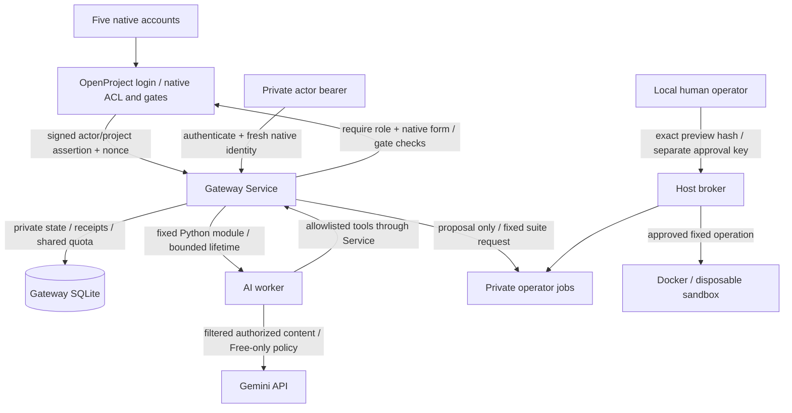

# P03-01 — implemented boundaries, 16 October 2026

This describes observed code/staging, not a deployed Supervisor. Future agents must enter through the same authenticated Service and shared quota; typed task fields are not authority.

| Boundary / asset | Existing control and source | Threat / required invariant |
|---|---|---|
| Native session to Gateway | `gateway/bridge.py`: HMAC, actor/project/audience,30s timestamp, durable one-use nonce; `app.py` signed UI route | Browser/model cannot invent actor or reuse confirmation. Bearer REST/MCP has no proposal confirmation tool. |
| Model/task to business tools | `gemini.py` allowlist/structured outputs; `service.py` Command extra-forbid, fresh native identity and `permissions.require` at entry and perform | Ticket prompt injection/task role/class cannot grant PM, admin or another actor's credential. Non-PM remains read/comment; native permissions can further reduce PM. |
| Business write | Existing preview/hash/expiry/actor-bound confirmation or explicit per-run native routine-write consent; worker scope; native lockVersion/forms/gates/reviewer independence | No prior context/task/result becomes consent. No blind retry after unknown write; receipts remain authoritative. |
| Model/provider | Persistent Free-only key/proof binding, shared atomic reservations, bounded provider-phase retry | No paid fallback, credential in prompt/log, hidden tool or write replay on503/429. Cached READY is not a live billing guarantee. |
| Gateway to worker | `ai_worker.py` fixed `[python,-m,gateway.ai_worker]`, bounded JSON/stdout/deadline, no shell command from model | This is process isolation for time/resource bounds, not a separate security principal: child can read Gateway credentials. Do not claim otherwise. |
| Workspace to host | `workspace.py` actor directories, traversal/link/hardlink denial, expected content hash and atomic replacement | File tools are existing restricted sandbox operations, not arbitrary host paths/deployment. Business-content model tool allowlist excludes code. |
| Gateway to operator | `service.py` permits only PM proposal `delete_work_package` or fixed test-suite request; `broker.py` exact hash/local human approval and separate approval key; `operator_state.py` fixed protocol | A queued proposal is not approval. Model cannot request deploy/admin/shell. Do not import broker/runner into agent runtime or mount Docker socket/approval key in Gateway/n8n. |
| Broker to sandbox | `runner.py` pinned images/fixed scripts, isolated disposable DB/network and limits | Privileged host path is separate from business execution. No automatic activation by future Supervisor. |
| State and receipts | Actor-scoped Store access, private runtime; native cache fresh ACL/source check | Cross-actor polling denied; stale/offline cache returns no old business payload. Context references must recheck ACL/version/expiry in P03-04. |

Actual staging inspection: readonly root, cap_drop ALL, no-new-privileges, loopback-only Gateway port; mounts only `/state`, `/workspaces`, readonly `/qldapm-policy/free-tier-proof.json`. No Docker socket/approval key mounted. `artifacts/P03-boundaries-runtime.json` records assertions. Gateway remains on native-only Quick Tunnel exposure; n8n/DB/Gateway private.

Regression evidence: `artifacts/P03-boundaries-tests.log` covers Gateway/RBAC/deep-AI/operator-state tests including signed nonce/confirmation/expiry, role ceilings, forbidden operator commands, unknown outcomes, path/link checks and published allowlists. No new permission or core change was necessary.

Residual risks: Gateway and its fixed worker share a credential trust domain; SQLite is private local storage, not an untrusted plugin sandbox. No external agent code execution is added. Supervisor/n8n machine identity/context/FTS still require their own acceptance. Five physical clients and main release remain P09/P10.
