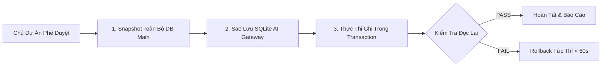

# BẢN XEM TRƯỚC VÀ ĐỀ XUẤT CẤP QUYỀN GHI LÊN HỆ THỐNG MAIN
## MAIN PRODUCTION WRITE APPROVAL PREVIEW & SAFEGUARD RUNBOOK

- **Thời điểm lập:** 2026-10-21T11:50:00+07:00
- **Mục đích:** Cung cấp bức tranh toàn cảnh, chi tiết từng trường dữ liệu sẽ thay đổi và phương án phòng ngừa rủi ro cho Chủ dự án trước khi ra quyết định phê duyệt ghi đè lên hệ thống Main (`http://localhost:8088` và `http://localhost:8090`).
- **Trạng thái Main hiện tại:** **HOÀN TOÀN NGUYÊN VẸN (0 MUTATIONS)**. Toàn bộ 329 Work Packages, bảng quan hệ và phiên bản hiện tại trên Main chưa bị thay đổi bất kỳ trường nào.

---

## 1. TỔNG HỢP CÁC TÁC ĐỘNG THAY ĐỔI DỮ LIỆU DỰ KIẾN (IMPACT MATRIX)

Khi Chủ dự án ra quyết định phê duyệt ghi (`MAIN_WRITE_APPROVAL`), các thay đổi sau sẽ được thực thi một cách tự động và nguyên tử (Atomic Transaction):

| Hạng Mục Thay Đổi | Số Lượng Bản Ghi | Chi Tiết Trường Bị Tác Động | Mục Đích Nghiệp Vụ |
| :--- | :---: | :--- | :--- |
| **Tạo Versions mới** | 3 bản ghi | Bảng `versions`: Thêm `Sprint 5`, `Sprint 6`, `Sprint 7` thuộc Project ID 5. | Thiết lập các mốc bàn giao Milestone chuẩn cho 7 Sprint. |
| **Tạo Sprint Boards** | 2 bản ghi | Cấu hình Sprint native: Bổ sung `Sprint 6` và `Sprint 7`. | Cho phép hiển thị bảng Kanban riêng cho 2 sprint mở rộng. |
| **Ghi ngày Subtasks** | 265 bản ghi | Bảng `work_packages`: Cập nhật `start_date`, `due_date`. | Khởi tạo lịch làm việc chi tiết cho 265 công việc lá theo thứ tự tô-pô. |
| **Cuộn ngày Tasks cha** | 53 bản ghi | Bảng `work_packages`: Cập nhật `start_date = min(con)`, `due_date = max(con)`. | Đảm bảo thanh tiến độ Task cha bao trùm toàn bộ các subtasks con. |
| **Cuộn ngày Epics ông** | 11 bản ghi | Bảng `work_packages`: Cập nhật `start_date = min(con)`, `due_date = max(con)`. | Hiển thị Roadmap tổng quan từ 01/10/2026 đến 08/01/2027 trên Gantt. |
| **Phân bổ Sprint** | 234 bản ghi | Bảng `work_packages`: Cập nhật `version_id` và nhãn Sprint tương ứng. | Đưa các công việc vào đúng chu kỳ 2 tuần của từng Sprint. |
| **Nâng cấp AI Gateway** | 1 container | Cập nhật image `qldapm-ai-gateway-1` sang `qldapm-ai:rd-qual-20261021-v2`. | Kích hoạt bộ điều phối đa chuyên gia BA+QA và mở khóa Live Gemini UAT. |

---

## 2. QUY TRÌNH BẢO ĐẢM AN TOÀN TRƯỚC KHI GHI (PRE-DEPLOYMENT SAFEGUARDS)

Để loại trừ 100% rủi ro mất mát dữ liệu hoặc gián đoạn dịch vụ, quy trình thực thi sẽ tuân thủ nghiêm ngặt 3 chốt chặn:



### Bước 1: Sao lưu toàn diện Cơ sở dữ liệu Main (Full DB Snapshot)
Thực thi lệnh dump nhị phân nguyên vẹn cơ sở dữ liệu PostgreSQL trước khi mở transaction ghi:
```bash
docker exec -t qldapm-openproject-db-1 pg_dump -U postgres openproject > "backups/main_pre_7sprint_$(date +%Y%m%d_%H%M%S).sql"
```

### Bước 2: Sao lưu cơ sở dữ liệu AI Gateway
Sao lưu tệp SQLite lưu trữ lịch sử phiên chạy và token receipts:
```bash
cp openproject/ai/gateway/gateway.db "backups/gateway_pre_v2_$(date +%Y%m%d_%H%M%S).db"
```

### Bước 3: Cơ chế Rollback tự động dưới 60 giây (Instant Rollback Plan)
Nếu có bất kỳ lỗi nào xảy ra trong quá trình cập nhật (ví dụ: mất kết nối, lỗi ràng buộc khóa ngoại, xung đột dữ liệu):
- Hệ thống tự động kích hoạt `ROLLBACK TRANSACTION`.
- Trong trường hợp xấu nhất, khôi phục lại database từ bản dump chỉ mất chưa đầy 60 giây bằng lệnh `pg_restore`.

---

## 3. MẪU DỮ LIỆU ĐỐI CHIẾU TRƯỚC VÀ SAU KHI GHI (BEFORE / AFTER PREVIEW)

Trích xuất minh họa cho gói công việc Epic 1 và các Subtask tiêu biểu:

```text
========================================================================================
MINH HỌA DỮ LIỆU: TRƯỚC VS SAU KHI ÁP DỤNG KẾ HOẠCH 7 SPRINT
----------------------------------------------------------------------------------------
[EPIC 1] Work Package #1: "Hạ tầng & Xác thực hệ thống Native"
- Trước: start_date: NULL, due_date: NULL, version: NULL
- Sau:   start_date: 2026-10-01, due_date: 2026-10-14, version: Sprint 1

[TASK 1.1] Work Package #2: "Cài đặt & Cấu hình OpenProject Core"
- Trước: start_date: NULL, due_date: NULL, version: NULL
- Sau:   start_date: 2026-10-01, due_date: 2026-10-07, version: Sprint 1

[SUBTASK 1.1.1] Work Package #3: "Cấu hình Docker Compose môi trường Main"
- Trước: start_date: NULL, due_date: NULL, version: NULL
- Sau:   start_date: 2026-10-01, due_date: 2026-10-03, version: Sprint 1 (3 ngày)

[SUBTASK 1.1.2] Work Package #4: "Khởi tạo Schema & Extension PostgreSQL"
- Trước: start_date: NULL, due_date: NULL, version: NULL
- Sau:   start_date: 2026-10-04, due_date: 2026-10-07, version: Sprint 1 (2 ngày, follows #3)
========================================================================================
```

---

## 4. HÀNH ĐỘNG CỦA CHỦ DỰ ÁN ĐỂ KÍCH HOẠT

Hiện tại hệ thống đang ở chế độ **CHỜ LỆNH (PENDING APPROVAL)**. Kỹ sư tiếp quản tuyệt đối không tự ý thực hiện bất kỳ lệnh ghi nào vào Main.

Khi Chủ dự án đã xem xét kỹ lưỡng và sẵn sàng cho việc ghi dữ liệu chính thức, Chủ dự án chỉ cần phản hồi:
> **"Tôi phê duyệt áp dụng lịch trình 7 Sprint và nâng cấp Gateway lên Main."**

Ngay khi nhận được lệnh, kỹ sư sẽ tiến hành sao lưu, ghi dữ liệu, nâng cấp container và báo cáo kết quả nghiệm thu hoàn tất trong vòng vài phút.
