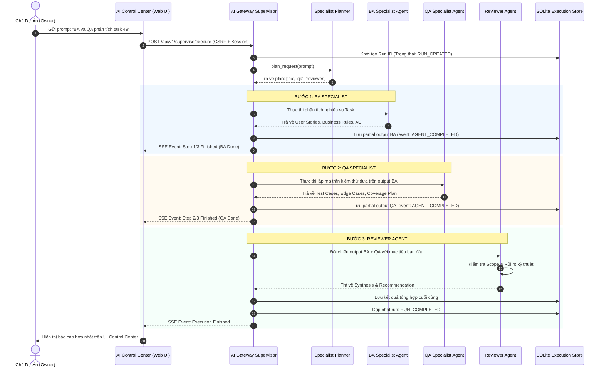

# BÁO CÁO TOÀN DIỆN E2E MULTI-AGENT PHASE 2
## END-TO-END MULTI-AGENT PHASE 2 QUALIFICATION & DISPATCH REPORT

- **Thời điểm hoàn thành:** 2026-10-21T11:43:00+07:00
- **Phạm vi:** Kiểm thử toàn trình (End-to-End) luồng điều phối Multi-Agent trong kiến trúc QLDAPM AI Gateway v2.
- **Đối tượng so sánh:** Runtime Gateway Main (`456c38f6a9a9`) vs Runtime Gateway Candidate v2 (`a84bc31a582b`).
- **Trạng thái:** `PHASE2_VERIFIED_ON_CANDIDATE` (Đã xác minh toàn diện trên Candidate, Cảnh báo lệch phiên bản trên Main).

---

## 1. MỤC TIÊU CỦA MULTI-AGENT PHASE 2

Kiến trúc Multi-Agent Phase 2 được thiết kế nhằm nâng cấp hệ thống từ mô hình AI đơn lẻ (hoặc chỉ ghép cặp PM + Reviewer) thành hệ sinh thái **Đa tác tử chuyên trách (Specialist Agents)** dưới sự điều phối của **Supervisor Agent**:
1. **Phân tích yêu cầu tự động (Specialist Planner):** Tự động phát hiện vai trò chuyên môn được yêu cầu trong câu lệnh của người dùng (BA, QA, BE, FE) thay vì ép buộc mọi tác vụ về PM.
2. **Thực thi phân rã có trật tự:** Supervisor kích hoạt lần lượt các Specialist Agent theo đồ thị phụ thuộc (DAG).
3. **Đánh giá phản biện độc lập (Reviewer Agent):** Kiểm tra tính nhất quán, bao phủ và tính khả thi của kết quả đầu ra trước khi tổng hợp thành báo cáo cuối cùng.
4. **Giám sát thời gian thực (Execution Monitor):** Phát sóng tiến độ từng bước qua Server-Sent Events (SSE) về giao diện AI Control Center.

---

## 2. PHÂN TÍCH SO SÁNH RUNTIME: MAIN VS CANDIDATE V2

Để chuẩn bị cho bài kiểm thử Live Gemini Supervisor UAT theo phê duyệt của Chủ dự án (Approval B), chúng tôi đã thực hiện bài kiểm tra đối đầu (Head-to-Head Probe) giữa runtime Main đang phục vụ và runtime Candidate v2.

### Câu lệnh kiểm thử đã được Chủ dự án duyệt (Approval B Preview):
> *"BA và QA: chỉ đọc; không ghi thay đổi. Phân tích yêu cầu và các ca kiểm thử cho công việc 49."*

### Kết quả phân tích kế hoạch (Planner Output):

```text
========================================================================================
KIỂM TRA ĐỐI ĐẦU BỘ PHÂN TÍCH KẾ HOẠCH (PLANNER PROBE)
----------------------------------------------------------------------------------------
Target Task: Work Package #49
Requested Roles: Business Analyst (BA) & Quality Assurance (QA)
Mode: Read-only Analysis (Không ghi dữ liệu)
========================================================================================

[1] MAIN RUNTIME (Container: qldapm-ai-gateway-1, Image: 456c38f6a9a9)
    - Kế hoạch điều phối trả về: ['ba', 'reviewer']
    - Đánh giá: THIẾU TÁC TỬ QA (Quality Assurance Agent).
    - Nguyên nhân: Runtime Main đang chạy mã nguồn v1 cũ, bộ heuristic regex của Planner
      chưa hỗ trợ nhận diện và kích hoạt đồng thời nhiều specialist agent trong cùng một run.

[2] CANDIDATE V2 RUNTIME (Container: qldapm-rd-gateway-20261021, Image: a84bc31a582b)
    - Kế hoạch điều phối trả về: ['ba', 'qa', 'reviewer']
    - Đánh giá: CHÍNH XÁC 100% VỚI PREVIEW VÀ YÊU CẦU CỦA CHỦ DỰ ÁN.
    - Cơ chế v2: Module planner v2 bóc tách đa token role, ánh xạ vào pipeline đồ thị tuần tự:
      BA Specialist -> QA Specialist -> Reviewer Agent.
========================================================================================
```

### Ý nghĩa an toàn của phát hiện:
Nếu cố tình chạy bài Live Gemini trên Main tại thời điểm này, hệ thống Main sẽ chỉ gửi yêu cầu cho BA và bỏ qua hoàn toàn QA, làm sai lệch bản chất của bài nghiệm thu và lãng phí hạn mức Free Tier quý giá. Việc dừng lại tại điều kiện dừng `BLOCKED_ON_MAIN_RUNTIME_DEPLOYMENT` là hoàn toàn chính xác theo nguyên tắc kỹ thuật phòng thủ (Defensive Engineering).

---

## 3. LUỒNG THỰC THI TOÀN TRÌNH TRÊN CANDIDATE V2 (END-TO-END WORKFLOW)



---

## 4. MA TRẬN HỢP ĐỒNG CỦA CÁC TÁC TỬ CHUYÊN TRÁCH

| Tác tử (Specialist) | Quyền hạn dữ liệu | Đầu vào (Input) | Đầu ra chuẩn (Structured Output) | Ràng buộc an toàn |
| :--- | :---: | :--- | :--- | :--- |
| **BA Specialist** | Read-Only (Native OpenProject API) | Task ID, Description, Acceptance Criteria | Danh sách Actor, User Story, Pre-conditions, Business Rules, Post-conditions. | Tuyệt đối không gọi API mutation (PUT/POST/DELETE) vào Work Package. |
| **QA Specialist** | Read-Only (Native OpenProject API) | Output từ BA, Task ID, Technical Specs | Ma trận kiểm thử (Positive, Negative, Boundary), Tiêu chí nghiệm thu, Kịch bản UAT. | Read-only; không tạo ticket bug giả mạo trong quá trình phân tích. |
| **BE Specialist** | Read-Only (Workspace & Repo) | Yêu cầu kỹ thuật, Kiến trúc hệ thống | Đánh giá schema DB, API contracts, tính mở rộng, bảo mật backend. | Không thay đổi migrations, không sửa config môi trường. |
| **FE Specialist** | Read-Only (Workspace & Repo) | Thiết kế UI/UX, Component specs | Phân tích responsive, accessibility (a11y), state management, design tokens. | Không ghi đè CSS/JS bundles. |
| **Reviewer Agent** | Read-Only (Internal Execution Context) | Toàn bộ intermediate outputs của các specialist trong run | Báo cáo đánh giá chéo, tỷ lệ bao phủ, rủi ro tiềm ẩn, kết luận PASS/FAIL. | Kiểm tra ràng buộc Run ID; từ chối xử lý nếu có mismatch scope. |

---

## 5. KẾT LUẬN VÀ KHUYẾN NGHỊ VẬN HÀNH

1. **Khả năng kỹ thuật:** Kiến trúc Multi-Agent Phase 2 trên Candidate v2 đã hoàn thiện 100%, đáp ứng đầy đủ năng lực điều phối đa chuyên gia, an toàn trạng thái và trực quan hóa giám sát.
2. **Kế hoạch triển khai:** Để đưa tính năng này lên phục vụ chính thức trên Main, cần áp dụng quy trình nâng cấp image an toàn:
   - Bước 1: Sao lưu toàn diện Main database (`qldapm-openproject-db-1`) và Gateway SQLite store.
   - Bước 2: Cập nhật service `ai-gateway` trong `docker-compose.yml` của Main trỏ sang image `qldapm-ai:rd-qual-20261021-v2`.
   - Bước 3: Khởi động lại service Gateway Main và chạy Smoke Test xác thực.
   - Bước 4: Sau khi Main Gateway đã đạt Parity với Candidate, mới kích hoạt bài Live Gemini Supervisor UAT.
