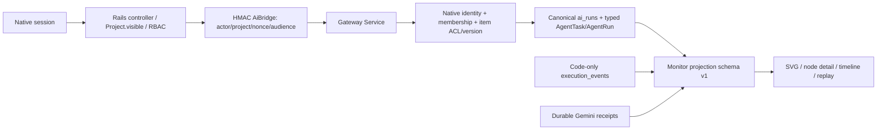

# Kiến trúc và luồng dữ liệu

**COMPLETE_ON_STAGING — 2026-10-19T19:59:52.412347+07:00**. [Serving deployment report](run_20261019_1635/deployment/STAGING_DEPLOYMENT_REPORT.md);30publicUI/API checksPASS. Qualification evidence below records pre-deployment validation.

Frontend hiện hữu là Rails ERB overlay `openproject/ai/core/overlay/app/views/qldapm_ai/`, dùng shell/assets OpenProject. Monitor bổ sung ERB/SVG/JavaScript có CSP nonce, không thêm Angular application hay dependency.

Các command đọc tái sử dụng `get_ai_run` để kiểm tra Native ACL và source fingerprint. Outputs lưu một lần trong `ai_runs.result.agent_outputs`; telemetry chỉ chứa codes/IDs/timestamps. History phân trang bằng SQL theo actor/project, không load toàn bộ hay gọi Native cho từng dòng. Khi mở detail mới kiểm tra nguồn và ẩn STALE.

Supervisor vẫn dùng registry/planner/provider hiện hữu. Instrumentation bổ sung vào đúng lifecycle; không thay thuật toán, model, retry budget hoặc quyền ghi. Model call events chỉ bao quanh SDK requests có thật; GET Monitor không gọi Gemini.

Serving hiện tại vẫn Gateway40cb4806/Core3b09393d. Candidate clone chạy loopback18097/18098, synthetic provider key, `gemini.enabled=false`, network qualification nội bộ. Không mở public Gateway endpoint mới.

Post-deployment acceptance: [STAGING_DEPLOYMENT_REPORT](run_20261019_1635/deployment/STAGING_DEPLOYMENT_REPORT.md). Exact servingpair456c38f6/7d76c1eb;30publicchecksPASS, ledger517unchanged. Ownerapproval61e1719f preserved; previewfile remains the immutable approved plan, not current deploymentstate.
