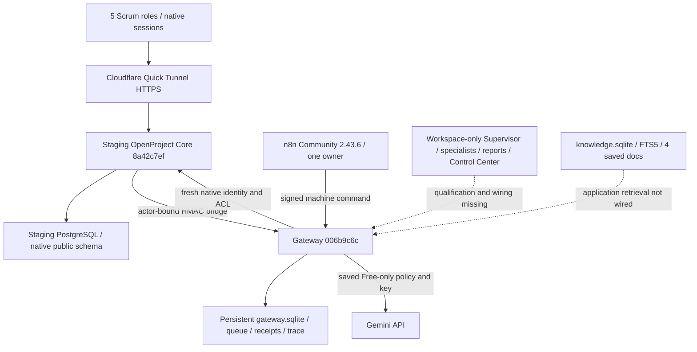

# Current architecture — source and runtime distinguished

## Runtime map

| Component | Source / entrypoint | Storage / network / ingress |
|---|---|---|
| OpenProject | core/overlay controllers, views, gates_api; quick_tunnel_web.rb → prod/web | stage-db + stage-assets; stage + stage-front; localhost18091 redirects to current HTTPS hostname |
| Gateway | gateway/app.py → Service; ai_worker.py → existing Gemini tool loop | /state bind; persistent tokens/proposals/usage/agent trace; localhost18092; private automation alias gateway |
| n8n | local-runtime.stage.yml; manual-status.v2, daily-brief.v2, workflow-errors.v1 | n8n-data volume + persisted encryption key; automation internal; editor through loopback Caddy5678 |
| Tunnel | QuickTunnel.Dockerfile + quick_tunnel_supervisor.sh | stage-front only; no socket or host mounts; internal2000 health/metadata |
| Landing | Quick.Caddyfile | localhost18090; access/index.html + current-url.json; no secret-file mount |
| Backup | local_backup.py via dedicated sidecar | private operator/local-backups; selected RO mounts, stage network; no serving restart |
| Knowledge | knowledge_storage/search/retrieval/ingestion/classifier modules in workspace | SQLite FTS5 file exists; separate PG schema qldapm_knowledge has2 tables; persistent library proof does not imply live retrieval/indexing |

Main remains separate: UI8088, Gateway8090; no P05–P08 promotion demonstrated. Runtime details, mount sources, ports, commands, image IDs and saved Compose file chain are in `runtime.json`; merged configuration is `compose-effective.json`.

Human API: /api/v1/commands, ai-runs, agent-runs, signed /internal/ui. Machine API: /internal/automation/status and signed /internal/automation/commands. Current source adds /api/v1/control-center/state; running app lacks it. Native UI: /projects/qldapm-local/qldapm-ai, native Work Packages/gates/insights. Code paths are under openproject/ai relative to workspace; registry tools are proposed definitions until real business dispatch is integrated. Operator shell/Docker/source tools remain outside BUSINESS_TOOLS.

Identity6=BA-PM,7=PM,8=BE,9=FE,10=QA in project3; stage-owner5 is separate. PM-only AI business writes still require native permission, scope, consent/proposal/hash and read-back. Five sessions on this host do not demonstrate five physical clients. Gemini local policy validates existing project/model15RPM/250KTPM/500RPD with13/225K/450 safety caps; no Google request in takeover, no live billing verification.
