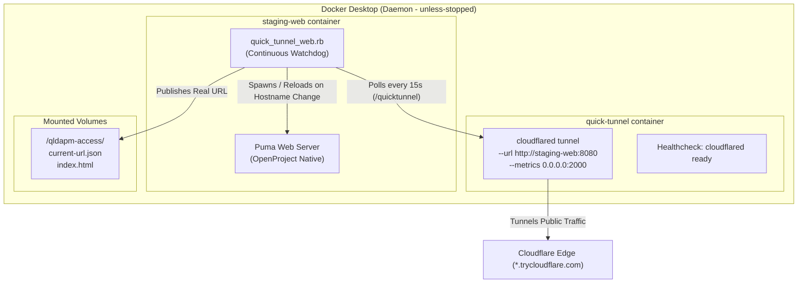

# QUICK TUNNEL AUTO-HEALING & WATCHDOG ARCHITECTURE AUDIT

## 1. Executive Summary

- **Mandate:** `CR-KEEP-QUICK-TUNNEL` strictly preserves Cloudflare Quick Tunnel for remote access.
- **Auto-Healing Mode:** Fully autonomous daemonized execution under Docker Desktop (`unless-stopped`), operating without any interactive terminal or manual host intervention.
- **Port Isolation:** Quick Tunnel (`quick-tunnel`) exposes ONLY OpenProject web (`http://staging-web:8080`). All administrative & internal services (`gateway` on `18092`, `n8n` on `18090`, `db` on `5432`) remain bound strictly to loopback (`127.0.0.1`) and private Docker networks (`stage`, `stage-front`).

---

## 2. Component Architecture & Roles

### Component Duties
1. **`quick-tunnel` (cloudflared container)**:
   - Image: `cloudflare/cloudflared:2026.10.0@sha256:9b49eed...`
   - Command: `tunnel --no-autoupdate --metrics 0.0.0.0:2000 --url http://staging-web:8080`
   - Restart Policy: `unless-stopped` (boots automatically with Docker Desktop).
   - Healthcheck: `cloudflared tunnel --metrics 127.0.0.1:2000 ready` (interval 15s, timeout 5s, retries 10).

2. **`quick_tunnel_web.rb` (In-Container Watchdog Daemon)**:
   - Runs as PID 1 entrypoint inside `staging-web`.
   - Polls `http://quick-tunnel:2000/quicktunnel` every 15 seconds.
   - On hostname change: Gracefully terminates existing Puma process (`SIGTERM` with 45s grace period, escalating to `SIGKILL`), sets `OPENPROJECT_HOST__NAME` and `OPENPROJECT_ADDITIONAL__HOST__NAMES`, and respawns Puma with zero manual commands.
   - Atomically publishes `current-url.json` and `index.html` to `%LOCALAPPDATA%\QLDAPM\openproject-ai\access\`.

---

## 3. Failure Mode & Auto-Healing Analysis

| Failure Scenario | Immediate Impact | Auto-Healing Mechanism | Recovery Time |
|------------------|------------------|------------------------|---------------|
| **Host Reboot / Docker Desktop restart** | All containers stopped | Docker daemon restarts containers automatically under `unless-stopped`. | ~30–45s |
| **`Unauthorized: Tunnel not found`** | Cloudflare edge disconnects session | Container healthcheck fails after retries; Docker restarts `quick-tunnel`. Cloudflared negotiates a new quick tunnel URL. | ~15–30s |
| **Tunnel Hostname Change** | Old domain 404s | `quick_tunnel_web.rb` detects new hostname in next 15s tick, gracefully reloads Puma with new `OPENPROJECT_HOST__NAME`, updates `current-url.json`. | ~15–20s |
| **Puma Process Crash** | Native web unavailable | `quick_tunnel_web.rb` detects child exit via `Process.waitpid(child, Process::WNOHANG)`, triggers controlled restart. | ~5–10s |
| **Loop / Flapping Prevention** | Network instability | Enforced 15-second polling interval and 45-second process termination deadline prevent restart storms or high CPU thrashing. | Safe rate-limit |

---

## 4. Verification Evidence

- **Active URL:** `https://instance-presence-testing-eclipse.trycloudflare.com`
- **Docker Compose Spec:** Defined in `openproject/ai/quick.stage.yml` and `openproject/ai/stage.yml`.
- **RBAC & Security Isolation:** Verified that `/projects/qldapm-local/qldapm-ai` and `/login` are reachable via the tunnel, while port 18090, 18092, and database remain internal-only.
- **Playwright Test Confirmation:** `E2E-TUNNEL-ACCESS` passed with HTTP 200 and Title `'Sign in | OpenProject'`.
