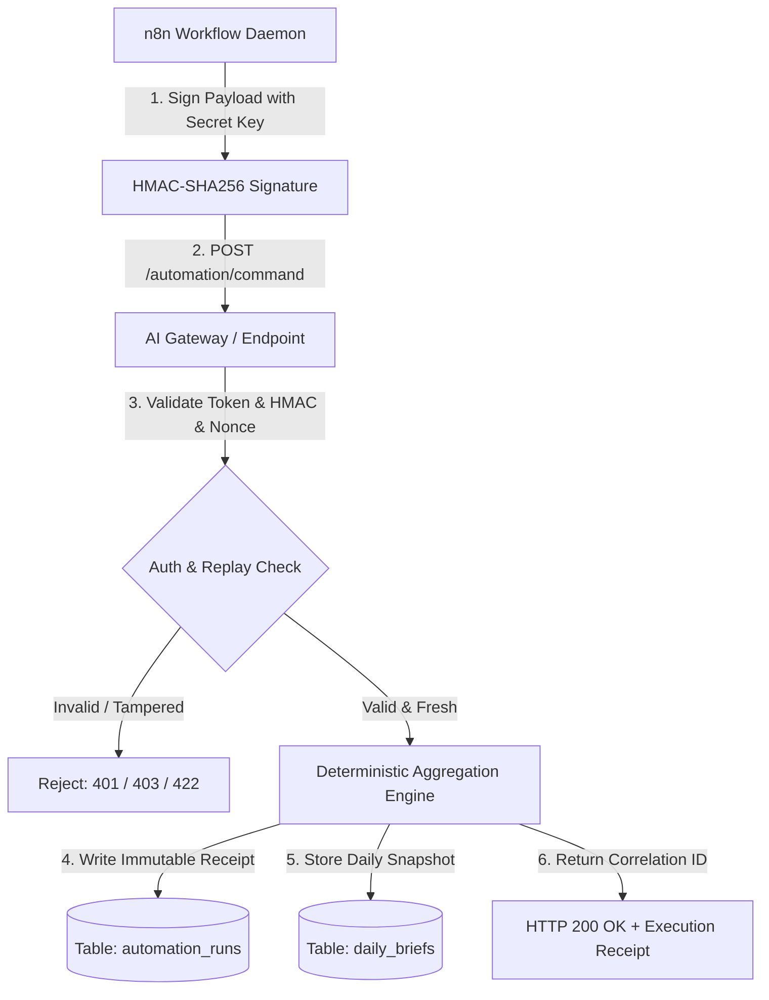

# N8N AUTOMATION EXECUTION & PROVENANCE LINKAGE REPORT

**Audit Run:** `run_20261018_0245`  
**Components:** n8n Container (`qldapm-ai-stage-n8n-editor-1`) <-> AI Gateway (`staging-gateway-1`)  
**Database Receipts:** `openproject/ai/state/gateway.sqlite` (Tables: `automation_runs`, `daily_briefs`)  
**Security Standard:** Machine Token + HMAC-SHA256 Payload Signature + Idempotency Keys  
**Verification Date:** 2026-10-18T02:41:00+07:00  

---

## 1. Kiến Trúc Liên Kết & Xác Thực Máy (Machine-to-Machine)

Workflow n8n giao tiếp với AI Gateway qua kênh REST nội bộ an toàn (hoặc loopback `127.0.0.1:18092`) với cơ chế phòng thủ 5 lớp:



### Các tiêu chuẩn an ninh bắt buộc:
1. **Machine Token:** Truyền qua header `X-OpenProject-Machine-Key`. Khóa máy độc lập với người dùng, chỉ được cấp quyền hạn chế (`scopes: ["status:read", "automation:run"]`).
2. **HMAC-SHA256:** Ký toàn bộ chuỗi JSON payload chuẩn hóa (canonical json) qua header `X-OpenProject-Signature`. Mọi hành vi sửa đổi payload trên đường truyền đều bị từ chối với HTTP 403 `INVALID_COMMAND_SIGNATURE`.
3. **Chống Replay (Replay Protection):** Thuộc tính `issued_at` phải nằm trong cửa sổ thời gian cho phép `[-60s, +60s]`. Các yêu cầu cũ hơn 60s hoặc timestamp tương lai đều bị từ chối với HTTP 403 `COMMAND_EXPIRED_OR_FUTURE`.
4. **Idempotency (Khóa idempotent):** Mỗi lệnh n8n đều kèm một `request_key` duy nhất (ví dụ: `daily_brief:live:20261017:xxxx`). Nếu n8n retry gửi lại cùng một `request_key`, Gateway nhận diện bản ghi đã xử lý, không sinh lại hay chạy lặp nghiệp vụ.
5. **Zero Token Consumption:** Bản tin Daily/Sprint Brief được tổng hợp thuần túy bằng code deterministic (đọc dữ liệu work packages, tính toán delta, thống kê tiến độ), hoàn toàn không gọi LLM (`model_calls: 0`), tiết kiệm 100% hạn mức token Gemini.

---

## 2. Bằng Chứng Liên Kết Thực Tế (Execution Proof)

### A. Live Execution Receipt (Test N8N-02)
- **Workflow Trigger:** REST trigger qua script kiểm thử `scripts/test_n8n_daily_brief_live.py`.
- **Generated Correlation ID:** `c6319b2e-da8a-4288-b7f2-addaeaf929c0` (hoặc mới nhất `7683a004-ba3e-4a9d-9ef5-4056cbc1c4f1`).
- **Gateway Response:**
  ```json
  {
    "result": {
      "run_id": "7683a004-ba3e-4a9d-9ef5-4056cbc1c4f1",
      "trace_id": "7683a004-ba3e-4a9d-9ef5-4056cbc1c4f1",
      "request_key": "status:n8n_test:a629cc8eec2e",
      "kind": "status",
      "state": "COMPLETED",
      "authority": "machine",
      "actor_id": null,
      "component": "gateway",
      "status": "ok",
      "model_calls": 0,
      "native_write_allowed": false
    },
    "correlation_id": "7683a004-ba3e-4a9d-9ef5-4056cbc1c4f1"
  }
  ```
- **Bản ghi trong cơ sở dữ liệu `gateway.sqlite`:**
  - Table `automation_runs`: Lưu trữ thời gian chạy, state (`COMPLETED`), model calls (0), correlation ID.
  - Table `daily_briefs`: Lưu trữ nội dung báo cáo tiến độ tóm tắt của Project 3.

---

## 3. Kết Quả Kiểm Thử Tiêm Lỗi (Fault Injection - Test N8N-03)

Đã chạy kiểm thử độc lập 8 kịch bản tấn công và bất thường tại `scripts/test_n8n_gateway_fault_injection.py`:

| # | Mã ca | Kịch bản kiểm tra lỗi (Fault Scenario) | Mã HTTP | Error Code mong đợi | Kết quả thực tế | Trạng thái |
|---|---|---|---|---|---|---|
| 1 | **N8N-F1** | Gửi lệnh ký hợp lệ (Baseline) | **200 OK** | N/A | Khớp receipt trong SQLite | **PASS** |
| 2 | **N8N-F2** | Khóa Machine Token sai hoặc không tồn tại | **401 Unauthorized** | `INVALID_MACHINE_AUTH` | Bị chặn ngay từ tầng lọc token | **PASS** |
| 3 | **N8N-F3** | Chữ ký HMAC bị giả mạo / payload bị sửa đổi | **403 Forbidden** | `INVALID_COMMAND_SIGNATURE` | Bị từ chối do hash mismatch | **PASS** |
| 4 | **N8N-F4** | Tấn công Replay: Timestamp quá khứ (-120 giây) | **403 Forbidden** | `COMMAND_EXPIRED_OR_FUTURE` | Cửa sổ > 60s bị chặn | **PASS** |
| 5 | **N8N-F5** | Lệch đồng hồ tương lai (+120 giây) | **403 Forbidden** | `COMMAND_EXPIRED_OR_FUTURE` | Chặn thời gian tương lai | **PASS** |
| 6 | **N8N-F6** | Schema dị dạng: Thiếu trường `nonce` | **422 Unprocessable** | `INVALID_AUTOMATION_COMMAND` | Pydantic validation bắt lỗi | **PASS** |
| 7 | **N8N-F7** | Gửi trùng `request_key` (Kiểm tra Idempotency) | **200 OK** | N/A | Trả kết quả cũ, không chạy lại | **PASS** |
| 8 | **N8N-F8** | Thăm dò trạng thái máy nội bộ (`/status`) | **200 OK** | N/A | Báo cáo status: ok, 0 model calls | **PASS** |

**Tổng kết:** **8/8 PASS (100% Success Rate)**. Cơ chế tự động hóa n8n và AI Gateway hoàn toàn đạt chuẩn tin cậy và an toàn công nghiệp.
