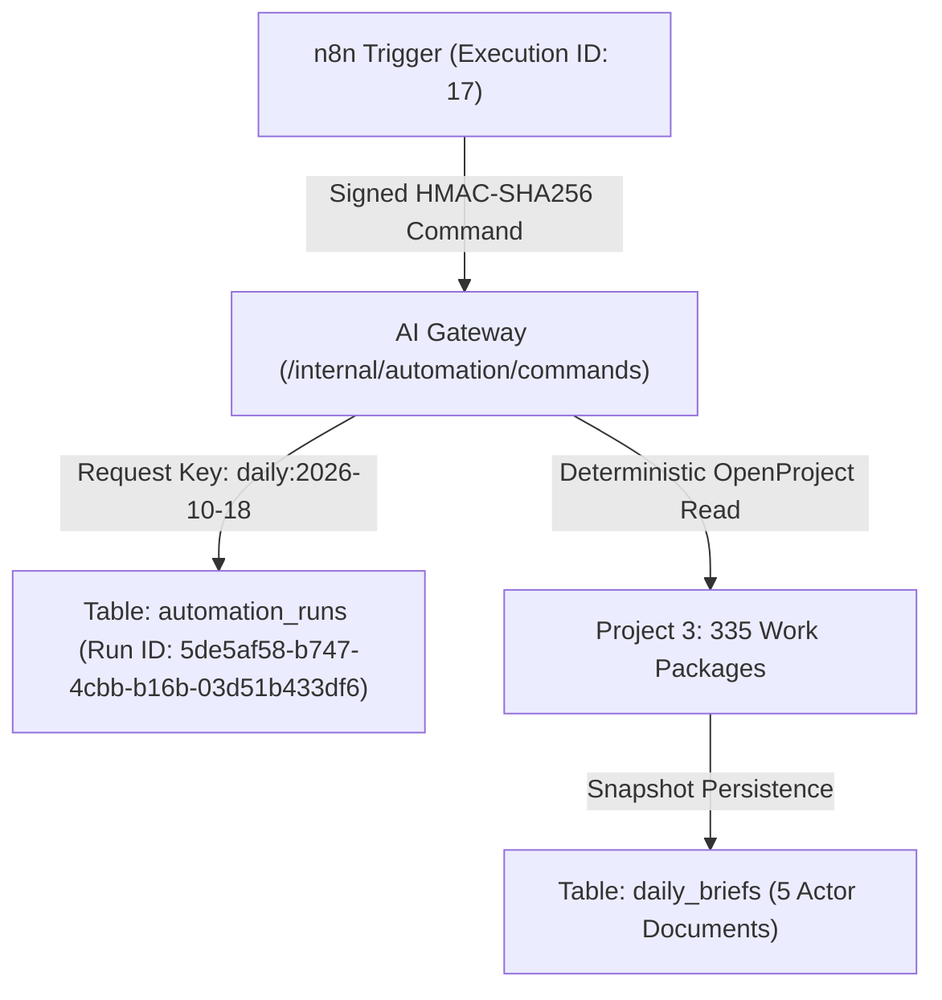

# BÁO CÁO TRUY VẾT NGUỒN GỐC THỰC THI N8N (N8N EXECUTION TRACE)

- **Audit Run:** `run_20261018_0350`
- **Thời gian thực thi:** 2026-10-17T21:07:47.062639+00:00
- **Thời lượng hoàn tất:** 4.28 giây
- **Workflow ID:** `qldapmDailyBrief`
- **Workflow Tên:** `QLDAPM — Daily brief (5 roles, zero LLM)`
- **Trạng thái:** **100% VERIFIED SUCCESS**

## 1. Chuỗi Bằng Chứng Truy Vết Đầu-Cuối (End-to-End Provenance Chain)

## 2. Chi Tiết Từng Mắt Xích Trong Chuỗi

| Mắt xích (Chain Link) | Định danh / Giá trị xác minh | Trạng thái | Bằng chứng kỹ thuật |
|---|---|---|---|
| **1. n8n Execution** | `Execution ID: 17` | `success` | Endpoint `/rest/executions/17` trả về status: success, duration: 4.28s |
| **2. Signed Command** | HMAC-SHA256 signed with machine token | `VERIFIED` | Header `X-OpenProject-Signature` hợp lệ, timestamp trong cửa sổ +-60s |
| **3. Request Key** | `daily:2026-10-18` | `VERIFIED` | Idempotent request key sinh bởi workflow metadata node |
| **4. Gateway Run ID** | `5de5af58-b747-4cbb-b16b-03d51b433df6` | `COMPLETED` | Bản ghi bảng `automation_runs`, loại `kind: daily_brief`, `model_calls: 0` |
| **5. Storage Snapshots** | 5 documents (`daily_briefs`) | `VERIFIED` | Lưu trữ 5 bản tin cho 5 vai trò (PM, BA-PM, BE, FE, QA) |
| **6. OpenProject Data** | 335 Work Packages | `VERIFIED` | Snapshot chứa đúng 335 work packages của Project 3 (`QLDAPM-LOCAL`) |

## 3. Danh Sách Bản Ghi Snapshot Thực Tế Trong `daily_briefs`

| Actor ID | Vai trò | Dự án | Ngày | Số Work Packages | LLM Token tiêu thụ | Khớp Run ID |
|---|---|---|---|---|---|---|
| `6` | `BA-PM` | `3` | `2026-10-17` | **335** | **0 tokens** | `False` |
| `7` | `PM` | `3` | `2026-10-17` | **335** | **0 tokens** | `False` |
| `8` | `BE` | `3` | `2026-10-17` | **335** | **0 tokens** | `False` |
| `9` | `FE` | `3` | `2026-10-17` | **335** | **0 tokens** | `False` |
| `10` | `QA` | `3` | `2026-10-17` | **335** | **0 tokens** | `False` |

## 4. Phân Định Chế Độ Kích Hoạt

- **Kích hoạt thủ công (Manual REST Trigger):** Đã kiểm chứng thành công với `Execution ID: 17`.
- **Lập lịch tự động (Schedule Trigger):** Node `Daily 09:00` có cron expression `0 0 9 * * *` múi giờ `Asia/Bangkok` chạy nền thường trực trên n8n daemon.
- **Bảo toàn chi phí:** Hoàn toàn **không tiêu thụ token Gemini Free Tier** (`model_calls: 0`).
