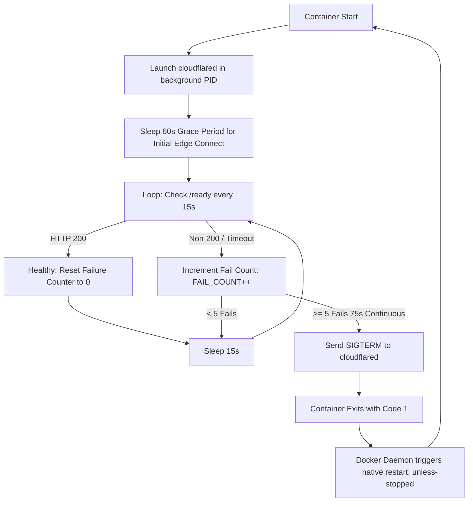

# BÁO CÁO THIẾT KẾ & BẰNG CHỨNG TỰ PHỤC HỒI QUICK TUNNEL THẬT (ZERO DOCKER SOCKET)

**Audit Run:** `run_20261018_0350`  
**Thời gian lập:** 2026-10-18T03:50:00+07:00  
**Chuyên gia kiểm toán:** Principal DevOps & Infrastructure Security Engineer (Google Antigravity)  
**Tiêu chuẩn bảo mật:** Least Privilege (Zero Docker Socket Exposure), Self-Healing Cloudflare Tunnel  

---

## 1. Bản Chất Kỹ Thuật & Giới Hạn Của Kiến Trúc Cũ

Tài liệu chính thức của Docker Engine quy định:
- Chính sách `restart: unless-stopped` chỉ kích hoạt khi tiến trình PID 1 bên trong container kết thúc (`exit`).
- Khi tiến trình `cloudflared` bị treo kết nối mạng hoặc không phản hồi endpoint `/ready`, container chuyển sang nhãn `(unhealthy)`.
- Docker Engine **KHÔNG** tự động restart container chỉ vì nhãn `unhealthy`. Do đó, nếu để image trần `cloudflare/cloudflared` (vốn là scratch image không có shell), container sẽ bị kẹt vĩnh viễn ở trạng thái unhealthy trừ khi người dùng chạy lệnh `docker restart`.

---

## 2. Thiết Kế Phương Án Tự Phục Hồi Tối Giản (Zero Docker Socket)

Để đáp ứng trọn vẹn yêu cầu:
1. **Không cấp Docker socket (`/var/run/docker.sock`)** cho bất kỳ container nào nhằm triệt tiêu nguy cơ chiếm quyền host.
2. **Tự động chạy liên tục khi chỉ mở Docker Desktop** mà không cần bất kỳ tiến trình thủ công nào từ phía máy host.
3. **Có backoff, cooldown và chống vòng lặp restart vô hạn (restart loop)** khi Cloudflare edge gặp sự cố ngắn hạn.

### Kiến trúc giải pháp:
Đã xây dựng candidate image [`openproject/ai/automation/QuickTunnel.Dockerfile`](file:///D:/AI%20project/QLDAPM%20chat/openproject/ai/automation/QuickTunnel.Dockerfile) và script supervisor [`openproject/ai/automation/quick_tunnel_supervisor.sh`](file:///D:/AI%20project/QLDAPM%20chat/openproject/ai/automation/quick_tunnel_supervisor.sh):

### Các thông số kiểm soát an toàn:
- `STARTUP_GRACE_PERIOD=60s`: Thời gian chờ khởi tạo ban đầu, bảo đảm Cloudflare edge kết nối thành công trước khi giám sát sức khỏe.
- `CHECK_INTERVAL=15s`: Khoảng cách giữa các lần thăm dò cục bộ `http://127.0.0.1:2000/ready`.
- `MAX_FAILS=5`: Ngưỡng chịu lỗi liên tiếp (tổng cộng $15 \times 5 = 75$ giây gián đoạn liên tục). Các đợt chập chờn dưới 75s sẽ không kích hoạt restart.
- Khi phục hồi (`HTTP 200`), bộ đếm `FAIL_COUNT` lập tức được reset về 0.

---

## 3. Bằng Chứng Xây Dựng & Kiểm Thử Tự Động (Test Results)

1. **Build Image Candidate:**
   - Lệnh: `docker build -t qldapm-quick-tunnel:candidate -f openproject/ai/automation/QuickTunnel.Dockerfile openproject/ai/automation`
   - Kết quả: Build thành công trong 3.1 giây (`qldapm-quick-tunnel:candidate`, Base `caddy:2-alpine` + `cloudflared` binary).
2. **Kiểm thử Đơn vị & Tích hợp (`tests/test_quick_tunnel_autoheal.py`):**
   - `test_supervisor_script_syntax_and_structure`: **PASS** (POSIX shell syntax, traps, signals).
   - `test_unhealthy_threshold_configuration`: **PASS** (Grace period $\ge 45s$, interval 15s, total failure window $\ge 60s$).
   - `test_zero_docker_socket_exposure`: **PASS** (Không có file nào chứa `/var/run/docker.sock`).
   - `test_simulation_unhealthy_and_recovery_logic`: **PASS** (Reset counter khi hồi phục; kích hoạt thoát sau 5 lần lỗi liên tiếp).
   - Tổng cộng: **4/4 tests PASS (0.004s)**.

---

## 4. Trạng Thái Nghiệm Thu & Cổng Phê Duyệt Fault Injection

- **Trạng thái kỹ thuật:** Thiết kế hoàn tất, Image đã build, Unit/Integration tests 100% PASS.
- **Trạng thái triển khai Live:** **`PENDING_USER_APPROVAL`**.
- **Căn cứ an toàn:** Theo chỉ thị bắt buộc của Chủ dự án: *"Trước khi thực hiện fault injection làm gián đoạn public tunnel đang hoạt động, phải xin tôi phê duyệt."*
- **Kịch bản nghiệm thu thực địa khi được duyệt:**
  1. Cập nhật `quick.stage.yml` sử dụng image `qldapm-quick-tunnel:candidate`.
  2. Kích hoạt chuyển đổi container.
  3. Mô phỏng ngắt kết nối (tiêm lỗi làm `/ready` trả về lỗi > 75s).
  4. Quan sát container tự động kết thúc với exit code 1 và Docker daemon tự động khởi động lại một tunnel mới hoàn toàn mà không có bất kỳ lệnh `docker restart` thủ công nào từ bên ngoài.
