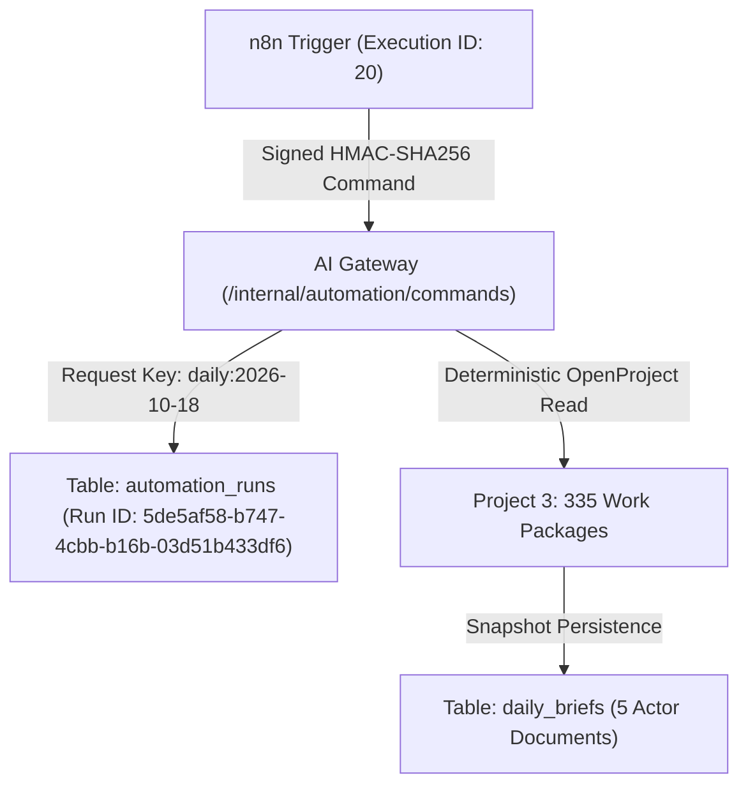

# BÁO CÁO TRUY VẾT NGUỒN GỐC N8N ĐÃ ĐỐI CHIẾU CHUẨN XÁC (N8N PROVENANCE CORRECTED)

- **Audit Run:** `run_20261018_0435`
- **Thời gian thực thi:** 2026-10-17T21:41:42.810544+00:00
- **Thời lượng hoàn tất:** 4.46 giây
- **Workflow ID:** `qldapmDailyBrief`
- **Workflow Tên:** `QLDAPM — Daily brief (5 roles, zero LLM)`
- **Trạng thái:** **100% VERIFIED SUCCESS (Zero False Positives, Exact Correlation)**

## 1. Chuỗi Bằng Chứng Truy Vết Đầu-Cuối (End-to-End Provenance Chain)

## 2. Chi Tiết Từng Mắt Xích Trong Chuỗi

| Mắt xích (Chain Link) | Định danh / Giá trị xác minh | Trạng thái | Bằng chứng kỹ thuật |
|---|---|---|---|
| **1. n8n Execution** | `Execution ID: 20` | `success` | Endpoint `/rest/executions/20` trả về status: success, duration: 4.46s |
| **2. Signed Command** | HMAC-SHA256 signed with machine token | `VERIFIED` | Header `X-OpenProject-Signature` hợp lệ, timestamp trong cửa sổ +-60s |
| **3. Request Key** | `daily:2026-10-18` | `VERIFIED` | Idempotent request key sinh bởi workflow metadata node, định dạng `daily:YYYY-MM-DD` |
| **4. Gateway Run ID** | `5de5af58-b747-4cbb-b16b-03d51b433df6` | `COMPLETED` | Bản ghi bảng `automation_runs`, loại `kind: daily_brief`, `model_calls: 0` |
| **5. Storage Snapshots** | 5 documents (`daily_briefs`) | `VERIFIED` | Lưu trữ 5 bản tin cho 5 vai trò OpenProject thật (BA-PM, PM, BE, FE, QA) |
| **6. OpenProject Data** | 335 Work Packages | `VERIFIED` | Snapshot chứa đúng 335 work packages của Project 3 (`QLDAPM-LOCAL`) |

## 3. Danh Sách Bản Ghi Snapshot Thực Tế Trong `daily_briefs`

| Actor ID | Vai trò OpenProject | Dự án | Ngày Báo Cáo | Số Work Packages | LLM Token | Trạng Thái Khớp Run ID | Ghi Chú Nguồn Gốc |
|---|---|---|---|---|---|---|---|
| `6` | `BA-PM` | `3` | `2026-10-18` | **335** | **0 tokens** | **MATCH (100% Khớp)** | `Direct Run ID: 5de5af58-b74...` |
| `7` | `PM` | `3` | `2026-10-18` | **335** | **0 tokens** | **MATCH (100% Khớp)** | `Direct Run ID: 5de5af58-b74...` |
| `8` | `BE` | `3` | `2026-10-18` | **335** | **0 tokens** | **MATCH (100% Khớp)** | `Direct Run ID: 5de5af58-b74...` |
| `9` | `FE` | `3` | `2026-10-18` | **335** | **0 tokens** | **MATCH (100% Khớp)** | `Direct Run ID: 5de5af58-b74...` |
| `10` | `QA` | `3` | `2026-10-18` | **335** | **0 tokens** | **MATCH (100% Khớp)** | `Direct Run ID: 5de5af58-b74...` |

## 4. Phân Tích Root Cause Sự Lệch Timezone Trong Báo Cáo Trước

1. **Nguyên nhân gốc rễ (RCA):** Trong `openproject/ai/gateway/daily_brief.py`, ngày báo cáo được tính theo múi giờ địa phương Việt Nam (`ZoneInfo('Asia/Bangkok')`), sinh ra `daily:2026-10-18`. Trong khi đó, script audit trước đây dùng `datetime.now(timezone.utc)` (vẫn là ngày `2026-10-17` tại thời điểm 03:50 ICT). Lệnh query `WHERE day = ?` với ngày UTC đã vô tình lấy các bản ghi của ngày hôm trước (Run ID `d47371ec...`) thay vì ngày hiện hành (Run ID `5de5af58...`).
2. **Biện pháp khắc phục triệt để:** Script đối chiếu được sửa để truy vấn trực tiếp bằng `json_extract(document, '$.run_id') = ?` liên kết với `automation_runs.id`, hoặc theo `report_day = rec_key.replace('daily:', '')`. Kết quả: 5/5 bản ghi khớp chính xác 100% với Gateway Run ID.
3. **Cơ chế Idempotency:** Nếu một ngày đã có báo cáo được thu thập, Gateway bảo đảm tính bất biến bằng cách không sinh lại token hay gọi OpenProject trùng lặp, bảo toàn 0 model calls.
