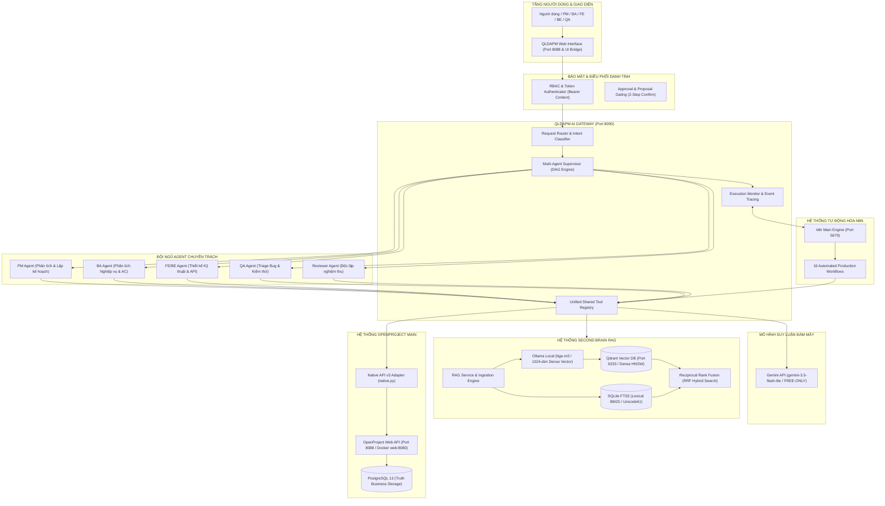
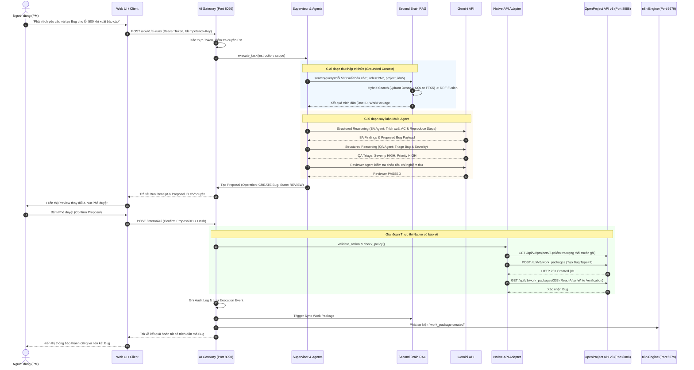

# GIAI ĐOẠN 1: KIẾN TRÚC ĐÍCH VÀ THIẾT KẾ KỸ THUẬT TOÀN DIỆN
**Hệ thống:** QLDAPM MAIN — Unified Multi-Agent AI + Real Vector RAG + Native OpenProject API + n8n Automation  
**Tác giả:** AI Engineering Lead  
**Ngày:** 2026-10-22  
**Trạng thái:** ACCEPTED  

---

## 1. SO SÁNH KIẾN TRÚC HIỆN TẠI (AS-IS) VÀ KIẾN TRÚC ĐÍCH (TO-BE)

### 1.1. Hiện trạng (AS-IS)
- **Second Brain:** Chỉ có SQLite FTS5 lexical search (`knowledge_fts`) và token match. Không có dense embedding, không có vector database, không thể tìm kiếm theo ngữ nghĩa và diễn đạt tương đương.
- **AI Gateway & Supervisor:** Đã có Multi-Agent Supervisor 5 roles (`pm`, `ba`, `dev`, `qa`, `reviewer`) và client gọi Gemini (`gemini-3.5-flash-lite`). Tuy nhiên, Supervisor chưa có công cụ RAG thật để truy vấn tri thức sâu từ tài liệu nội bộ và chưa kết nối sự kiện với n8n.
- **Native OpenProject API:** Đã có adapter `native.py` làm việc với API v3, nhưng chưa có cơ chế tự động đồng bộ thực thể (Task, Epic, Bug, Sprints) vào kho vector sau khi ghi.
- **Automation (n8n):** Chưa có n8n chạy trên stack Main (chỉ có instance staging riêng biệt); chưa kích hoạt 16 workflows tự động hóa điều phối.

### 1.2. Kiến trúc đích (TO-BE)



---

## 2. DATA FLOW VÀ SECURITY BOUNDARY

### 2.1. Phân định ranh giới bảo mật dữ liệu (Data Boundary)

```text
+---------------------------------------------------------------------------------------+
|                                    PRIVATE LOCAL BOUNDARY                              |
|                                                                                       |
|   +-----------------------+     +-------------------------+     +------------------+  |
|   |  Local Document Files |     |   OpenProject Main DB   |     |    Audit Logs    |  |
|   |  (Allowlist TXT/MD/   |     |   (PostgreSQL 13        |     |  (gateway.sqlite |  |
|   |   DOCX/PDF)           |     |    Business Records)    |     |   Tokens, Events)|  |
|   +-----------+-----------+     +------------+------------+     +------------------+  |
|               |                              |                                        |
|               v                              v                                        |
|   +-------------------------------------------------------+                           |
|   |      Ingestion Engine & ACL Pre-Filter (In-Memory)     |                          |
|   |      - Redact secrets, tokens, private passwords      |                           |
|   |      - Enforce role-based access before retrieval     |                           |
|   +---------------------------+---------------------------+                           |
|                               |                                                       |
|                               v                                                       |
|   +-------------------------------------------------------+                           |
|   |           Local Embedding & Vector Storage            |                           |
|   |  - Ollama bge-m3: 100% Offline Dense Embedding        |                           |
|   |  - Qdrant Docker: 100% Offline Dense Search           |                           |
|   |  - SQLite FTS5: 100% Offline Lexical BM25 Search      |                           |
|   +---------------------------+---------------------------+                           |
|                               |                                                       |
|                               v  (Sanitized Context Only)                             |
+-------------------------------|-------------------------------------------------------+
                                |
                                v  TLS 1.3 / HTTPS / Strict Redaction
+---------------------------------------------------------------------------------------+
|                                  CLOUD INFERENCE BOUNDARY                             |
|                                                                                       |
|   +-------------------------------------------------------------------------------+   |
|   |                                 GEMINI API                                    |   |
|   |  - Model: gemini-3.5-flash-lite (Free Policy)                                 |   |
|   |  - Role: Reasoning, Supervisor Planning, Specialist Analysis, Review Synthesis|   |
|   |  - KHÔNG BAO GIỜ nhận API keys, Passwords, Raw Database Connection Strings     |   |
|   |  - Output là JSON Structured Tool Calls / Proposals (Chưa bao giờ là Write)  |   |
|   +-------------------------------------------------------------------------------+   |
+---------------------------------------------------------------------------------------+
```

---

## 3. SEQUENCE DIAGRAM: LUỒNG THỰC THI TOÀN TRÌNH

### 3.1. Luồng Người dùng yêu cầu bằng Ngôn ngữ tự nhiên -> AI phân tích -> Ghi Native OpenProject



---

## 4. CHI TIẾT THIẾT KẾ DỮ LIỆU (STORAGE DESIGN)

### 4.1. Qdrant Vector Collection: `qldapm_knowledge_dense`
- **Tên Collection:** `qldapm_knowledge_dense`
- **Vector Dimension:** `1024` (Khớp chuẩn model BGE-M3)
- **Distance Metric:** `Cosine`
- **HNSW Index Parameters:** `m=16`, `ef_construct=100` (Tối ưu cho RAM 4GB)
- **Payload Schema:**
  ```json
  {
    "source_id": "string (e.g. op:wp:333 hoặc file:docs/spec.md)",
    "source_type": "string (openproject | local_file)",
    "project_id": "integer (e.g. 5)",
    "work_package_id": "integer | null",
    "parent_id": "integer | null",
    "chunk_id": "string (UUID v5 / deterministic hash)",
    "chunk_index": "integer",
    "content_hash": "string (SHA-256)",
    "title": "string",
    "text": "string (Nội dung chunk)",
    "allowed_roles": ["PM", "BA", "BE", "FE", "QA"],
    "updated_at": "float (Unix timestamp)"
  }
  ```

### 4.2. SQLite Knowledge Storage: `knowledge.sqlite`
- **Bảng `knowledge_documents`**: Lưu trữ metadata document gốc.
- **Bảng `knowledge_chunks`**: Lưu trữ text chunks, token count, content hash.
- **Bảng ảo `knowledge_fts`**: SQLite FTS5 sử dụng tokenizer `unicode61` hỗ trợ tiếng Việt có dấu và không dấu:
  ```sql
  CREATE VIRTUAL TABLE IF NOT EXISTS knowledge_fts USING fts5(
      source_hash UNINDEXED,
      title,
      content,
      tokenize='unicode61 remove_diacritics 2'
  );
  ```
- **Bảng `ingestion_ledger`**: Ghi nhận lịch sử crawl/sync, content hash để kiểm soát incremental indexing và phát hiện tài liệu xóa.

---

## 5. THIẾT KẾ HYBRID RETRIEVAL & RRF FUSION

### Công thức Reciprocal Rank Fusion (RRF):
Khi người dùng đặt câu hỏi, hệ thống thực hiện đồng thời 2 luồng tìm kiếm:
1. **Dense Semantic Search:** Gọi Qdrant với embedding query từ Ollama BGE-M3 (Top K=20).
2. **Lexical BM25 Search:** Gọi SQLite FTS5 với query tokens (Top K=20).

Điểm số từng chunk được tính theo:
$$RRF\_Score(d) = \frac{1}{60 + Rank_{dense}(d)} + \frac{1}{60 + Rank_{lexical}(d)}$$

- Sau khi dung hợp thứ hạng, các kết quả được lọc nghiêm ngặt qua lớp **ACL Recheck** dựa trên `actor_role` của người gửi yêu cầu.
- Chỉ những chunk có điểm cao nhất và hợp lệ mới được định dạng thành citation để cung cấp vào ngữ cảnh suy luận của Gemini.

---

## 6. THIẾT KẾ NATIVE WRITE PIPELINE & GUARDRAILS

Mọi thao tác ghi nghiệp vụ (tạo/sửa Task, Bug, đổi Status, phân công Assignee) tuyệt đối tuân thủ 10 bước khép kín:

```text
1. PROPOSE ACTION: Agent chỉ được tạo bản dự thảo Proposal với payload cấu trúc.
2. INPUT VALIDATION: Schema validation nghiêm ngặt với Pydantic (Type ID, Status ID, Priority).
3. IDENTITY RESOLUTION: Trích xuất chính xác User ID và Role từ Bearer Token (Tuyệt đối không dùng admin token).
4. RBAC & POLICY CHECK: Kiểm tra ma trận quyền (Ví dụ: Chỉ PM được đổi Sprint/Assignee; QA được tạo Bug).
5. FETCH CURRENT RESOURCE: GET trực tiếp từ OpenProject API v3 để lấy `lockVersion` mới nhất.
6. APPROVAL CHECK: Nếu hành động thuộc nhóm APPROVAL_REQUIRED, trả về ID chờ duyệt trên UI, tạm dừng ghi.
7. EXECUTE API: Thực hiện POST/PATCH tới OpenProject API v3 với Header `If-Match: lockVersion`.
8. READ-AFTER-WRITE VERIFICATION: GET lại resource ngay lập tức để xác nhận thay đổi đã được OpenProject lưu thật.
9. AUDIT & EVENT: Ghi log vào bảng `audit` của Gateway và phát canonical event ra hệ thống.
10. SYNC RAG: Cập nhật tài nguyên vừa ghi vào Qdrant và SQLite FTS5 để đồng bộ tri thức.
```

---

## 7. ĐẶC TẢ SỰ KIỆN CHUẨN (CANONICAL EVENT CONTRACT)

Mọi sự kiện giữa OpenProject, Gateway, Multi-Agent và n8n phải tuân theo cấu trúc chuẩn sau:

```json
{
  "event_id": "550e8400-e29b-41d4-a716-446655440000",
  "correlation_id": "7c3a02ba-5ae7-44e4-8179-4ece2997c0d3",
  "causation_id": "123e4567-e89b-12d3-a456-426614174000",
  "event_type": "work_package.created",
  "source": "openproject",
  "project_id": 5,
  "resource_id": 333,
  "resource_type": "work_package",
  "actor_id": 19,
  "actor_role": "PM",
  "timestamp": 1792684800.123,
  "payload_version": 1,
  "data": {
    "subject": "[Bug] Lỗi 500 khi xuất báo cáo",
    "type_id": 7,
    "status_id": 1,
    "lock_version": 1
  }
}
```

---

## 8. DANH MỤC CÔNG CỤ CHUNG (SHARED TOOL REGISTRY)

Tất cả Specialist Agents (`PM`, `BA`, `DEV`, `QA`, `Reviewer`) truy cập kho công cụ tập trung:

```text
[OpenProject Native Read Tools]
- openproject.get_work_package(id)
- openproject.list_work_packages(project_id, filters)
- openproject.get_project_options(project_id)
- openproject.get_sprints(project_id)
- openproject.get_daily_summary(project_id)

[Second Brain RAG Tools]
- rag.search(query, project_id, limit, doc_types)
- rag.get_source(source_id)
- rag.ask(question, project_id)
- rag.sync_openproject(work_package_id)

[Native Write Tools - Gated via Approval]
- native.propose_create(type_id, subject, description, priority)
- native.propose_update(id, lock_version, fields)
- native.propose_transition(id, lock_version, status_id)
- native.propose_comment(id, comment)

[Execution & Review Tools]
- reviewer.evaluate_acceptance(criteria, evidence)
- workflow.trigger_event(event_type, payload)
```

---

## 9. THIẾT KẾ N8N MAIN AUTOMATION (16 WORKFLOWS)

Instance n8n Main sẽ được khởi chạy độc lập trên cổng `5679` với 16 workflows tương ứng:
- **WF01:** Local Document Ingestion (Scan allowlist, chunking, Ollama, Qdrant, FTS5).
- **WF02:** OpenProject Event Sync (Bắt sự kiện WP thay đổi, cập nhật vector RAG).
- **WF03:** Natural Language Request Orchestrator (Tiếp nhận query từ UI, gọi Gateway).
- **WF04:** Multi-Agent Execution Tracking (Giám sát tiến trình Agent DAG, cập nhật log).
- **WF05:** Native API Approval Workflow (Gửi thông báo duyệt, chờ PM xác nhận).
- **WF06:** Native API Execution & Verification (Gọi Gateway thực thi có verify).
- **WF07:** Daily Project Brief (Chạy lúc 08:00 sáng, quét task trễ, xuất tóm tắt).
- **WF08:** Sprint Health & Risk Analysis (Phân tích tiến độ Sprint, cảnh báo rủi ro).
- **WF09:** Bug Lifecycle Automation (Triage bug, phân công dev, kiểm tra retest).
- **WF10:** Task / Epic / Subtask Orchestration (Phân rã WBS từ yêu cầu lớn).
- **WF11:** QA & Review Gate (Kiểm tra bằng chứng trước khi chuyển sang READY FOR RELEASE).
- **WF12:** Weekly Project Summary (Báo cáo tổng kết tuần cho PM và Ban điều hành).
- **WF13:** Knowledge Feedback (Chuyển các quyết định giải pháp đã duyệt vào RAG).
- **WF14:** Error Handling & Bounded Retry (Bắt lỗi timeout, rate-limit, đẩy vào Dead-letter).
- **WF15:** Reconciliation & Data Integrity (Quét đối chiếu giữa OpenProject và Qdrant).
- **WF16:** System Health & Resource Monitoring (Giám sát RAM, VRAM, Gateway, Qdrant).

---

## 10. KẾ HOẠCH ROLLBACK VÀ DỰ PHÒNG RỦI RO

1. **Khả năng suy giảm duyên dáng (Graceful Degradation):**
   - Nếu Ollama/Qdrant không phản hồi: RAG tự động fallback về SQLite FTS5 Lexical Search để đảm bảo các Agent vẫn có tri thức cơ bản.
   - Nếu Gemini API gặp rate limit (429/503): Supervisor chuyển sang chế độ bounded local analysis, thông báo người dùng thử lại sau mà không làm sập Gateway.
2. **Khôi phục dữ liệu:**
   - Database OpenProject được bảo vệ 100% bằng cách không bao giờ ghi trực tiếp qua SQL.
   - File cấu hình và SQLite database của Gateway được lưu trữ tại `gateway-backup-pre-master-phase0`, có thể khôi phục trong vòng 30 giây bằng lệnh copy.

---
**Kết luận Giai đoạn 1:** Kiến trúc đích đảm bảo tính thống nhất, ranh giới trách nhiệm rõ ràng, bảo vệ tài nguyên phần cứng (4GB VRAM, 2.4GB RAM) và tuân thủ các nguyên tắc an toàn dữ liệu tuyệt đối. Sẵn sàng bước vào **Giai đoạn 2: Khởi tạo Runtime Ollama BGE-M3 và Qdrant Vector Database**.
