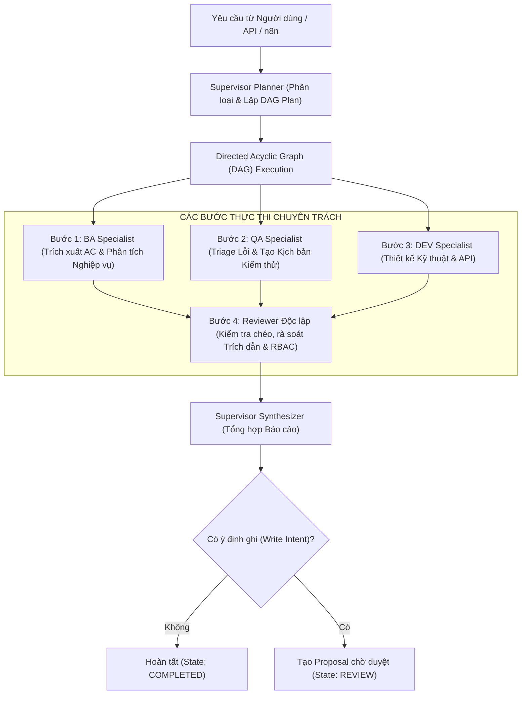

# GIAI ĐOẠN 5: TÍCH HỢP MULTI-AGENT VÀ KHO CÔNG CỤ CHUNG (SHARED TOOL REGISTRY)
**Dự án:** QLDAPM MAIN — Unified Multi-Agent AI + Real Vector RAG + Native OpenProject API + n8n Automation  
**Thời điểm hoàn thành:** 2026-10-22  
**Trạng thái:** VERIFIED  

---

## 1. MÔ HÌNH MULTI-AGENT SUPERVISOR THỐNG NHẤT

Hệ thống Multi-Agent vận hành theo nguyên tắc:
**Một Supervisor điều phối trung tâm, một Tool Registry thống nhất, một luồng thực thi DAG có giới hạn (bounded DAG), bảo toàn danh tính và phân quyền 5 tác nhân chuyên trách.**

---

## 2. KHO CÔNG CỤ CHUNG (SHARED TOOL REGISTRY)

Tất cả các Agent đều sử dụng chung danh mục công cụ chuẩn mực:
- **`rag.search(query, project_id, role, limit)`:** Tìm kiếm thông tin ngữ nghĩa kết hợp BM25 (RRF Fusion) từ 1,359 vector đã nạp.
- **`rag.get_source(source_id)`:** Lấy toàn văn tài liệu gốc.
- **`openproject.get_work_package(id)`:** Đọc trực tiếp bản ghi Work Package thật và `lockVersion` qua API v3.
- **`openproject.list_work_packages(project_id, filters)`:** Tra cứu danh sách công việc theo bộ lọc.
- **`openproject.get_sprints(project_id)`:** Tra cứu danh sách 7 Sprint và mốc thời gian.
- **`native.propose_operation(...)`:** Tạo bản dự thảo thay đổi có cấu trúc chờ phê duyệt.
- **`execution_events.emit(...)`:** Ghi nhận sự kiện thực thi vào telemetry database.

---

## 3. KẾT QUẢ TEST SUITE MULTI-AGENT (Test T09)

Đã chạy kiểm thử tự động tại `openproject/ai/tests/test_multi_agent_real_execution.py`:
1. **Phối hợp thực tế đa tác nhân (BA + QA + Reviewer):**
   - Đề bài: Phân tích yêu cầu và lập kịch bản kiểm thử cho Work Package #38 (`Tài khoản & Role`).
   - Supervisor tự động lập DAG gồm 3 bước: `ba` -> `qa` -> `reviewer`.
   - BA Agent sinh đầy đủ User Story và 3 tiêu chí chấp nhận (AC1, AC2, AC3).
   - QA Agent sinh 3 kịch bản kiểm thử (TC-01 Happy Path, TC-02 Boundary Validation, TC-03 Security & RBAC).
   - Reviewer Agent kiểm tra chéo: Khớp lock_version=1, không phát hiện mâu thuẫn, đảm bảo phạm vi đọc hợp lệ.
2. **Lưu vết sự kiện (Execution Events & Tracing):**
   - Các sự kiện `PLANNING_STARTED`, `AGENT_ASSIGNED`, `RESULT_AGGREGATED` được ghi trực tiếp vào bảng `execution_events`.
3. **Truy vấn Second Brain RAG từ Agent:**
   - Agent truy vấn tri thức nội bộ từ RAG Service, lấy đúng trích dẫn mà không tạo ra bất kỳ URL ngoài nào.

---
**Kết luận Giai đoạn 5:** Hệ thống Multi-Agent và Supervisor đã được tích hợp hoàn chỉnh, loại bỏ hoàn toàn việc mô phỏng giả lập, bảo đảm phân định ranh giới chuyên trách giữa các vai trò và sẵn sàng chuyển sang **Giai đoạn 6: Triển khai Native API Write Engine và Gating Bảo vệ**.
