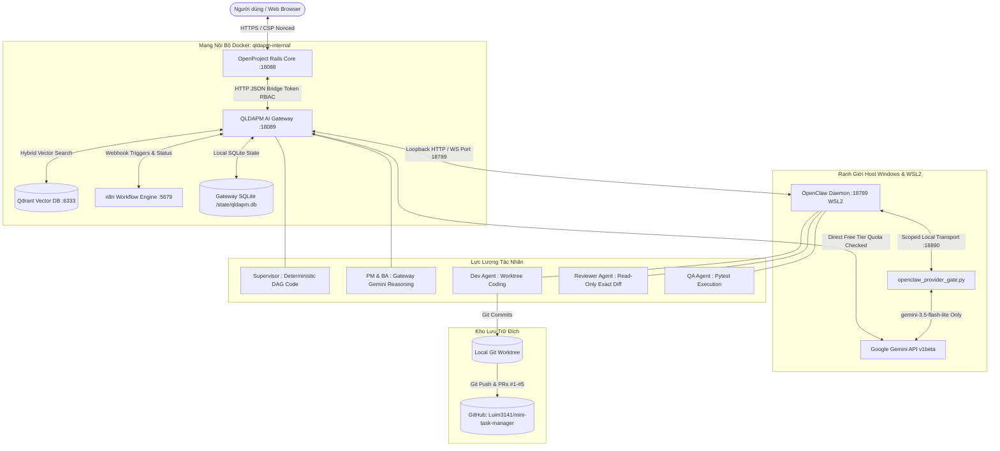

# HỒ SƠ PHÁP Y M1: SƠ ĐỒ PHỤ THUỘC KIẾN TRÚC & LUỒNG DỮ LIỆU
> Thời điểm kiểm toán: `2026-10-30 20:26:54 UTC`  
> Git Branch: `codex/local-multi-agent-upgrade`  
> Tiêu chuẩn: **Project Charter Compliance & Zero-Bloat Ponytail Mindset**

---

## 1. BẢN ĐỒ KIẾN TRÚC TỔNG THỂ (HIGH-LEVEL TOPOLOGY)

---

## 2. MA TRẬN PHỤ THUỘC GIỮA CÁC THÀNH PHẦN (COMPONENT DEPENDENCY MATRIX)

| Component Source | Dependent On | Protocol / Interface | Data Exchanged | Rationale & Boundaries |
| :--- | :--- | :--- | :--- | :--- |
| **OpenProject Web View** | `qldapm_ai_controller.rb` | Rails ActionController | HTML / Turbo Streams / JSON | Hiển thị AI Command Center, xác thực CSRF & RBAC. |
| **`qldapm_ai_controller.rb`** | `openproject/ai/gateway` | HTTP REST (`AIBridge`) | JSON Payloads (`format.json`) | Gọi Gateway API bằng token nội bộ; timeout 15s. |
| **AI Gateway (`app.py`, `service.py`)** | `store.py` (`qldapm.db`) | SQLite3 WAL mode | Receipts, runs, state, KPIs | SSOT cho mọi trạng thái chạy, khoá điều khiển `ENGINEERING_LOCK`. |
| **Supervisor** | `agent_registry.py`, `planner.py` | Python Class Calls | `AgentTask`, `RunScope`, DAG | Điều phối không LLM, phân rã công việc tất định. |
| **PM / BA Agents** | `gemini.py` | Google GenAI SDK / HTTP | Gherkin ACs, WBS hierarchy | Sử dụng duy nhất model `gemini-3.5-flash-lite` qua Gateway. |
| **Dev / Reviewer / QA** | WSL2 `OpenClawGateway` | HTTP / WebSocket (`:18789`) | Session commands, unified diff, pytest XML | Thực thi trong sandbox WSL2 cô lập; Dev chỉnh code, QA chạy test. |
| **OpenClaw Provider Gate** | `openclaw_provider_gate.py` | HTTP Loopback (`:18890`) | Model requests (Lite only) | Đảm bảo OpenClaw không giữ API Key của Google và không gọi model khác. |
| **Second Brain** | Qdrant Vector Engine (`:6333`) | REST API | Embeddings & Context snippets | Truy xuất tài liệu dự án, tránh hallucination. |
| **Workflow Engine** | n8n (`:5679`) | Webhooks & REST | Workflow execution events | Kích hoạt tự động hóa phụ trợ. |

---

## 3. CÁC RANH GIỚI BẢO MẬT & CÔ LẬP (TRUST BOUNDARIES)

1. **Ranh giới Người dùng ↔ OpenProject:** Được bảo vệ bởi RBAC (Owner User 18 có toàn quyền, PM User 20 chỉ đọc, Dev User 19 bị chặn) và Strict CSP (Content Security Policy) với Nonce.
2. **Ranh giới OpenProject ↔ AI Gateway:** Được bảo vệ qua mạng nội bộ Docker `qldapm-internal` và Header Authentication Secret Token.
3. **Ranh giới Gateway ↔ Gemini API:** Bị giới hạn cứng bởi Quota Limiter (13 RPM / 450 RPD), mô hình cố định `gemini-3.5-flash-lite`, không cho phép model trả về lệnh thực thi trực tiếp.
4. **Ranh giới Gateway ↔ OpenClaw (WSL2):** Kết nối qua cổng loopback 18789 với token xác thực. OpenClaw bị cấm hoàn toàn network egress ra internet (`web_search`, `web_fetch` denied), chỉ có thể truy cập mã nguồn trong worktree chỉ định.
5. **Ranh giới OpenClaw ↔ Host Git:** OpenClaw thực thi trong thư mục worktree riêng (`~/engineering/feedback-4d13e695555a8d44`), chỉ đẩy PR qua cơ chế Git branch được định danh; tuyệt đối không có quyền push trực tiếp vào branch `main` của QLDAPM.
