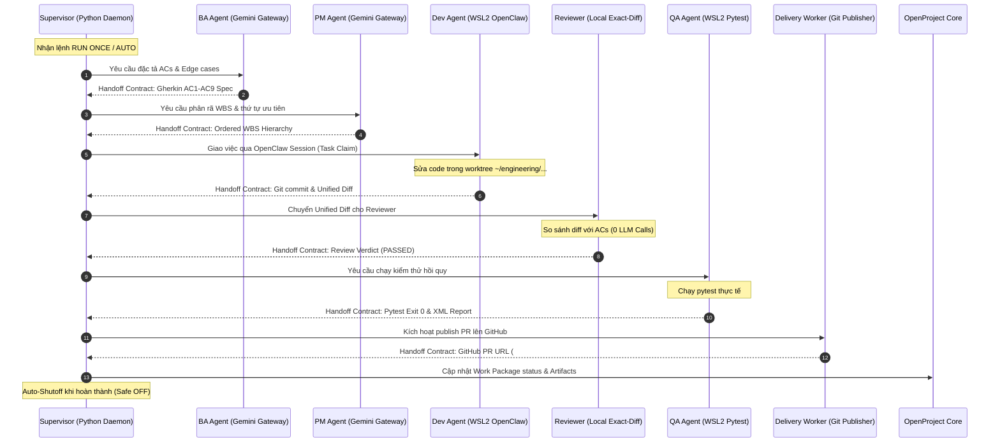

# HỒ SƠ PHÁP Y M2: MA TRẬN NĂNG LỰC VÀ GIAO TIẾP LIÊN AGENT (HANDOFF & CAPABILITY MATRIX)
> Thời điểm kiểm toán: `2026-10-30 20:27:57 UTC`  
> Git Branch: `codex/local-multi-agent-upgrade`  
> Tiêu chuẩn: **Contract-Driven Deterministic State Machine**

---

## 1. QUY TRÌNH BÀN GIAO LIÊN AGENT (INTER-AGENT HANDOFF SEQUENCE)

---

## 2. MA TRẬN HỢP ĐỒNG GIAO TIẾP VÀ DỮ LIỆU ĐỔI (INTERACTION CONTRACTS)

| Chặng bàn giao (Handoff Edge) | Định dạng dữ liệu (Payload Schema) | Ràng buộc kiểm tra (Validation Rule) | Hành vi khi lỗi (Error / Failure Recovery) |
| :--- | :--- | :--- | :--- |
| **Supervisor → BA** | `AgentTask` (Task ID, scope, context) | Cấm context injection ngoài scope | Thử lại tối đa 1 lần, nếu lỗi ghi receipt `FAILED`. |
| **BA → Supervisor** | `BusinessResponse` (User Story, ACs) | Gherkin cú pháp hợp lệ, AC có mã số | Từ chối đặc tả, yêu cầu sinh lại hoặc dừng quy trình. |
| **Supervisor → PM** | `AgentTask` + BA output | Kiểm tra tính nhất quán với Native Backlog | Ghi nhận lỗi lập lịch, dừng phân rã. |
| **PM → Supervisor** | WBS JSON (Task order, dependencies) | Không chu trình (DAG), IDs khớp Native | Dừng luồng, báo `WBS_DEPENDENCY_CYCLE`. |
| **Supervisor → Dev** | OpenClaw session dispatch | Workspace worktree sạch, branch chỉ định | Rollback worktree, hủy session hỏng. |
| **Dev → Supervisor** | Git Commit SHA + Unified Diff | Diff không rỗng, không sửa ngoài scope | Bounded rework (tối đa 2 lượt sửa). |
| **Supervisor → Reviewer** | Unified Diff + AC checklist | Diff chuẩn patch, AC có thể kiểm chứng | Từ chối nhận xét nếu diff bị hỏng. |
| **Reviewer → Supervisor** | JSON Verdict (`PASSED`/`REWORK`) | Bắt buộc có file, dòng, lý do rõ ràng | Nếu `REWORK`, Supervisor trả Dev sửa theo budget. |
| **Supervisor → QA** | Test suite target (`test_create_list.py`) | Môi trường test có virtualenv sẵn | Báo `TEST_ENV_UNAVAILABLE`. |
| **QA → Supervisor** | Mã thoát (`0` hoặc `1`) + XML report | File XML hợp lệ, khớp với số lượng test | Nếu fail, ghi nhận bug, mở defect workflow. |
| **Supervisor → Publisher** | Branch name, PR title, description | Git credentials an toàn, remote GitHub | Thử lại với exponential backoff. |
| **Supervisor → OpenProject** | Mutation receipt + WP status ID | lock_version của WP phải khớp | Báo xung đột `STALE_OBJECT_ERROR`. |

---

## 3. CƠ CHẾ PHỤC HỒI & TỰ ĐỘNG BẢO VỆ (FAIL-SAFE & RECOVERY)

1. **Idempotency (Tính Bất Khả Tác Lặp):** Mỗi bước trong chuỗi bàn giao đều được gán `run_id` và `task_id` duy nhất trong SQLite. Không có bước nào bị thực thi trùng lặp.
2. **Safe Auto-Shutoff:** Khi phát hiện tất cả 5 Units đã đạt `DELIVERED`, Supervisor tự động ngắt chế độ `AUTO` chuyển sang `OFF`, ghi nhận `shutoff_reason: ALL_DELIVERED`.
3. **Project 5 Isolation:** Toàn bộ chuỗi bàn giao chỉ áp dụng cho Project 6 (`ai-dev-demo`) và Work Package #379. Toàn bộ 341 Work Packages của Project 5 hoàn toàn bất khả xâm phạm.
