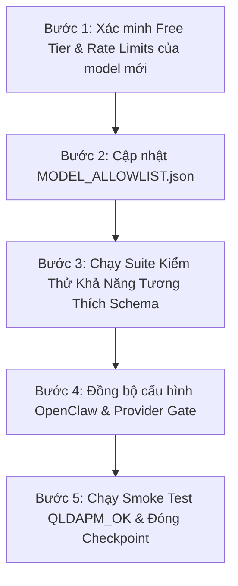

# HỒ SƠ PHÁP Y M4: KẾ HOẠCH NÂNG CẤP & THAY ĐỔI MÔ HÌNH AN TOÀN (MODEL CHANGE PLAN)
> Thời điểm lập: `2026-10-30 20:30:11 UTC`  
> Tiêu chuẩn an toàn: **Zero-Downtime, Zero-Silent-Failure & Full Free Tier Verification**

---

## 1. NGUYÊN TẮC BẤT DI BẤT DỊCH KHI THAY ĐỔI MÔ HÌNH

1. **Tuân thủ Project Charter:** Tuyệt đối không chuyển sang mô hình có tính phí nếu chưa có ngân sách và sự phê duyệt văn bản của Chủ dự án.
2. **Không phân mảnh cấu hình:** Không được phép đổi model ở một nơi mà bỏ quên nơi khác (Gateway, OpenClaw, Provider Gate, UI).
3. **Kiểm tra tương thích Schema trước khi áp dụng:** Mô hình mới phải vượt qua bài kiểm tra Structured Output (`FactResponse`, Pydantic validation) trước khi cho phép tham gia luồng chính.

---

## 2. QUY TRÌNH 5 BƯỚC THAY ĐỔI MÔ HÌNH (5-STEP CHANGE PROTOCOL)

1. **Bước 1 — Thẩm định chính sách giá:** Tra cứu bảng giá chính thức từ Google AI Studio, ghi nhận RPM, RPD, TPM vào `MODEL_ALLOWLIST.json`.
2. **Bước 2 — Cập nhật hằng số cấu hình tập trung:**
   - Cập nhật hằng số `MODEL` trong `openproject/ai/gateway/gemini.py`.
   - Cập nhật hằng số `MODEL` trong `openproject/ai/automation/openclaw_provider_gate.py`.
3. **Bước 3 — Kiểm thử tương thích Pydantic:** Chạy script `test_model_compatibility.py` với các schema nghiệp vụ (User Story, Gherkin ACs, WBS DAG).
4. **Bước 4 — Đồng bộ OpenClaw:** Cập nhật `models.providers.google.models[0].id` trong `~/.openclaw/openclaw.json`.
5. **Bước 5 — Kiểm thử tích hợp:** Thực hiện lệnh kiểm thử kết nối tổng hợp `SMOKE_PROMPT` ("Reply with exactly QLDAPM_OK").
