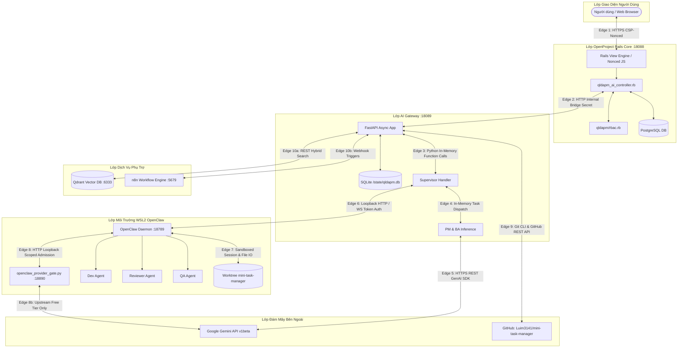

# HỒ SƠ PHÁP Y M6: BẢN ĐỒ GIAO TIẾP TOÀN DIỆN HỆ THỐNG (END-TO-END COMMUNICATION MAP)
> Thời điểm kiểm toán: `2026-10-30 20:31:42 UTC`  
> Git Branch: `codex/local-multi-agent-upgrade`  
> Tổng số ranh giới giao tiếp khảo sát: **10 Ranh giới (Boundaries)**

---

## 1. SƠ ĐỒ ĐỒ THỊ 10 RANH GIỚI GIAO TIẾP (10-BOUNDARY TOPOLOGY)

---

## 2. ĐẶC TẢ 10 RANH GIỚI GIAO TIẾP

1. **Ranh giới 1 (User ↔ OpenProject Web):** Giao tiếp browser qua HTTP/HTTPS. Bảo vệ bởi CSRF token, Session Cookie (Rack Session Store), và Strict CSP với dynamic nonces.
2. **Ranh giới 2 (OpenProject ↔ AI Gateway):** Rails controller giao tiếp với FastAPI qua mạng nội bộ Docker `qldapm-internal`. Xác thực qua `X-QLDAPM-Gate-Token`.
3. **Ranh giới 3 (Gateway ↔ Supervisor):** Lời gọi hàm nội bộ trong tiến trình Python. Quản lý trạng thái và khoá điều khiển tất định (`ENGINEERING_LOCK`).
4. **Ranh giới 4 (Supervisor ↔ PM / BA):** Giao việc theo mô hình Pydantic (`AgentTask`, `RunScope`). PM phân tích WBS, BA chuẩn hóa tiêu chí Gherkin.
5. **Ranh giới 5 (PM/BA ↔ Google Gemini API):** Giao thức HTTPS REST v1beta. Sử dụng Google GenAI SDK với client giới hạn byte (`BoundedClient`), mô hình cố định `gemini-3.5-flash-lite`.
6. **Ranh giới 6 (Supervisor ↔ OpenClaw WSL2):** Kết nối qua cổng loopback `127.0.0.1:18789`. Xác thực bằng Bearer Token cục bộ, kiểm tra trạng thái health trước khi gửi phiên.
7. **Ranh giới 7 (OpenClaw ↔ Sandbox Worktree):** Truy xuất filesystem nội bộ trong thư mục worktree chỉ định. Dev sửa code, Reviewer đọc diff, QA chạy pytest.
8. **Ranh giới 8 (OpenClaw ↔ Provider Gate):** OpenClaw gọi proxy cổng 18890 bằng local client token. Gate kiểm tra quota, ép cứng model `gemini-3.5-flash-lite`, rồi chuyển tiếp lên Google API.
9. **Ranh giới 9 (AI Gateway ↔ GitHub):** Sử dụng Git CLI đẩy các commit nhánh và gọi GitHub REST API để quản lý Pull Requests (#1–#5).
10. **Ranh giới 10 (AI Gateway ↔ Qdrant & n8n):** Qdrant phục vụ hybrid RAG retrieval qua cổng 6333; n8n nhận webhooks điều phối báo cáo qua cổng 5679.
