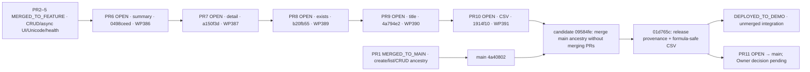

# Demo integration release — deployed 03/11/2026

Mini Task Manager tại `http://localhost:18791` đang phục vụ commit `01d765c01d62a0d636e276f72bdc5cdc62db8c5a`, branch `codex/demo-integration-20261103`, với nhãn **UNMERGED_INTEGRATION_TEST_RELEASE**. [PR integration #11](https://github.com/Luim3141/mini-task-manager/pull/11) hướng tới `main`, OPEN/mergeable-clean; chưa merge. Các PR #6–#10 vẫn OPEN, không đổi trạng thái.

## Dependency graph thực tế

`pr-chain.json` được lấy qua GitHub API và kiểm tra `git merge-base --is-ancestor`. Mọi head PR1–10 là ancestor của candidate. PR6–10 hiện không xung đột với base của từng PR, không có submitted GitHub review/CI check runs trong snapshot; reviewer/QA evidence riêng của Engineering Worker đã đối chiếu cùng head SHA. Không giả local pytest thành GitHub CI.

## Kết quả thực thi

| Gate | Kết quả | Evidence |
|---|---|---|
| Baseline nguồn PR10 | 37 tests PASS | baseline.json |
| Formula bug red | 13 dangerous title cases failed trước fix | test-history/ và formula-red.json |
| Final source/acceptance | 52 tests PASS; gồm JavaScript VM regression | final.json |
| Actual MAIN API | 11 GET checks PASS, revision/type headers khớp | http-verification.json |
| Actual HTTP business fixture | CRUD, detail/exists/title, summary, Unicode/q/status, CSV escaping/formula-prefix PASS trên SQLite tạm, port18792 | http-verification.json |
| Source parity | 9 deployed files khớp byte-for-byte exact Git archive; archive CRLF tương đương Git blob LF, đã ghi cả hai hashes | source-parity.json |
| SQLite preservation | schema/tasks/sequence logical hash trước/sau bằng nhau; task count0→0 | deployment.json |
| Provenance | `/release`, HTML banner và `X-QLDAPM-Revision`/`X-QLDAPM-Release-Type` | public-release-metadata.json |

Không ghi test task vào SQLite live để giữ nguyên dữ liệu, nên positive CRUD/Unicode/CSV rows được kiểm thử trên actual HTTP server cùng exact deployed release với DB fixture riêng. Live kiểm tra read-only đủ health/summary/list/export/detail/exists/title và error422/404. Không gọi một tập clone tests là positive writes đã xảy ra trên MAIN.

CSV dùng `csv.writer` chuẩn; quoted tab prefix cho title bắt đầu bằng formula/control/full-width variants. JSON titles và SQLite vẫn nguyên văn. CSV consumer theo máy nhận tab prefix ở các ô nguy hiểm. Đây là bảo vệ cho export được tải xuống, không cam kết mọi lần re-save/import trong mọi spreadsheet; không có Excel/Calc GUI acceptance trong scope agent này. Tham chiếu [OWASP CSV Injection](https://owasp.org/www-community/attacks/CSV_Injection).

## Deployment / rollback

Source và server unit trước thay đổi, demo-service metadata và online SQLite backup được giữ private tại path trong `deployment.json`. Source release cũ không xóa. Dịch vụ vẫn bind127.0.0.1:18791, cùng database `/home/openclaw/engineering/demo-data/tasks.sqlite`, cùng resource limits256MiB/50%CPU và non-root user. Không thay schema/task rows.

Rollback kỹ thuật: stop user service `qldapm-mini-task-manager.service`, phục hồi `server.before.py` và `unit.before.service` từ private rollout backup, daemon-reload/start, kiểm tra health/revision và DB logical hash. Không tự restore database vì deployment không sửa dữ liệu. `deploy_candidate.py` tự phục hồi source/unit nếu readiness sau rollout lỗi.

Public Gateway metadata `/state/demo-release.json` đã ghi atomically đúng contract phối hợp GitHub Sync agent. Gateway phải xác minh actual health/revision trước khi hiển thị `DEPLOYED_TO_DEMO`, và vẫn giữ `main_merged=false`. Không dùng nhãn `PR_OPEN` hoặc `INTEGRATED_IN_CANDIDATE` thay cho merge.

Chưa làm Computer Use UAT (chỉ root ở final phase), không merge PR11, không resume391, không paid provider/DR/P5 writes. Final user-facing acceptance thuộc root/Owner.
