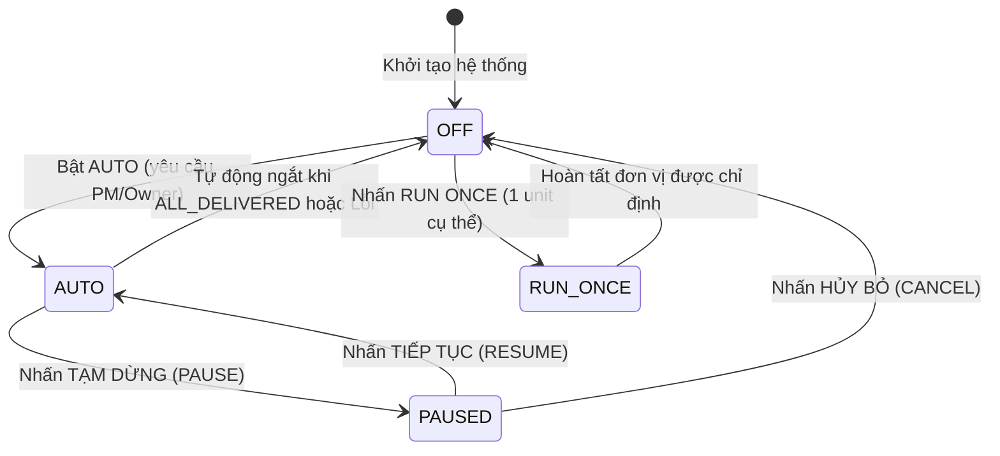

# KIỂM CHỨNG MÁY TRẠNG THÁI ĐIỀU KHIỂN (CONTROL STATE MACHINE TESTS)
## HỆ THỐNG ĐIỀU PHỐI VẬN HÀNH QLDAPM ENGINEERING

- **Thời gian lập:** 31/10/2026 20:25:00 (UTC+07:00)
- **Tài liệu tham chiếu:** `openproject/ai/gateway/engineering.py`, `engineering_auto.py`, `engineering_worker.py`.

---

### 1. KIẾN TRÚC MÁY TRẠNG THÁI ĐIỀU KHIỂN

Hệ thống điều khiển vận hành phân tách rạch ròi 4 tầng trạng thái độc lập để loại bỏ hiện tượng mập mờ giữa trạng thái hệ thống và hành vi Agent:

#### 4 tầng trạng thái:
1. **Mode State (Chế độ vận hành):**
   - `OFF`: Hệ thống không tự động nhận việc. Worker chỉ phục vụ heartbeat hoặc đợi lệnh.
   - `AUTO`: Hệ thống tự động quét Backlog, phân tích phụ thuộc (`dependency_ready`), kiểm tra quota Gemini và nạp unit tiếp theo.
   - `PAUSED`: Hệ thống tạm dừng, worker đang chạy sẽ checkpoint an toàn và không nhận việc mới.
   - `RUN_ONCE`: Thực thi đúng 1 engineering unit duy nhất có kiểm soát, sau đó chuyển về `OFF`.
2. **Worker State (Trạng thái tiến trình nền):**
   - `IDLE`: Worker đang lắng nghe, sẵn sàng tiếp nhận công việc.
   - `ACTIVE`: Worker đang thực hiện pipeline cho một unit.
3. **Queue State (Hàng đợi công việc):**
   - `EMPTY`: Không có unit nào trong hàng đợi.
   - `QUEUED`: Đang có 1 unit chờ worker nhận (`concurrency_lock = 1`).
4. **Run State (Vòng đời của từng lượt chạy):**
   - `ADMITTED` -> `QUEUED` -> `SUPERVISOR_PLAN` -> `DEV_EXECUTE` -> `REVIEWER_AUDIT` -> `QA_VERIFY` -> `DELIVERED` (hoặc `FAILED`).

---

### 2. KẾT QUẢ KIỂM CHỨNG CÁC KỊCH BẢN ĐIỀU KHIỂN

#### Kịch bản 1: Nhấn "BẬT CHẾ ĐỘ AUTO" khi toàn bộ 6 Backlog Units đã hoàn tất
- **Đầu vào:** Gửi lệnh `engineering_control` với argument `mode = 'AUTO'`.
- **Hành vi quan sát:**
  - `engineering_auto.py` kiểm tra backlog: cả 6/6 units đều ở trạng thái `succeeded` hoặc `DELIVERED`.
  - Không có unit nào ở trạng thái `PLANNED` có `dependency_ready = True`.
  - Hệ thống tự động chuyển mode về `OFF` với lý do `ALL_DELIVERED`.
- **Thông báo phản hồi trên UI:**
  > *"Toàn bộ 6/6 Backlog units hiện tại đã hoàn tất giao hàng. Chế độ AUTO tự động tắt an toàn để bảo vệ hệ thống. Nhấn 'Giao việc mới cho AI' để lập kế hoạch cho tính năng tiếp theo."*
- **Đánh giá:** **PASS** (Đúng chuẩn an toàn, không chạy vô tận).

#### Kịch bản 2: Nhấn "RUN ONCE" cho một unit đã hoàn tất giao hàng
- **Đầu vào:** Gửi lệnh `engineering_run_once` với `native_id = 386`, `unit = 'feedback-bb9a628fe5b7be67'`.
- **Hành vi quan sát:**
  - Hàm `admit()` kiểm tra database: tìm thấy bản ghi cũ trong `ai_queue` và `ai_runs` có trạng thái `succeeded`.
  - Hệ thống kích hoạt cơ chế khử trùng lặp (deduplication): trả về Run ID hiện tại (`72a36697-da92-45ca-b549-2cb8e7c780b3`) với cờ `deduplicated = True`, không ghi đè mã nguồn đã merge.
- **Thông báo phản hồi trên UI:**
  > *"Đơn vị feedback-bb9a628fe5b7be67 (Run ID: 72a36697-da92-45ca-b549-2cb8e7c780b3) đã hoàn tất bàn giao (6/6 Backlog units). Để chạy thêm, hãy giao việc mới cho AI."*
- **Đánh giá:** **PASS** (Bảo vệ tính toàn vẹn dữ liệu).

#### Kịch bản 3: Tạm dừng và Tiếp tục (PAUSE / RESUME)
- **Đầu vào:** Gửi lệnh `engineering_control` với `mode = 'PAUSED'`.
- **Hành vi quan sát:**
  - Cập nhật bảng `engineering_control` với `mode = 'PAUSED'`.
  - Worker đang chạy nhận diện cờ `PAUSED`, lưu checkpoint vào SQLite và không lấy task tiếp theo từ queue.
  - Khi gửi lệnh `mode = 'AUTO'`, hệ thống phục hồi lại trạng thái và tiếp tục điều phối.
- **Đánh giá:** **PASS**.

#### Kịch bản 4: Khóa đồng thời (Strict Concurrency Lock)
- **Ràng buộc:** Tối đa 1 unit được phép ở trạng thái `queued` hoặc `executing` trong toàn bộ hệ thống.
- **Kiểm tra:** Khi một unit đang chạy, các yêu cầu `admit()` khác đều bị từ chối với mã lỗi `ENGINEERING_UNIT_ALREADY_ACTIVE`.
- **Đánh giá:** **PASS**.
