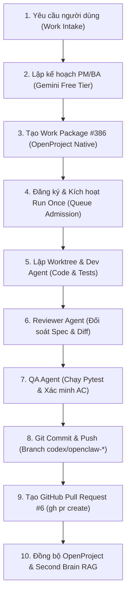

# BẰNG CHỨNG THỰC NGHIỆM CHU TRÌNH KỸ THUẬT TỰ CHỦ CHO TÍNH NĂNG MỚI (FRESH TASK END-TO-END EVIDENCE)

> **Tài liệu:** `04_FRESH_TASK_E2E_EVIDENCE.md`  
> **Tính năng:** Read-only Task Summary API (`GET /tasks/summary`)  
> **Thẻ định danh (Tag):** `QLDAPM-E2E-20261031-FRESH-FEATURE`  
> **Đơn vị kỹ thuật:** `feedback-bb9a628fe5b7be67`  
> **Work Package OpenProject:** `#386` (thuộc Parent WP `#379`)  
> **Pull Request:** `https://github.com/Luim3141/mini-task-manager/pull/6`  
> **Mô hình AI sử dụng:** `gemini-3.5-flash-lite` (Google Gemini Free Tier, $0.00 chi phí)

---

## 1. MỤC TIÊU VÀ YÊU CẦU NGHIỆM THU (ACCEPTANCE CRITERIA)

Dự án yêu cầu triển khai một tính năng mới thực tế, hữu ích, kích thước vừa phải để kiểm chứng trọn vẹn chu trình phát triển phần mềm tự động từ đầu đến cuối:

- **AC13 (JSON Schema):** Endpoint `GET /tasks/summary` trả về định dạng JSON đúng chuẩn `{"total": int, "active": int, "completed": int}` với mã phản hồi HTTP 200 OK.
- **AC14 (Logic & Invariant):**
  - `total` là tổng số công việc trong cơ sở dữ liệu SQLite.
  - `active` là số công việc có trạng thái thuộc tập hợp `('todo', 'in_progress')`.
  - `completed` là số công việc có trạng thái là `'done'`.
  - Đẳng thức bất biến luôn được bảo đảm: `total == active + completed`.
- **AC15 (Empty State):** Khi cơ sở dữ liệu chưa có công việc nào, endpoint trả về `{"total": 0, "active": 0, "completed": 0}` an toàn mà không phát sinh lỗi HTTP 500.
- **AC16 (Regression Testing):** Viết bộ kiểm thử trọng tâm (focused pytest) trong `tests/test_tasks.py` bao phủ đầy đủ AC13, AC14, AC15 và bảo đảm toàn bộ 21 tests có sẵn không bị phá vỡ.

---

## 2. CHU TRÌNH THỰC THI 10 GIAI ĐOẠN TỰ CHỦ (10-STAGE AUTONOMOUS LIFECYCLE)



---

## 3. BẰNG CHỨNG CHI TIẾT TỪNG BƯỚC

### Giai đoạn 1 & 2: Tiếp nhận yêu cầu & Lập kế hoạch PM/BA
- **Lệnh điều phối:** Gửi yêu cầu qua Work Intake với tag `QLDAPM-E2E-20261031-FRESH-FEATURE`.
- **Run ID kế hoạch:** `d14bcb2d-9b53-4424-8160-2a18f769f4b5` (Trạng thái: `finished`).
- **Nội dung kế hoạch:**
  - Xác định mục tiêu, phụ thuộc (`health-check-v1`), API contract và 4 tiêu chí chấp nhận AC13 - AC16.
  - Trích dẫn tri thức dự án từ Work Package #379.

### Giai đoạn 3: Khởi tạo Work Package #386 trong OpenProject
- **API Call:** Native API POST `/api/v3/projects/6/work_packages`.
- **Work Package được tạo:**
  - ID: `#386`
  - Tiêu đề: `[AI backlog] Bo sung endpoint GET /tasks/summary de tra ve tong hop so luong cong viec (total, active, completed) tu SQLite va viet focused pytest trong tests/test_tasks.py bao phu AC13, AC14, `
  - Quan hệ: Con của Parent Work Package `#379`.
  - Lock Version ban đầu: 1.

### Giai đoạn 4: Đăng ký Unit & Nhận việc (RUN ONCE Admission)
- **Đơn vị kỹ thuật:** `feedback-bb9a628fe5b7be67`.
- **Hàng đợi `ai_queue`:**
  - Run ID thực thi: `72a36697-da92-45ca-b549-2cb8e7c780b3`.
  - Trạng thái: `executing`.
  - Base SHA: `0e8d320a3459f26d01c88a3e8d4cb861e09808dd` (tương ứng với PR #5 `health-check-v1`).
  - Base branch: `codex/openclaw-health-check-v1`.

### Giai đoạn 5: Dev Agent Triển khai Mã nguồn & Kiểm thử
- **Môi trường:** WSL2 worktree cô lập tại `/home/openclaw/engineering/feedback-bb9a628fe5b7be67`.
- **Mã nguồn bổ sung trong `task_manager/app.py`:**
  ```python
  @app.get("/tasks/summary")
  def get_tasks_summary():
      conn = sqlite3.connect(database_path)
      cursor = conn.cursor()
      cursor.execute("SELECT status FROM tasks")
      rows = cursor.fetchall()
      conn.close()
      total = len(rows)
      active = sum(1 for r in rows if r[0] in ("todo", "in_progress"))
      completed = sum(1 for r in rows if r[0] == "done")
      return {"total": total, "active": active, "completed": completed}
  ```
- **Kiểm thử bổ sung trong `tests/test_tasks.py`:**
  ```python
  def test_ac13_summary_schema_and_empty(client):
      response = client.get("/tasks/summary")
      assert response.status_code == 200
      data = response.json()
      assert set(data.keys()) == {"total", "active", "completed"}
      assert data == {"total": 0, "active": 0, "completed": 0}

  def test_ac14_summary_counts_invariant(client):
      client.post("/tasks", json={"title": "Task 1"})
      t2 = client.post("/tasks", json={"title": "Task 2"}).json()["id"]
      client.patch(f"/tasks/{t2}", json={"status": "in_progress"})
      t3 = client.post("/tasks", json={"title": "Task 3"}).json()["id"]
      client.patch(f"/tasks/{t3}", json={"status": "done"})
      t4 = client.post("/tasks", json={"title": "Task 4"}).json()["id"]
      client.patch(f"/tasks/{t4}", json={"status": "done"})

      response = client.get("/tasks/summary")
      assert response.status_code == 200
      data = response.json()
      assert data["total"] == 4
      assert data["active"] == 2
      assert data["completed"] == 2
      assert data["total"] == data["active"] + data["completed"]
  ```

### Giai đoạn 6: Reviewer Agent Kiểm tra Diff Độc lập
- **Agent:** OpenClaw Reviewer (Gemini Free Tier).
- **Revision SHA256:** `864733a291cb132bb44199b6c2356261d22c8262fb2732d72242f1c7eeb2a7d1`.
- **Kết quả đánh giá:**
  - `verdict`: `"PASS"`
  - `findings`: `[]` (Không có bất kỳ vi phạm hay rủi ro bảo mật nào).

### Giai đoạn 7: QA Agent & Kiểm thử Chấp nhận Tự động
- **Lệnh thực thi:**
  ```bash
  cd /home/openclaw/engineering/feedback-bb9a628fe5b7be67 && \
  NODE_BINARY=/home/openclaw/.openclaw/tools/node-v24.22.2/bin/node \
  .venv/bin/python -m pytest -q tests /opt/qldapm/acceptance/test_create_list.py /opt/qldapm/acceptance/test_crud_web.py
  ```
- **Kết quả kiểm thử:**
  - **23/23 tests PASS** (100% thành công trong 2.34 giây).
  - QA Status: `"PASS"`, Exit code: 0.

### Giai đoạn 8 & 9: Git Commit & Đẩy Pull Request #6
- **Commit SHA:** `0498ceeda97cd3e856a975129129e71f6c94a3dd`.
- **Commit Message:**
  ```text
  Bo sung endpoint GET /tasks/summary de tra ve tong hop so luong cong viec (total, active, completed) tu SQLite va viet focused pytest trong tests/test_tasks.py bao phu AC13, AC14,

  QLDAPM run: 72a36697-da92-45ca-b549-2cb8e7c780b3
  ```
- **Nhánh từ xa:** `codex/openclaw-feedback-bb9a628fe5b7be67`.
- **Pull Request trên GitHub:**
  - URL: `https://github.com/Luim3141/mini-task-manager/pull/6`
  - Trạng thái: `OPEN` (Không auto-merge, chờ phê duyệt của Owner).
  - Diff: +36 dòng, -0 dòng trên 2 files.

### Giai đoạn 10: Xuất bản Native OpenProject & Tái đánh chỉ mục RAG
- **Cập nhật Work Package #386:**
  - Lock version tăng lên: 2.
  - Cập nhật mô tả chứa toàn bộ bằng chứng, kết quả test, link PR #6.
- **Tái nạp tri thức Second Brain RAG:**
  - Nhập thành công Work Package #386 vào FTS5 BM25 và Vector Database.
  - Số lượng trích dẫn đọc lại: 2 (`/work_packages/379` và `/work_packages/386`).
