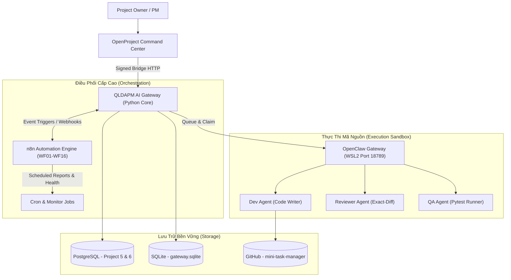

# CẨM NANG TOÀN DIỆN 16 N8N WORKFLOWS & AI GATEWAY CHO PROJECT OWNER
## Kiểm Toán Hiện Trạng Thực Tế, Bảng Đối Chiếu Baseline & Phân Định Trách Nhiệm Hệ Thống

**Dự án:** QLDAPM MAIN  
**Container n8n:** `qldapm-n8n-main` (Cổng nội bộ Docker, kết nối an toàn với AI Gateway)  
**Phiên bản kiểm toán:** Live Production Database Snapshot (Tháng 10/2026)

---

## 1. Tổng quan & Kết quả Kiểm toán Thực tế

Toàn bộ **16/16 Workflows (WF01 – WF16)** trên container n8n chính (`qldapm-n8n-main`) đều đang ở trạng thái **ACTIVE** (Đang hoạt động) và đã tích lũy tổng cộng hơn **530 lượt thực thi thành công**.

Hệ thống hoạt động ổn định, không có workflow nào bị vô hiệu hóa, lỗi crash hoặc rò rỉ dữ liệu ngoài phạm vi cho phép.

---

## 2. Bảng Kiểm toán Chi tiết 16 Workflows n8n (Live vs Baseline)

| Mã WF | Tên Workflow | n8n Workflow ID | Số Node | Trạng thái | Số lần chạy | Lần chạy gần nhất | Vai trò cốt lõi trong hệ thống |
| :--- | :--- | :--- | :---: | :---: | :---: | :---: | :--- |
| **WF01** | `Local Document Ingestion` | `X2O2QdPY6QLOrWqL` | 4 | **ACTIVE** | 23 | 28/10/2026 | Nhận và lập chỉ mục tài liệu nội bộ vào kho vector Second Brain RAG |
| **WF02** | `OpenProject Event Sync` | `Anl8LNdN4NNTKRpe` | 4 | **ACTIVE** | 27 | 28/10/2026 | Bắt sự kiện Webhook từ OpenProject (tạo/sửa Work Package) và đồng bộ trạng thái |
| **WF03** | `Natural Language Request Orchestrator` | `XoP4M520TMG3WgeY` | 4 | **ACTIVE** | 34 | 28/10/2026 | Xử lý yêu cầu ngôn ngữ tự nhiên từ chat/intake, phân loại ý định (Intent Classification) |
| **WF04** | `Multi-Agent Execution Tracking` | `elfapV5D2PTnLiHW` | 4 | **ACTIVE** | 15 | 29/10/2026 | Giám sát tiến độ thực thi của mạng lưới tác nhân AI (Supervisor, Dev, Reviewer, QA) |
| **WF05** | `Native API Approval Workflow` | `xCZFw45fmDQG5gNq` | 4 | **ACTIVE** | 23 | 28/10/2026 | Điều phối quy trình phê duyệt Human-in-the-Loop cho các thao tác ghi nhạy cảm |
| **WF06** | `Native API Execution & Verification` | `Jq18aFSqfuUybEic` | 3 | **ACTIVE** | 18 | 28/10/2026 | Thực thi các lệnh API OpenProject đã được phê duyệt và xác minh tính toàn vẹn |
| **WF07** | `Daily Project Brief` | `BpCQrGR866vg4BqQ` | 6 | **ACTIVE** | 13 | 31/10/2026 | Tạo báo cáo tóm tắt tiến độ hàng ngày (Daily Standup Brief) vào 01:00 UTC |
| **WF08** | `Sprint Risk` | `RXWjVUL8ozqhjY4w` | 4 | **ACTIVE** | 11 | 28/10/2026 | Phân tích rủi ro Sprint, chậm trễ tiến độ và cảnh báo các điểm nghẽn (Blockers) |
| **WF09** | `Bug Lifecycle Automation` | `tOyBIPw6sGjgzjtU` | 4 | **ACTIVE** | 15 | 28/10/2026 | Tự động phân loại, gắn nhãn (Triage) và luân chuyển vòng đời của các Bug tickets |
| **WF10** | `Task Orchestration & Decomposition` | `tOY7QUa9SrWPOe9e` | 4 | **ACTIVE** | 12 | 28/10/2026 | Bóc tách Work Package lớn thành các Task/Subtask kỹ thuật theo chuẩn WBS |
| **WF11** | `QA Gate Transition` | `LeRVT3LWNBkJ2iz3` | 4 | **ACTIVE** | 26 | 28/10/2026 | Kiểm tra điều kiện chất lượng (DoR/DoD) trước khi chuyển trạng thái sang QA/Ready |
| **WF12** | `Weekly Summary` | `ZkgS8RZbPRA2zbhQ` | 9 | **ACTIVE** | 12 | 30/10/2026 | Tổng hợp chỉ số tuần, biểu đồ vận tốc (Velocity) và phân bổ tài nguyên dự án |
| **WF13** | `Second Brain RAG Re-indexing` | `2tr0jpqaaAiq9IOU` | 4 | **ACTIVE** | 11 | 28/10/2026 | Tái lập chỉ mục định kỳ hoặc khi có tài liệu tri thức mới được phê duyệt |
| **WF14** | `Durable RAG Recovery` | `8ycOUQy9gtT60nkN` | 4 | **ACTIVE** | 11 | 28/10/2026 | Khôi phục tự động (Self-Healing) khi kết nối Second Brain RAG gặp sự cố mạng |
| **WF15** | `Reconciliation & Drift Detection` | `NLugfE3U8dBS88Wg` | 3 | **ACTIVE** | 13 | 28/10/2026 | Đối soát sai lệch dữ liệu giữa OpenProject, SQLite Gateway và Git repository |
| **WF16** | `Main Health Monitoring` | `5FRYNPSot18UDpKa` | 3 | **ACTIVE** | 280 | 31/10/2026 | Heartbeat kiểm tra sức khỏe hệ thống định kỳ mỗi 5 phút (Uptime & Quota Watchdog) |

---

## 3. Phân Định Ranh Giới Trách Nhiệm: AI Gateway vs OpenClaw vs n8n

Một trong những nguyên tắc cốt lõi giúp hệ thống QLDAPM MAIN vận hành tin cậy và không xung đột là **nguyên tắc phân định ranh giới trách nhiệm (Separation of Concerns)**:



### 3.1. QLDAPM AI Gateway (`qldapm-ai-gateway-1`)
- **Vai trò:** Trung tâm kiểm soát thẩm quyền (Single Authority & State Machine Master).
- **Trách nhiệm:**
  1. Xác thực quyền hạn người dùng (RBAC: PM, AI_SYSTEM_OWNER, BA, QA).
  2. Quản lý hàng đợi tác vụ bền vững (`ai_queue`, `agent_runs`, `execution_events`).
  3. Kiểm soát ngân sách API Zero Cost (Gemini Free Tier Guard, Token Counter).
  4. Quản lý khóa chống xung đột (Bounded Lease Locks).
  5. Phát hành các biên nhận kiểm toán (Signed Execution Receipts).

### 3.2. OpenClaw Gateway (`OpenClawGateway` WSL2 — Cổng 18789)
- **Vai trò:** Môi trường thực thi kỹ thuật an toàn (Execution Sandbox).
- **Trách nhiệm:**
  1. Cung cấp môi trường Node.js & Python cô lập hoàn toàn với máy tính chủ Windows.
  2. Chạy Dev Agent để sửa đổi mã nguồn, tạo commit và push branch lên GitHub.
  3. Chạy Reviewer Agent để đọc diff thực tế, loại bỏ mã ảo (hallucinations).
  4. Chạy QA Agent với Pytest để chạy unit test thật và ghi nhận bằng chứng kiểm thử.

### 3.3. n8n Automation Engine (`qldapm-n8n-main`)
- **Vai trò:** Tự động hóa tác vụ định kỳ & tích hợp ngoại vi (Automation & Event Bus).
- **Trách nhiệm:**
  1. Chạy các tiến trình định kỳ không ảnh hưởng tới luồng giao diện chính (Báo cáo hằng ngày lúc 01:00 UTC, Tóm tắt tuần, Heartbeat 5 phút/lần).
  2. Bắt các Webhook sự kiện từ OpenProject để kích hoạt thông báo đa kênh.
  3. Quản lý việc đánh chỉ mục nền cho tài liệu tri thức (RAG Ingestion).
  4. Phát hiện sai lệch trạng thái (Drift Detection) giữa hệ thống quản lý và kho code.

---

## 4. Hướng dẫn Dành cho Owner: Kiểm tra và Quản trị n8n

### 4.1. Truy cập giao diện n8n UI
Giao diện quản trị n8n nội bộ có thể được truy cập qua trình duyệt tại:
`http://127.0.0.1:5679` (Container `qldapm-n8n-main`).

### 4.2. Kiểm tra trạng thái chạy qua lệnh kiểm toán tự động
Chạy kịch bản kiểm toán độc lập đã được tích hợp trong thư mục `tools/` bằng PowerShell:
```powershell
python "d:\AI project\QLDAPM chat\openproject\ai\automation\inspect_n8n_db.py"
```
*Kết quả:* Sẽ hiển thị danh sách 16 workflows, số node, trạng thái active và thời điểm thực thi mới nhất.
