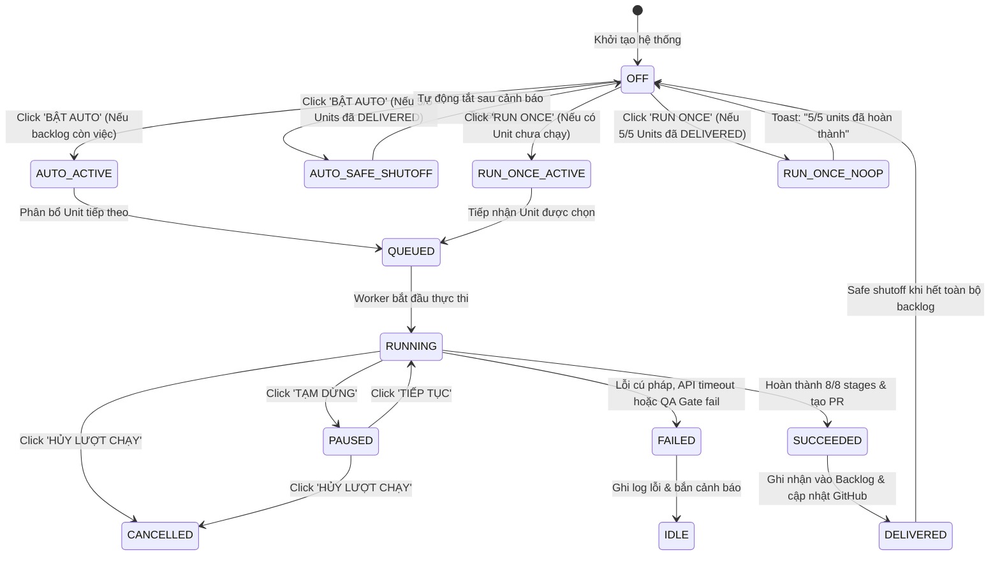

# MA TRẬN MÁY TRẠNG THÁI (STATE MACHINE MATRIX) — PHASE 2.9.2
**Hệ thống:** QLDAPM MAIN AI Command Center & Supervisor Pipeline  
**Ngày lập:** 2026-10-31  
**Mục tiêu:** Định nghĩa chuẩn xác toàn bộ các trạng thái vòng đời, sự kiện chuyển đổi, điều kiện tiên quyết và cơ chế ngắt an toàn (Zero-Silent-Failure).

---

## 1. TỔNG QUAN CÁC TRẠNG THÁI VẬN HÀNH (OPERATIONAL STATES)

| Mã trạng thái | Tên hiển thị trên UI | Mô tả chi tiết | Trạng thái Worker | Hành động cho phép từ UI |
| :--- | :--- | :--- | :--- | :--- |
| `OFF` | **OFF (Tắt)** | Chế độ AI Engineering tắt hoàn toàn. Không tự động chạy bất kỳ tác vụ nào. | `IDLE (Sẵn sàng)` | `BẬT AUTO`, `RUN ONCE`, `Sync GitHub` |
| `IDLE` | **IDLE (Chờ)** | Hệ thống sẵn sàng nhận lệnh. Không có run nào đang active. | `IDLE (Sẵn sàng)` | `RUN ONCE`, `BẬT AUTO`, `Sync GitHub`, `Cấu hình lịch` |
| `QUEUED` | **Đang xếp hàng** | Một lượt chạy (Run) đã được chấp nhận, chuẩn bị cấp phát worker. | `ASSIGNED` | `CANCEL`, `PAUSE` |
| `RUNNING` | **Đang chạy** | Worker đang thực thi các bước trong pipeline (từ S01_SPEC đến S08_DELIVERY). | `BUSY` | `PAUSE`, `CANCEL` |
| `PAUSED` | **Tạm dừng** | Quá trình chạy bị dừng lại giữa chừng bởi lệnh người dùng để can thiệp. | `PAUSED` | `RESUME`, `CANCEL`, `OFF` |
| `BLOCKED` | **Bị chặn** | Tác vụ gặp lỗi phụ thuộc hoặc thiếu input cần thiết từ người dùng. | `IDLE` | `RUN ONCE`, `RESUME`, `CANCEL` |
| `FAILED` | **Thất bại** | Gặp lỗi không phục hồi được trong quá trình tạo code, review hoặc test. | `IDLE` | `RUN ONCE` (Retry), `Sync GitHub` |
| `CANCELLED`| **Đã hủy** | Lượt chạy bị hủy bỏ chủ động bởi người quản trị. | `IDLE` | `RUN ONCE`, `BẬT AUTO` |
| `DELIVERED`| **Bàn giao (5/5)** | Tất cả các Backlog Units đã hoàn thành xuất sắc, PR sẵn sàng. | `IDLE (Sẵn sàng)` | `Sync GitHub`, `Snapshot Tức Thời`, `Cấu hình lịch` |

---

## 2. MA TRẬN CHUYỂN DỊCH TRẠNG THÁI (STATE TRANSITIONS)

---

## 3. BẢNG PHÂN TÍCH SỰ KIỆN & PHẢN HỒI GIAO DIỆN (EVENT HANDLING TABLE)

| Trạng thái ban đầu | Sự kiện kích hoạt (Event) | Điều kiện tiên quyết (Guards) | Trạng thái đích | Phản hồi giao diện & Toast (Zero-Silent-Failure) |
| :--- | :--- | :--- | :--- | :--- |
| `OFF` | Click `BẬT AUTO` | Backlog có unit `PLANNED` | `RUNNING` | Nút đổi sang trạng thái hoạt động; Toast: *"Đã bật chế độ AUTO"*. |
| `OFF` | Click `BẬT AUTO` | Toàn bộ 5/5 units `DELIVERED` | `OFF` | Giữ nguyên `OFF`; Toast Warning: *"Tất cả 5 backlog units đã hoàn thành (DELIVERED). Tự động ngắt AUTO để bảo vệ hệ thống."* |
| Bất kỳ | Click `RUN ONCE` | Có unit sẵn sàng chạy | `QUEUED` -> `RUNNING` | Nút hiển thị spinner; Toast Info: *"Đang khởi động chạy unit..."* |
| Bất kỳ | Click `RUN ONCE` | Toàn bộ 5/5 units `DELIVERED` | Giữ nguyên | Toast Success/Info: *"Tất cả 5 backlog units đã hoàn thành bàn giao (DELIVERED). Không còn unit tồn đọng."* |
| `RUNNING` | Click `PAUSE` | Có `active_run_id` | `PAUSED` | Header đổi badge sang `PAUSED`; Toast: *"Đã tạm dừng tiến trình thực thi của Worker"*. |
| `PAUSED` | Click `RESUME` | Run đang ở trạng thái `paused` | `RUNNING` | Badge chuyển `RUNNING`; Toast: *"Tiến trình thực thi đã được tiếp tục"*. |
| `RUNNING` / `PAUSED` | Click `CANCEL` | Run đang chạy hoặc tạm dừng | `CANCELLED` | Worker giải phóng về `IDLE`; Toast: *"Lượt chạy đã được hủy bỏ thành công"*. |
| Bất kỳ | Click `Sync GitHub` | Không phụ thuộc state | Giữ nguyên | Spinner quay trong 1s; Toast: *"Đã đồng bộ thành công hiện trạng GitHub (5 PRs, 5 branches, 0 CI failures)"*. |
| Bất kỳ | Click `Lưu cấu hình lịch` | Dữ liệu giờ hợp lệ | Giữ nguyên | Modal tự đóng; Toast: *"Cấu hình lịch báo cáo tự động đã được lưu thành công"*. |
| Bất kỳ | Polling chu kỳ 20s | Mạng bình thường | Giữ nguyên | Âm thầm cập nhật KPI và log tiến độ nếu có thay đổi mà không reload trang. |

---

## 4. QUY TẮC BẢO TOÀN TRẠNG THÁI KHÔNG THỂ BỊ XÂM PHẠM (STATE INVARIANTS)
1. **Chế độ mặc định luôn là `OFF`:** Khi khởi động hoặc khi hoàn thành toàn bộ backlog, hệ thống bắt buộc quay về `OFF`.
2. **Không chạy chồng lấn (No Concurrent Runs):** Tại một thời điểm, chỉ cho phép duy nhất tối đa 1 run được phép ở trạng thái `RUNNING`.
3. **Idempotency của RUN ONCE:** Gọi `RUN ONCE` nhiều lần khi hệ thống đã hoàn thành 5/5 units không gây ra tác dụng phụ (no-op), không tạo ra Work Package mới, không tạo PR trùng lặp.
4. **Bảo toàn Project 5:** Không có bất kỳ sự kiện hay chuyển dịch trạng thái nào được phép gửi lệnh thay đổi tới cơ sở dữ liệu của Project 5 (`qldapm-local`).
